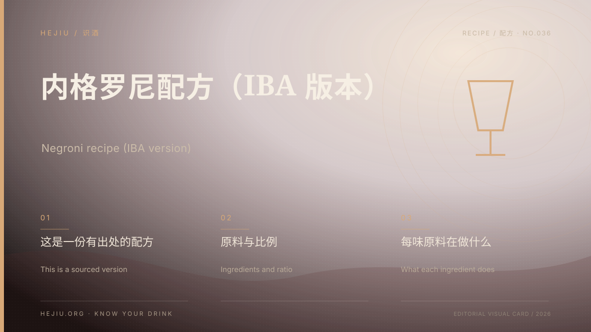

# 内格罗尼配方（IBA 版本）

这是[内格罗尼](ref:cocktail)的一个有明确出处的配方版本。配方版本与鸡尾酒身份分开记录，未来出现不同来源的版本时，可以并列保存而不互相覆盖。本页只描述这一版的比例与做法，不把其他版本混写进来。

图：内格罗尼配方（IBA 版本） 双语视觉卡（项目自绘 SVG）。不是实拍。

## 这是一份有出处的配方

IBA（国际调酒师协会）的公开配方把内格罗尼列为等量三份：金酒、金巴利与甜味美思各一份，搅拌后滤入古典杯，以橙皮装饰。本页采用这一版本，并在步骤中说明每一步的目的，方便在家复现时判断问题出在哪里。

配方版本的意义在于可追溯。同一款鸡尾酒可能有不同比例、不同基酒或不同装饰的版本；如果不标明出处，读者无法判断差异来自版本还是操作。因此，本页把“来源版本”单独列出，不与其他配方混在一起。

## 原料与比例

- 金酒 30 毫升
- 金巴利苦酒 30 毫升
- 甜味美思 30 毫升
- 冰适量
- 橙皮 1 片

比例是 1:1:1。这个比例不是唯一正确的版本，但它是 IBA 公开配方采用的版本，也是比较容易复现的起点。先用标准比例做一次，再讨论调整；否则无法判断你改变的是“版本”还是“操作”。

## 每味原料在做什么

[金酒](ref:gin)提供骨架和植物香气。它的酒精度较高，负责把整体撑起来；如果金酒的植物香气很强，成品会更偏草本，甜味美思的甜感也会显得更清楚。

金巴利提供苦味和红色。它的苦不是缺陷，而是结构的一部分：苦味给甜味一个边界，让成品不至于甜腻。金巴利的颜色也会影响成品的观感，但颜色不说明质量。

甜味美思提供甜度、葡萄酒基底和香料气息。它同时带来水分和糖分，使高酒精度的金酒变得圆润。甜味美思的品质差异会明显影响成品，但本页不评价具体品牌。

## 搅拌与稀释

把原料倒入装有冰块的调酒杯，用吧勺搅拌至杯壁充分冷却。搅拌的目的有两个：降温和稀释。搅拌时间不足，成品会偏烈、香气封闭；搅拌过度，稀释太多，酒体会变薄。

搅拌比摇和更温和，不会带入大量空气和冰屑，成品更清澈。内格罗尼是短饮，通常追求清澈和可控的稀释，所以采用搅拌。具体的稀释量取决于冰量、冰型和搅拌时间，无法只凭“搅几下”判断。

## 冰块与杯型

成品滤入[古典杯](ref:vessel)，杯中预先放入一块大冰。大冰融化慢，能在饮用过程中持续降温，同时让稀释缓慢发生；碎冰降温快，但会迅速稀释，适合一开始就想要清爽口感的场合。

古典杯矮而宽，便于放大冰块，也便于放置橙皮。杯子没有杯梗，手持杯身会传递体温；想延长保冷时间，可以握住杯口附近或使用杯垫。关于内格罗尼配方（IBA 版本）的冰型、稀释与温度，可参考[加冰与温度](ref:ice)。

## 橙皮装饰

挤压橙皮，让皮中的精油喷到杯口和酒液表面，然后置于杯口。橙皮提供的是香气，不是酸度；它不会明显改变甜酸平衡，却会影响第一口的香气印象。

橙皮不要过度挤压到发苦。白瓤部分苦味较强，挤压时以表皮朝向酒液、快速短促为宜。没有新鲜橙皮时，宁可不加，也不要用放置过久、已经干燥的橙皮。

## 单位与替换

本页使用毫升，不自动换算为盎司或“份”。家庭量具的精度不同，用毫升比用“几勺”更容易复现。若没有量酒器，可以用相同体积的小杯作为临时量具，但要先确认它的容量。

替换基酒、苦酒或味美思会形成另一款饮品，不应继续使用同一配方标题而不说明差异。例如把金酒换成其他烈酒，或把金巴利换成其他苦酒，酸甜苦的比例和香气结构都会改变。替换是可以的，但要把它记录为“变体”，而不是当作原配方。

## 常见错误

第一，冰量不足。冰少会让降温不够，稀释失控，成品偏烈且香气不展开。

第二，搅拌时间太短。杯壁没有充分冷却，入口会显得刺。

第三，使用碎冰后长时间放置。碎冰融化快，几分钟内就会把酒稀释得寡淡。

第四，橙皮挤得太用力。白瓤的苦味会进入酒液，破坏原本的苦甜平衡。

第五，把等量比例当成唯一答案。比例是版本的一部分，改比例就是改版本，应明确说明。

## 版本差异

不同来源的内格罗尼可能有不同的比例、不同的苦酒、不同的装饰，甚至不同的杯型。有的版本强调等量，有的版本调整金酒与苦酒的比例；有的用橙片，有的只用橙皮。这些差异不是谁“正宗”，而是版本不同。

比较版本时，应先固定其他条件：同样的冰、同样的杯型、同样的搅拌时间，再比较比例或原料的差异。否则，你很难判断差异来自配方还是操作。关于鸡尾酒结构的一般说明，可以参考[调酒基础](ref:cocktails-guide)；关于苦味开胃酒的角色，可以参考[开胃酒](ref:aperitif)。

## 边界

本页的内格罗尼配方（IBA 版本）配方按一个可核对版本记录，不评价具体品牌，也不把等量比例说成唯一正确做法。内格罗尼配方（IBA 版本）的配方是起点，不是法律；任何改动都应标明差异。饮酒应适量，并遵守当地法律与安全要求；不要在没有许可或安全条件的地方操作明火。

对照阅读：[内格罗尼](ref:cocktail)、[金酒](ref:gin)。

**关键事实。**

| 项目 | 内容 |
| --- | --- |
| 一句话定位 | 金酒、金巴利与甜味美思各 30 毫升，搅拌后滤入装有冰块的古典杯，以橙皮装饰；本文说明比例、技法、器具与替换边界 |
| 技法 | stir |
| 出品 | 1 杯 |
| 主要配料 | 金酒 30毫升、金巴利苦酒 30毫升、甜味美思 30毫升、冰 undefinedundefined |

**来源与边界。** 本页关于「内格罗尼配方（IBA 版本）」的关键事实，主要由以下来源交叉核对：International Bartenders Association（配方比例、调制方法与成品杯型；确认该饮品属于 IBA 官方鸡尾酒名单）、Oxford University Press（搅拌、稀释与苦味开胃酒的一般背景）、Dave Arnold / W. W. Norton（冰、温度与稀释对成品的影响）等 5 条来源。价格、批次与状态会变，涉及这些字段时以页面所列来源的最新版本为准。正文为项目自写，来源只作核验，不复制原文。
