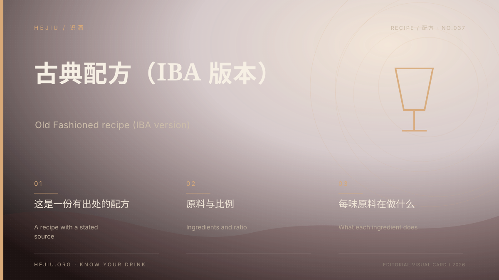

# 古典配方（IBA 版本）

这是[古典](ref:cocktail)的一个有明确出处的配方版本。古典是少数“在杯中完成”的经典鸡尾酒：糖、苦精、水与威士忌在同一只杯子里依次加入并搅拌，不需要先摇和再滤冰。本页记录这一版的比例与顺序，不把其他做法混写进来。

图：古典配方（IBA 版本） 双语视觉卡（项目自绘 SVG）。不是实拍。

## 这是一份有出处的配方

IBA（国际调酒师协会）的公开配方使用 45 毫升波本或黑麦威士忌、一块方糖、数滴安高天娜苦精和少量清水，在古典杯中直调，以橙片或橙皮装饰。本页采用这一版本，并在每一步说明目的，方便在家复现时判断问题出在哪一环。

古典配方（IBA 版本）的配方版本与鸡尾酒身份分开记录，是为了可追溯。古典在不同年代、不同酒吧有不同做法：有的用糖浆，有的用糖块；有的加苏打水，有的只加几滴水；有的装饰橙皮，有的加樱桃。这些差异不是谁“正宗”，而是版本不同，应该分别标明出处。

## 原料与比例

- 波本或黑麦威士忌 45 毫升
- 方糖 1 块
- 安高天娜苦精 2 滴
- 清水 约 5 毫升
- 冰 适量
- 橙皮或橙片 1 片（可选酒渍樱桃 1 颗）

这一版没有果汁、没有碳酸饮料，也不用糖浆稀释。它的全部结构就是“烈酒 + 少量糖 + 少量水 + 苦精”。比例看似随意，实际上每一味都在改变成品的方向：糖决定甜度与酒体，水决定稀释起点，苦精决定香气的宽度。

用量是起点，不是法律。杯子大小、冰块多少、威士忌的酒精度都会影响结果。第一次做时先按本页数字，之后再按自己的口味一次只改一个变量，否则无法判断变化来自哪里。

## 每味原料在做什么

[威士忌](ref:whisky)是主体，提供谷物香气、甜感与酒精骨架。波本以玉米为主，通常更甜、更饱满；黑麦比例高的威士忌更辛香、更干。换基酒会明显改变成品，但结构不变，仍属于古典家族。

方糖提供甜度，也提供少量溶解后的体积。糖太少，酒会显得干硬、苦精突出；糖太多，会盖住威士忌的细节。糖必须在加冰前基本溶解，否则甜味会集中到最后几口。

苦精提供香气与苦味的边界。它用量很小，却能把威士忌的甜感“提起来”，让成品不至于单调。苦精的品牌与配方不同，香气方向也不同；本页只用安高天娜作为这一版的基准，不评价其他品牌。

清水的作用常被低估。几滴水就能让高酒精度的威士忌略微打开，香气更清楚；水太多则会让酒体变薄。加水量应按威士忌的酒精度调整，而不是固定不变。

## 调制步骤

先在古典杯中放方糖，滴上苦精与少量清水，用吧勺或捣棒轻轻压碎并搅拌，直到糖基本溶解。这一步不能省：糖块完整地留在杯底，加冰后更难溶解，最后几口会突然变甜。

接着加冰至杯口下缘，倒入威士忌，再用吧勺轻轻搅拌十几秒，让糖液、苦精、水与威士忌混合，同时降温。搅拌幅度不宜大，避免冰块剧烈撞击而快速融化。关于搅拌的一般原理，可以参考[搅拌](ref:technique)与[调酒基础](ref:cocktails-guide)。

## 冰与稀释

古典的稀释来自两个部分：配方中主动加入的少量水，以及冰块在饮用过程中慢慢融化。前者是可控的，后者取决于冰型、室温和饮用速度。

大冰块表面积小、融化慢，能让酒在较长时间里保持低温而不过度稀释；碎冰降温快，但几分钟内就会让酒变淡。用大冰时，可以先让威士忌稍微降温，再倒入杯中，避免冰块被室温酒液迅速加热。

成品的实际强度取决于威士忌的[酒精度](ref:abv)、糖量与冰量，而不是只按配方的毫升数判断。更多关于冰型的说明，可以参考[加冰与温度](ref:ice)。

## 杯型与温度

传统上使用[古典杯](ref:vessel)：矮而宽，杯口足以放入方糖、吧勺和大冰块，宽口也方便闻香。杯子没有杯梗，手持杯身会传递体温；想延长保冷，可以握住杯口附近，或使用杯垫。

杯子容量会影响配方表现。杯太小，加冰后容易溢出；杯太大，香气空腔过大，香气容易散。配方中的“加冰至杯口下缘”应理解为按自己的杯子调整冰量，而不是机械照搬。

## 装饰

橙皮提供柑橘精油香气，挤压后喷在杯口与酒液表面，会影响第一口的印象；橙片则更偏视觉。酒渍樱桃提供甜香和辨识度，但不是必需。装饰应在饮用前完成，提前放置太久，柑橘皮会变干，香气减弱。

装饰的作用是补充，不是掩盖。橙皮挤得太用力，白瓤的苦味会进入酒液；樱桃放得太多，甜味会压过威士忌本身。想要清爽香气，用橙皮；想要甜香与视觉识别，加樱桃；两者都用时应减量。

## 常见错误

第一，糖没有溶解就加冰。糖沉底会让最后几口突然变甜，也影响整体平衡。

第二，水加得太多。古典不是“淡化的威士忌”，过量加水会让酒体松散、香气封闭。

第三，搅拌幅度过大。剧烈搅动会让冰块快速融化，稀释失控。

第四，用碎冰加满一杯。短饮通常更适合大冰，碎冰会让酒在几分钟内变淡。

第五，装饰过度。橙皮、橙片、樱桃同时堆满杯口，会掩盖威士忌的细节。

## 版本差异与变体

以糖浆替代方糖，溶解更快、甜度更易控制，但会额外带入水分；以苏打水替代清水，成品带轻微气泡，口感更轻；以其他苦精替代安高天娜，香气方向会改变；以其他烈酒替代威士忌，则形成不同基酒的古典类饮品。

变体不是错误版本，而是有明确替换逻辑的分支。记录变体时应写清替换了哪一味、比例如何变化，否则同名不同做法会造成混淆。本页只记录 IBA 这一版，具体变体仍应各自标明出处。

## 边界

本页的古典配方（IBA 版本）配方按一个可核对版本记录，不评价具体品牌，也不把某一种糖、苦精或装饰说成唯一正确做法。古典配方（IBA 版本）的配方是起点，不是法律；任何改动都应标明差异。饮酒应适量，避免空腹快速饮用；驾车、服药或怀孕期间不应饮酒，并遵守当地法律。

相关条目：[古典](ref:cocktail)。
