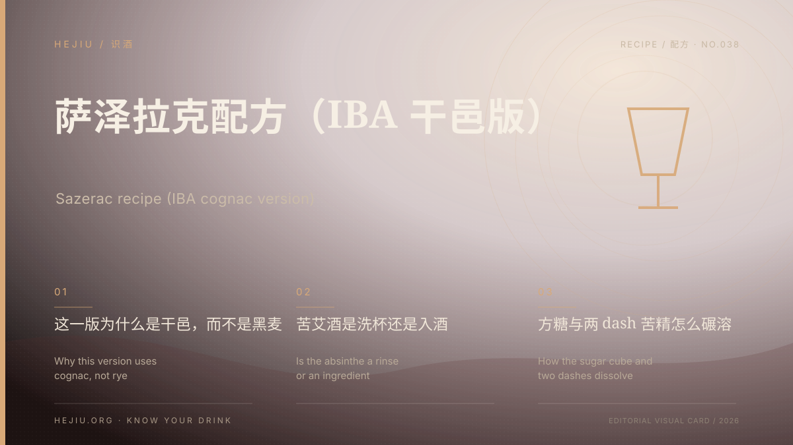

# 萨泽拉克配方（IBA 干邑版）

这份配方记录 [萨泽拉克](ref:cocktail)在 IBA 公开条目里的干邑版本：干邑 50 毫升、苦艾酒 10 毫升用于涮杯、方糖 1 块、佩肖苦精 2 dash，搅拌后滤入预冷的古典杯，以柠檬皮收尾。它与酒吧里更常见的黑麦版本不是同一个配方，本页只把干邑版写到能复现的程度，并把与常见做法的差异标出来。

图：萨泽拉克配方（IBA 干邑版） 双语视觉卡（项目自绘 SVG）。不是实拍。

> **先给结论**
> **一句话：** 这页判断萨泽拉克配方（IBA 干邑版）怎么做、容易失败在哪一步。
>
> - **适合谁：** 想按步骤做出萨泽拉克配方（IBA 干邑版）、并知道失败点在哪的人。
> - **不适合谁：** 不准备称量、也不接受步骤顺序影响结果的人。
> - **先看这两点：**
>   - 顺序不能反：先把方糖放进调酒杯，滴上 2 dash 佩肖苦精，用吧勺背面或捣棒把糖压碎、搅成湿砂状，确认没有整粒糖块，再倒入干邑。
>   - IBA 条目给出的基酒是干邑；同一条目还注明，美国内战之后干邑变得难以获得，黑麦威士忌才被用来替代。

## 这一版为什么是干邑，而不是黑麦

IBA 条目给出的基酒是干邑；同一条目还注明，美国内战之后干邑变得难以获得，黑麦威士忌才被用来替代。也就是说，黑麦版不是“原始配方”，而是供应条件改变后的长期替代方案。今天多数酒吧默认黑麦，于是“萨泽拉克”在口语里常指黑麦版，而 IBA 记录的是更早的葡萄骨架。

两者的差别不只是原料名。[白兰地](ref:brandy)以葡萄为原料，带来果香、花香和相对柔和的质地；黑麦更辛辣、更干，尾段有明显的谷物与香料。换成黑麦后，方糖与苦精的用量要跟着调整：干邑版糖略多也不显腻，黑麦版糖多则会发甜，把辛香盖住。

本页把干邑写进材料表，是为了让“版本”可追溯。想喝黑麦版，请把它当作变体另记一份比例，而不是在同一页里边做边改；否则你无法判断杯中的差异来自原料还是操作。

## 苦艾酒是洗杯还是入酒

材料表里的 10 毫升苦艾酒，是涮杯的用量上限，不是要全部倒进酒里的分量。做法是：把苦艾酒倒入预冷的杯子，转动让内壁挂上一层酒膜，多余的全部倒掉，只留下香气。

原因很直接：苦艾酒酒精度通常在 60% 以上（不同产品差异很大，以标签为准），茴香与甘草气息极强。50 毫升干邑里直接加入 10 毫升苦艾酒，比例就是 5:1，茴香会盖住干邑的果香，喝起来更像一杯被稀释的茴香酒；而涮杯真正附着在杯壁上的只有一两毫升，香气在，重量不在。

IBA 的步骤还要求涮杯后加碎冰静置，再倒掉碎冰与残液。碎冰在这里有两个作用：快速把杯子降到低温并在杯壁结霜，同时把多余的[苦艾酒](ref:absinthe)带走。跳过倒掉这一步，等于把涮杯变成了加料。

美国在 1912 年禁绝苦艾酒后，新奥尔良改用本地茴香酒 Herbsaint 替代，今天的酒吧两种都能见到。用 Herbsaint 时香气更偏甘草、甜感更明显，涮杯用量可以略减。

## 方糖与两 dash 苦精怎么碾溶

顺序不能反：先把方糖放进调酒杯，滴上 2 dash 佩肖苦精，用吧勺背面或捣棒把糖压碎、搅成湿砂状，确认没有整粒糖块，再倒入干邑。

为什么先滴苦精：苦精的主要成分是水与酒精，能把糖块表面润湿、加速崩解，香气也会先附着在糖上；干邑酒精度高但几乎没有水分，直接倒进去反而会让糖块表面结壳，溶得更慢。一块方糖大约 4 克，室温下需要十几秒的碾压才能完全化开。

如果不想碾糖，可以用 10 毫升 1:1 糖浆代替，糖量接近，但会多带入约 5 毫升水，稀释起点提前，搅拌时间要相应缩短。这是替换，不是原步骤，材料表仍按方糖记录。

一 dash 大约 1 毫升上下，随瓶口与滴嘴不同而变化。2 dash 是香气量级，不是味道量级：它给酒液一层樱桃与茴香的底色，不会让酒变苦。

## 为什么杯子要先冻过

这杯酒最后不加冰。IBA 的做法是涮杯、加碎冰静置、倒掉碎冰，再把酒滤进空杯；杯中没有任何冰块支撑温度，杯子本身就是唯一的冷源。

预冷的[古典杯](ref:vessel)做三件事：让酒液入杯后不再升温，压住酒精的刺激；让茴香与柠檬油的香气停在杯口，而不是被热气冲散；在杯壁结一层薄霜，延长低温时间。冷冻室放 15 分钟以上即可，厚壁杯要更久。

如果杯子是常温的，第一口会明显更冲，苦艾酒的香气像酒精一样往上顶；等杯子被酒液降温，后半杯才回到正常状态。同一杯酒前后像两杯，问题不在配方，而在杯子。

杯子从冷冻室取出后会吸附空气中的水汽，表面发白是正常现象。不要在冰杯里直接倒热水或用力冲冷水，骤冷骤热容易让厚玻璃开裂。关于冰与温度的更多说明，可以看[加冰与温度](ref:ice)。

## 佩肖与安高天娜差在哪

两者都是苦精，但方向不同。佩肖颜色偏亮红，酒体较轻，主调是樱桃、茴香与龙胆的苦，苦味收得较快；安高天娜颜色深、质地厚，丁香、肉桂、多香果的气息更突出，苦味更长也更干。

酒精度也不一样：佩肖约 35%，安高天娜约 44.7%。滴同样滴数，佩肖带入的酒精更少，香气更轻。这个差异在短饮里会被放大，因为整杯酒只有 50 毫升基酒。

在这杯酒里，佩肖的茴香与樱桃正好接住涮杯留下的苦艾酒；换成安高天娜，丁香会把茴香压下去，整体变成另一种风格。真要用安高天娜，先从 1 dash 起，不要按 1:1 替换，也不要两瓶各来 2 dash 当作“更复杂”。

佩肖本身就是新奥尔良的产物，由法裔药剂师安托万·佩肖创制；它和这杯酒的绑定，既是风味选择，也是地方身份。关于鸡尾酒中苦精的一般用法，可以看[调酒基础](ref:basics)。

## 从 Sazerac Coffee House 到 2008 年的官方认定

安托万·佩肖（Antoine Peychaud）是 19 世纪新奥尔良的法裔药剂师，常被追溯到在 1830 年代调制出以自己名字命名的苦精。关于他用蛋杯（法语 coquetier）盛苦精待客、进而演变成鸡尾酒的说法流传很广，但缺少同期档案，只能当作传说。

1850 年代，新奥尔良出现了以 Sazerac 为名的咖啡馆（当时当地把酒吧称作 coffee house），店里常用 Sazerac-de-Forge 家的干邑调这杯酒，酒名由此而来。具体是谁第一次把苦艾酒加进去，说法不一，本页不把它写成定论。

内战之后干邑供应中断，黑麦取而代之；1912 年美国禁绝苦艾酒，本地茴香酒接棒。两次替换都改变了这杯酒，也都留在今天的版本里。所以“传统配方”其实是一条不断被供应条件改写的线，而不是一份从未变过的档案。

2008 年的认定需要说清楚：当年 4 月，拟把萨泽拉克定为路易斯安那州官方鸡尾酒的议案被否决；6 月 23 日，州议会改为宣告它为新奥尔良市的官方鸡尾酒。准确说法是“新奥尔良市的官方鸡尾酒”，不是“州官方鸡尾酒”。法条文本也把创制者写作佩肖，这属于官方叙事，与史学考证是两件事。

## 搅拌：20 到 30 秒看什么

这杯酒用搅不用摇。理由不是“传统”，而是结构：它没有柑橘汁、蛋清或奶油，不需要乳化与充气；摇和会带入空气与碎冰，让酒液浑浊，也会让稀释更难控制。

调酒杯里加冰到七分满，倒入干邑后搅拌 20 至 30 秒。判断标准有两个：杯壁外侧起雾、手摸明显发凉；酒液在杯中出现均匀的旋涡，冰面略微下沉。达到这两点，稀释大约在 15% 至 25% 之间，香气也已经打开。

搅不够，酒温偏高、入口刺，苦艾酒的茴香会显得尖；搅过头，酒体变薄，干邑的果香被水冲散。冰的质量决定这个窗口有多宽：大块硬冰融得慢，窗口宽；碎冰或半化冰融得快，几秒之差就会过头。相关原理见[搅拌](ref:stirring)。

## 柠檬皮：挤的是油，不是皮

IBA 的装饰是柠檬皮。用削皮刀取一条黄色表皮，尽量不带白色海绵层；表皮朝下对准杯口，用拇指与食指快速挤压，让油雾落在酒液表面，再把皮在杯口擦一圈。

柠檬皮提供的是香气，不是酸度。它不会让酒变酸，却会改变第一口的印象：柑橘油浮在表面，先于干邑到达鼻腔，把茴香的甜感托起来。挤得太用力、把白瓤压出汁，苦味会进入酒液，和苦精的苦叠在一起，显得脏。

没有新鲜柠檬时，宁可不加。干柠檬皮只剩纤维，挤不出油，放在杯里只是装饰。用橙皮也可以，但那是变体：橙皮的甜香更厚，会把佩肖的樱桃气息往另一个方向推。

## 失败点清单

- 苦艾酒没有倒干净。涮杯变成加料，茴香盖住干邑，这是最常见的失败。
- 糖没有碾溶。杯底有砂粒，最后几口突然发甜，前后不一致。
- 杯子没有预冷。第一口冲，香气散得快，整杯酒的温度曲线是错的。
- 用安高天娜 1:1 替换佩肖。丁香压过茴香，风格变了却仍叫同一个名字。
- 搅拌过度或用了碎冰。酒体变薄，果香被稀释成水味。
- 柠檬皮带白瓤。苦味叠加，尾段发干。

## 变体与替换边界

黑麦版是最常见的变体：把干邑换成黑麦，糖与苦精不变，成品更辛辣、更干。酒吧里还有干邑与黑麦各半的折中版，逻辑是保留果香又补回辛香，这同样是变体，比例要写清楚。

苦艾酒的替代品包括 Herbsaint 与其他茴香酒，涮杯用量按香气强度调整。柠檬皮换成橙皮、方糖换成糖浆，都会改变香气或含水量，应记录为替换而不是“原配方”。

替换基酒后不要继续用同一份材料表。配方页的价值在于可追溯：改了什么、为什么改，都要写出来，读者才能判断杯中的差异来自哪里。

## 器具、单位与复现

需要的器具很少：量酒器负责 50 与 10 毫升的准确度，吧勺负责碾压方糖与搅拌，调酒杯提供足够的冰与空间，滤冰器负责把冰挡在杯外。不需要摇酒壶，也不需要双重过滤。

本页用毫升与 dash，不做盎司换算。家用[量酒器](ref:jigger)的刻度通常够用；没有量酒器时，用已知容量的小杯替代，但要先确认刻度。碾压方糖用[吧勺](ref:spoon)的背面即可，不必专门买捣棒。

复现的顺序是：先冷冻杯子，再碾糖，再涮杯，最后搅拌与滤酒。把这三件事的先后固定下来，你就有了一个可以逐项调整的基准；之后换干邑、换苦精、换冰，才知道每一步改变了什么。

## 另见

- [萨泽拉克](ref:cocktail)：这杯酒的身份、来历与风格定位。
- [苦艾酒](ref:absinthe)：涮杯所用酒款的香气特征。
- [古典杯](ref:vessel)：杯型、容量与持杯方式。
- [搅拌](ref:stirring)：稀释与降温的操作原理。
- [调酒基础](ref:basics)：糖、苦精与烈酒的基本结构。
