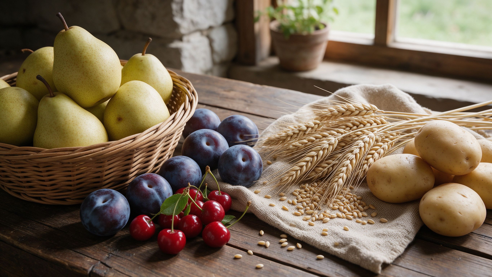

# 僵尸配方（IBA 版本）

这是[僵尸](ref:cocktail)在 IBA 当代经典类别下的一个可追溯版本。本页只记录这一版：三款朗姆合计 120 毫升，青柠汁 20 毫升，法勒南 15 毫升，Donn's Mix 15 毫升，石榴糖浆 5 毫升，安高天娜苦精 1 dash，培诺茴香酒 6 滴，加约 170 克碎冰摇和后连冰倒入高球杯。配方页与鸡尾酒身份分开写，是为了让 1934 年原版与各家酒吧的改编版日后能并列保存，而不是互相覆盖。

图：僵尸配方（IBA 版本） 类型示意图。图片：Doubao Seedream 5.0 AI 辅助绘制（项目自有），不是僵尸配方（IBA 版本）的实拍。

## 这一版从哪来：1934 年与 IBA 之间

僵尸常被追溯到 1934 年，创始人是 Don the Beachcomber 的 Donn Beach（本名 Ernest Gantt），店开在好莱坞。这个说法在提基研究里基本一致，但"1934 年"更接近一个被反复引用的起点，而不是有完整档案链的注册日期。早期配方用编号代替原料名，写在只有他自己读得懂的清单里，连店里的调酒师也只能照着编号取酒；研究者 Jeff "Beachbum" Berry 后来的复原工作，才让这些编号重新变成可执行的配方。

IBA 现在的条目属于"当代经典"，与 1934 年原版并不相同：它用三款常见的市售朗姆替代了当年的高酒精度德梅拉拉朗姆，把神秘的 4 号混合液写成可复制的 Donn's Mix，方法也从吧台搅打改成加碎冰的短促处理。本页的比例取自 IBA 公开条目，于 2026 年 11 月 7 日核对。如果你在网上看到"僵尸等于朗姆加菠萝汁加石榴糖浆加肉桂"的版本，那不是这一版；两者的差别会在下文展开。

## 两杯上限是怎么来的

关于僵尸最有名的传说，是 Don the Beachcomber 规定每位客人最多两杯。流传的讲法是：有位宿醉的客人喝完后说自己一整天像僵尸一样，名字由此而来；另一层讲法是老板清楚这杯酒的强度，干脆用店规限量。这两种说法都属于传闻，没有可核对的原始文件，本页把它们写成传说，而不是档案事实。

但"两杯"背后的算术是真实的。IBA 版本的三款朗姆合计 120 毫升，按常见的 40% 至 43% 酒精度估算，纯酒精约 48 至 52 毫升；摇和与杯中碎冰还会再稀释两三成，入口时相当于三到四个标准杯。它喝起来却是果汁和糖浆的味道，苦味与酒精的刺痛被压得很低，于是"喝得快"变成最危险的部分。两杯上限的真正含义不是禁令，而是提醒：这杯酒的强度不会靠灼烧感提前警告你。

## 三款朗姆各管一段

牙买加深色朗姆 45 毫升是低音。[朗姆酒](ref:rum)的产区风格在这里体现得最明显：牙买加以高酯类闻名，糖蜜、熟香蕉、树脂和一点野性的 funk 都从这里来，它决定了这杯酒"像不像提基"。它不需要最贵，但必须有味道；换成中性朗姆，成品会变成一杯加了糖的果汁。

波多黎各金色朗姆 45 毫升是骨架。它通常更干净、更轻，带甘蔗甜香和轻微的香草、椰子气息，作用是把深色朗姆的厚重撑开，让酒体有中段。很多人以为颜色越深越正宗，于是把这一份也换成深色朗姆，结果整杯塌成一团糖蜜，酸和香气都被埋掉。

德梅拉拉朗姆 30 毫升是重量与焦香。它来自圭亚那的德梅拉拉糖蜜，木质、焦糖、可可与香料感明显，酒体厚，收尾长。它在总量里只占四分之一，却让前两款的甜不至于发飘。三者的比例是 45 比 45 比 30，也就是三比三比二；深色一侧合计 75 毫升，浅色一侧 45 毫升，这个不平衡是故意的。

## overproof 的位置：强度不是靠多加酒

1934 年原版用过 151 proof 的德梅拉拉朗姆，这类酒按美制酒精度约 75.5%，少量就能把整杯的骨架顶起来。IBA 现在的条目没有 overproof，用 30 毫升常规德梅拉拉替代，这是版本差异，不是谁抄错。

overproof 的作用不是"更烈的味道"，而是穿透力：高酒精会把香气往上推，让糖浆和果汁不至于把朗姆盖住。代价也很直接，15 毫升 75.5% 的酒就带来约 11 毫升纯酒精，相当于把整杯再抬高一档。合理的用法是把 15 毫升常规朗姆换成 overproof，而不是在 120 毫升之上再加一份；后者已经是另一个版本，应当明确标注。

还有一种常见误解，是以为加了 overproof 就可以多放糖。实际相反，高酒精会同时放大甜感和灼热感，糖浆该减多少只能靠试喝决定，不能靠换算。配方给的是起点，强度是结果的一部分。

## Donn's Mix：葡萄柚与肉桂，以及菠萝汁为什么不在表里

IBA 条目里的 Donn's Mix 写作新鲜黄葡萄柚汁两份、肉桂糖浆一份。15 毫升的混合液，按这个比例就是 10 毫升葡萄柚汁加 5 毫升肉桂糖浆。葡萄柚提供更长、带一点苦的酸，青柠提供尖锐的前段酸，两者分工不同；肉桂糖浆提供暖香，把深色朗姆的焦糖和青柠的酸缝在一起。

这里有一处必须说明的争议。Beachbum Berry 的复原把当年神秘的 4 号原料解释为白葡萄柚汁加肉桂糖浆，这个解释流传很广；但依据 Donn Beach 档案的近期研究认为，肉桂其实是另一个编号的风味料，4 号另有其物，因此"葡萄柚加肉桂"只是一个近似的工作假设。IBA 采用它，是因为它可复制、风味接近，而不是因为它等于 1934 年的原液。

至于菠萝汁：它出现在很多酒吧版和网络版里，理由是带来泡沫、果肉感和更柔的酸。但它同时带来水和糖，会把 120 毫升朗姆的骨架冲淡。IBA 这一版没有它，所以按本页比例再加 30 毫升菠萝汁，成品会比原版更淡、更甜，那属于变体。菠萝更适合留在装饰里，或者在你主动减少糖浆时再加入。

## 青柠、石榴与苦精：三条细线

青柠汁只有 20 毫升，比多数酸类鸡尾酒少，因为葡萄柚已经贡献了一部分酸。它负责前段的尖锐感和香气，量不足时整杯发闷，量过多则会把肉桂和糖蜜压下去。用鲜榨的，瓶装青柠汁的香气在摇和后几乎不留。

石榴糖浆 5 毫升，对应 IBA 原文的 1 茶匙。它的作用不只是染色：红色水果的甜和轻微的单宁给中段加了一层厚度，也让苦精的香料感有落点。它不应该被加到 15 毫升，那样会把整杯拉向糖果味，朗姆的 funk 会被掩掉。

安高天娜苦精 1 dash 提供丁香、肉桂和一点苦，把肉桂糖浆的方向坐实。培诺茴香酒 6 滴是整杯最容易被低估的部分：它不改变甜酸，只改变香气的形状，让第一口显得更高、更亮。6 滴就是 6 滴，倒成 6 毫升会得到一杯甘草糖水；如果担心失手，可以改用洗杯的方式，把茴香酒在杯内转一圈后倒掉。

## 摇和、碎冰与连冰倒入

IBA 原文的做法是：把所有材料与 170 克碎冰放进电动搅拌机，短促搅打几秒，然后倒入高杯。这一步的目的不是把冰打成泥，而是让碎冰、糖浆和果汁在极短时间内混匀，同时把空气卷进去，得到细冰悬浮的浑浊酒液。

本页的技法写的是[摇和](ref:shaking)，理由是可复现性：家庭没有搅拌机时，用摇酒壶加约 170 克碎冰，用力摇 10 至 12 秒，得到的温度、稀释和充气程度与短促搅打很接近，这种手法在提基体系里常被称为鞭摇。区别在于搅打更容易过度，一旦打久，冰会全部化掉，泡沫塌陷，成品变成淡果汁。

碎冰与大方冰的取舍也在这里。碎冰降温快、稀释快，适合这杯必须现做现喝的长饮；大方冰降温慢，酒体会更集中，但喝到后面香气打不开。摇和时间可以按冰量微调：冰少就摇短一点，冰多可以稍长；目标始终是壶壁发白、手感明显变冷，而不是"摇够多少下"。关于冰型与温度的进一步说明，见[加冰与温度](ref:ice)。

## 杯型：高球杯能装下的不只是酒

IBA 写的是高杯，本站对应[高球杯](ref:vessel)，容量通常在 300 至 400 毫升之间，具体以产品为准。杯子要够高，才能让碎冰堆出杯口，形成冰丘；杯子太小，冰会顶到杯沿，第一口全是冰水，酒液反而被挤到下面。

提基杯（tiki mug）是这类酒最常见的替代器型，陶瓷厚壁保冷好、造型也贴合风格，但本站没有登记该器型，因此本页的杯型引用只写高球杯。用提基杯时要注意两点：厚壁会让人低估容量，实际倒进去的酒往往比看起来多；杯口窄的款式不方便放碎冰，冰量不足会让香气封闭。

杯子和碎冰都建议提前冷藏。冰不够冷时，摇和后的酒液会在杯中迅速回温，气泡感和香气一起散掉。

## 装饰：薄荷先拍，水果后放

IBA 只写薄荷叶。本页写薄荷枝与水果，是把常见做法合并记录：薄荷 1 枝提供清凉的嗅觉前调，水果（菠萝角或青柠片）提供视觉识别和一点果皮香气。水果不进入配方计量，也不改变甜酸，它只是装饰。

薄荷不要捣。拍一下让细胞破裂、香气释放就够了，捣碎会带出叶绿素的苦涩，几分钟后变成草腥味。插在冰堆顶部，不要埋进酒里。水果同理，切太厚会占掉杯口，泡太久会让表面发酸；现切现放，喝完之前不必再动它。

## 常见失败点

第一，摇和时间不足。糖浆没有完全融合，入口的甜一段一段，温度也不够低。

第二，用大方冰却按碎冰的时间摇。降温不足，香气封闭，喝起来像稀释过的朗姆糖水。

第三，加了菠萝汁却仍按原比例放石榴糖浆。双重加甜，酸跟不上，成品发腻。

第四，把 6 滴培诺倒成 6 毫升。茴香会盖掉肉桂、苦精和朗姆的全部细节。

第五，用只靠焦糖色上色的所谓深色朗姆。颜色有了，糖蜜和酯类没有，成品只剩甜。

第六，一次做四杯。摇壶装不下 480 毫升以上的液体再加冰，摇不开，稀释和温度都会失控；分两次摇，或改用大容器搅打。

## 变体与版本差异

1934 年原版的核心是 overproof 德梅拉拉朗姆与编号混合液，酒精度比 IBA 版本更高，香气也更野。现代酒吧常见的改法有三种：加 15 毫升 overproof 作为顶层；把波多黎各金色朗姆换成农业朗姆，酸香更突出；加入 20 至 30 毫升菠萝汁，做成更长、更易饮的版本。

这三种改法都能叫僵尸，但都应该在记录里写清替换了什么。判断改得好不好，不要只看像不像，而要看三件事：朗姆还在不在前面，酸有没有被糖盖住，冰化完之后是否还剩下结构。关于鸡尾酒结构的一般说明，见[调酒基础](ref:basics)；与[迈泰](ref:mai-tai)相比，僵尸的朗姆总量更大、果汁更少、酒精度更高，两者的平衡逻辑并不相同。

## 另见

- [僵尸](ref:cocktail)：这杯酒的身份、命名与风格位置。
- [朗姆酒](ref:rum)：牙买加、波多黎各与德梅拉拉风格的差异。
- [摇和](ref:shaking)：摇和的动作、时间与稀释控制。
- [高球杯](ref:vessel)：长饮杯型与冰量的关系。
- [加冰与温度](ref:ice)：碎冰、大方冰与冷却速度。
