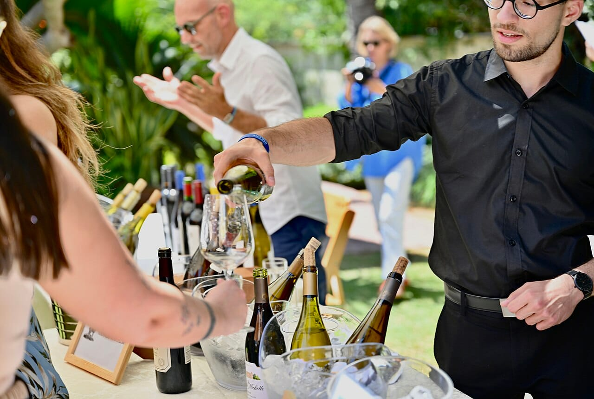

# 盲品

盲品是在不看标签的情况下，通过香气、口感、结构与余味，推断酒的类型、产区、年份与品质。它的目的不是“猜对”，而是“有条理地观察”：把主观印象拆成可比较的维度。香气是其中最重要的线索之一，具体可以看[香气](ref:aroma)。

盲品需要系统方法。先看颜色，再闻香气，再尝口感，最后判断结构；每一步都记录，最后再对照标签。没有方法，盲品只是猜谜；有方法，盲品是训练。

图：一场品鉴会现场。图片：U.S. Embassy Jerusalem，CC BY 2.0，via Wikimedia Commons（[原图页面](https://commons.wikimedia.org/wiki/File:California_wine_tasting_event_in_cooperation_with_the_U.S._Foreign_Agricultural_Service_held_in_Israel_on_12_June_2023_-_8.jpg)）。

## 原理与偏见

盲品的核心，是去掉“标签偏见”。看到酒标，人会不自觉地被产区、价格、品牌影响；盲品把视觉信息拿掉，让判断回到香气与口感。

但盲品并不完全客观。颜色、杯型、温度、倒酒顺序、甚至房间气味，都会影响判断；盲品减少了一种偏见，也可能引入另一种。理解这些变量，比追求“绝对正确”更重要。

盲品也不能替代日常饮用。日常喝酒，标签与故事是体验的一部分；盲品是训练工具，用来提高感官的敏感度与描述的准确性。

## 历史与场景

盲品最早与葡萄酒贸易、评奖与产区评估有关。酒商需要在不看标签的情况下判断品质与产地；评奖需要公平比较；侍酒师训练需要反复练习。

今天，盲品常见于品鉴会、考试、餐厅培训与朋友聚会。它可以是正式的（计时、打分、写 tasting note），也可以是轻松的（猜产区、猜年份）。场景不同，规则不同，但方法相通。

盲品也不只用于葡萄酒。啤酒、威士忌、清酒与咖啡都可以盲品；不同酒种的维度不同，但“先观察、再描述、后判断”的顺序相同。关于啤酒品鉴，可以参考[啤酒品鉴入门](ref:beer-tasting)。

## 适合什么酒

盲品适合有明确风格的酒：葡萄酒、啤酒、威士忌、清酒。它们有可比较的维度，例如颜色、香气、酸度、苦度、酒体与余味；风格越明确，盲品越有训练价值。关于葡萄酒，可以参考[葡萄酒](ref:wine)。

它不适合完全陌生的酒。没有喝过、没有参照的品类，盲品只能描述，不能判断；先建立“标准样本”，再做盲品，才有意义。

它也不适合过量。盲品需要专注，酒精会降低判断力；一次盲品的数量要控制，品与品之间要漱口、休息。

## 方法与顺序

第一步，看颜色。观察透明度、深浅、边缘色；颜色能提示酒龄、品种与工艺，但不是唯一依据。

第二步，闻香气。先静置闻，再轻轻摇杯；分辨果香、花香、香料、木桶、矿物与发酵味。关于闻香，可以参考[闻香](ref:nosing)。

第三步，尝口感。小口入口，让酒液覆盖舌面；注意酸度、甜度、苦度、单宁、酒体与余味。不要急着吞，感受结构。

第四步，做判断。把观察到的维度组合起来，推断类型、产区、年份与品质；先给“可能范围”，再缩小，不要一上来就猜具体酒庄。

第五步，对照标签。最后才看标签，记录“猜对”与“猜错”的原因；猜错比猜对更有学习价值。

## 记录与训练

盲品记录要具体。不要只写“好喝”或“不好喝”，要写“酸度高、单宁细、余味长、香气偏黑莓与雪松”；描述越具体，越容易比较。

训练可以从“对比盲品”开始：同一品种、不同产区；同一产区、不同年份；同一酒款、不同温度。对比能放大差异，也能建立参照。

训练频率比强度重要。每周一次、每次三到五款，比一次喝十款更有效；记录要保留，过一段时间回看，能看到自己的盲点。

描述语言需要练习。刚开始可以只用“轻/中/重”“短/中/长”这样的尺度，再逐步加入具体词汇：果香是红果还是黑果，花香是新鲜还是干枯，木桶是香草还是烟熏。词汇越具体，判断越有依据，也越容易与他人比较。

盲品也可以设计成游戏。把几款酒倒进同样的杯子，编号，参与者各自写笔记，最后一起对照；不要公布价格与产区，避免“贵的就是好的”偏见。游戏化的盲品，能降低压力，也能让新手更愿意描述。

盲品与考试不同。考试要求在规定时间内给出答案，训练要求在没有压力的情况下观察；不要把考试的“猜对率”当成盲品的全部价值。日常训练，应该允许慢、允许错、允许反复比较。

## 常见误区

第一，追求“猜对”。盲品的目的是观察与描述，不是猜谜；猜错也能学到东西。

第二，忽略温度与杯型。温度与杯型会改变香气与口感，盲品要统一条件；否则判断会被变量干扰。

第三，一次喝太多。酒精会降低判断力，也会让味觉疲劳；数量要控制，品与品之间要休息。

第四，只看标签。盲品后再看标签，是为了对照，不是为了“证明自己对”；标签不是答案，观察才是。关于品鉴杯，可以参考[品鉴杯](ref:glass)；关于第一口，可以参考[第一口](ref:first)。

对照阅读：[闻香](ref:nosing)、[第一口，先别急着下结论](ref:first)。

**关键事实。**

| 项目 | 内容 |
| --- | --- |
| 一句话定位 | 在不看标签的情况下，通过香气、口感、结构与余味推断酒的类型、产区、年份与品质；关键是系统方法，而不是“猜对” |
| 适用对象 | 葡萄酒、品鉴杯 |

**来源与边界。** 本页关于「盲品」的关键事实，主要由以下来源交叉核对：Oxford University Press（盲品与感官评估的背景）、Encyclopaedia Britannica（葡萄酒感官与产区背景）、Wine Folly（品鉴杯型与感官训练建议）等 5 条来源。价格、批次与状态会变，涉及这些字段时以页面所列来源的最新版本为准。正文为项目自写，来源只作核验，不复制原文。

**并读。** 把「盲品」与「闻香」、「香气（aroma）」、「第一口，先别急着下结论」放在一起读时，先确认它们是同一层级还是上下游关系：先确认动作目的与工具，再比较力度、节奏与常见失误。本页负责给出技法的基本坐标，对照条目补上具体案例与差异；读完再回到本页，才能分清哪些差别属于技法本身，哪些只是产地、批次或品牌选择。

**适用边界。** 对「盲品」而言，动作要点会因工具与酒种调整；练习时以安全和不浪费酒为前提。

**更新提示。** 「盲品」最近核对于 2026-11-20；设备、温度、时间与操作细节会因工艺版本不同，实践前以设备说明与专业文献为准。

**编者注。** 本页把「盲品」作为技法条目处理：定义、流程与关键数字以正文表格为准，与「闻香」、「香气（aroma）」的差异用对照阅读验证；遇到价格、批次或地址，回到页面所列来源核对。
