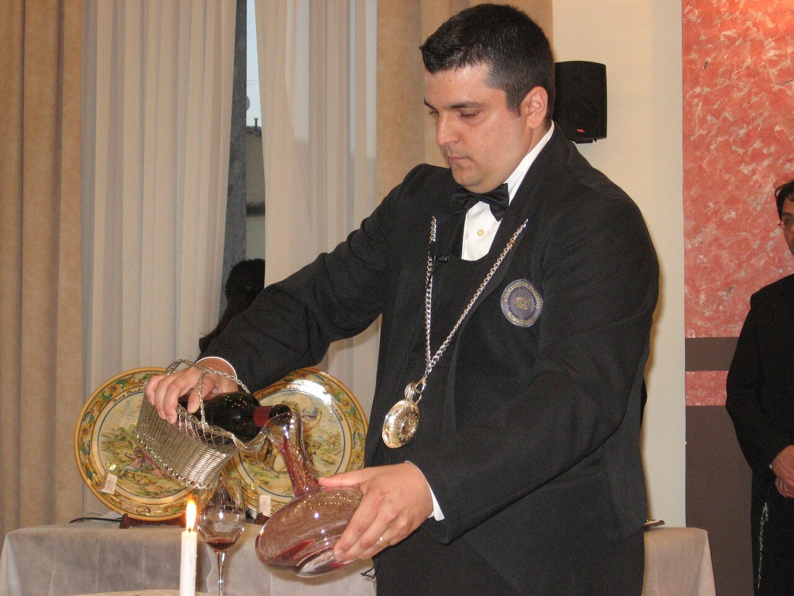

# 醒酒

醒酒（decanting，也译作滗酒、换瓶）是把酒液从原瓶中缓慢倒入另一容器，使酒与瓶底沉淀分离，并让酒液接触空气的侍酒技法。它包含两个目的：一是去除沉淀，二是让香气与口感更开放。两个目的并不总是同时成立，因此是否需要醒酒、醒多久，要看酒种、酒龄与当前状态。

图：侍酒师把酒倒入醒酒器。图片：Fabio Ingrosso，CC BY 2.0，via Wikimedia Commons（[原图页面](https://commons.wikimedia.org/wiki/File:Sommelier_decanting_and_serving_wine_at_a_restaurant.jpg)）。

## 定义与适用对象

醒酒的对象通常是[红葡萄酒](ref:red-wine)、年份波特等[加强葡萄酒](ref:fortified)，以及部分陈年[白兰地](ref:brandy)。

这些酒在瓶中陈年后可能产生色素、单宁与酒石酸形成的沉淀；沉淀本身不有害，但会让入口变得粗糙、影响观感。醒酒前把酒瓶直立静置，就是为了让沉淀集中，倒酒时才能避开。

醒酒不是“所有酒都要做”的固定仪式。年轻、单宁紧实的红葡萄酒可能受益于短时间接触空气；老酒则可能在短时间内香气衰退。起泡酒与多数清爽型白葡萄酒通常不需要醒酒，因为气泡与新鲜香气会因过度接触空气而损失。

## 为什么要醒酒

第一是分离沉淀。把酒瓶直立静置一段时间，让沉淀沉到瓶底，再缓慢倒出，可以避免把沉淀带入杯中。第二是促进氧化。酒液与空气接触后，部分还原性香气会散开，单宁与色素发生轻微变化，口感可能变得更柔顺。

第三是展示与仪式。餐厅在客人面前醒酒，既能让客人看到酒的状态，也能确认酒没有明显缺陷。仪式的价值不等于技术必要性；如果酒本身不需要，强行醒酒反而可能损害表现。

## 何时不该醒酒

老酒是典型例子。陈年数十年的酒在瓶中已经非常脆弱，长时间接触空气会让原本细腻的香气迅速消散。老酒醒酒通常以“分离沉淀”为主，动作要轻，时间要短，甚至只在出瓶前短暂静置。

另一类不适合的是香气极易挥发的酒，例如部分老年份香槟或轻盈的白葡萄酒。过度醒酒会让果香与花香散失，酒体显得空洞。判断标准是酒的状态，而不是价格或年份标签。

## 醒酒器与器具

常见醒酒器有宽底、窄颈的造型，宽底增加酒液与空气的接触面积，窄颈减少香气散失。也有更宽口的“瀑布式”醒酒器，接触空气更充分，适合年轻、单宁强的酒。器型选择影响氧化速度，因此不是一个装饰问题。关于器型与清洗，可以参考[醒酒器](ref:decanter)。

除了醒酒器，还需要光源、干净的漏斗或倒酒器、以及足够高的杯脚或托盘。光源用于观察沉淀位置，避免把沉淀倒入醒酒器。漏斗和滤网可以帮助拦截较大的沉淀，但也可能遮蔽酒液的细微变化，使用时应权衡。

## 操作步骤

第一步，提前把酒瓶直立静置，让沉淀集中到瓶底；静置时间取决于酒龄与沉淀量，可能从数小时到一天不等。第二步，在光源下缓慢开瓶，避免晃动瓶身。第三步，把瓶口靠近醒酒器，保持稳定、连续、低速地倾倒。关于倒酒动作，可以参考[倒酒](ref:pouring)。

第四步，观察瓶肩处的沉淀，当沉淀接近瓶口时停止倾倒，宁可留下少量酒液，也不要把沉淀带入。第五步，醒酒器中的酒静置一段时间后试饮，根据香气与口感决定是否继续等待。整个过程应避免温度剧烈变化。

## 时间控制

醒酒时间没有统一公式。年轻、单宁强的红葡萄酒可能需要较长时间；老酒则可能只需几分钟到十几分钟。判断方法是持续试饮：如果香气闭塞、单宁突出，可以再等；如果香气开始衰退、口感变薄，应立即上桌。

环境温度也会影响醒酒速度。温度高，氧化快；温度低，变化慢。餐厅通常会把醒酒器放在接近饮用温度的环境中，而不是放在暖气旁。时间控制是动态的，不能照搬“醒酒半小时”这样的固定说法。

## 与品鉴的关系

醒酒会改变酒的呈现，因此品鉴记录应写明是否醒酒、醒了多久、使用何种器型。同一瓶酒在刚开瓶与醒酒后可能呈现完全不同的香气与结构；如果记录不写条件，比较就失去意义。

醒酒也可能掩盖缺陷。过度氧化会让一些异味暂时变得柔和，但并不能消除缺陷。专业品鉴通常会在醒酒前后各做一次记录，以区分“酒的变化”与“酒的问题”。这也是醒酒作为技法需要被记录的原因。

## 常见误区

第一，所有红酒都要醒酒。清爽型、年轻易饮的红酒可能不需要，过度醒酒会损失果香。

第二，醒酒时间越长越好。时间过长会让香气散失、酒体变薄，老酒尤其脆弱。

第三，醒酒可以去除所有缺陷。它只能分离沉淀、促进氧化，不能修复软木塞污染等问题。

第四，醒酒器越贵越好。器型与接触面积比价格更重要，合适的形状才能服务于酒的状态。

第五，倒酒越猛越好。猛烈倾倒会搅动沉淀，也容易让香气过度挥发，应保持稳定低速。

对照阅读：[红葡萄酒](ref:red-wine)、[白兰地](ref:brandy)。

## 延伸阅读

- [红葡萄酒](ref:red-wine)：单宁、沉淀与陈年之间的关系。
- [加强葡萄酒](ref:fortified)：年份波特等需要分离沉淀的酒种。
- [白兰地](ref:brandy)：陈年烈酒的沉淀与侍酒方式。
- [橡木桶陈酿](ref:oak)：桶陈如何影响沉淀、单宁与香气。

**关键事实。**

| 项目 | 内容 |
| --- | --- |
| 一句话定位 | 把酒液与沉淀分离、并让酒与空气接触的侍酒技法；是否需要醒酒取决于酒种、酒龄与状态，不是所有酒都适合长时间醒酒 |
| 适用对象 | 红葡萄酒、加强葡萄酒、白兰地 |

**来源与边界。** 本页关于「醒酒」的关键事实，主要由以下来源交叉核对：Oxford University Press（提供关于醒酒、沉淀与老酒侍酒的条目；由原条目末尾参考资料迁移，未逐条复核访问日期）、OIV（葡萄酒的定义与一般工艺框架）、Encyclopaedia Britannica（提供关于葡萄酒酿造、澄清与陈年的条目）等 5 条来源。价格、批次与状态会变，涉及这些字段时以页面所列来源的最新版本为准。正文为项目自写，来源只作核验，不复制原文。
