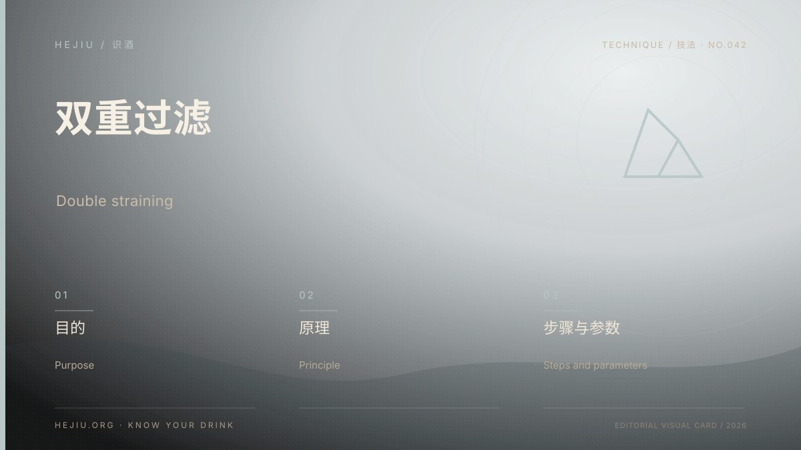

# 双重过滤

双重过滤（double straining）是把酒液连续通过两道滤器的技法。第一道通常是摇酒壶自带的滤冰器或锥形滤器，负责挡住冰块、大块果肉与碎叶；第二道是细滤网，负责拦下更小的颗粒、果肉纤维与冰屑。它不改变配方，却明显改变成品的口感与外观。

图：双重过滤 双语视觉卡（项目自绘 SVG）。不是实拍。

## 目的

双重过滤的首要目的，是让酒液更干净。摇和后，杯中常残留细小的果肉、香草碎屑与冰屑，它们悬浮在酒液里，入口有颗粒感，静置后还会沉淀在杯底。

第二个目的，是控制外观。清亮的短饮需要透亮的酒液，细滤网能去掉让酒液发雾的微粒，使颜色更纯、更通透。

第三个目的，是保护装饰与饮用体验。碎叶与果肉会黏在杯口或装饰上，也会堵塞吸管；过滤后，入口更顺，杯中也更整洁。

但双重过滤不是“越干净越好”。它会带走一部分气泡与挥发性香气，也会降低出品速度。配方如果追求丰富的泡沫或明显的果肉质感，单道过滤甚至不过滤可能更合适。

## 原理

过滤是按其颗粒大小拦截悬浮物。主滤器孔洞较大，先承担大部分固体；细滤网孔洞更小，负责剩余微粒。两道滤器串联，等于把不同尺寸的颗粒分两次去掉，避免细网被大块固体迅速堵死。

细滤网的阻力明显更大，流速会下降。流速过慢时，酒液在滤网上停留更久，气泡更容易破裂，香气也更容易散失。若用力压滤网，颗粒会被挤压穿过网孔，过滤反而失效，网面也可能变形。

过滤并不能“清除”异味。它只处理物理颗粒，不改变酒精、糖与酸的平衡。配方本身失衡时，双重过滤不会让酒变好喝，只会让酒看起来更干净。

## 步骤与参数

第一步，准备好两道滤器。主滤器可以是摇酒壶的滤冰器或独立的锥形滤器；细滤网应完好、洁净，并确认能稳放在目标杯口上。

第二步，预冷目标杯与滤网。冷杯能减少过滤后回温，冷滤网也能减少香气损失；如果滤网刚从热水中取出，应等它冷却并沥干。

第三步，把细滤网放在杯口，主滤器放在细滤网上方。两者应贴合稳定，避免倾倒时滑动。

第四步，将摇好的酒液倒入主滤器，让酒液自然流过。不要一开始就猛倒，以免冲击把细网冲偏，也避免细网瞬间被颗粒填满。

第五步，滤完后轻敲滤器边缘，让附着的液滴落下；不要用勺或手按压固体，也不要把滤网上的残渣刮进杯中。

第六步，立即清洗两道滤器。果肉与糖分干结后会堵塞网孔，也会带来异味。

细滤网的网目、孔径与材质因产品而异，应由产品标注决定，不存在统一的“最佳目数”。配方若注明了过滤方式，应以配方为准。过滤速度也受液体黏度、果肉量与冰屑量影响，不能用固定秒数判断。

## 适用与替代

双重过滤适合含果肉、碎叶与大量冰屑的摇和配方。以柑橘汁为主、需要清澈外观的短饮，例如[大都会](ref:cosmo)，常采用双重过滤；含薄荷或其他香草的摇和配方，也能借此去掉碎叶。

它不适合以泡沫为卖点的配方。含蛋清或奶油的酒液经过细滤网时，部分泡沫会被破坏；这类配方通常只做单道过滤，甚至直接倒入杯中保留泡沫。含大量果肉的配方也不适合，细网会迅速堵塞。

替代方案包括：只做单道过滤，保留更多质感与气泡；用纱布或咖啡滤纸做更慢、更彻底的澄清，但香气损失更大、速度更慢；需要完全清澈时，改用静置与倾析等澄清方法，而不是依赖滤网。关于摇和的基本流程，可参考[摇酒](ref:shaking)。

## 常见失败点

第一，顺序颠倒。先过细网、再过主滤器，等于让细网承受全部固体，很快堵塞。

第二，用力按压。压力会把微粒挤过网孔，也会让滤网变形。

第三，滤网不洁。残留的果肉与油脂会带入异味，也会影响下一杯的流速。

第四，杯口不稳。细滤网滑落会让酒液洒出，也会破坏已经滤好的部分。

第五，过滤过度。所有配方都用最细的网，泡沫与香气被一并带走，成品变得扁平。

第六，忽视产出损失。滤网与滤器上残留的液体不少，配方量较小时，损失比例更明显。

第七，滤完不洗。糖与果肉干结，网孔越来越窄，下一次过滤会越来越慢。

## 练习方法

用同一配方做两杯，一杯单道过滤、一杯双重过滤，其余步骤完全一致。对比透明度、入口颗粒感、泡沫高度与香气强度。这个对照能直观看出双重过滤换来了什么，又牺牲了什么。

再用清水与少量果肉练习过滤速度：观察细网何时开始变慢，学会在主滤器上分散倾倒，而不是集中冲击一个点。

最后练习清洁：滤完后立即用温水冲洗细网，用软刷轻刷，晾干后检查网面是否平整。稳定的清洁习惯比追求更细的网更重要。

## 常见误区

第一，“双重过滤一定更高级”。它只是一种取舍，适合需要清澈的配方，不适合所有酒。

第二，“滤网越细越好”。过细的网会堵塞、吸走香气，也会拖慢出品。

第三，“过滤能修正配方”。过滤只去除颗粒，不能改变酸甜与酒精平衡。

第四，“所有鸡尾酒都该双重过滤”。含蛋清的配方通常保留泡沫，单道过滤更合适。

第五，“主滤器可以省略”。只靠细网会让固体迅速堆积，过滤又慢又不均匀。

第六，“滤网不用每次清洗”。残留物会干结、堵塞并带来异味，必须及时清洁。

相关条目：[细滤网](ref:fine)。

## 另见

- [细滤网](ref:fine)：网面、结构与清洁要点。
- [滤冰器](ref:strainer)：第一道过滤的主力。
- [摇酒](ref:shaking)：双重过滤最常见的上游步骤。
- [大都会](ref:cosmo)：需要清澈外观的摇和短饮。
- [调酒基础](ref:basics)：过滤在整体流程中的位置。

**关键事实。**

| 项目 | 内容 |
| --- | --- |
| 一句话定位 | 先用主滤器挡住冰块与大块固体，再经细滤网滤除果肉、碎叶与冰屑的技法；换来更干净的口感与外观，但速度更慢 |
| 适用对象 | 大都会、纸飞机 |
