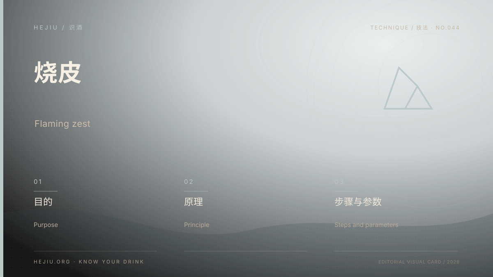

# 烧皮

烧皮（flaming zest）是把柑橘皮外层对准火焰、挤压皮油让油雾穿过火苗并落入杯中的技法。油雾在火焰中短暂燃烧，带出烘烤与焦香，随后香气落在酒液表面。它常见于古典鸡尾酒的升级版本，也常被用作吧台表演；但明火与高酒精度的环境叠加，使它成为风险最高的一类装饰技法之一。

图：烧皮 双语视觉卡（项目自绘 SVG）。不是实拍。

## 目的

烧皮的第一目的，是改变香气。柑橘皮外层的油胞富含挥发性香气，直接挤压（即“喷皮”）已经能带来清新的柑橘香；让油雾穿过火焰，会让部分香气被加热并短暂燃烧，产生烘烤、焦糖与轻微的烟熏感，香气从“明亮”转向“温暖”。

第二目的，是改变香气的落点。油雾在杯口上方燃烧后落下，香气集中在酒液表面与杯口，饮用者端起杯子时先闻到的是这一层。关于香气的层次，可参考[香气](ref:aroma)与[闻香](ref:nosing)。

第三目的，是呈现。火焰短暂出现，视觉冲击强，适合需要现场感的场合。但呈现不能凌驾于安全之上；在禁止明火的场所，这一技法不应使用。

## 原理

柑橘皮外层（通常称为外皮或油层）含有大量挥发性精油，其中许多成分易燃。挤压时，油以细小油雾喷出；油雾与火焰接触，迅速气化并燃烧，形成一瞬间的火光。燃烧并不持续，因为油量很少、雾滴很细，火焰很快熄灭。

火焰对香气的影响是双重的。适度的加热让部分香气成分更易挥发，并产生轻微的烘烤气息；过度燃烧则会让油变成焦油与烟尘，带来刺鼻的苦烟味，落在酒液里反而破坏香气。白色内皮几乎不含精油，压到内皮只会带来苦味与水分。

湿度也很关键。刚洗过、表面带水的果皮会在火焰中产生蒸汽与溅射，油雾不均匀，还容易烫手。果皮应擦干再操作。

## 步骤与参数

第一步，选择干净的柑橘。表皮应完整、无腐烂，并按需要清洗与擦干。打蜡的果皮在燃烧时可能产生不愉快的气味，使用前应确认表皮状态。

第二步，切取果皮。取一条宽度适中的果皮，尽量只带外层油胞，减少白色内皮。皮条太窄出油少，太宽则容易压到内皮。

第三步，准备火源与操作位置。使用稳定的火柴或长嘴点火器，避开易燃物、酒瓶、纸巾、窗帘与低矮天花板；台面应耐热，旁边不要摆放敞开的高酒精度酒瓶。

第四步，把果皮置于杯口上方，油层朝向酒杯，火焰放在果皮与酒杯之间。挤压果皮，让油雾穿过火焰落向杯口。动作应短促、可控，不要持续用力挤压。

第五步，火焰熄灭后立即移开果皮与火源，确认没有余火，再把果皮作为装饰放入杯中或丢弃。不要让燃烧中的果皮停留在杯口。

第六步，尽快出品。烘烤香气会随时间散失，烟雾也可能积累。

烧皮没有统一的距离、角度或挤压时长参数，因为果皮含油量、火焰大小与杯型都不同。原则是“短、稳、低”：时间短、火焰稳、动作低，避免油雾四溅。若场所禁止明火，应直接改用不点火的喷皮。

## 适用与替代

烧皮适合香气结构化、酒精度较高的短饮。以[古典鸡尾酒](ref:old-fashioned)为例，橙皮是常见装饰，喷皮或烧皮都能强化柑橘与糖的呼应；酒体较重的威士忌类配方也较能承受烘烤香气。

它不适合香气纤细、以花香或清鲜柑橘为主的配方。烟熏与焦香会盖过细腻的香气，让成品显得沉重。含大量气泡的饮品也不适合在杯口操作明火。

替代方案包括：只做喷皮，不点火，安全且香气清晰；用脱水柑橘片或干燥果皮做装饰；用少量烟熏装饰（例如烟熏过的杯口或香料）替代；需要烟熏香气时，使用专门的烟熏工具，而不是在杯口玩火。若所在地法规或场所规定禁止明火，应无条件遵守。

## 常见失败点

第一，烧到白色内皮。内皮含油少、含水多，燃烧后带来苦味与焦味。

第二，挤压过猛。油雾过多，火焰变大，香气变成刺鼻的油烟。

第三，果皮带水。水滴在火焰中溅射，容易烫伤，也让油雾不均匀。

第四，火源位置不当。火焰离杯口太近，可能烧到杯沿或装饰；太远则油雾无法穿过火焰。

第五，附近有高酒精度的敞口酒。挥发的气体可能被点燃，风险远高于一杯酒的装饰。

第六，操作者头发、衣袖或围裙靠近火焰。动作幅度一大就可能引燃。

第七，燃烧中的果皮落入杯中。焦油与烟尘直接进入酒液，香气被破坏。

第八，在通风不良或低矮空间操作。烟雾积累，也会增加火灾风险。

## 练习方法

先在耐热托盘或水面上练习挤压，不点火：观察油雾喷出的方向、范围与力度，确认自己能控制落点。再在有人监护、远离易燃物的环境中练习点火，使用长嘴点火器，保持手臂稳定。

练习时可以用清水代替酒液，只观察火焰与油雾的形态，不饮用。每次只做一次短促挤压，避免连续喷油。练习结束后检查台面是否有油渍与余火。

更重要的是练习“放弃”：如果环境不合适，能立刻改做不点火的喷皮。安全习惯比技法熟练度更重要。

## 常见误区

第一，“火焰越大越好看”。火焰越大，油烟与焦味越重，风险也越高。

第二，“烧皮能提高酒精度”。燃烧的是少量果皮油，不是酒液；它改变的是香气，不是酒精含量。

第三，“所有柑橘都一样”。不同品种的果皮含油量、香气与表皮厚度不同，效果会有差异。

第四，“哪里都能烧”。低天花板、通风差、附近有易燃物的场所都不适合，场所禁止明火时更不应操作。

第五，“烧过的皮可以一直放在杯里”。燃烧后的果皮会继续释放焦味，应尽快移开或丢弃。

第六，“用高酒精度酒助燃更方便”。在杯口倒酒点燃会带来不可控的火焰，绝不应作为烧皮的替代方案。

## 另见

- [古典鸡尾酒](ref:old-fashioned)：橙皮装饰的经典场景。
- [香气](ref:aroma)：理解柑橘皮油与挥发性香气。
- [闻香](ref:nosing)：如何评价烧皮带来的香气变化。
- [调酒基础](ref:basics)：装饰与出品在整体流程中的位置。

对照阅读：[古典](ref:old-fashioned)、[闻香](ref:nosing)。
