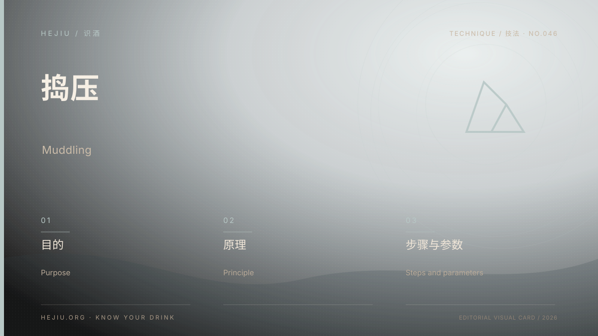

# 捣压

捣压（muddling）是把香草、水果或糖块放在杯中用捣棒轻压，让香气与汁液释放出来的调酒技法。它是“在杯中构建”的一部分，常见于莫吉托、薄荷茱莉普一类以新鲜植物香气为核心的配方。它看起来简单，实际却很容易因为力度、顺序或工具不合适而毁掉一杯酒。

图：捣压 双语视觉卡（项目自绘 SVG）。不是实拍。

## 目的

捣压要解决的是“如何在不加热、不长时间浸泡的前提下，让植物原料的风味进入酒液”。薄荷叶、罗勒叶、青柠角、浆果与糖块如果整块放入酒液，风味释放很慢；轻压可以破坏部分细胞结构，让精油与果汁接触酒液。捣压还承担混合功能：把糖与青柠汁在杯底略作碾压，有助于糖溶解，也让后续搅拌更均匀。

它不是榨汁，也不是研磨。目标是把香气“打开”，而不是把植物组织全部破坏。理解这一点，就能明白为什么“用力越大越好”是错的。

## 原理

植物香气主要存在于叶片表面的精油腺体与果皮外层的油胞。压力使这些结构破裂，精油进入酒液；同时果肉细胞破裂，果汁释出。压力过大时，叶片与果皮内侧的苦涩物质、叶绿素分解产物也会一起进入酒液，香气反而变得浑浊。

因此捣压的关键是“压开而不撕碎”。薄荷叶被反复捶打成碎末后，切口氧化，颜色变暗，风味从清亮转向草青与苦涩。柑橘类如果压到白色内皮，苦味会明显上升。糖在杯底提供磨擦，帮助精油与果汁更快融入，但糖本身不产生香气。温度与时间也影响结果：捣压通常在室温下进行，时间很短；捣压后若久置，香气的挥发性成分会持续散失。

## 步骤与参数

第一步，按配方准备原料。薄荷通常只取叶片，去掉粗茎；青柠切成方便压榨的角块；浆果是否需要先压碎，取决于配方对果肉与澄清度的要求。

第二步，把原料放入最终上桌的杯子或搅拌容器中。需要糖的配方，先放糖与少量酸汁，让杯底形成磨擦层；不需要糖的配方，直接放入植物原料。

第三步，握稳杯身，捣棒垂直向下，用短促而可控的力度压下去，再轻微转动后抬起。重复次数以香气是否释放、叶片是否仍然完整为准，而不是固定次数。看到叶片变深、边缘略软即可停止。

第四步，加入酒液与冰块，按配方继续搅拌或摇和。捣压只是预处理，不是混合的终点。

第五步，取出捣棒，擦净或冲洗后再用于下一杯。含柑橘与糖的捣棒表面黏腻，残留会污染下一杯。

捣压没有统一的力度与次数标准，因为香草品种、叶片老嫩、杯具形状与配方目标都不同；把“压几下”当作固定参数，往往比观察叶片状态更不可靠。配方若给出顺序与用量，应优先遵循配方。

## 适用与替代

适合捣压的原料包括薄荷、罗勒、百里香等香草，青柠与柠檬角，浆果，以及需要与糖一起碾压的糖块。它们共同的特点是香气集中在易碎结构里，且配方希望保留新鲜感。

不适合捣压的包括花瓣、过于细嫩的香草、已经切碎的果皮，以及希望保持清澈的配方。苦味重的柑橘内皮、带籽的果肉也应避免大力压。

替代方案有几种。把香草与酒液一起短时间摇和，可以释放香气，但碎叶会混入酒液，需要过滤；用糖浆或浸泡预先提取香气，风味更稳定，但少了现做的鲜度；用搅拌代替捣压，则香气释放较弱。选择哪一种，取决于配方要的是“新鲜植物的锋利感”还是“稳定可复现”。

在[莫吉托](ref:mojito)一类配方中，捣压与搅拌配合；在需要澄清的配方中，则可能改为摇和后双重过滤。技法之间不是互相替代，而是服务于不同的成品目标。关于整体流程，可参考[调酒基础](ref:basics)。

## 常见失败点

第一，压得太狠。薄荷被打成碎末，酒液出现草腥与苦涩，颜色也变暗。

第二，压到柑橘白色内皮。苦味压过香气，成品失衡。

第三，压得太轻。叶片完整但香气几乎没有进入酒液，喝起来像“加了薄荷的苏打水”。

第四，杯具太薄或杯口太窄。用力时杯子受力集中，可能破裂；捣棒也容易卡住。

第五，捣棒不洁。上一杯的果肉与糖残留会带入异味，也可能影响卫生。

第六，顺序错误。先加冰再捣压，冰块会阻碍原料受力，还会让捣棒打滑；正确顺序通常是先处理植物原料，再加冰与液体。

第七，把捣压当成“必须”的步骤。并非所有含薄荷的配方都需要捣压，有些配方更依赖摇和或浸泡。

## 练习方法

可以用清水与薄荷练习，观察不同力度下叶片的变化：轻压后叶片变深但仍然完整，重压后出现碎屑与暗色切口。把两种结果分别闻一闻，记住“清亮”与“草腥”的差别。

再用同一配方做两杯，一杯轻压、一杯重压，其余步骤完全相同，对比香气与苦味。这种对照练习比记次数更能建立手感。练习时还应熟悉杯具：用常用杯型练习捣棒的角度与行程，避免在正式出品时因杯口太窄而手忙脚乱。

最后练习清洁与节奏：捣压后立即擦净捣棒，换杯时冲洗，形成固定动作。技法稳定的前提是动作稳定，而不是某一次特别用力。

## 常见误区

第一，“越用力越出味”。捣压的目标是释放香气，不是破坏组织；过度用力带来的是苦味与浑浊。

第二，“所有原料都要捣压”。花瓣、细香草与已经切碎的果皮不适合，压了反而破坏香气。

第三，“捣压可以代替摇和”。捣压只处理植物原料，冷却、稀释与整体混合仍需要后续步骤。

第四，“薄荷要捣到碎”。碎叶氧化快，香气散失也快，成品会显得沉闷。

第五，“捣棒越重越好”。重量影响控制，过重的捣棒在薄杯中难以收力，反而增加破损风险。

第六，“捣压后可以久放”。香气会持续挥发，最好按配方顺序尽快完成后续步骤。

## 另见

- [莫吉托](ref:mojito)：以薄荷与青柠为核心的构建型配方。
- [薄荷茱莉普](ref:julep)：另一种以薄荷香气为主的长饮。
- [捣棒](ref:muddler)：长度、材质与握持方式。
- [摇酒](ref:shaking)：需要过滤碎叶时的替代思路。
- [香气](ref:aroma)：理解植物香气与挥发性的基础概念。
- [调酒基础](ref:basics)：构建、摇和与搅拌的整体流程。
