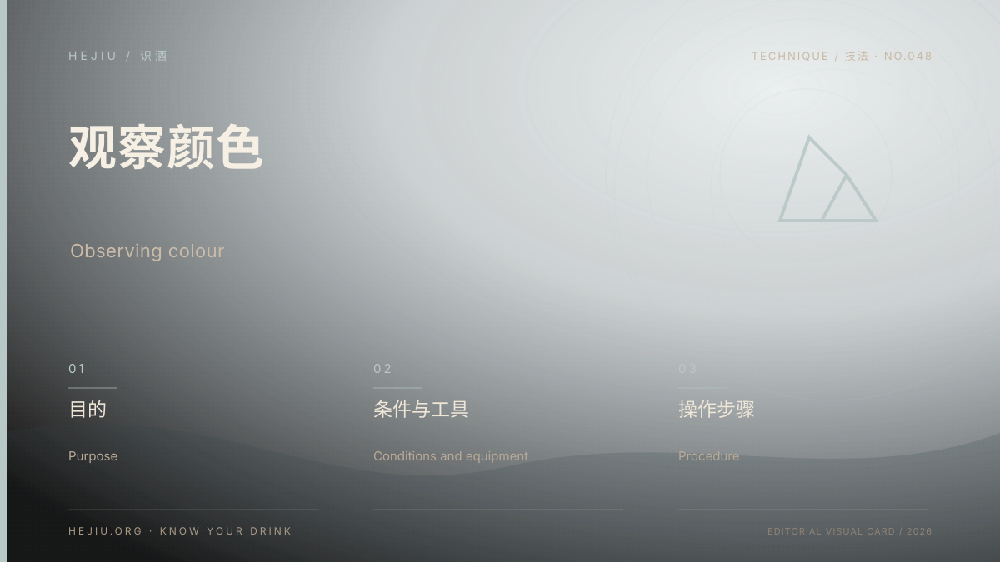

# 观察颜色

观察颜色是品鉴的第一步：在倒酒之后、闻香之前，用眼睛判断酒液的澄清度、色调与浓度。它不能告诉你酒好不好喝，但能提供酒龄、品种、浸皮时间、是否经过桶陈等线索。把颜色当成线索而不是结论，是这项技法的前提。

图：观察颜色 双语视觉卡（项目自绘 SVG）。不是实拍。

## 目的

第一是检查状态。浑浊、悬浮物、异常沉淀或起泡酒的气泡表现，都可能提示过滤、运输、储存或瓶内状况。第二是建立预期。深色红葡萄酒通常意味着更多的浸皮与单宁，白葡萄酒由青绿转向金黄则提示陈年。第三是留下可比较的记录。颜色描述越具体，越能在同款不同年份、同品种不同产区之间做对照。

颜色不是质量评分。深浅、浓淡与好坏没有直接对应关系；同一品种在不同产区、不同年份可以呈现完全不同的色泽。把颜色单独拿出来下结论，是最常见的误用。

## 条件与工具

观察颜色需要可控的条件。背景应为白色或浅灰，例如白纸、白桌布；光源以自然光或显色性好的白光为宜，避免彩色灯、霓虹灯与强烈反光。酒杯应干净、无水渍、无洗涤剂残留，杯型尽量统一，否则杯壁厚度与杯口形状会改变观感。

常用工具很简单：一只透明酒杯、一张白纸、一个稳定光源，以及记录用的笔或手机。需要拍照时，把白纸放在杯后、镜头与杯身保持固定距离，避免自动白平衡把颜色拍偏。若比较两款酒，应使用同型杯、同样的酒量、同样的倾斜角度。

## 操作步骤

第一步，倒入少量酒液，约占杯容的三分之一；倒得太满会压缩观察角度，也不利于摇杯。第二步，持杯脚而不是杯身，把杯子倾斜约四十五度，让酒液在杯壁形成一层薄薄的弧面。

第三步，先看弧面中心，再看边缘。中心反映酒液的浓度与主色调，边缘的色带往往更薄、更透明，能看出色调的细微变化。第四步，把杯子放回白纸前，正视观察澄清度：是否有悬浮颗粒、沉淀、气泡或杯壁附着物。

第五步，轻轻摇杯，让酒液在杯壁留下一层薄膜，观察酒痕下落的速度与形态，即常说的“挂杯”。挂杯只能作为酒精与糖分等物理性质的参考，不是质量指标。第六步，把观察结果按“澄清度、色调、浓度、气泡、其他”分开记录。

## 判读参数

色调是最有信息量的维度。白葡萄酒常见的变化是从青柠绿、柠檬黄，走向金黄、琥珀，最后偏棕；红葡萄酒则从紫红、宝石红，走向石榴红、砖红，边缘出现橙色。起泡酒随着陈年，颜色通常也会从浅黄走向金黄。色调变化与品种、浸皮、桶陈和瓶陈都有关，不能只归因于年龄。

浓度指颜色深浅与不透明度。红葡萄酒的浓度受浸皮时间、品种皮厚、年份成熟度影响；白葡萄酒的浓度受压榨方式、是否带皮接触、桶陈影响。浓度高不等于酒体厚，也不等于质量好。

澄清度需要区分“正常沉淀”和“异常浑浊”。老酒瓶底的色素与酒石酸沉淀很常见，倒酒时避开即可；如果浑浊伴随异味、絮状悬浮或开瓶后迅速恶化，才需要怀疑缺陷。起泡酒的气泡应细密、持续、成串上升；粗大、稀少且迅速消失，可能提示压力或杯具清洁问题。

挂杯与酒精度、残余糖分和温度有关。温度低、酒精高时，酒痕通常更明显。它可以辅助判断，但不能替代入口后的酒体评估。

## 失败案例

第一，在彩色灯光下观色。光线本身有颜色，会把白葡萄酒染成金色、把红葡萄酒压成黑色。第二，握杯身观察。手掌温度会让酒液升温，杯壁留下指纹，也影响气泡表现。

第三，倒得太满。酒液接近杯口时，倾斜角度受限，边缘色带看不见，摇杯也容易溢出。第四，用不同杯型比较两款酒。杯壁厚度、杯口收拢程度与容量都会改变颜色深浅的观感。

第五，把颜色深浅当成酒体。颜色是光学现象，酒体是口感重量，两者相关但不重合。第六，把沉淀一律当成缺陷。老酒沉淀是正常的，关键看是否伴随异味与浑浊。

第七，拍照不做校正。手机自动白平衡与滤镜会把色调改变，导致不同批次照片无法比较。

## 练习方法

可以从同款不同年份开始：买两瓶同一生产者的酒，年份相差数年，用同型杯、同酒量并排观察，记录色调与边缘色带的变化。第二步是同品种不同产区，例如同一品种在两个气候不同的地区，比较浓度与色调差异。

第三步是建立照片档案。固定白纸、固定距离、固定光源，拍下杯口正视图与倾斜侧视图，并在文件名中写明酒名、年份、日期与是否醒酒。第四步是盲看练习：只看颜色，先写下酒龄与工艺猜测，再对比实际信息，训练的是“知道自己看到了什么”，而不是猜对。

练习时应注意，颜色判断受杯型与光线影响很大。任何结论都应附上观察条件，否则无法复现。

## 与其他环节的关系

观察颜色是[闻香](ref:aroma)与入口之前的准备。颜色提示的年龄与浓度，会影响你闻香时对强度的预期，也会影响入口时对酒体的判断。但预期本身可能造成偏差，因此更稳妥的做法是先如实记录颜色，再闻香，最后用口感修正前面的判断。

颜色也与[醒酒](ref:decanting)和温度有关。醒酒会改变酒液与空气的接触，短时间内的色调通常变化不明显，但澄清度可能因沉淀重新悬浮而改变。温度降低时，白葡萄酒的香气收敛，颜色观感却可能显得更清淡。把这些条件写进记录，比较才有意义。

## 常见误区

第一，颜色越深，酒越好。深浅与品种、工艺、年份相关，与质量没有直接关系。

第二，白葡萄酒越浅越年轻。某些品种与工艺本身颜色偏浅，不能只看色调判断年龄。

第三，挂杯越多，酒越浓。挂杯主要反映酒精与糖分，不能替代口感评估。

第四，有沉淀就是坏了。老酒沉淀正常，需结合气味与澄清度判断。

第五，在餐厅灯光下就能准确观色。彩色与昏暗光线会系统性改变判断，应尽量借助白纸与自然光。

## 延伸阅读

- [葡萄酒](ref:wine)：葡萄酒的基本分类与酿造框架。
- [红葡萄酒](ref:red)：浸皮、单宁与颜色之间的关系。
- [白葡萄酒](ref:white)：压榨、带皮接触与色调变化。
- [起泡酒](ref:sparkling)：气泡表现与陈年对颜色的影响。
- [香气](ref:aroma)：观色之后的下一个感官环节。
- [第一次品鉴](ref:tasting)：把观色、闻香与入口串起来的入门流程。
- [选一只杯子](ref:glass)：杯型如何影响观色与闻香。
