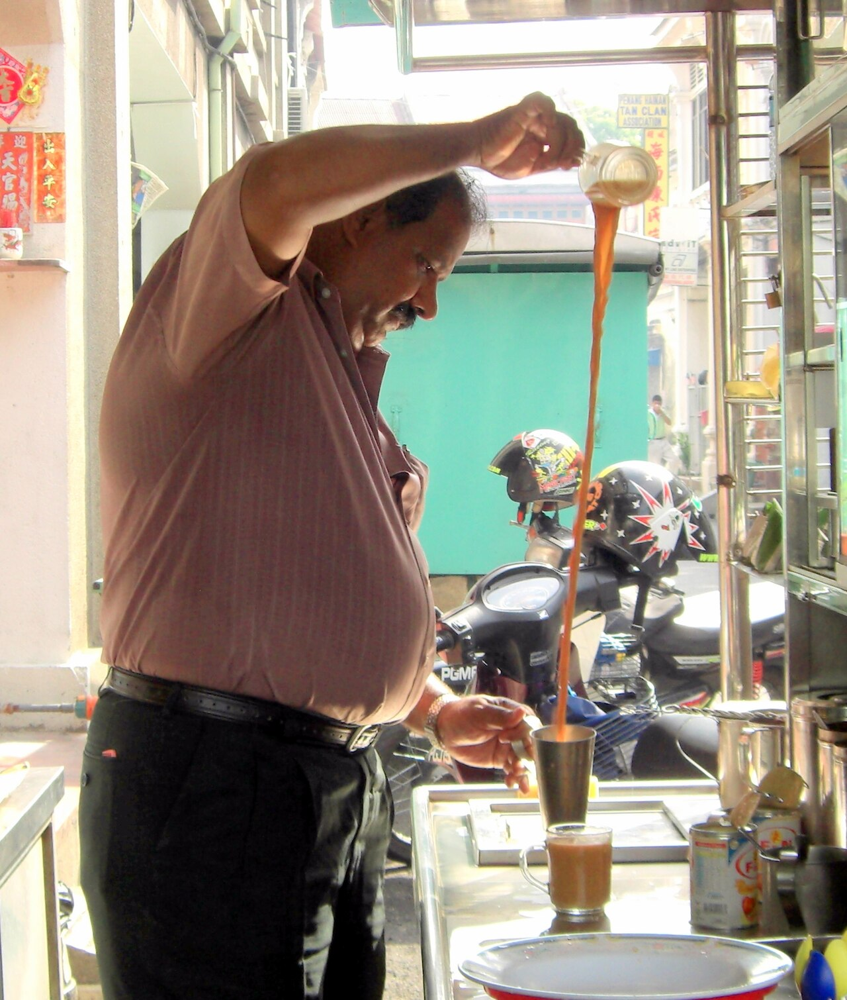

# 倒酒

倒酒是把酒液从瓶中定量倒入杯中的动作。它看似简单，却同时涉及酒量控制、沉淀管理、气泡保留与卫生。倒得太满，香气无法聚集，摇杯会溢出；倒得太猛，沉淀被搅起，气泡也被打散。合适的倒法能让后面的观色、闻香与入口都更准确。

图：倒酒。图片：Cheng from Austin, US，CC BY-SA 2.0，via Wikimedia Commons（[原图页面](https://commons.wikimedia.org/wiki/File:Teh_tarik_man_pulling_tea.jpg)）。

## 目的

第一是定量。每杯倒入合适的量，既方便品鉴，也避免浪费。第二是保护酒液。缓慢、贴壁的倒法可以减少冲击，避免沉淀扬起与气泡逸出。第三是卫生。瓶口不应接触杯口，倒完后不应有酒液沿瓶身滴落。

第四是呈现。倒酒是侍酒过程的一部分，动作稳定、顺序清楚，能让同桌的人看到酒的状态，也方便分配。

## 工具与准备

基本工具是酒杯、餐巾或布，以及需要时的醒酒器或倒酒器。餐巾用于擦净瓶口与收瓶时接住最后一滴；醒酒器用于分离沉淀；倒酒器可以帮助控制流速，但也会改变香气释放，使用时应权衡。

杯型影响倒酒量。杯腹宽、杯口收拢的杯子能聚集香气，适合倒少量；高杯或直筒杯的容量分布不同，倒同样体积看起来可能更满。比较不同酒款时，应使用同型杯并保持同样的酒量。

倒酒前应确认瓶口干净、杯具无水渍与洗涤剂残留。若刚开瓶，先擦净瓶口；若酒中有沉淀，提前直立静置，并在倒酒时观察瓶肩。

## 操作步骤

第一步，站姿稳定，瓶身与桌面保持一定距离，不要悬得太高。第二步，把瓶口靠近杯口但不接触，通常从杯壁一侧开始倒，让酒液沿杯壁流下。

第三步，控制流速。开始时可稍快，接近目标量时放慢，避免突然过量。第四步，观察杯中的酒量，倒到预定位置即停。第五步，收瓶时轻轻旋转瓶口，让最后一滴沿瓶口收回，随即用餐巾擦净。

第六步，按顺序为同桌的人倒酒，通常先客后主、先长后幼，或按主办方的安排。第七步，倒完后把酒瓶放回稳定的位置，标签朝向方便查看的方向。

## 参数与判断

酒量因酒种与场合而异。葡萄酒通常倒到杯容的三分之一左右，给香气留出空间，也方便摇杯；起泡酒可以稍多，但应分次倒入，避免泡沫溢出；白酒与烈酒常以小杯为单位，一次少量，便于控制节奏。

倒酒速度影响沉淀与气泡。老酒与有沉淀的酒应更慢，并在瓶肩处停下；起泡酒应贴壁、分次倒，避免直冲杯底。温度也会影响表现：温度高的起泡酒泡沫更活跃，倒酒应更慢。

倒酒量还与品鉴目的有关。需要观色与闻香时，少量足够；作为佐餐饮用时，可以按用餐节奏分次添加，而不是一次倒满。把“倒满”当成热情，往往会牺牲香气与体验。

## 失败案例

第一，倒得太满。杯口附近没有香气聚集空间，摇杯会溢出，端起时也容易洒。第二，瓶口接触杯口。瓶口外侧的灰尘与残留会进入杯中，也不卫生。

第三，倒得太猛。酒液直冲杯底，沉淀被搅起，起泡酒的气泡被打散。第四，收瓶不旋转。最后一滴沿瓶身流下，弄脏瓶身与桌面。

第五，老酒倒酒前晃动瓶身。沉淀扬起后，前面的澄清度观察与醒酒都失去意义。第六，起泡酒一次倒满。泡沫迅速升起并溢出，杯中也难以继续添酒。

第七，用同一酒量对待所有酒种。白葡萄酒、红葡萄酒、起泡酒与白酒的杯型与节奏不同，不能套用同一个“倒满”标准。

## 练习方法

第一步，用水与量杯练习。把水倒进不同杯型，记录到达三分之一、二分之一所需的时间与手感。第二步，练习贴壁倒。让水流沿杯壁流下，观察是否产生冲击与飞溅。

第三步，练习收瓶。倒到目标量后旋转瓶口，确认最后一滴不会沿瓶身落下。第四步，练习起泡酒的分次倒法，先用清水模拟，再在实际开瓶时应用。

第五步，在实际侍酒中记录。写下酒种、杯型、倒酒量与是否出现溢出或滴漏，逐步形成自己的节奏。练习的目标是稳定与可重复，而不是表演。

## 与其他环节的关系

倒酒承接[开瓶（软木塞）](ref:opening-cork)与[开瓶（起泡酒）](ref:opening-sparkling)，并为[观察颜色](ref:observing-colour)与闻香做准备。倒酒量决定杯中酒液的表面积与香气聚集程度，也决定观色时能否看清边缘色带。

需要分离沉淀时，倒酒与[醒酒](ref:decanting)是连续动作：先在光源下观察瓶肩，再缓慢把澄清酒液倒入醒酒器，沉淀接近瓶口时停止。倒酒的动作越稳定，醒酒的效果越好。

## 常见误区

第一，倒满才显得大方。倒满会压缩香气空间，也让品鉴与摇杯变得困难。

第二，倒酒越快越熟练。速度与稳定性是两件事，缓慢、贴壁的倒法更专业。

第三，瓶口碰杯更方便。接触会带来卫生问题，也容易碰倒杯子。

第四，所有酒都倒一样多。起泡酒、老酒与白酒的杯型、气泡与沉淀情况不同，酒量应分别调整。

第五，收瓶不需要擦。最后一滴会沿瓶身流下，既弄脏瓶身，也可能滴到桌面。

对照阅读：[葡萄酒](ref:wine)、[白酒](ref:baijiu)。

## 延伸阅读

- [葡萄酒](ref:wine)：葡萄酒侍酒的基本框架。
- [起泡酒](ref:sparkling)：气泡保留与分次倒酒。
- [白酒](ref:baijiu)：小杯分次倒酒的节奏。
- [选一只杯子](ref:glass)：杯型如何影响倒酒量与香气。
- [醒酒](ref:decanting)：倒酒与分离沉淀的衔接。
- [香气](ref:aroma)：倒酒量如何影响香气聚集。
- [观察颜色](ref:observing-colour)：倒酒之后的第一个观察环节。

**关键事实。**

| 项目 | 内容 |
| --- | --- |
| 一句话定位 | 把酒液从瓶中定量倒入杯中的侍酒技法；目标是控制酒量、减少沉淀搅动、保留气泡并保持卫生，而不是把杯子倒满 |
| 适用对象 | 葡萄酒、起泡酒、白酒 |

**来源与边界。** 本页关于「倒酒」的关键事实，主要由以下来源交叉核对：Oxford University Press（提供关于侍酒、倒酒与酒杯的条目；提供关于烈酒侍酒与分量的条目）、OIV（葡萄酒侍酒的一般框架）、Wine Folly（形制/工艺/馆藏背景）。价格、批次与状态会变，涉及这些字段时以页面所列来源的最新版本为准。正文为项目自写，来源只作核验，不复制原文。
