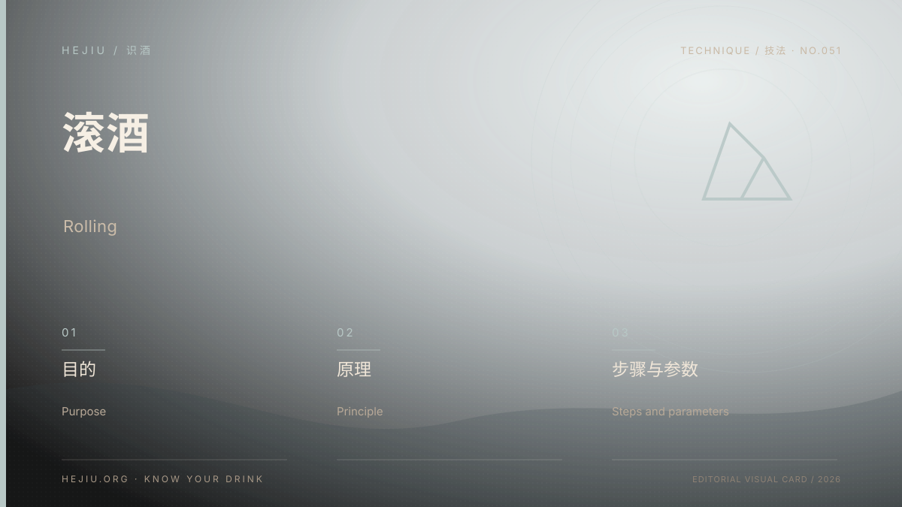

# 滚酒

滚酒（rolling）是把酒液在两个容器之间反复来回倾倒的混合技法。它既不是摇和，也不是搅拌，而是借助重力让液体在转移过程中混合、接触空气并适度冷却。滚酒在吧台并不算最常见的技法，但当配方明确要求时，它往往对应着特定的口感目标。

图：滚酒 双语视觉卡（项目自绘 SVG）。不是实拍。

## 目的

滚酒的第一个目的，是温和地混合。酒液在容器之间来回流动，产生适度的湍流，足以让不同密度的原料融合，却不像摇和那样剧烈。

第二个目的，是控制充气量。滚酒会让酒液形成细流并暴露在空气中，带来少量充气，但不会像摇和那样打出大量泡沫。对于希望口感略柔、又不想要厚泡沫的配方，这是一个中间选项。

第三个目的，是在有冰的情况下完成冷却与稀释。滚酒如果使用冰块，冰在转移过程中与酒液接触，带来冷却与稀释，但速度通常比摇和慢。配方是否加冰、加多少冰，会直接改变成品。

第四个目的，是呈现。把酒液从高处倒回杯中，本身带有动作感；但滚酒首先是混合技法，不应只为了表演而使用。

## 原理

滚酒的混合动力来自重力与流动。液体从一个容器落入另一个容器时，形成细流与冲击，产生剪切与扰动；反复来回，混合逐渐均匀。与摇和相比，滚酒的剪切力更低，气泡引入更少，容器内的压力也几乎不变。

与搅拌相比，滚酒的充气更多。搅拌主要让液体在冰与吧勺之间流动，接触空气有限；滚酒的细流会持续暴露在空气中，因此能带来轻微的通气感。两种技法都温和，但结果并不相同。

稀释取决于冰。若配方使用冰块，冰在每次转移中都会接触酒液并融化；转移次数越多、冰越小，稀释越快。若配方不加冰，滚酒主要是混合与充气，不会带来明显降温。

## 步骤与参数

第一步，准备两个干净、稳定的容器。常见组合是摇酒壶的一端与另一端，或摇酒壶与搅拌杯；不建议两个玻璃杯直接互倒，因为碰撞与温度变化都可能让玻璃破裂。

第二步，按配方把原料放入其中一个容器。需要加冰的配方，此时加入冰块；不需要加冰的配方，则只放液体。

第三步，把容器靠近，保持稳定的高度差，缓慢而持续地倒入另一个容器。倒得太高会溅出，也会引入过多空气；倒得太低则混合不足。

第四步，再倒回原容器，如此反复。来回次数应由配方或目标口感决定，没有统一的“标准次数”；配方若给出次数或描述，应优先遵循。

第五步，完成后把酒液留在最终容器中，必要时过滤，再按配方装饰与出品。

第六步，立即清洗两个容器。含糖、奶油或果汁的残留会干结，也会影响下一次使用。

滚酒的操作参数——高度差、流速、来回次数——没有通用数值。它们取决于容器形状、液体黏度、是否加冰与配方目标；把某一组数字当作标准，反而容易做出与配方不符的成品。

## 适用与替代

滚酒适合配方明确要求滚酒的酒款，也适合需要温和混合、少量充气且不希望产生厚泡沫的场合。部分以香气或细腻口感为重点的配方会采用这种方式，让酒液融合而不被剧烈搅动。

它不适合需要快速冷却与明显稀释的配方。摇和在这两点上效率更高。它也不适合含大量果肉或需要乳化的原料；滚酒的剪切力不足以充分打散固体或油脂。

替代方案包括：需要更少充气时改用[搅拌](ref:stirring)；需要更快冷却、更多稀释或泡沫时改用[摇和](ref:shaking)；只需要混合而不介意少量气泡时，也可以用吧勺轻柔搅拌。选择哪一种，取决于配方要的口感，而不是技法的“难度”。

需要区分的是“滚压柑橘”。把整颗柑橘在台面上滚动、轻压，是为了让果皮与果肉稍微软化、方便榨汁，这属于备料动作，不是滚酒。两者中文里都可能出现“滚”字，但目的与对象完全不同。

## 常见失败点

第一，两个玻璃杯直接互倒。碰撞、温差与受力都可能让杯子破裂，应使用金属摇酒壶或专用容器。

第二，倒得太高。酒液飞溅，台面变脏，也会引入过多空气。

第三，倒得太慢。液体沿容器壁流下，混合不足，来回多次仍然不均匀。

第四，容器不稳。手滑或桌面晃动会让酒液洒出，也可能打翻冰块。

第五，用热液体。热液体在密闭或半密闭容器中会产生蒸汽与压力，转移时容易烫伤。

第六，来回次数过多。加冰的配方会因此过度稀释，香气也被过度充气冲散。

第七，容器不洁。残留的果汁与糖会让下一杯带上异味，也可能堵塞滤器。

第八，把滚酒当成摇和的替代品。两者在冷却速度、稀释与泡沫上差异明显，不能随意互换。

## 练习方法

先用清水练习。把水从一个金属摇酒壶倒入另一个，保持稳定高度，观察水流是否连续、是否有飞溅；再练习倒回，形成固定节奏。

接着在水中加入冰块，观察冰块的移动与水的清澈度变化。练习控制高度与速度，让冰块在容器内移动而不是飞出。

最后用实际配方练习，对比滚酒与摇和、搅拌的成品差异。记录香气、泡沫、温度感与稀释程度，建立自己的判断。练习时在水槽或托盘上方操作，减少清理负担。

## 常见误区

第一，“滚酒就是摇和”。滚酒没有剧烈摇晃，压力与泡沫都更少，冷却也更慢。

第二，“滚酒不需要冰”。是否加冰由配方决定；加冰才有明显冷却与稀释。

第三，“任何两个杯子都能互倒”。玻璃杯互倒有破裂风险，应选择稳定、耐冲击的容器。

第四，“滚得越久越好”。过度滚酒会让加冰配方过度稀释，也会让香气散失。

第五，“滚酒可以替代搅拌”。两者都温和，但充气量与操作方式不同，应按配方选择。

第六，“滚酒只是为了好看”。它确实改变混合与充气，不能只当作表演动作。

相关条目：[摇酒壶](ref:shaker)。

## 另见

- [搅拌](ref:stirring)：更温和、充气更少的混合方式。
- [摇酒](ref:shaking)：更快冷却、更多稀释与泡沫的方式。
- [摇酒壶](ref:shaker)：滚酒常用的容器之一。
- [搅拌杯](ref:mixing)：另一种可用的容器与搅拌场景。
- [调酒基础](ref:basics)：混合方式在整体流程中的位置。
