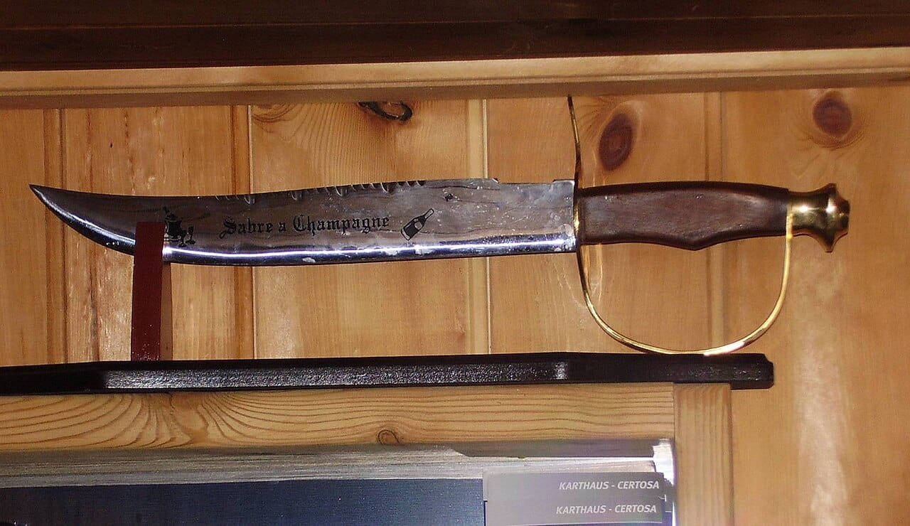

# 军刀开香槟

军刀开香槟（sabrage）是用一把军刀或专用香槟刀，沿瓶颈的接缝快速滑开瓶口，让瓶口与瓶塞在瓶内压力作用下一起飞出。它不是“砍”，而是“滑”：刀背沿接缝快速移动，撞击瓶口凸缘，玻璃环断裂，瓶塞被压力推出。

这个动作有表演性，也有风险。瓶内压力很高，瓶口飞出的速度很快；操作不当，玻璃碎片、瓶塞与酒液都可能伤人。它适合受过训练、能控制瓶身与方向的人，不适合在拥挤的室内或没有防护的场合尝试。

图：一把香槟军刀。图片：Slartibartfass，CC BY 3.0，via Wikimedia Commons（[原图页面](https://commons.wikimedia.org/wiki/File:Champagners%C3%A4bel_Bellavista.jpg)）。

## 原理与压力

香槟瓶内压力通常高于大气压数倍，瓶塞与瓶口被金属丝与瓶口结构固定。军刀沿瓶颈接缝滑过，撞击瓶口凸缘，使玻璃环产生裂纹；裂纹扩展，瓶口环断裂，瓶塞与瓶口在压力下飞出。

接缝是瓶身最薄弱的环节之一。瓶口环与瓶身的连接处，玻璃厚度变化，应力集中；沿接缝撞击，能让裂纹沿着结构扩展，而不是把整个瓶身击碎。刀背比刀刃更安全，因为它不切割，只传递冲击。

温度影响压力。温度越高，瓶内压力越大，开瓶越猛烈；温度越低，压力越小，动作越安全。军刀开香槟通常要求瓶子充分冰镇，既是为了安全，也是为了让气泡稳定。

## 历史与传说

军刀开香槟的起源有多种说法，最常见的是拿破仑时期的骑兵传说：骑兵在马上用军刀开瓶，庆祝胜利。这个故事的真实性难以考证，但它让 sabrage 成为“庆祝”与“仪式”的象征。

19 世纪，香槟进入更多宴会与庆典，军刀开瓶从军事传说变成宴会表演。今天的香槟协会与酒商，更多强调安全与规范：冰镇、稳瓶、方向、距离，而不是“越猛越好”。

传说归传说，动作的原理是物理。理解压力、接缝与温度，比记住故事更重要；没有这些条件，军刀开瓶只是危险的表演。

## 适合什么场合

军刀开香槟适合庆典、婚礼、发布会与户外活动，也适合经过训练的侍酒师表演。它需要空间、光线与安全距离；不适合拥挤的室内、低矮的天花板或靠近人群的餐桌。

它只适合香槟与部分起泡酒瓶。香槟瓶的玻璃厚度与形状经过设计，能承受瓶内压力；普通起泡酒瓶不一定适合，尤其是薄壁瓶。不要用军刀开普通的静止葡萄酒瓶。关于起泡酒，可以参考[起泡酒](ref:bubbly)；关于温度，可以参考[加冰与温度](ref:ice)。

它不适合替代常规开瓶。日常饮用，拇指控制、缓慢旋转瓶身更安全、更安静；军刀开瓶是“表演”，不是“必需”。关于常规开瓶，可以参考[开瓶（起泡酒）](ref:opening)。

## 动作与安全

第一步，冰镇。瓶子要在冰桶中充分冷却，温度低、压力小；不要用刚拿出冰箱的瓶子，也不要摇晃。

第二步，擦瓶。擦干瓶身，去掉水与冰，避免手滑；瓶口与接缝要干净，没有封帽残留。

第三步，找接缝。瓶身通常有一条垂直接缝，瓶口环与接缝相交；刀背沿这条线滑向瓶口凸缘。

第四步，稳瓶。一只手握住瓶底，瓶身倾斜约 30 到 45 度，瓶口朝向空旷、无人、无玻璃的方向；不要朝向人脸、灯具或窗户。

第五步，滑刀。刀背沿接缝快速、果断地滑向瓶口，撞击凸缘；不要犹豫，也不要用力砍。瓶口飞出后，立即稳住瓶身，避免酒液喷出。

## 风险与防护

玻璃碎片是主要风险。瓶口环断裂时，可能有小碎片飞散；操作者与旁观者要戴护目镜，至少保持一臂以上的距离。

瓶塞与瓶口飞出速度很快，方向不可控；瓶口要朝向空旷处，不要朝向人群、宠物或易碎物品。室内操作要确认天花板高度与空间。

酒液喷出也可能造成滑倒与污染。开瓶后先用布擦拭瓶口，再倒酒；不要立即把瓶口对准酒杯，压力未完全释放时会喷溅。

军刀的选择也有讲究。专用香槟刀通常刀身宽、刀背厚，重量集中在刀背，撞击时更稳；普通军刀或装饰刀，刀背太薄，撞击力不足，也容易伤手。刀要保持干净、无油，避免滑脱；用完擦干，放在刀架或刀套里，不要随手丢在抽屉里。刀背如果有卷刃或缺口，要及时更换，缺口会让撞击方向偏移。

## 常见误区

第一，用刀刃砍。刀刃会切割玻璃，产生更多碎片；军刀开香槟用的是刀背，靠冲击而不是切割。

第二，瓶子不够冷。温度高，压力大，开瓶更猛烈，碎片飞得更远；必须充分冰镇。

第三，朝向人群。瓶口飞出的方向不可控，必须朝向空旷处；旁观者要戴护目镜。

第四，把它当日常开瓶。军刀开瓶是表演，有风险；日常饮用应该用拇指控制、缓慢旋转瓶身。关于香槟，可以参考[香槟](ref:champagne)；关于香槟笛杯，可以参考[香槟笛杯](ref:flute)。

对照阅读：[开瓶（起泡酒）](ref:opening)、[香槟笛杯](ref:flute)。

相关条目：[起泡酒](ref:bubbly)。

**关键事实。**

| 项目 | 内容 |
| --- | --- |
| 一句话定位 | 用军刀沿香槟瓶颈的接缝快速滑开瓶口，利用瓶内压力让瓶口与瓶塞一起飞出；需要冰镇、稳瓶与安全距离 |
| 适用对象 | 起泡酒、香槟笛杯、香槟 |

**来源与边界。** 本页关于「军刀开香槟」的关键事实，主要由以下来源交叉核对：Oxford University Press（军刀开香槟的历史与做法）、Encyclopaedia Britannica（香槟工艺与瓶内压力背景）、Comité Interprofessionnel du vin de Champagne（香槟服务与开瓶建议）等 5 条来源。价格、批次与状态会变，涉及这些字段时以页面所列来源的最新版本为准。正文为项目自写，来源只作核验，不复制原文。

**并读。** 把「军刀开香槟」与「开瓶（起泡酒）」、「起泡酒」、「香槟笛杯」放在一起读时，先确认它们是同一层级还是上下游关系：先确认动作目的与工具，再比较力度、节奏与常见失误。本页负责给出技法的基本坐标，对照条目补上具体案例与差异；读完再回到本页，才能分清哪些差别属于技法本身，哪些只是产地、批次或品牌选择。

**适用边界。** 对「军刀开香槟」而言，动作要点会因工具与酒种调整；练习时以安全和不浪费酒为前提。

**更新提示。** 「军刀开香槟」最近核对于 2026-11-20；设备、温度、时间与操作细节会因工艺版本不同，实践前以设备说明与专业文献为准。

**编者注。** 本页把「军刀开香槟」作为技法条目处理：定义、流程与关键数字以正文表格为准，与「开瓶（起泡酒）」、「起泡酒」的差异用对照阅读验证；遇到价格、批次或地址，回到页面所列来源核对。
