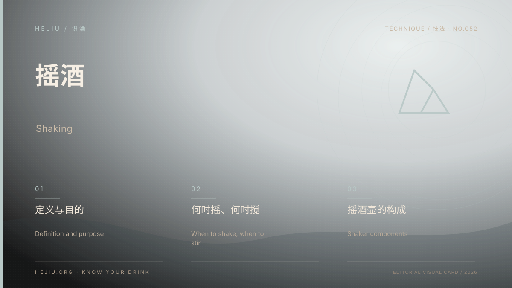

# 摇酒

摇酒（shaking，也称摇和）是把原料与冰块放入摇酒壶中快速摇晃的调酒技法。它同时完成三件事：冷却、稀释与混合。与搅拌相比，摇和的速度更快、充气更多、稀释也更明显，因此适合含果汁、奶油、蛋清或糖浆的配方，而不适合所有鸡尾酒。

图：摇酒 双语视觉卡（项目自绘 SVG）。不是实拍。

## 定义与目的

摇酒的核心目的是在短时间内让不同密度的原料充分混合，并把温度降下来。果汁、糖浆与酒精度不同的原料如果只靠搅拌，很难在短时间内融合；快速摇晃产生的湍流可以让它们迅速均匀。

摇和还会让少量空气进入酒液，形成更轻盈的口感。这种充气对含蛋清或奶油的配方尤其重要，可以产生细腻的泡沫层。但对以香气为主的清澈鸡尾酒，过多充气可能让酒体显得松散。

## 何时摇、何时搅

判断标准通常是原料与目标口感。含柑橘汁、糖浆、蛋清、奶油或果泥的配方，通常需要摇和；以酒类与苦味酒、美思为主的配方，通常适合搅拌，以保持清澈与细腻香气。

以[内格罗尼](ref:negroni)为例，国际调酒师协会的公开配方采用加冰搅拌，滤入装有冰块的古典杯。若改用摇和，也能得到类似结构，但稀释更多、口感更松，香气也更分散。技法选择会改变成品，因此配方页与技法页应分别说明。

## 摇酒壶的构成

常见的[摇酒壶](ref:shaker)由壶身、壶盖与滤冰器组成，也有两段式的波士顿摇酒壶。三段式摇酒壶密封性好，适合含蛋清或奶油的配方；两段式摇酒壶容量大、操作快，但密封与滤冰需要额外注意。

壶身材质影响导热与手感，金属壶冷却快，玻璃壶便于观察但易碎。无论哪种壶，使用前都应检查密封圈与壶盖是否完好，避免摇动时漏液或壶盖飞出。

## 基本动作

基本姿势是：一手握住壶身，另一手按住壶盖，壶身略向前倾，肘部靠近身体。摇动时以肩肘带动，保持节奏稳定，让冰块在壶内来回撞击，而不是上下乱甩。摇动幅度过大容易漏液，幅度过小则混合不足。

摇和时间通常为十几秒，具体取决于配方、冰块大小与目标稀释度。摇到壶身外壁结霜、手感明显变冷，是常见的判断信号。摇完后应立即通过滤冰器滤入杯中，避免冰块继续融化稀释。

## 冰与稀释

冰块是摇和的重要组成部分，不只是冷却介质。冰块在摇动中融化，带来稀释，也影响最终[酒精度](ref:abv)与口感。使用大块、干燥的冰，融化慢，稀释更可控；使用碎冰，冷却快但稀释也快。

如果配方要求较高浓度，应减少摇和时间或使用更大的冰块；如果希望口感更柔和，可以适当延长摇和。稀释不是失误，而是配方设计的一部分，关键是能否稳定复现。冰块形状也会影响摇和：方形大冰融化较慢，碎冰冷却快但出水也快，需要按配方选择。冰块的质量同样重要：有异味、浑浊或融化过快的冰，会让成品带上杂味，也会让稀释难以控制。吧台通常使用洁净饮用水制作的冰块，并保持冰铲与冰桶的卫生。

## 干摇与湿摇

干摇指不加冰摇和，常用于含蛋清或奶油的配方，目的是先产生泡沫，再加入冰块进行湿摇。湿摇则是加冰摇和，完成冷却与稀释。两段式做法可以兼顾泡沫与温度，但步骤更多，需要更严格的卫生与时间控制。

干摇时原料温度较高，摇动后壶内压力上升，开盖时要小心。湿摇后如果继续放置，泡沫会逐渐消散，因此应在完成后尽快饮用。技法顺序会影响成品结构，配方应明确写出。若配方同时含酸与蛋清，先干摇可以让泡沫更稳定；先加冰湿摇则可能让泡沫被稀释，层次不明显。

## 常见失误

第一，壶盖没盖紧就用力摇，导致漏液甚至壶盖飞出。第二，冰块太少或太大，导致冷却不足或稀释失控。第三，摇动幅度过大，只有上下甩动而没有让冰块充分撞击。第四，摇完不立即滤冰，冰块继续融化，酒体变淡。

第五，所有鸡尾酒都摇和。以香气与清澈为目标的配方，搅拌往往更合适。第六，忽视卫生，摇酒壶内残留的果汁与奶油会成为微生物滋生的温床，每次使用后都应彻底清洗。

## 清洁与卫生

摇酒壶使用后应立即倒空、冲洗，避免果汁与糖浆在壶内干燥结块。含蛋清或奶油的配方更需要彻底清洗，必要时拆开滤冰器与密封圈。清洁后应晾干，避免异味与金属氧化。

吧台卫生直接影响饮品安全。生鸡蛋、奶油等原料应按食品安全要求储存与处理；摇酒壶、滤冰器与吧勺应分开清洗。技法是风味的一部分，卫生是底线，两者不能互相替代。

对照阅读：[摇酒壶](ref:shaker)、[内格罗尼配方（IBA 版本）](ref:recipe)。

## 延伸阅读

- [摇酒壶](ref:shaker)：壶型、材质与使用要点。
- [内格罗尼](ref:negroni)：搅拌型经典鸡尾酒的例子。
- [内格罗尼配方](ref:recipe)：可执行的用量、步骤与器具。
- [酒精度](ref:abv)：理解摇和稀释与成品强度。

**关键事实。**

| 项目 | 内容 |
| --- | --- |
| 一句话定位 | 把原料与冰块放入摇酒壶中快速摇晃，使酒液冷却、稀释并均匀混合的调酒技法；与搅拌相比，摇和带来更多充气与稀释 |
| 适用对象 | 内格罗尼、内格罗尼配方（IBA 版本） |

**来源与边界。** 本页关于「摇酒」的关键事实，主要由以下来源交叉核对：International Bartenders Association（官方配方所写的调制方法；鸡尾酒调制方法的通用分类）、Oxford University Press（提供关于摇和、稀释与鸡尾酒技法的条目；由原条目末尾参考资料迁移，未逐条复核访问日期）、Christopher Kimball's Milk Street（形制/工艺/馆藏背景）。价格、批次与状态会变，涉及这些字段时以页面所列来源的最新版本为准。正文为项目自写，来源只作核验，不复制原文。

**并读。** 把「摇酒」与「摇酒壶」、「内格罗尼」、「内格罗尼配方（IBA 版本）」放在一起读时，先确认它们是同一层级还是上下游关系：先确认动作目的与工具，再比较力度、节奏与常见失误。本页负责给出技法的基本坐标，对照条目补上具体案例与差异；读完再回到本页，才能分清哪些差别属于技法本身，哪些只是产地、批次或品牌选择。
