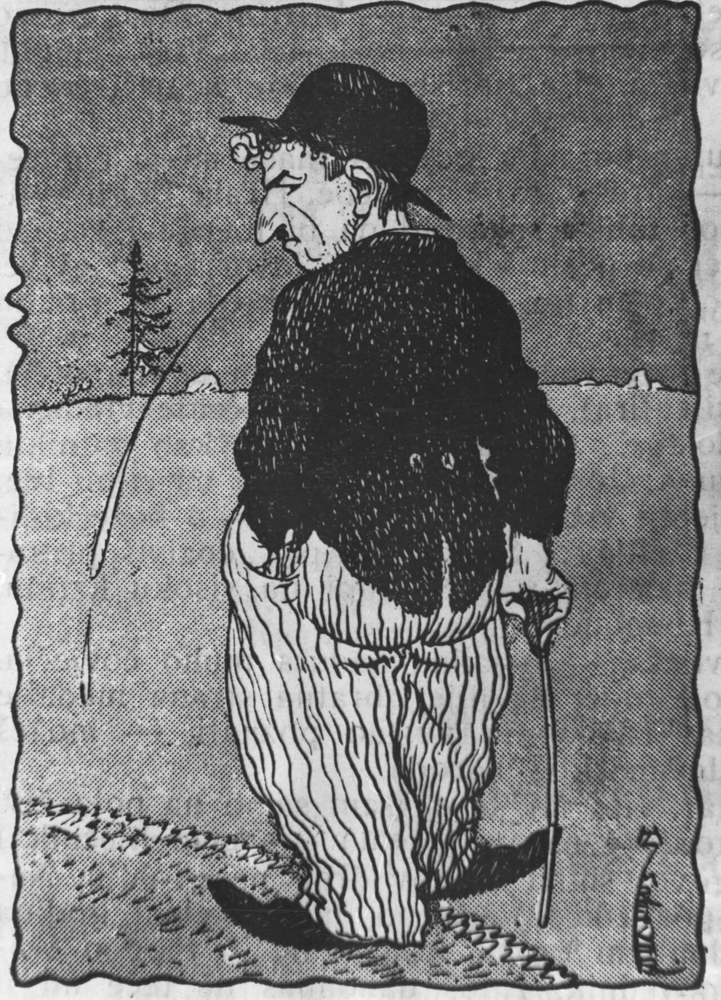

# 吐酒

吐酒（spitting）是专业品鉴的基本动作：把酒液含在口中，让它在舌面与口腔内充分接触，然后把酒吐进吐酒桶。它的目的不是拒绝这杯酒，而是在不摄入大量酒精的前提下完成评估。酒展、评审、酿酒师品鉴与侍酒师考试中，吐酒是标准做法。

图：吐酒。图片：Hinko Smrekar，Public domain，via Wikimedia Commons（[原图页面](https://commons.wikimedia.org/wiki/File:Hinko_Smrekar_-_Avtoportret_kot_Charlie_Chaplin.jpg)）。

## 目的

第一是保持清醒。连续品评十几款甚至几十款酒时，即使每口只喝一点，累积酒精也会影响判断与安全。第二是保护感官。酒精会麻痹味觉与嗅觉，也会让口腔干燥，吐酒能减少这种干扰。

第三是控制摄入。品鉴的目标是收集信息，不是饮酒。第四是礼貌与职业性。在专业场合，吐酒表示你在认真评估，而不是来喝酒；对同场的人也是一种尊重。

吐酒并不等于浪费。用于品鉴的酒量本来就很小，吐出的部分不会改变酒庄或主办方的成本结构。真正需要避免的是开瓶后不喝、让酒氧化变质。

## 工具与场地

最基本的工具是吐酒桶。常见吐酒桶带有漏斗状开口与较大的桶身，有些还带盖或挡板，减少飞溅与气味扩散。桶应放在伸手可及、略低于口腔的位置，避免吐的时候需要弯腰或抬高下巴。

还需要纸巾或布、清水与记录工具。纸巾用于擦拭杯口与嘴角；清水用于在酒款之间漱口，但不必每次都大量漱口，以免残留水稀释下一款酒。场地应通风，桶内液体应及时处理，避免气味积累。

家庭品鉴可以用带盖的小桶、宽口容器或在厨房水槽旁进行。关键是容器够深、开口够大、位置稳定，且不会因为反溅弄脏衣物与桌面。

## 操作步骤

第一步，按[入口](ref:sipping)的方式取少量酒液，约五到十毫升，让它在口腔内铺开，停留两到三秒。不要为了吐酒而草草含一下就吐，接触时间不足会漏掉中段风味。

第二步，微微低头，把嘴唇靠近桶口，保持上身稳定。第三步，用短促、可控的力道把酒液吐出，让液体落入桶中，而不是喷散。第四步，吐完后用纸巾轻擦嘴角，避免酒液残留。

第五步，必要时用少量清水漱口，再把水吐入桶中。第六步，立即记录。吐酒之后，余味仍会在口腔与鼻腔停留一段时间，这是判断[余味](ref:finish)的时机，不要马上用清水把一切冲掉。

## 参数与节奏

入口量决定接触是否充分，也决定吐出的难度。量太少，酒液无法覆盖口腔；量太多，吐的时候容易呛到或溅出。五到十毫升是常见范围，烈酒可以更少。

吐酒的频率应与品鉴节奏匹配。每一款酒都应先闻香、再入口、再吐出、再记录，形成固定循环。连续快速吐酒而不记录，会让不同酒款的印象混在一起。

酒精摄入需要估算，而不是凭感觉。以十毫升、酒精度百分之十二的酒为例，一口约含一点二毫升纯酒精；即使大部分吐出，口腔黏膜仍会吸收少量。品评款数多时，应安排休息、补充水分，并且不要驾车。吐酒不能作为“可以开车”的理由。

## 失败案例

第一，只吐一半。酒液在口腔后部残留，被本能吞下，既影响判断也增加摄入。第二，桶的位置太高或太远。为了对准桶口而仰头或前倾，容易呛咳或溅出。

第三，吐得太用力。酒液在桶中反弹，可能溅到衣物、桌面或旁人。第四，吐入自己的酒杯或水杯。这会污染器具，也会让后续品评失真。

第五，吐完立即大量漱口。清水会冲掉余味，错过判断余味长度的时机。第六，共用吐酒桶却不注意卫生。桶口不应接触嘴唇，保持距离，必要时使用挡板。

第七，把吐酒当成酒量测试的替代。吐酒减少摄入，但不等于零摄入；品鉴结束后仍应确认状态再决定是否驾车。

## 练习方法

第一步是用水练习。用清水代替酒，练习从入口到吐出的轨迹与力度，确认不会溅出、不会呛到。第二步是镜前练习。观察自己的头位、肩部与手部是否稳定，避免吐的时候身体晃动。

第三步是节奏练习。准备三到五款不同的饮品，按“闻香、入口、吐出、记录”的固定顺序完成一轮，记录每款的余味时间。第四步是场地布置练习。把桶放在不同高度与距离，找出自己最稳定、最不容易溅出的位置。

练习的重点是形成肌肉记忆，让吐酒成为不需要思考的动作，把注意力留给感官判断。

## 与其他环节的关系

吐酒承接[入口](ref:sipping)，但不终止品鉴。吐出之后，香气与余味仍会在鼻腔与口腔中延续，因此记录应在吐后立即进行。把吐酒当成“结束”，会漏掉余味这一项。

吐酒也影响品鉴会的组织。款数多、酒精度高的场合，应准备足够的吐酒桶、纸巾与清水，并安排座位与动线，避免人与人之间互相干扰。主办方如果把吐酒视为不礼貌，往往会让参与者被迫摄入过多酒精，反而降低品鉴质量。

## 常见误区

第一，吐酒是不尊重酒。专业品鉴中吐酒是标准动作，与喜不喜欢这款酒无关。

第二，吐酒等于没有喝到。香气、口感与余味在吐出前已经接触，吐酒不影响大部分感官评估。

第三，吐完就不会摄入酒精。口腔黏膜仍会吸收少量酒精，品评后不应立即驾车。

第四，吐酒可以随便找地方。容器、位置与卫生都会影响安全与体验，应提前布置。

第五，吐酒越快越专业。过快会漏掉中段风味，也会让记录变得粗糙。

吐酒不是把酒吐回杯中或桌上，而是吐入专用吐酒桶；在餐厅里随意吐酒会被视为失礼，先确认场地是否提供吐酒容器。

## 延伸阅读

- [入口](ref:sipping)：吐酒之前的入口与口腔接触。
- [余味](ref:finish)：吐出之后仍需判断的维度。
- [酒精度](ref:abv)：理解摄入量与酒精浓度的关系。
- [葡萄酒](ref:wine)：葡萄酒专业品鉴的基本流程。
- [白酒](ref:baijiu)：白酒品评中的小杯与吐酒习惯。
- [第一次品鉴](ref:tasting)：从观色到吐酒的完整入门流程。
