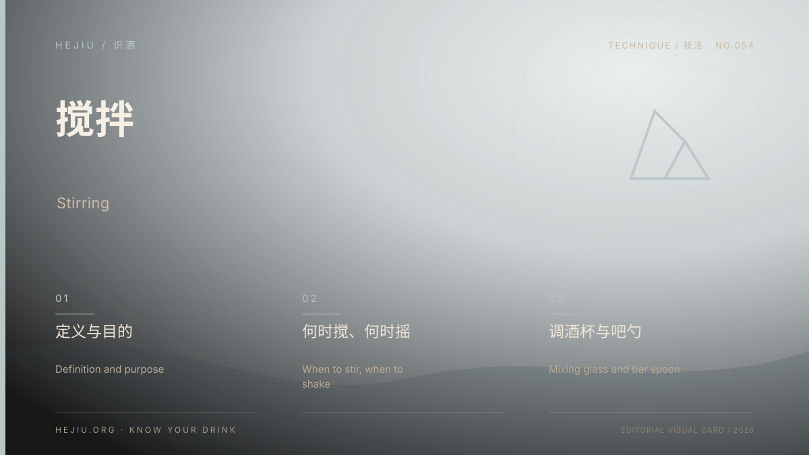

# 搅拌

搅拌（stirring）是把原料与冰块放入调酒杯，用吧勺稳定搅动的调酒技法。它主要完成三件事：降温、适度稀释与混合。与[摇酒](ref:shaking)相比，搅拌带入的空气少、冰屑少，成品更清澈，香气也更细腻，因此适合以酒类为主的短饮。

图：搅拌 双语视觉卡（项目自绘 SVG）。不是实拍。

## 定义与目的

搅拌的核心目的是让不同原料在低温下均匀混合，同时只带入可控的稀释。金酒、味美思、苦味酒这类原料密度与黏度接近，搅拌足以让它们融合；不需要像果汁、糖浆那样依靠剧烈摇晃来打散。

搅拌不追求“越冷越好”，而是追求“够冷、稀释合适”。温度太低需要更长时间，稀释也随之增加；温度不够则香气封闭、入口发刺。目标是找到一个稳定可复现的平衡点，而不是追求某个固定秒数。

家庭环境没有调酒杯时，可以用厚壁直身玻璃杯替代，容量要足以让冰块与吧勺同时活动。杯口过窄会让吧勺难以顺畅搅动，杯壁过薄则容易在搅拌时传递热量，也可能在碰撞中裂开。

## 何时搅、何时摇

判断标准通常是原料与目标口感。以酒类、苦味酒、味美思为主的配方，通常适合搅拌；含柑橘汁、糖浆、蛋清、奶油或果泥的配方，通常需要摇和。前者追求清澈与细腻香气，后者需要充分混合与充气。

以[干马天尼](ref:martini)为例，国际调酒师协会的公开配方采用加冰搅拌，滤入预冷的杯中。若改用摇和，也能得到类似结构，但稀释更多、口感更松，香气也更分散。[古典配方](ref:old-fashioned)则是在杯中直接搅拌，不经过滤冰，属于另一种直调方式。技法选择会改变成品，配方页应写明采用哪一种。

## 调酒杯与吧勺

常见的调酒杯是玻璃或金属的直身杯，容量足以容纳原料与足量冰块。玻璃杯便于观察颜色与稀释，金属杯降温更快。无论哪种，使用前都应预冷或至少冲洗干净，避免残留气味。

[吧勺](ref:spoon)是搅拌的主要工具：勺柄细长，便于沿杯壁搅动；勺头小，便于控制幅度。使用时应握住勺柄中上部，让勺头在冰块之间穿行，而不是把冰块搅得上下翻飞。

## 基本动作

基本姿势是：一手扶住杯身，另一手持吧勺，勺头插入冰块之间，沿杯壁做稳定的圆周运动。搅拌幅度不宜过大，幅度过大只会让冰块剧烈撞击、加速融化；幅度过小则混合不均。

搅拌时间通常为十几秒到二十几秒，取决于冰量、冰型、杯子的预冷程度与目标稀释度。常见的判断信号是杯壁明显变冷、杯外出现水汽。搅拌完成后应立即滤冰，避免酒液继续浸泡在融水中。

## 冰与稀释

冰块是搅拌的重要组成部分，不只是冷却介质。冰块在搅动中融化，带来稀释，也影响最终[酒精度](ref:abv)与口感。使用大块、干燥的冰，融化慢，稀释更可控；使用碎冰或湿冰，冷却快但稀释也快。

如果配方要求较高浓度，应减少搅拌时间或使用更大的冰块；如果希望口感更柔和，可以适当延长搅拌。稀释不是失误，而是配方设计的一部分，关键是能否稳定复现。冰块质量同样重要：有异味、浑浊或融化过快的冰，会让成品带上杂味。关于冰型的进一步说明，可参考[加冰与温度](ref:ice)。

## 滤冰与出品

搅拌完成后需要滤冰。常见做法是使用滤冰器或细滤网，把酒液滤入预冷或装有冰块的杯中。滤冰要快，避免酒液在滤网中停留过久；滤冰器与滤网应保持清洁，避免残留气味。

滤入装有冰块的杯子（例如古典杯）时，杯中的冰会继续降温，但也会继续稀释；滤入空杯（例如马天尼杯）时，成品温度更稳定，但回温更快。两种出品方式对应不同的饮用节奏，配方应写清楚。

没有滤冰器时，可以用细滤网或干净的茶滤替代，但不要用力压挤冰块，以免碎冰落入杯中。滤网用完应立即冲洗，残留的酒液与糖分会吸引灰尘与昆虫。

## 常见失误

第一，冰量不足。冰少会让降温不够，稀释失控，成品偏烈且香气不展开。第二，搅拌幅度过大。剧烈搅动只会让冰块快速融化，稀释难以控制。第三，搅拌时间过短。杯壁没有充分冷却，入口会显得刺。

第四，搅拌后不立即滤冰。冰块继续融化，酒体变淡。第五，调酒杯不干净。残留的果汁或洗涤剂会污染成品。第六，所有鸡尾酒都用搅拌。含果汁、糖浆或蛋清的配方，搅拌难以充分混合。

## 清洁与卫生

调酒杯与吧勺使用后应立即冲洗，避免糖浆与果汁干燥结块。玻璃杯注意杯底与杯壁交界处的残留，金属杯注意内壁的划痕。清洁后应晾干，避免异味。

吧台卫生直接影响饮品安全。吧勺、滤冰器与调酒杯应分开清洗；接触过生蛋、奶油等原料的工具更应彻底清洁。技法是风味的一部分，卫生是底线，两者不能互相替代。

对照阅读：[吧勺](ref:spoon)、[干马天尼](ref:martini)。

## 延伸阅读

- [吧勺](ref:spoon)：勺型、握法与使用要点。
- [干马天尼](ref:martini)：搅拌型经典鸡尾酒的例子。
- [干马天尼配方](ref:recipe)：可执行的用量、步骤与器具。
- [古典配方](ref:old-fashioned)：在杯中直调与搅拌的另一种做法。
- [酒精度](ref:abv)：理解搅拌稀释与成品强度。

**关键事实。**

| 项目 | 内容 |
| --- | --- |
| 一句话定位 | 把原料与冰块放入调酒杯，用吧勺沿杯壁稳定搅拌，使酒液冷却、适度稀释并均匀混合的调酒技法；与摇和相比，搅拌充气少、成品更清澈 |
| 适用对象 | 干马天尼、古典、干马天尼配方（IBA 版本） |

**来源与边界。** 本页关于「搅拌」的关键事实，主要由以下来源交叉核对：International Bartenders Association（官方配方所写的搅拌方法与成品杯型；确认该饮品属于 IBA 官方鸡尾酒名单）、Oxford University Press（搅拌、稀释与鸡尾酒技法的一般背景）、Dave Arnold / W. W. Norton（温度、冰型与稀释对搅拌成品的影响）。价格、批次与状态会变，涉及这些字段时以页面所列来源的最新版本为准。正文为项目自写，来源只作核验，不复制原文。
