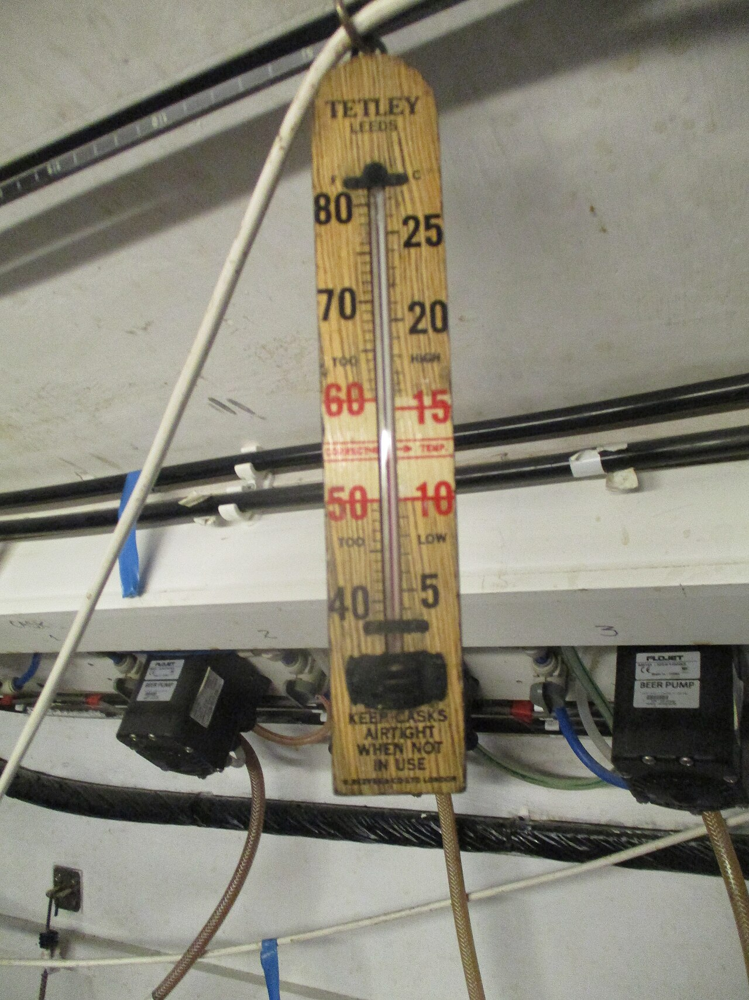

# 温度控制

温度控制是通过冷藏、冰桶、室温回温与储存管理，让酒液在合适温度饮用。它不是“越冷越好”，也不是“室温就行”，而是“让酒液到达它需要的温度，并尽量稳定”。

温度影响香气、气泡、口感与发酵。温度太低，香气被压住；温度太高，酒精挥发快，口感变松；温度波动大，酒液反复热胀冷缩，瓶塞与酒质都受影响。

图：酒窖里的温度计。图片：Mtaylor848，CC BY-SA 4.0，via Wikimedia Commons（[原图页面](https://commons.wikimedia.org/wiki/File:Tetley%27s_thermometer,_cellar,_New_Inn,_Wetherby_(4th_December_2022).jpg)）。

## 原理与变量

温度控制的核心，是热传递。空气传热慢，水传热快，金属传热更快；因此，冰桶比冰箱快，金属杯比玻璃杯快。控制温度，先要选对传热介质。

环境温度、瓶身温度与酒液温度不是一回事。瓶壁温度受环境影响，酒液温度受瓶壁与时间影响；用红外温度计测瓶壁，只能作为参考；要测酒液，得用探针。

温度变化的速度也重要。骤冷会让玻璃产生应力，骤热会让瓶内压力升高；温度控制要“缓慢、稳定”，而不是“快速、极端”。关于测量，可以参考[温度计](ref:thermometer)。

## 不同酒的适饮温度

起泡酒通常 6 到 8 摄氏度，低温能保留气泡，也能让酸度更清爽；白葡萄酒通常 8 到 12 摄氏度，轻盈的白酒偏低，饱满的白酒偏高；桃红通常在 8 到 12 摄氏度。

红葡萄酒通常 14 到 18 摄氏度，轻盈的红酒偏低，饱满的红酒偏高；甜酒通常 6 到 10 摄氏度，低温能平衡甜度；烈酒通常室温或略低，具体要看风格与饮用方式。

这些数字是范围，不是标准答案。同一款酒，不同年份、不同杯型、不同场合，适饮温度可能不同；先按范围，再按口感调整。关于加冰，可以参考[加冰与温度](ref:ice)。

## 降温的方法

冰桶是最快的降温方式。冰水混合，水位没过酒液，15 到 30 分钟能让一瓶酒降到适饮温度；冰桶适合起泡酒、白葡萄酒与需要快速降温的红酒。关于冰桶，可以参考[冰桶](ref:bucket)。

冰箱适合长时间储存与缓慢降温。冰箱温度稳定，但降温慢；一瓶白葡萄酒从室温降到适饮温度，可能需要 1 到 2 小时。不要把酒长期放在冰箱门上，温度波动大。

冷冻室不适合快速降温。冷冻会让玻璃产生应力，也可能让瓶塞冻结、酒液膨胀；除非是应急，不要用冷冻室。降温要慢，不要用“极端手段”。

## 升温的方法

室温回温是最安全的方式。把酒从冰箱取出，放在室温下 20 到 40 分钟，让酒液缓慢回到适饮温度；红葡萄酒从酒窖取出，也常需要回温。

手心捂杯是快速的升温方式。手掌的温度传进杯壁，让酒液略暖；但手心也会让香气集中，适合品鉴，不适合大量服务。不要用热水冲瓶，骤热会让玻璃破裂。

温水浴可以加速回温。把酒瓶放进温水（不超过 30 摄氏度），让水温慢慢传递；水温不能太高，也不能让瓶塞进水。升温要慢，不要用微波炉或热水壶。

## 储存温度

储存温度要稳定。酒窖或酒柜的温度通常 12 到 14 摄氏度，湿度 60% 到 70%；温度波动比绝对数值更伤酒。温度高，酒熟得快；温度低，酒熟得慢。

温度波动会让瓶塞反复膨胀收缩，空气进入，酒液氧化；湿度太低，瓶塞干裂；湿度太高，标签发霉。储存要避光、避震、避异味。

长期储存与短期饮用要分开。长期储存用酒柜或酒窖；短期饮用可以放冰箱，但不要超过几天；开瓶后的酒，要冷藏并尽快喝完。关于香气，可以参考[香气](ref:aroma)。

温度之所以重要，是因为它改变分子的运动。温度升高，香气分子挥发更快，酒精也更容易刺鼻；温度降低，分子运动变慢，香气被“锁住”，口感也显得更紧。不是所有香气都在同一温度下表现最好，所以适饮温度是因酒而异的。

温度还改变甜感与酸感。低温会让甜味显得不那么突出，酸味显得更清爽；升温会让甜味更明显，也会让酸味显得更柔。甜酒要低温，是为了平衡甜度；白葡萄酒要低温，是为了让酸度更清爽；红葡萄酒温度稍高，是为了让单宁与香气展开。

气泡也受温度影响。二氧化碳在低温下溶解得更多，气泡更细、更持久；温度升高，气泡逸出快，口感变“平”。这就是为什么起泡酒要冰镇，而不是常温饮用。

## 常见误区

第一，所有酒都冰镇。红葡萄酒长时间冰镇会压住香气；白葡萄酒也不是越冷越好。

第二，用冷冻室快速降温。骤冷会让玻璃产生应力，也可能让瓶塞冻结；降温要慢。

第三，忽略温度波动。温度反复变化比绝对温度更伤酒；储存要稳定。

第四，只凭手感判断。手感不准，也不同步；用温度计测量，比“摸着凉”更可靠。关于发酵温度，可以参考[发酵](ref:fermentation)；关于葡萄酒，可以参考[葡萄酒](ref:wine)。

对照阅读：[加冰这件事，没有标准答案](ref:ice)、[发酵](ref:fermentation)。

**关键事实。**

| 项目 | 内容 |
| --- | --- |
| 一句话定位 | 通过冷藏、冰桶、室温回温与储存管理，让酒液在合适温度饮用；温度影响香气、气泡、口感与发酵，稳定比绝对数值更重要 |
| 适用对象 | 葡萄酒 |

**来源与边界。** 本页关于「温度控制」的关键事实，主要由以下来源交叉核对：Oxford University Press（酒水温度与服务背景）、Encyclopaedia Britannica（葡萄酒温度与发酵背景）、Comité Interprofessionnel du vin de Champagne（照起泡酒的饮用温度与服务建议）等 5 条来源。价格、批次与状态会变，涉及这些字段时以页面所列来源的最新版本为准。正文为项目自写，来源只作核验，不复制原文。

**并读。** 把「温度控制」与「加冰这件事，没有标准答案」、「葡萄酒」、「发酵」放在一起读时，先确认它们是同一层级还是上下游关系：先确认动作目的与工具，再比较力度、节奏与常见失误。本页负责给出技法的基本坐标，对照条目补上具体案例与差异；读完再回到本页，才能分清哪些差别属于技法本身，哪些只是产地、批次或品牌选择。

**适用边界。** 对「温度控制」而言，动作要点会因工具与酒种调整；练习时以安全和不浪费酒为前提。

**更新提示。** 「温度控制」最近核对于 2026-11-20；设备、温度、时间与操作细节会因工艺版本不同，实践前以设备说明与专业文献为准。

**编者注。** 本页把「温度控制」作为技法条目处理：定义、流程与关键数字以正文表格为准，与「加冰这件事，没有标准答案」、「葡萄酒」的差异用对照阅读验证；遇到价格、批次或地址，回到页面所列来源核对。
