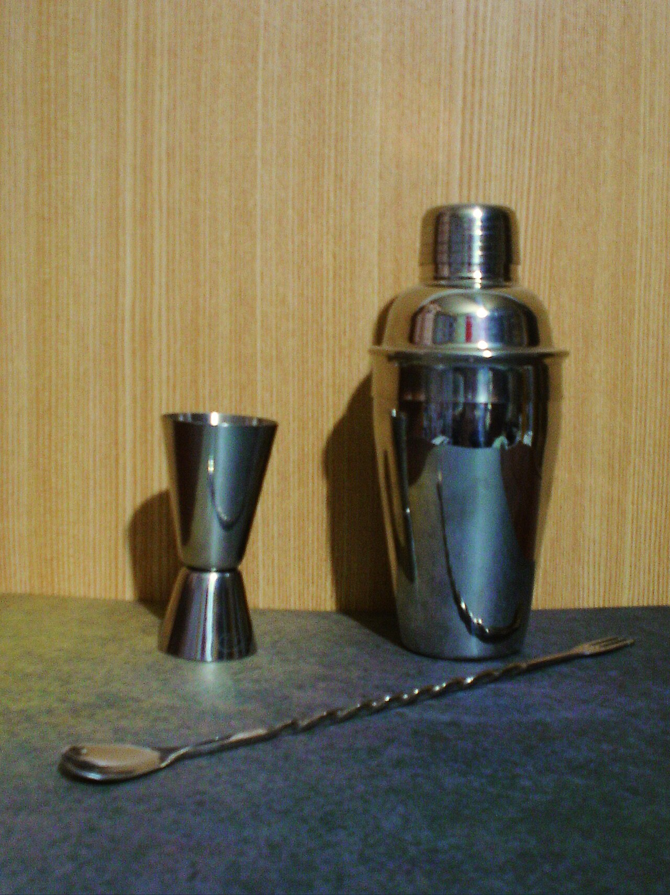

# 吧勺

吧勺（bar spoon）是调酒用的长柄勺，勺头一端用于量取少量液体，勺柄用于搅拌，螺旋状的杆身则便于手指控制与引导倾倒。它看起来简单，却是搅拌型鸡尾酒的基本工具：长度、重量与勺头容量都会影响操作效率与成品口感。

图：吧勺。图片：Wikimedia Commons contributor，CC BY-SA 3.0，via Wikimedia Commons（[原图页面](https://commons.wikimedia.org/wiki/File:Cocktail_shaker_set.JPG)）。

## 定义与形制

吧勺通常由不锈钢制成，长度从 25 厘米到 40 厘米不等。勺头容量常见为 5 毫升左右，也有更小或更大的规格。勺柄中段常有螺旋纹，既增加握持摩擦力，也方便在搅拌时让手指沿杆滑动。

形制上还有带叉端或带弹簧端的款式，用于夹取装饰或过滤。不同形制服务于不同动作，但核心功能仍是搅拌与引导。选择时应先确认长度是否适配常用杯型与搅拌杯，而不是只看外观。

## 尺寸与容量

长度决定能否深入高杯或搅拌杯，也影响搅拌时的手部姿势。过短的勺子在高杯中难以触及底部，搅拌不充分；过长的勺子在浅杯中不易控制，容易碰倒杯壁。常见吧台会根据杯型准备不同长度的吧勺。

勺头容量影响量取精度。以勺计量时，应确认勺头实际容量，而不是凭“一勺”估算。配方中的少量糖浆、苦味酒或柠檬汁，用勺量取可以提高一致性，但专业出品仍建议使用量酒器或电子秤。

## 搅拌动作

搅拌的目的是冷却、稀释与均匀混合，同时尽量保持酒体清澈。基本动作是把吧勺插入装有冰块的搅拌杯，勺背贴近杯壁，手指沿螺旋杆轻轻转动，让冰块与酒液缓慢流动。动作应稳定、连续，而不是剧烈搅动。

搅拌时间取决于冰块大小、酒液温度与目标稀释度。搅拌到杯壁结霜、手感明显变冷，是常见的判断信号。搅拌结束后应通过滤冰器滤入预冷杯中，避免冰块继续融化。动作与时间控制，比工具本身更能决定成品。如果要稳定复现，可以记录搅拌圈数或时间，并在相同冰块条件下比较结果。

## 与摇和的对比

搅拌与[摇酒](ref:shaking)是两种不同的技法。摇和通过剧烈摇晃带来更多充气与稀释，适合含果汁、蛋清或奶油的配方；搅拌则更温和，适合以酒类、苦味酒与美思为主的配方，能保持清澈与细腻香气。

[内格罗尼](ref:negroni)的 IBA 配方采用加冰搅拌，滤入装有冰块的古典杯。若改用摇酒壶，成品稀释更多、口感更松。吧勺与[摇酒壶](ref:shaker)不是替代关系，而是对应不同配方目标的两套工具。

## 其他用途

吧勺还可以用于引导倾倒。把勺背贴近杯壁，酒液沿勺背流下，可以减少冲击与混合，常用于分层鸡尾酒或需要缓慢倒入的饮品。勺头也可用于量取少量液体、夹取小型装饰或调整杯中冰块。

在分层饮品中，吧勺的引导作用尤其明显：酒液沿勺背缓慢流下，密度差异得以保留，形成可见的层次。这类操作需要耐心与稳定，工具只是辅助，动作才是关键。如果勺背离杯壁太远，酒液会直接落入并打散层次；贴壁过紧又可能让流速过慢，需要根据杯型调整角度。

## 材质与保养

不锈钢吧勺耐用、易清洁，是最常见的选择。使用后应立即冲洗，避免糖浆与果汁在勺头与螺旋纹中残留；清洗后擦干，避免水渍与氧化。螺旋纹容易藏污，必要时用软刷清洁。

吧勺不宜用来敲击冰块或撬动硬物，以免弯曲变形。长时间使用后，勺头与杆身的连接处可能出现松动，应及时更换。保养得当的吧勺可以使用很久，但它终究是消耗型工具，出现明显变形就不应继续用于出品。若表面镀层脱落或出现锈斑，也不应继续接触饮品。

## 常见误区

第一，吧勺越长越好。长度应与杯型匹配，过长或过短都会影响操作。

第二，一勺就是固定容量。不同勺头容量不同，配方应写明实际毫升数。

第三，搅拌越用力越好。剧烈搅动会带入过多空气，也会让冰块过快融化。

第四，吧勺只能搅拌。它还可用于引导倾倒、量取与夹取装饰。

第五，用吧勺代替滤冰器。搅拌后的冰块需要单独过滤，吧勺不能完成滤冰。

吧勺的螺旋杆不是为了好看：它能让手指在搅拌时保持稳定，减少碰到杯壁；勺头容量也常被用来量取 1 吧勺，约 5 毫升。

吧勺容量常按约 5 毫升计，但不同品牌勺头有差异；量取前先确认勺头，别把螺旋杆当成刻度。

吧勺的螺旋杆长度影响手指位置；搅冰时用勺背贴杯壁，能减少碰撞与气泡。

## 选购建议

选购时先确认长度与常用杯型是否匹配，再检查勺头容量与杆身是否平直。螺旋纹应均匀、无毛刺，勺头与杆身的连接应牢固。家庭使用可以选择中等长度、勺头容量明确的款式；高频出品的吧台则应准备不同长度以适配杯型。

材质以不锈钢为主，表面处理影响手感与清洁难度。购买后先用清水试搅拌，确认勺头不刮杯壁、杆身不易滑手，再用于正式出品。工具的价值在于稳定复现，而不是外观。

对照阅读：[摇酒](ref:shaking)、[摇酒壶](ref:shaker)。

## 延伸阅读

- [摇酒](ref:shaking)：摇和的动作、冰与稀释控制。
- [内格罗尼](ref:negroni)：搅拌型经典鸡尾酒的例子。
- [摇酒壶](ref:shaker)：摇和工具的类型与选型。
- [内格罗尼配方](ref:recipe)：可执行的用量、步骤与器具。

**关键事实。**

| 项目 | 内容 |
| --- | --- |
| 一句话定位 | 用于搅拌鸡尾酒、引导倾倒与量取少量液体的长柄吧台工具；长度、勺头容量与螺旋杆设计影响搅拌效率与操作手感 |
| 材质 | 不锈钢 |
| 用途 | 搅拌鸡尾酒、引导倾倒与量取少量液体 |

**来源与边界。** 本页关于「吧勺」的关键事实，主要由以下来源交叉核对：International Bartenders Association（搅拌与摇和类鸡尾酒的调制方法）、Oxford University Press（提供关于吧勺、搅拌与吧台工具的条目；由原条目末尾参考资料迁移，未逐条复核访问日期）、Difford's Guide（吧台工具与搅拌技法的公开说明）。价格、批次与状态会变，涉及这些字段时以页面所列来源的最新版本为准。正文为项目自写，来源只作核验，不复制原文。
