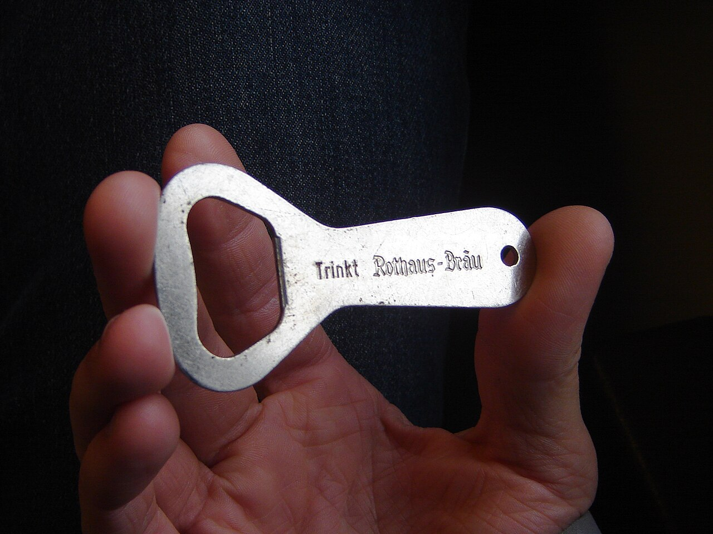

# 啤酒开瓶器

啤酒开瓶器是开启皇冠盖（crown cap）啤酒瓶的简易工具。它的结构比软木塞开瓶器简单：没有螺旋，也没有长杠杆，只有一个卡住瓶盖下缘的凹槽，以及一个向上撬的支点。

皇冠盖是玻璃啤酒瓶最常见的封口：金属盖的边缘有锯齿状的卡扣，压紧在瓶口。开瓶器的凹槽卡住盖子的下缘，向上撬，卡扣被拉开，盖子脱落。动作要稳，不要用力过猛。

图：一只简易金属开瓶器。图片：Ich，Public Domain，via Wikimedia Commons（[原图页面](https://commons.wikimedia.org/wiki/File:Bottle_Opener.jpg)）。

## 结构与类型

最常见的类型是“酒吧刀”（bar blade）：一块扁平的不锈钢片，一端有开瓶凹槽，另一端可以夹在手指间；它薄、快、适合高频使用，也常被酒吧用来开瓶。

“钥匙形”开瓶器是最古老的类型之一：一个圆环或手柄，前端有一个凹槽；它便宜、轻便，适合家庭与户外。墙挂式开瓶器固定在墙上或桌边，用杠杆省力，适合酒吧与餐厅。

还有“双头”开瓶器：一端开皇冠盖，另一端开螺旋盖或罐头；它的优点是通用，缺点是凹槽可能不够贴合，容易打滑。类型不同，选择要看使用频率与瓶型。

## 皇冠盖的原理

皇冠盖的边缘有多个卡扣，压紧在瓶口凸缘上。开瓶器的凹槽卡住盖子的下缘，向上撬，卡扣被拉开；盖子的金属有一定弹性，拉开后不会回弹，盖子就脱落了。

开瓶的角度很重要。开瓶器要与瓶口垂直，凹槽完全卡住盖子下缘；角度太斜，凹槽只卡住一部分，容易打滑，也会把盖子拉变形。

力度要稳，不要猛。猛撬会让瓶口受力过大，也可能让瓶身晃动，泡沫喷出；稳撬能让卡扣逐个脱开，盖子完整脱落。关于啤酒服务，可以参考[啤酒](ref:beer)。

## 适合什么瓶

啤酒开瓶器适合皇冠盖啤酒瓶，也适合部分玻璃瓶饮料，例如汽水、果汁与康普茶。它的凹槽尺寸要与瓶盖匹配；太小，卡不住；太大，容易滑。

它不适合螺旋盖。螺旋盖需要旋转打开，用开瓶器撬会损坏瓶口，也可能让瓶盖变形；螺旋盖应该用手或开瓶器上的螺旋功能。

它不适合软木塞。软木塞需要螺旋与杠杆，啤酒开瓶器没有这些结构；用啤酒开瓶器撬软木塞，会把塞子弄碎，也会让木屑掉进酒里。关于软木塞开瓶，可以参考[开瓶器](ref:corkscrew)。

## 使用步骤

第一步，握住瓶身。一只手握住瓶身中下部，另一只手拿开瓶器；瓶身要稳，不要晃动。

第二步，卡住凹槽。把开瓶器的凹槽卡在瓶盖下缘，确保凹槽与瓶口垂直；可以先轻轻试一下，确认卡稳。

第三步，向上撬。以开瓶器的支点为轴，向上撬；力度要稳，不要猛；听到“啪”的一声，盖子脱落。

第四步，检查瓶口。开瓶后检查瓶口是否有金属碎片或玻璃裂纹；如果有，不要饮用。开瓶器也要擦干净，避免残留物。

## 清洗与保养

开瓶器使用后要擦干净。凹槽里会残留瓶盖的金属屑与饮料，用温水冲洗，再用干布擦干；不要长时间浸泡，以免生锈。

不锈钢开瓶器可以用软布擦拭，不要用钢丝球，以免留下划痕；塑料开瓶器不要靠近高温，以免变形。墙挂式开瓶器要定期检查固定螺丝，避免松动。

存放时避免潮湿。开瓶器不要放在水槽边或潮湿的抽屉里；凹槽容易积水，长期会生锈。长期不用时，擦干后单独存放。

## 常见误区

第一，角度太斜。凹槽只卡住一部分，容易打滑；开瓶器要与瓶口垂直。

第二，用力过猛。猛撬会让瓶口受力过大，也可能让泡沫喷出；力度要稳。

第三，用啤酒开瓶器开软木塞。没有螺旋与杠杆，会把塞子弄碎；软木塞要用专用开瓶器。

第四，忽略瓶口检查。开瓶后要检查是否有金属碎片或玻璃裂纹；如果有，不要饮用。关于啤酒杯，可以参考[啤酒马克杯](ref:mug)；关于倒酒，可以参考[倒酒](ref:pouring)；关于选杯，可以参考[如何选杯](ref:glass)。

开瓶动作也会影响泡沫。开瓶时瓶内压力突然释放，二氧化碳会迅速逸出；如果瓶身被摇晃，或开瓶动作太猛，泡沫会喷出。稳开、慢开，能让压力平缓释放，泡沫也更细腻。开瓶后不要立即倒酒，让瓶子静置几秒，气泡稳定后再倒，泡沫更均匀。

啤酒的温度也影响开瓶体验。温度越低，二氧化碳溶解得越多，开瓶时泡沫越细；温度越高，气泡越容易逸出，泡沫也更粗。开瓶前先确认酒的温度，再决定是否冰镇；不要用“摇一摇”来判断气泡，摇瓶只会让泡沫更难控制。关于温度，可以参考[加冰与温度](ref:ice)。开瓶后如果泡沫太多，可以稍等几秒，让泡沫回落，再沿杯壁缓慢倒入。开瓶器用完要擦干，凹槽里的酒液干了会变黏，下一次开瓶容易打滑。

对照阅读：[啤酒](ref:beer)、[倒酒](ref:pouring)。

**关键事实。**

| 项目 | 内容 |
| --- | --- |
| 一句话定位 | 用于开启皇冠盖啤酒瓶的简易工具，常见酒吧刀、墙挂式与钥匙形；卡住瓶盖下缘，向上撬开，动作要稳 |
| 材质 | 不锈钢、塑料 |
| 用途 | 开启皇冠盖啤酒与部分玻璃瓶饮料 |

**来源与边界。** 本页关于「啤酒开瓶器」的关键事实，主要由以下来源交叉核对：Oxford University Press（啤酒服务与开瓶工具背景）、Encyclopaedia Britannica（啤酒瓶盖、泡沫与饮用方式）、British Beer and Pub Association（酒吧啤酒服务与开瓶方式）等 4 条来源。价格、批次与状态会变，涉及这些字段时以页面所列来源的最新版本为准。正文为项目自写，来源只作核验，不复制原文。

**并读。** 把「啤酒开瓶器」与「啤酒」、「啤酒马克杯」、「倒酒」放在一起读时，先确认它们是同一层级还是上下游关系：先确认用途与材质，再比较尺寸、手感与替代方案。本页负责给出工具的基本坐标，对照条目补上具体案例与差异；读完再回到本页，才能分清哪些差别属于工具本身，哪些只是产地、批次或品牌选择。

**适用边界。** 对「啤酒开瓶器」而言，材质与尺寸会影响手感；替代工具可以完成动作，但精度与效率不同。

**更新提示。** 「啤酒开瓶器」最近核对于 2026-11-20；尺寸、材质、容量与替代品会变，购买前以厂商规格为准。

**编者注。** 本页把「啤酒开瓶器」作为工具条目处理：定义、流程与关键数字以正文表格为准，与「啤酒」、「啤酒马克杯」的差异用对照阅读验证；遇到价格、批次或地址，回到页面所列来源核对。
