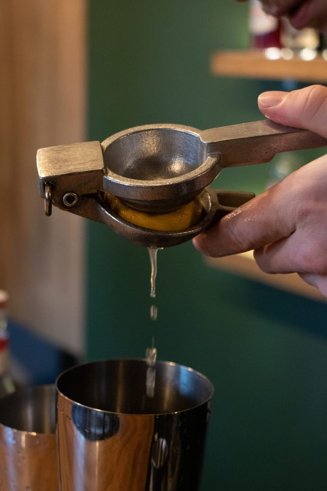

# 压榨器

压榨器（citrus press）是用来压榨半个柑橘的手动工具。它通过杠杆或螺旋结构把力放大，让操作者用较小的手劲挤出果汁，同时把果肉、籽与大部分果皮挡在杯外。对于以新鲜青柠汁、柠檬汁为核心的配方，它是决定出汁效率与稳定性的基础器具之一。

图：一只手正用金属杠杆压榨器挤柠檬，果汁流入下方的摇酒壶。图片：Guste Cibulskyte，CC0，来源：[原始页面](https://wordpress.org/photos/photo/486a216f78/)。

## 它解决什么问题

压榨器首先解决的是“手劲不够”的问题。青柠与柠檬的果皮紧实，单靠手指挤压很难把果汁挤干，连续做几杯更容易手部疲劳，出汁量也不稳定。

第二个问题，是分离。压榨器的杯状结构把果肉与籽留在内部，果汁从底部或侧面流出，减少籽落入酒液、果肉堵塞滤器的情况。

第三个问题，是卫生与效率。徒手挤压会让手接触果汁，也不方便连续操作；压榨器提供固定的受力面，清洗后可以重复使用，适合吧台节奏。

它不能解决的是“果汁品质”。压榨器只负责挤出果汁，水果的新鲜度、品种与成熟度才决定风味。器具不能把一颗不新鲜的青柠变成好果汁。

## 结构与材料

常见的压榨器是杠杆式：底座上有一个杯状或碗状的压榨腔，上方连接可上下摆动的压杆，压杆末端有与果形贴合的压头。把半个柑橘放入压榨腔，压下压杆，果汁即被挤出。

另一种是螺旋式：通过旋转螺纹杆把压头向下推，力更均匀，速度较慢，适合需要较大出汁量的场合。螺旋式通常更占空间，也更重。

材料方面，常见有不锈钢、带涂层的铸铝与食品级塑料。不锈钢耐酸、易清洁，但重量较大；铸铝轻便、成本较低，涂层一旦破损，酸性果汁可能接触金属，带来异味与腐蚀；食品级塑料轻便、价格较低，但长期使用后可能出现划痕与老化。选择时应优先看接触果汁部分的材料状态，而不是整体外观。

压榨腔的形状与尺寸也很重要。腔体过小放不进较大的柠檬，腔体过大则对小青柠支撑不足，压榨时容易歪斜。压头与果形的贴合程度影响出汁效率，也影响果皮是否被压破。

## 怎么选

第一，看常用水果的尺寸。以青柠为主的吧台与以柠檬、葡萄柚为主的吧台，需要的压榨腔尺寸不同。购买前应确认腔体能容纳常用果实的半个。

第二，看稳定性。底座面积大、重心低的款式在用力时不易滑动；底座太轻，压榨时需要用另一只手固定，反而更费力。

第三，看杠杆行程与手感。压杆的行程应足够压扁半个果实，握持处不应硌手；螺旋式的旋转阻力也应均匀。

第四，看接触果汁部分的材料。酸性果汁会加速未保护金属的腐蚀，涂层破损的铸铝尤其需要留意。

第五，看清洁难度。可拆卸的压榨腔、没有难以触及的死角，更适合高频使用。

第六，看是否可进洗碗机。不同材料与涂层的耐受性不同，应以产品说明为准。

不要只看“压得干不干”。出汁效率与果实状态、切割方式、压榨力度都有关，器具只是其中一个因素。

## 正确用法

第一步，清洗水果。柑橘表皮可能带有灰尘与农药残留，压榨前应清洗并擦干，尤其是需要保存果皮装饰时。

第二步，把水果横向切成两半。横切能让果肉瓣与压榨腔的受力方向一致，出汁更均匀；切面应平整，避免果皮碎片落入果汁。

第三步，把半个果实切面朝下放入压榨腔。让压头对准果肉中心，而不是压在果皮上。

第四步，平稳压下压杆或旋转螺旋。力度应持续而均匀，不要猛压；猛压会让果皮破裂，释放苦味油，也可能让果汁飞溅。

第五步，压到明显不再出汁时停止。继续用力压榨白色内皮与果皮，会带入苦味与油脂。

第六步，把果汁倒入量器或称量，按配方使用。需要清澈果汁时，可通过细滤网或[双重过滤](ref:double)去掉果肉纤维。压榨腔内的果肉与籽应及时清除，避免堵塞。

第七步，使用后立即冲洗。柑橘酸与糖分会腐蚀金属、干结在缝隙里，也会影响下一杯的风味。

## 替代方案

没有压榨器时，可以使用手动榨汁锥（reamer）：把锥头插入果肉，旋转挤压，适合少量出汁，但手部疲劳更明显。也可以用手挤压，或用夹钳式榨汁器；后者适合橙子与葡萄柚，体积较大。

需要大量果汁时，电动榨汁机效率更高，但清洗更麻烦，也可能因高速旋转带入更多果肉纤维与空气。购买瓶装果汁可以节省时间，但风味与新鲜度不同于现榨，配方若强调“鲜榨”，不应替换。

如果只是需要少量柑橘皮油，不必压榨：用削皮刀取皮并挤压即可。器具的选择应服从配方对果汁与果皮的不同需求。

## 保养与安全

每次使用后，应立即用温水冲洗压榨腔、压头与底座，去除果肉、籽与果皮碎片。酸性果汁停留时间越长，对金属的腐蚀越明显。清洗后擦干或晾干，避免水渍与氧化。

定期检查涂层与压头表面。涂层起皮、金属露出锈斑或塑料出现裂纹时，应停止用于接触果汁。不要用钢丝球或强碱性清洁剂擦洗，以免破坏表面。

安全方面，压榨器有杠杆与铰链结构，手指应远离压合处；底座应放在平稳台面，避免用力时翻倒。不要压榨整颗果实，也不要把手伸进压榨腔清渣时同时压杆。处理后应及时清洁台面与手部，生鲜果汁接触过的表面应按食品安全要求处理。

## 常见误区

第一，“压得越用力出汁越多”。过度用力会压破果皮，带入苦味油，也会让果汁飞溅。

第二，“所有柑橘都能用同一台”。青柠、柠檬、橙子与葡萄柚的尺寸差异明显，腔体需要匹配。

第三，“果皮朝下更容易出汁”。切面朝下才对，果皮朝下会把油与苦味压进果汁。

第四，“籽掉进去没关系”。籽与果肉会堵塞滤器，也会带来苦味。

第五，“瓶装果汁可以完全替代”。现榨果汁的香气与酸度不同，配方若强调新鲜度，应使用鲜榨。

第六，“压榨器不用每次洗”。酸性残留会腐蚀金属并影响风味，必须及时清洁。

相关条目：[莫吉托](ref:mojito)、[威士忌酸](ref:sour)。

## 另见

- [莫吉托](ref:mojito)：以新鲜青柠汁为基础的构建型配方。
- [威士忌酸](ref:sour)：以柠檬汁与糖平衡的经典酸类。
- [细滤网](ref:fine)：过滤果肉与纤维的下一步。
- [调酒基础](ref:basics)：柑橘汁在配方中的位置。
- [双重过滤](ref:double)：需要清澈果汁或成品时的处理方式。
