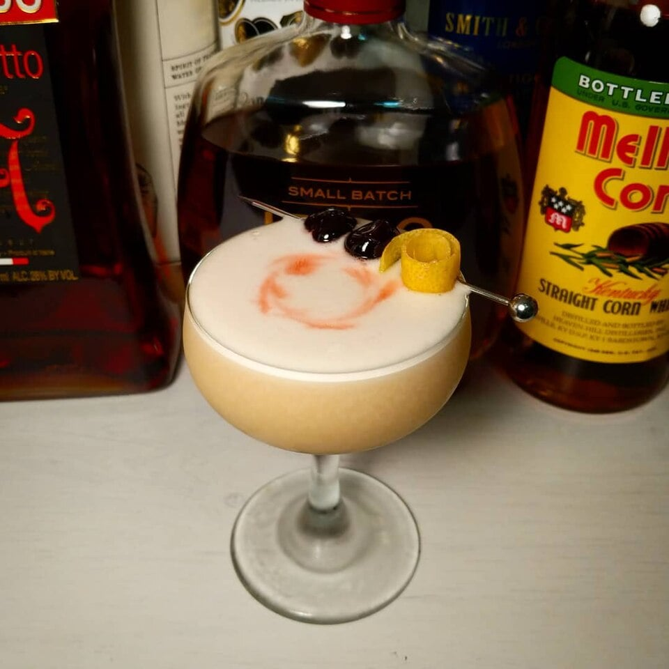

# 鸡尾酒签

鸡尾酒签是一根细长的签子，用来把橄榄、樱桃、柑橘皮或珍珠洋葱固定在杯口或酒液上方。它看起来是最不起眼的吧台小物，但长度、粗细、尖端和材料都会影响装饰是否稳、客人喝起来是否顺手，以及这杯酒在端上桌的几秒里给人什么印象。

图：一杯威士忌酸，杯口用金属酒签串起两颗酒渍樱桃，旁边还有一卷柠檬皮。图片：Ilikefood，CC BY-SA 4.0，来源：[原始页面](https://commons.wikimedia.org/wiki/File:Whiskey_sour_in_coupe_glass_with_garnishes.jpg)。

## 一根签要同时做三件事

第一是固定。橄榄和樱桃表面光滑、有重量，泡在酒里会沉底；签子把它们托在杯口或架在杯沿，让装饰可见，也让客人第一眼就认出这杯酒。

第二是取食。有了签，客人可以用手指捏住签柄把装饰提起来，不必把手指伸进酒里。这对需要吃装饰的酒尤其重要。

第三是引导。签子的朝向、长度和装饰的位置，会决定客人的鼻子先闻到什么、第一口从哪里喝。这些细节不属于配方，却属于出品。

## 竹、塑料、金属：三种材料的取舍

竹签便宜、轻、表面有细微纹理，摩擦力好，橄榄和樱桃不容易滑。缺点是会吸水，泡久了变软、发霉，也可能起毛刺；基本上是一次性用品。

塑料签颜色多、可重复使用、不怕水，但强度低，遇到较硬的装饰会弯；廉价塑料在酒精和酸性环境里可能老化、掉色。它适合需要区分装饰的场合，比如用不同颜色标记不同酒款。

金属签最结实，外观也最干净，适合高级出品。不锈钢耐腐蚀，清洗后可反复使用；但金属导热快，冰镇过的签子握起来不舒服，表面光滑也让橄榄容易转动。电镀或低等级金属签遇到盐水和酸会起斑、褪色，甚至带出金属味。

## 10–15 厘米这个长度从哪来

酒签的常见长度在 10–15 厘米。这个区间不是随意定的，它对应三件事：杯子的高度、装饰的直径、手指与杯口之间需要的余量。

短于 10 厘米，签子架在杯口时两端余量太少，装饰容易滑进酒里，手指也容易碰到酒液。长于 15 厘米，签子重心偏高，插着橄榄时会晃，端杯时容易碰倒，视觉上也显得笨重。

不同杯型可以在这个区间里选：马天尼杯口宽、杯身浅，10–12 厘米的签就够；高球杯更高，装饰要架在杯口上方，12–15 厘米更稳。以具体产品为准，购买前最好拿常用杯子比一下。

## 单签、双签与鸡尾酒叉

单签是一根尖头，最常用，适合一颗橄榄、一颗樱桃或一片柑橘皮。

双签有两根平行的签齿，可以固定两颗装饰，比如橄榄加洋葱，或者两颗樱桃。它的好处是装饰不会互相转动，排列更整齐；缺点是插入时两个孔要同时对准，软质装饰容易被戳烂。

鸡尾酒叉有两到三个短齿，更接近小叉子，适合取食较软的装饰，比如酒渍樱桃或大块水果。它不像单签那样容易把装饰戳穿，但固定力弱，不适合架在杯口。

选择取决于装饰的数量和质地，不是越复杂越好。一颗橄榄用单签最干净；需要两种装饰时再用双签。

## 尖端朝上还是朝下

这是吧台里最容易被忽略的安全细节。多数做法是把尖端朝下放入杯中，让签柄的钝端朝上。这样客人低头喝酒时，脸和眼睛不会正对尖头；即使杯子倾倒，尖头也朝着杯底。

如果装饰需要立在杯口上方，签子会有一部分露出杯外，这时应让尖端埋进装饰里，钝端朝外。无论哪种方式，都不应该让尖头悬在杯口正上方、指向客人的脸。

竹签劈裂后会产生很细的木刺，塑料签受热或弯折后可能形成尖锐断口。发现签子弯曲、开裂、起毛，应当直接丢弃，不要因为“还能用”而留下。

## 金属签遇到酸与盐水

橄榄泡在盐水中，樱桃和柑橘带酸，这些都会加速金属腐蚀。不锈钢签相对稳定，但并非所有不锈钢都一样；长期接触盐分和酸，低等级材料仍可能出现点蚀。

电镀签的表面是一层装饰性金属，反复插拔和清洗会磨损镀层，露出底层金属后腐蚀更快，也可能让酒液带上金属味。如果签子出现斑点、发暗、掉色，或者插过的橄榄隔夜变味，就应停止使用。

金属签不适合长时间留在酒里。出品时插上，客人取走后就应该收走；不要把金属签当成搅拌棒留在杯中。需要搅拌时，用[吧勺](ref:spoon)更合适。

## 装饰如何改变喝的动作

签子的位置会改变杯口的空间。横架在杯口的签子会挡住一部分杯沿，客人需要转头或用吸管；竖插在杯中的签子则可能碰到鼻子。

橄榄的位置也有讲究。放在杯底，客人第一口先喝到酒；架在杯口，橄榄的咸味会先进入鼻腔，改变对酒体的感知。[干马天尼](ref:martini)常用这种架法，让咸香先于酒液到达。樱桃同理，[曼哈顿](ref:manhattan)里的酒渍樱桃甜香会在入口前先到达。

柑橘皮用签子固定时，皮的外侧应朝向客人，油胞破裂后香气才能向外散发；如果皮被戳得千疮百孔，油会提前流失。用[刻槽刀](ref:channel)拉出的长条，可以一端挂在杯口、一端用签子压住，比直接戳穿更稳。

## 替代方案：牙签、吧勺与竹签

牙签是最常见的替代品，但长度通常只有 6–7 厘米，架不住大多数杯型，强度也不够，插橄榄容易断。它适合小杯或临时使用，不适合正式出品。

吧勺可以代替签子取装饰，长柄能伸到杯底，勺背还能托住樱桃；但它不能刺穿装饰，也无法把装饰固定在杯口。作为取食工具可以，作为展示工具不行。

长竹签、烧烤签可以截短使用，但断面粗糙，需要打磨。金属小叉、甜品叉在应急时也能用，只是尺寸和杯型不一定匹配。

## 清洁与存放

金属签用完立即用温水冲洗，把盐水和果肉残渣冲掉，擦干后存放。不要泡在水槽里过夜，也不要用钢丝球擦，以免留下划痕、加速腐蚀。可进洗碗机的款式应以产品说明为准。

竹签和木签是一次性的，不要清洗后重复使用。水洗会让木质吸水膨胀，干燥后开裂，木刺风险更高。塑料签可以短时重复使用，但出现弯曲、发白、裂纹就应丢弃。

存放时把签子放在干燥的筒或分隔盒里，尖端朝下，避免和刀具混放。吧台常用的做法是分格摆放，单签、双签、叉子各一格，出品时不用翻找。装饰的选择与摆放顺序，在[调酒基础](ref:basics)里和杯型、冰块一起构成出品标准。

## 常见误区

第一，“牙签就能当酒签”。长度和强度都不够，橄榄会滑落，签子容易断。

第二，“金属签最卫生，可以一直泡在酒里”。盐和酸会腐蚀金属，也会改变味道。

第三，“签子越尖越好插”。过尖的签子容易刺穿装饰、扎到手，也更容易在杯口留下危险。

第四，“装饰只是好看”。装饰的位置会改变香气到达鼻子的顺序，也影响第一口的口感。

第五，“竹签洗一洗还能用”。木质吸水后容易开裂发霉，不宜重复使用。

第六，“双签一定比单签高级”。装饰数量和质地才决定用哪种，单颗橄榄用双签反而累赘。

## 另见

- [吧勺](ref:spoon)：取装饰和搅拌的工具，与酒签分工不同。
- [干马天尼](ref:martini)：以橄榄或柠檬皮为装饰的经典酒款。
- [曼哈顿](ref:manhattan)：常用酒渍樱桃与酒签出品。
- [刻槽刀](ref:channel)：制作柑橘皮条装饰的工具。
- [调酒基础](ref:basics)：装饰在出品流程中的位置。

对照阅读：[吧勺](ref:spoon)、[曼哈顿](ref:manhattan)。
