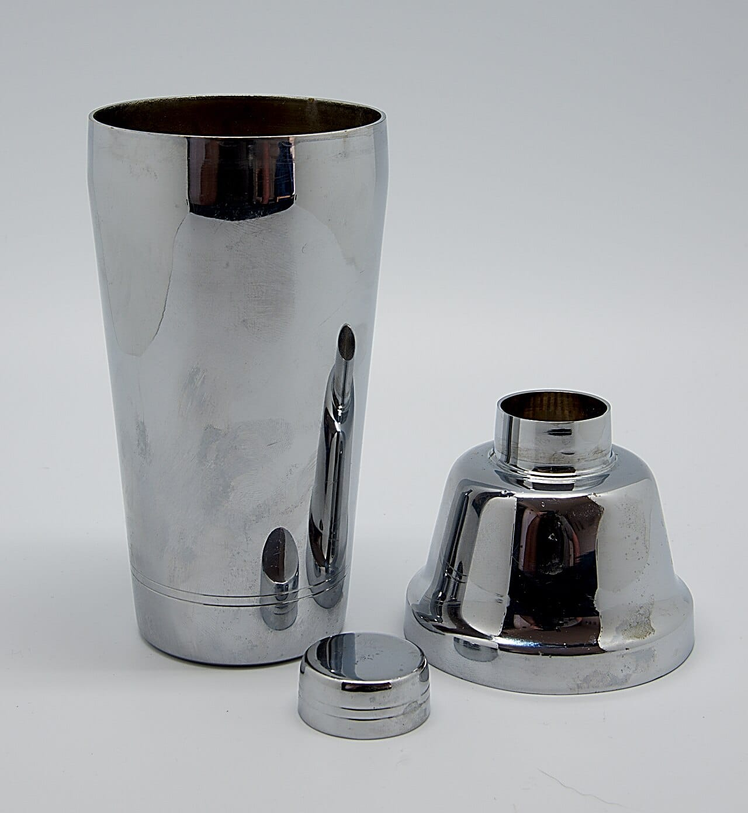

# 摇酒壶

摇酒壶（cocktail shaker）是用于摇和鸡尾酒的吧台工具。它把原料与冰块封闭在壶内，通过快速摇晃完成冷却、稀释与混合。摇酒壶的结构、材质与容量直接影响操作效率与成品口感，因此它不是可有可无的配件，而是调酒流程中的核心器具。

图：摇酒壶。图片：Clément Bucco-Lechat，CC BY-SA 3.0，via Wikimedia Commons（[原图页面](https://commons.wikimedia.org/wiki/File:Shaker_-_2.jpg)）。

## 定义与类型

常见类型有三段式摇酒壶与两段式摇酒壶。三段式由壶身、壶盖与内置滤冰器组成，密封性较好，适合含蛋清、奶油或果汁的配方；两段式通常由壶身与壶盖组成，容量更大，需要另配滤冰器，操作更快但密封要求更高。

还有一种法式摇酒壶，外形类似带盖的金属罐，容量较大，常用于摇和较稀的配方。不同类型没有绝对优劣，关键在于是否与配方、冰块和操作习惯匹配。两段式壶在没有内置滤冰器时，需要额外准备滤网，否则倒酒时冰块会直接落入杯中。

## 材质与结构

壶身多为不锈钢，也有玻璃与铜制款式。不锈钢耐用、导热快、易清洁，是最常见的吧台选择；玻璃便于观察混合状态，但易碎，不适合高强度摇和；铜制壶身外观独特，但重量大、保养要求高。

结构上，壶盖的密封圈、壶身的厚度与壶口的角度都会影响使用。密封圈老化会导致漏液，壶口过宽则滤冰时不易控制。检查这些细节，比只看外观更能判断一只摇酒壶是否好用。

## 容量与选型

容量决定了能否容纳原料与足够多的冰块。容量过小，冰块不足，冷却与稀释都难以控制；容量过大，冰块在壶内空间过大，撞击不充分，混合效率反而下降。常见吧台会准备不同容量的摇酒壶，以应对单人份与多人份配方。

选型还要考虑手型与操作空间。壶身过粗不易握稳，过重则长时间摇和容易疲劳。家庭使用可以选择容量适中、密封可靠的三段式；高频出品的吧台则更看重耐用性与清洗效率。

## 密封与滤冰

密封是摇酒壶最关键的性能之一。摇和时壶内压力上升，如果壶盖或密封圈不严，液体会从缝隙渗出，既浪费原料也影响卫生。使用前应检查壶盖是否完全扣合，摇动时用手掌压住壶盖。

滤冰方式影响成品。三段式摇酒壶内置滤冰器，倒酒时可以直接拦截冰块；两段式需要另配滤网或滤冰器，操作步骤更多。滤冰不彻底会让冰块继续融化，稀释成品，因此滤冰速度与器具选择同样重要。

## 清洁与保养

每次使用后应立即倒空、冲洗，避免果汁、糖浆与奶油残留。含蛋清或奶油的配方需要拆开壶盖与滤冰器，彻底清洗密封圈与缝隙。清洗后应晾干，避免水渍与异味。

不锈钢壶身可以用软布擦干，避免用钢丝球刮伤表面；玻璃壶身要避免骤冷骤热，防止破裂。密封圈属于易损件，出现老化、变形或异味时应及时更换。保养得当的摇酒壶可以使用很久，保养不当则会带来卫生与安全问题。

## 与技法的关系

摇酒壶是[摇酒](ref:shaking)技法的载体，但工具不能替代动作。握壶姿势、摇动幅度、时间与冰块状态，都会改变成品。壶再好，如果摇动幅度过大导致漏液，或摇和时间不足导致混合不均，结果仍然不理想。

以[内格罗尼](ref:negroni)为例，IBA 配方采用搅拌而非摇和；如果改用摇酒壶，稀释与充气会增加，成品风格随之改变。这说明工具与技法、配方需要一起考虑，不能把“用摇酒壶”当作所有鸡尾酒的标准做法。

## 常见误区

第一，摇酒壶越贵越好。价格与品牌不等于适合，密封、容量与手感才是关键。

第二，所有鸡尾酒都用摇酒壶。以香气与清澈为目标的配方通常适合搅拌，摇和会带来额外稀释与充气。

第三，壶盖随便扣上就能摇。密封圈老化或壶盖未扣紧都会漏液，使用前应检查。

第四，摇完可以放着不管。冰块会继续融化，成品被稀释，应在摇完后尽快滤冰饮用。

第五，只洗壶身不洗壶盖。壶盖与滤冰器最容易残留果汁与奶油，必须拆开清洗。

## 选购建议

选购时先确定用途：家庭调酒可选容量适中、密封可靠的三段式；经常出品多杯可选容量更大的两段式，并配好滤冰器。其次检查密封圈是否贴合、壶盖是否容易开合、壶身重量是否适合长时间握持。

材质方面，不锈钢是稳妥选择；玻璃适合低频使用与展示；铜制适合注重外观的场景，但要接受更高的保养成本。购买后先用清水试摇，确认不漏液，再用于含酒精与果汁的配方。若是家用，还应考虑收纳空间与清洗便利，避免买了大容量却长期闲置。

对照阅读：[摇酒](ref:shaking)、[内格罗尼配方（IBA 版本）](ref:recipe)。

## 延伸阅读

- [摇酒](ref:shaking)：摇和的动作、冰与稀释控制。
- [内格罗尼](ref:negroni)：搅拌型经典鸡尾酒的例子。
- [内格罗尼配方](ref:recipe)：可执行的用量、步骤与器具。
- [古典杯](ref:vessel)：杯型与冰块对成品的影响。

**关键事实。**

| 项目 | 内容 |
| --- | --- |
| 一句话定位 | 用于摇和鸡尾酒的吧台工具，常见三段式与两段式两种结构；壶身、密封与滤冰方式影响冷却、稀释与操作效率 |
| 材质 | 不锈钢、玻璃 |
| 用途 | 摇和鸡尾酒，使原料冷却、稀释并均匀混合 |

**来源与边界。** 本页关于「摇酒壶」的关键事实，主要由以下来源交叉核对：International Bartenders Association（摇和类鸡尾酒的调制方法）、Oxford University Press（提供关于摇酒壶、吧台工具与调酒技法的条目；由原条目末尾参考资料迁移，未逐条复核访问日期）、Cocktail Kingdom（公开在售摇酒壶的常见规格与材料；未复制原文与图片）。价格、批次与状态会变，涉及这些字段时以页面所列来源的最新版本为准。正文为项目自写，来源只作核验，不复制原文。

**并读。** 把「摇酒壶」与「摇酒」、「内格罗尼」、「内格罗尼配方（IBA 版本）」放在一起读时，先确认它们是同一层级还是上下游关系：先确认用途与材质，再比较尺寸、手感与替代方案。本页负责给出工具的基本坐标，对照条目补上具体案例与差异；读完再回到本页，才能分清哪些差别属于工具本身，哪些只是产地、批次或品牌选择。
