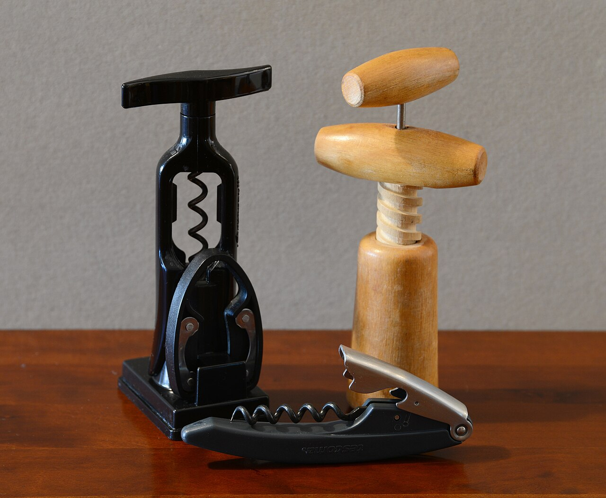

# 开瓶器

开瓶器是用螺旋与杠杆拔出软木塞的工具。它的核心不是“钻进去”，而是“把旋转变成向上的拉力”：螺旋进入软木塞，杠杆把提拉的力量放大，软木塞被缓慢、垂直地拔出。它主要服务于[葡萄酒](ref:wine)的开瓶与侍酒。

开瓶器的种类很多：侍酒刀（sommelier knife）、蝶形开瓶器、杠杆式开瓶器、台式开瓶器。它们的结构不同，但逻辑相同：螺旋要居中，拉力要垂直，速度要慢。工具越好，越不容易断塞。

图：几款不同结构的开瓶器。图片：Alvesgaspar，CC BY-SA 4.0，via Wikimedia Commons（[原图页面](https://commons.wikimedia.org/wiki/File:Corkscrews_December_2014-1.jpg)）。

## 结构与类型

侍酒刀是最常见的类型。它把螺旋、杠杆与刀片折进一把小折刀里，便于携带；使用时先把刀片切开封帽，再把螺旋钻进软木塞，最后用杠杆逐级抬起。它的优点是便携，缺点是需要技巧。

蝶形开瓶器有两片“翅膀”。螺旋进入软木塞后，两片翅膀展开，再向下压，利用杠杆把塞子拔出；它的优点是省力，缺点是体积大，不适合携带。

杠杆式开瓶器有一个长手柄与一个卡住瓶口的支点。它能把拉力放大，适合老塞与易断的塞子；台式开瓶器则固定在桌面上，适合酒吧高频使用。类型不同，选择要看使用场景，而不是“越贵越好”。

## 螺旋与杠杆的原理

螺旋的设计，是把旋转运动变成直线运动。螺旋的螺距、直径与锥度，决定它进入软木塞的难易；螺旋太粗，容易把塞子撑裂；太细，又容易滑脱。好的螺旋通常有锋利的尖端与适中的螺距。

杠杆的作用，是放大力量。支点越靠近瓶口，杠杆越长，拉力越大；但杠杆太长，也越容易把塞子拉断。侍酒刀的杠杆是“逐级”的，每抬一级，塞子上升一点；这种分段拉力，比一次性硬拔更安全。

垂直是关键。螺旋要沿瓶身轴线进入，不能歪；歪了，塞子受力不均，容易断。拔的时候也要垂直向上，不能左右扭；左右扭会让塞子与瓶口摩擦，增加断裂风险。

## 适合什么瓶

开瓶器适合天然软木塞与部分合成塞。天然软木塞有弹性，螺旋容易进入；合成塞较硬，需要更慢的进入与更稳的拉力。它不适合螺旋盖，也不适合需要保留气泡的起泡酒。

起泡酒的瓶内有压力，软木塞会在开瓶时弹出；用普通开瓶器钻入，可能让塞子突然飞出，也有安全风险。起泡酒应该用拇指控制、缓慢旋转瓶身，或者用军刀开瓶。关于起泡酒开瓶，可以参考[开瓶（起泡酒）](ref:sparkling)。

老酒的塞子更脆弱。年代久的软木塞会变软、变干，螺旋容易把塞子弄碎；老酒最好用杠杆式开瓶器，或者用“双叉”工具。断塞不是小事，木屑会掉进酒里，影响口感与安全。

## 使用步骤

第一步，去掉封帽。用侍酒刀的刀片沿瓶口下缘切开，不要割到手；封帽要完整取下，露出软木塞。

第二步，清洁瓶口。用干净布擦一下瓶口与塞子，去掉灰尘与霉斑；如果塞子表面有霉，先擦干净再判断是否污染。

第三步，螺旋居中。把螺旋的尖端对准塞子中心，沿瓶身轴线缓慢钻入；不要从边缘斜着钻，也不要钻穿塞子。

第四步，杠杆抬起。把侍酒刀的支点卡在瓶口，逐级抬起杠杆；塞子上升一点，就换一个支点，直到塞子大部分露出。

第五步，缓慢拔出。最后用手轻轻拔出塞子，不要用力过猛；拔出的瞬间，瓶口可能有不悦的气味，先闻一下，判断是否污染。关于完整流程，可以参考[开瓶（软木塞）](ref:opening)。

## 清洗与保养

开瓶器使用后要擦干净。螺旋上会残留软木屑与酒液，用温水冲洗，再用干布擦干；不要长时间浸泡，以免铰链生锈。

侍酒刀的铰链需要保养。定期滴一小滴食品级润滑油，保持杠杆顺滑；不要用食用油，油会变质、发黏。刀片要保持锋利，钝刀会割破封帽，也会割到手。

存放时避免潮湿。开瓶器不要放在水槽边或潮湿的抽屉里；螺旋与刀片容易生锈，铰链容易卡死。长期不用时，擦干后单独存放。螺旋尖端可以用软布包住，避免碰撞变形。

## 常见误区

第一，螺旋不居中。从边缘斜着钻，塞子受力不均，容易断；螺旋要对准中心，沿轴线进入。

第二，拔得太快。一次性硬拔，塞子容易断；要逐级抬杠杆，缓慢拔出。

第三，用开瓶器开起泡酒。瓶内压力会让塞子突然飞出，有安全风险；起泡酒应该用拇指控制或军刀开瓶。

第四，忽略断塞。断塞的木屑会掉进酒里，影响口感与安全；断塞后要换工具，把剩余塞子取出，必要时过滤。关于软木塞污染，可以参考[软木塞污染](ref:taint)；关于醒酒，可以参考[醒酒](ref:decanting)与[醒酒器](ref:decanter)。

对照阅读：[开瓶（软木塞）](ref:opening)、[葡萄酒](ref:wine)。

**关键事实。**

| 项目 | 内容 |
| --- | --- |
| 一句话定位 | 用螺旋与杠杆拔出软木塞的工具，常见侍酒刀、蝶形与杠杆式；螺旋要居中，拔出要慢，断塞要处理 |
| 材质 | 不锈钢、塑料、木材 |
| 用途 | 拔出天然软木塞与部分合成塞 |

**来源与边界。** 本页关于「开瓶器」的关键事实，主要由以下来源交叉核对：Oxford University Press（开瓶工具与葡萄酒服务背景）、Encyclopaedia Britannica（软木塞与葡萄酒瓶的历史）、Corning Museum of Glass（酒瓶与玻璃工艺背景）等 4 条来源。价格、批次与状态会变，涉及这些字段时以页面所列来源的最新版本为准。正文为项目自写，来源只作核验，不复制原文。

**并读。** 把「开瓶器」与「开瓶（软木塞）」、「软木塞污染（cork taint）」、「葡萄酒」放在一起读时，先确认它们是同一层级还是上下游关系：先确认用途与材质，再比较尺寸、手感与替代方案。本页负责给出工具的基本坐标，对照条目补上具体案例与差异；读完再回到本页，才能分清哪些差别属于工具本身，哪些只是产地、批次或品牌选择。

**适用边界。** 对「开瓶器」而言，材质与尺寸会影响手感；替代工具可以完成动作，但精度与效率不同。

**更新提示。** 「开瓶器」最近核对于 2026-11-20；尺寸、材质、容量与替代品会变，购买前以厂商规格为准。

**编者注。** 本页把「开瓶器」作为工具条目处理：定义、流程与关键数字以正文表格为准，与「开瓶（软木塞）」、「软木塞污染（cork taint）」的差异用对照阅读验证；遇到价格、批次或地址，回到页面所列来源核对。
