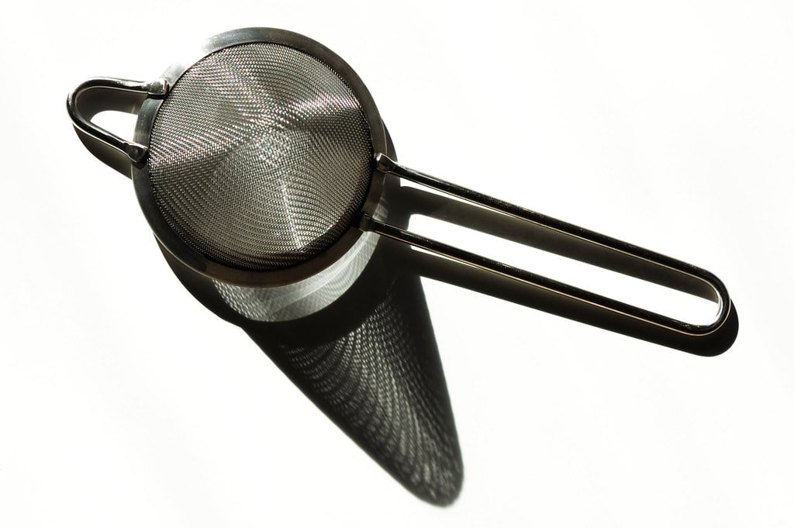

# 细滤网

细滤网（fine strainer）是双重过滤中的第二道滤器。它通常由细密的网面与金属框架组成，放在主滤器下方或杯口上方，用来拦下果肉纤维、碎叶、冰屑与细小的蛋清碎块。它不负责挡住冰块，也不负责混合，只负责把已经过滤过一次的酒液再“筛细”一层。

图：一把锥形细网滤器，金属网面与双线手柄清晰可见。图片：theilr，CC BY-SA 2.0，来源：[原始页面](https://www.flickr.com/photos/90863480@N00/4172725365)。

## 它解决什么问题

细滤网解决的是“主滤器挡不住的微粒”。摇和之后，滤冰器能挡住冰块与较大的固体，但果肉纤维、香草碎屑与冰屑仍会穿过孔洞，悬浮在酒液中。

这些微粒会带来几个问题。入口有颗粒感，静置后沉淀在杯底，影响外观；碎叶会继续氧化，带来草腥味；冰屑会让酒液在杯中继续稀释。细滤网把这些问题集中处理。

它还帮助控制泡沫。含蛋清的配方有时不希望泡沫太厚，细滤网能打散部分气泡；但更多时候，含蛋清的配方会刻意避开细滤网，以保留泡沫。过滤方式的选择，取决于配方要的是清澈还是泡沫。

## 结构与材料

细滤网的基本结构是网面、框架与手柄。网面负责拦截，框架负责支撑与保持形状，手柄方便拿取与轻敲。

网面材料常见有不锈钢与尼龙。不锈钢网耐用、易清洁、耐冷热，但若长期接触酸性果汁且未及时清洗，可能出现锈斑；尼龙网轻便、成本较低，但不耐高温，表面划伤后容易藏污。框架多为金属，有些产品带挂钩或底座，可以稳放在杯口。

形状上，常见有圆锥形与圆形。圆锥形重心较低、容量较大，适合放在杯口；圆形较扁平，适合直接架在容器上。尺寸差异明显，购买前应确认能覆盖常用杯口，也不会因为太大而晃动。

网面的疏密程度通常由产品标注，常见说法是“细网”或“超细网”，但不同厂商的标注并不统一。不要仅凭“目数”比较不同产品，实际拦截效果还受网面平整度、编织方式与流速影响。

## 怎么选

第一，看用途。若主要用于摇和后的短饮，选择网面细密、框架稳定的款式；若主要用于过滤果肉较多的果汁，网面过细会迅速堵塞，反而不如稍粗的滤网。

第二，看尺寸与稳定性。滤网应能稳放在常用杯口或搅拌杯上，不会因为倾倒而滑动。带挂钩或宽边框的款式通常更稳。

第三，看材料与耐酸性。经常接触柠檬汁、青柠汁的吧台，应选择耐酸、易清洁的网面，并养成及时冲洗的习惯。

第四，看清洁难度。网面与框架的接缝是藏污重点，选择接缝平整、没有难触及死角的产品。

第五，看网面是否平整。凹陷、翘起或脱线的网面会让颗粒从缝隙穿过，也容易挂住果肉。

第六，看手柄与收纳。手柄应握持舒适，长度适中；太长的滤网在收纳与清洗时都不方便。

## 正确用法

第一步，检查滤网是否洁净、网面是否完整。有破洞或脱线的滤网不能用于精细过滤。

第二步，把细滤网放在目标杯口或容器上，确认稳定。必要时先预冷杯子与滤网，减少香气损失与回温。

第三步，把主滤器放在细滤网上方。主滤器负责挡住冰块与大块固体，细滤网负责剩余微粒，顺序不能颠倒。

第四步，缓慢倒入酒液，让酒液自然流过。不要集中冲击一个点，以免把颗粒压进网面或把滤网冲偏。

第五步，滤完后轻敲框架，让附着的液滴落下。不要用勺背按压固体，也不要把网面上的残渣刮进杯中。

第六步，立即清洗。用温水冲洗，配合软刷轻刷网面，晾干后检查是否有凹陷或锈斑。

细滤网不能替代主滤器，也不能用来过滤含有大量果肉的整杯果汁。它的设计目标是处理少量微粒，而不是承担全部固体。

## 替代方案

没有细滤网时，可以用较小的茶滤或汤汁滤网临时替代，但网面精度与稳定性通常不足。纱布与咖啡滤纸能提供更彻底的澄清，但流速很慢，也会带走更多香气与气泡。

如果只是想去掉较大的碎叶，单道过滤已经足够；如果希望保留泡沫，含蛋清的配方应跳过细滤网。需要完全清澈的成品时，可以考虑静置、倾析或更专业的澄清方法，而不是一味追求更细的网。

## 保养与安全

每次使用后应立即冲洗。糖、果肉与蛋清残留会在网孔中干结，下一次过滤会越来越慢，也容易滋生微生物。清洗时用软刷顺网面方向轻刷，不要用力折弯网面。

定期检查网面与框架。出现锈斑、破洞、脱线或网面与框架分离时，应停止使用。尼龙网不耐高温，不要用来过滤滚烫的液体；金属网也应避免突然的冷热冲击。

存放时应保持干燥，避免与尖锐器具挤压。细滤网较薄，变形后难以恢复平整，过滤效果会明显下降。处理生鲜果汁与蛋清后，应按食品安全要求清洁滤网、台面与手部。

## 常见误区

第一，“网越细越好”。过细的网会堵塞、拖慢出品，也会带走香气与气泡。

第二，“细滤网可以替代主滤器”。只用细网会让固体迅速堆积，过滤又慢又不均匀。

第三，“双重过滤一定更好”。它适合需要清澈的配方，不适合以泡沫或果肉质感为卖点的酒。

第四，“过滤能修正配方”。过滤只处理颗粒，不能改变酸甜与酒精平衡。

第五，“滤网不用每次洗”。残留会干结、堵塞并带来异味。

第六，“滤网可以压着用”。按压会把颗粒挤过网孔，也会让网面变形。

相关条目：[双重过滤](ref:double)、[滤冰器](ref:strainer)、[摇酒](ref:shaking)。

细滤网不是越细越好：网孔过密会拖慢出酒并吸附部分香气，双重过滤时还要与粗滤网配合，避免冰屑堵网。

## 另见

- [双重过滤](ref:double)：细滤网对应的完整技法。
- [滤冰器](ref:strainer)：第一道过滤的主力。
- [摇酒](ref:shaking)：细滤网最常见的上游步骤。
- [大都会](ref:cosmo)：需要清澈外观的摇和短饮。
- [调酒基础](ref:basics)：过滤在整体流程中的位置。
