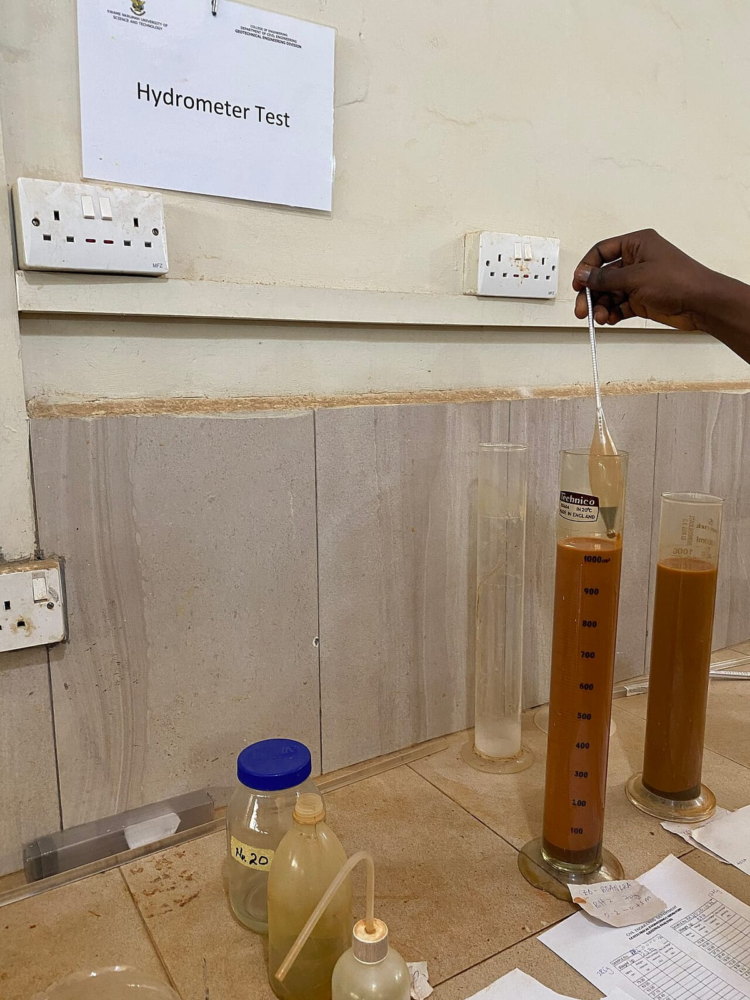

# 比重计（hydrometer）

比重计是一支看起来很简单、实际上很讲究的玻璃仪器：下端是一个 weighted bulb，上端是细长的 stem，放进液体后靠浮力直立，液面与 stem 上刻度的交点就是读数。它测的是密度或比重，不是直接的“酒精度”或“糖度”。酒精度、糖度、proof 等数值，都是先读密度，再根据温度、溶液组成和换算表推出来的。把比重计当成“酒精测量仪”，是使用时最常见的概念错误。

图：实验室中的比重计测试；玻璃比重计在量筒中读数，画面不是酒精计或糖度计。图片：Maame1Yaa，CC0，via Wikimedia Commons（[原图页面](https://commons.wikimedia.org/wiki/File:Laboratory_Hydrometer_test.jpg)）。

> **先给结论**
> **一句话：** 这页判断比重计（hydrometer）值不值得买，以及有没有替代方案。
>
> - **适合谁：** 想弄懂比重计（hydrometer）的用途、替代方案和使用边界的人。
> - **不适合谁：** 只想要工具清单、不关心使用场景的人。
> - **先看这两点：**
>   - 第一步是准备样品：液体必须均匀、无气泡、温度稳定。
>   - 选购时先确定量程：测啤酒麦汁通常用 1.000–1.120 的比重计；测葡萄酒或高糖果汁可能需要 1.000–1.140；测烈酒 proof 需要酒精计。

## 定义与原理

比重计依据阿基米德原理工作：浸在液体中的物体受到向上的浮力，浮力大小等于它排开的液体的重量。比重计的重量固定，液体的密度越大，它排开的体积越小，于是它浮得越高，液面在 stem 上的位置也越高；液体密度越小，它沉得越深，读数越低。因此，刻度可以从上到下或从下到上按密度、比重或特定溶液的百分含量来标定。

同样的玻璃仪器，可以做成不同的“表”：密度计读 g/mL 或 kg/m³；比重计读相对于水的比值（specific gravity）；酒精计读乙醇体积百分数或 proof；糖度计读蔗糖质量分数（°Brix）。名称不同，不等于原理不同，而是刻度与适用溶液不同。用糖度计去测烈酒，或用酒精计去测含糖发酵液，读数会被溶解物干扰，不能直接当成目标值。

## 常见刻度类型

密度计（density hydrometer）以 g/mL 或 kg/m³ 标度，适合需要绝对密度的场合。比重计（specific gravity hydrometer）以水在指定温度下的密度为 1，读数如 1.050、0.995；酿酒行业常用它来描述麦汁、果汁或发酵液的密度。酒精计（alcoholometer）以乙醇-水溶液的体积百分数或 proof 标度，TTB 的计量手册把刻度定为 0（水）、100（proof spirits）、200（无水乙醇），并规定在 60°F 下读数。糖度计（saccharometer）以蔗糖质量分数标度，常见 0–30 °Brix，用于葡萄成熟度、果汁与发酵监控。

还有波美计（Baumé）、API 计等工业刻度，主要用于特定液体。它们的刻度不是通用的“浓度”，不能拿波美度直接换成酒精度。选择哪一种，取决于你要测的液体和你要的答案：测发酵进度用比重或 Brix，测烈酒 proof 用酒精计，测一般液体密度用密度计。

## 怎么读

第一步是准备样品：液体必须均匀、无气泡、温度稳定。把样品倒入干净、透明、足够深的量筒，量筒直径应能让比重计自由漂浮而不碰壁。若有泡沫，静置或轻轻搅动让气泡逸出；含二氧化碳的样品需要先去除气体，否则气泡会附着在 instrument 上，读数偏低。

第二步是放入比重计：抓住 stem 的上端，缓慢浸入液体，浸到比自然漂浮位置稍深一点，再松手让它自由漂浮。不要让它撞到量筒底部，也不要让手温加热液体。等它静止、没有气泡附着后读数。读数时眼睛略低于液面，缓慢抬高视线，直到液面从椭圆变成一条直线；这条线与刻度的交点就是读数。视线要与 stem 垂直，避免视差；同时读温度计，因为温度会改变密度。

第三步是修正：比重计通常在 20°C 或 60°F 下标定。样品温度不同，读数需要按修正表换算。TTB 的《计量手册》规定，温度低于 60°F 时比重计读数低于真实 proof，高于 60°F 时读数高于真实 proof，必须查表修正。酿酒行业也常用 20°C 的修正表；不同行业的标准温度不同，不能混用。

## 温度与校准

温度是比重计测量中最容易被忽略的变量。液体的密度随温度变化，玻璃的体积也随温度变化；如果样品不在标定温度，读数就不是标准条件下的密度。测量前应让样品与量筒、比重计接近同一温度，必要时用恒温水浴。读数后立即记录温度，再查表或计算修正值。只读密度、不读温度，等于把一半数据丢掉了。

校准同样重要。NIST 的比重计校准服务会在约 10%、50%、90% 的量程点测量，并给出修正公式；日常使用可以用已知密度的标准液体（如纯水）做单点检查，但单点检查不能覆盖整个量程。TTB 要求生产者频繁测试比重计与温度计，误差超过一个分度就应停用并送检。玻璃比重计易碎，stem 弯曲、bulb 有裂纹或刻度松动都会影响读数；发现破损应更换，不要用胶水修补后继续使用。

## 在酿造与烈酒中的用途

在啤酒与葡萄酒酿造中，比重计用来跟踪发酵：发酵前读麦汁或果汁的比重，得到 original gravity 或 Brix；发酵结束后再读 final gravity，两个数值的差可以估算酒精产量。酿酒师还会用它判断发酵是否结束、是否需要调整温度或添加酵母。比重计不能直接告诉你“酒精度”，因为发酵液里还有糖、蛋白质和酒精，密度是这些成分共同作用的结果；必须用起始与结束的密度差，再结合经验公式或实验室分析。

在烈酒生产与税务计量中，酒精计用来读 proof。TTB 要求用精密比重计与温度计，按 27 CFR 30.23 的操作读取，再查 Table 1 修正到 60°F。现代工厂可以用密度计或振荡管仪器，但仍需校准与比对。对消费者来说，比重计不是家用必需品；如果你只是想知道一款酒的酒精度，标签和检测报告比自购比重计更可靠。

## 局限与替代工具

比重计的第一个局限是“间接”：它测密度，不区分密度变化来自糖、酒精、蛋白质还是溶解盐。含糖量高的发酵液，密度高不一定酒精度高；酒精增加会降低密度，但糖的存在会把密度抬高。第二个局限是“温度”：没有温度修正，读数不可比。第三个局限是“样品量”：量筒太细、比重计太大，或样品太少，都会让它碰壁或无法自由漂浮。第四个局限是“气泡与悬浮物”：二氧化碳、蛋白质、果肉都会干扰读数。

替代工具包括折射仪（测折射率，常用于 Brix 与果汁）、振荡管密度计（实验室精度高）、近红外光谱仪（在线检测）和 pycnometer（比重瓶）。折射仪测含酒精溶液时需要修正，不能把 Brix 直接当酒精度；振荡管密度计也需要温度控制与校准。没有一种工具能“直接读出一切”，关键是知道它测的物理量是什么，以及如何把读数换算成你要的答案。

## 常见误读

第一，比重计不是“酒精测量仪”。它测密度；酒精度是从密度、温度与溶液组成推算的。第二，读数不是“越深越烈”。比重计在纯水里读数接近 1.000，在乙醇里读数低于 1.000；高度酒精的密度反而更低。第三，Brix 不是“糖度=甜度”。Brix 是蔗糖质量分数的近似，发酵液中的酒精、酸和可溶性固形物都会影响折射与密度，实际甜度还要看残糖与酸度。

第四，温度不重要是错的。同一杯酒在 15°C 与 25°C 下读数不同，查表修正后才能比较。第五，读数可以“估着看”是错的。弯月面、视差、气泡和 stem 湿润都会带来误差；按标准操作，读数应到最小分度，必要时估读到半分度。第六，比重计不是“越贵越准”。关键是量程匹配、校准有效、操作规范；一支便宜但校准良好的比重计，可能比一支昂贵但未校准的更适合日常使用。

## 选购与保养

选购时先确定量程：测啤酒麦汁通常用 1.000–1.120 的比重计；测葡萄酒或高糖果汁可能需要 1.000–1.140；测烈酒 proof 需要酒精计，量程覆盖 0–200 proof。再看分度：分度越细，读数越精确，但也越难读。玻璃比重计要检查 stem 是否直、刻度是否清晰、bulb 是否无裂纹；塑料比重计耐摔但精度和长期稳定性通常不如玻璃。

保养时，使用后立即用清水冲洗，避免糖液或酒石沉淀干在 stem 上；用软布擦干，放在原装塑料筒或泡沫盒里，不要与硬物混放。不要用热水冲洗，以免玻璃热胀裂；不要用超声波清洗，除非厂家明确允许。长期不用时，保持干燥、避光、避免高温。定期用纯水或标准液检查零点，发现偏差就送检或更换。

## 在写作与教学中的表达

写作时，较准确的表达是“用比重计测得发酵液比重从 1.050 降到 1.010，再结合温度与公式估算酒精度”，而不是“比重计测出酒精度 5%”。介绍工具时，先说明它测的物理量，再说明刻度类型与温度基准，最后说明换算的局限。教学演示中，最好同时展示密度计、酒精计与糖度计的区别，让读者看到“同一原理、不同刻度”的关系。

比重计的价值，不在于它能把一款酒“量化成一个数字”，而在于它把密度、温度与换算关系摆在台面上。只要你知道读数背后的物理量，它就是一个可靠、便宜、可复现的工具；如果你把读数当成直接的酒精度或糖度，它就会制造精确的错觉。工具本身没有错，错的是口径。

相关条目：[发酵](ref:fermentation)、[原麦汁浓度（original gravity）](ref:gravity)、[酒精度（ABV）](ref:abv)。

## 延伸阅读与另见

- [发酵](ref:fermentation)：比重计跟踪的代谢过程。
- [原麦汁浓度](ref:gravity)：起始比重与可溶性固形物。
- [酒精度](ref:abv)：由密度差与温度推算的目标值之一。
- [标准酒度与 Proof](ref:proof)：酒精计的刻度与换算。
- [白利度](ref:brix)：糖度计的刻度与适用边界。
