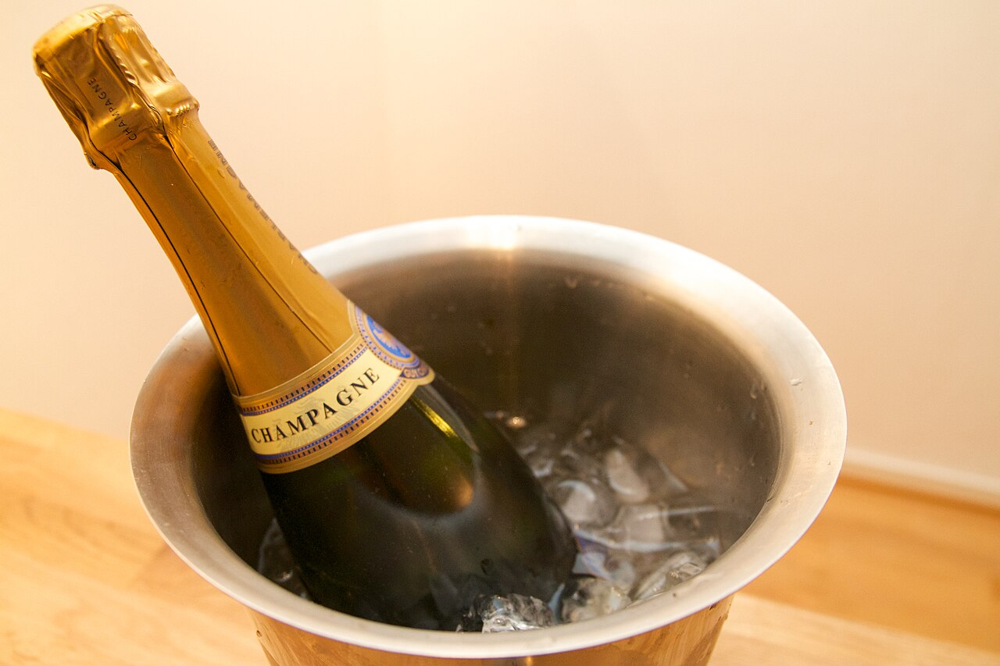

# 冰桶

冰桶是给酒瓶降温的桶形容器，常见不锈钢、铜或玻璃制。它的作用不是“把瓶子埋进冰里”，而是“让瓶子浸在冰水里”：冰水混合物的导热效率远高于纯冰，降温更快、更均匀。

冰桶的形状通常高而窄，能竖放酒瓶，也能让水位没过酒液；桶口较宽，方便加冰与取瓶；桶底较厚，放在桌上更稳。它既是工具，也是餐桌上的视觉中心。

图：一只香槟冰桶。图片：Kjetil Ree，CC BY-SA 3.0，via Wikimedia Commons（[原图页面](https://commons.wikimedia.org/wiki/File:Champagne_cooler_-_2013-12-26_at_19-32-24.jpg)）。

## 器型与材料

冰桶的核心是“桶形、够深、不漏水”。桶身要能竖放一瓶酒，桶口要能让瓶子与冰水充分接触；桶底要平稳，避免倾倒。金属桶导热快，降温更迅速；玻璃桶美观，但导热慢，降温也慢。

不锈钢最常见，耐用、易清洗、价格适中；铜桶导热更好，也更贵，适合正式场合；玻璃桶适合展示，但要注意温差，避免骤冷骤热导致破裂。

冰桶的容量要与瓶型匹配。香槟瓶与葡萄酒瓶的直径不同，桶太窄，瓶子放不进去；桶太浅，水位无法没过酒液。购买前量一下常用酒瓶的直径与高度，比只看“好看”更实用。

## 冰水比纯冰更快

纯冰与瓶子之间有空隙，空气是热的不良导体，降温慢；冰水混合物能填满空隙，水是热的良导体，能把瓶身的热量迅速带走。冰桶里加水和加冰同样重要。

水位的目标是“没过酒液”。酒液在瓶身的中下部，水位要至少到瓶肩；如果只埋住瓶底，上半瓶仍然是温的，降温不均匀。加冰后轻轻搅一下，让冰与水混合，温度更均匀。

盐能加速降温，但也会让冰点更低、冰融化更快。除非需要快速降温，一般不建议加盐；盐会让桶壁结霜，也可能让标签受潮。关于冰与温度，可以参考[加冰与温度](ref:ice)。

## 适合什么酒

冰桶最适合起泡酒、甜酒与需要低温的白葡萄酒。起泡酒通常在山麓温度（约 6 到 8 摄氏度）饮用，冰桶能快速降温，也能在餐桌上保持温度；甜酒与部分白葡萄酒也需要低温。

它也可以给红葡萄酒“降温”。如果红葡萄酒温度过高（例如夏天室温 28 摄氏度），短时间放入冰桶 5 到 10 分钟，能让酒液回到合适温度；但不要长时间冰镇，低温会压住香气。

它也不适合长期存放。冰桶是“服务工具”，不是“酒柜”；长时间泡在冰水里，酒标会脱落，瓶塞也可能受潮。关于起泡酒的服务，可以参考[开瓶（起泡酒）](ref:sparkling)与[香槟笛杯](ref:flute)。

冰桶与冰箱的分工也不同。冰箱适合长时间储存，温度稳定，但降温慢；冰桶适合快速降温与餐桌服务，降温快，但温度会逐渐上升。需要快速把酒降到适饮温度时，冰桶更有效；需要长期保持温度时，冰箱更可靠。两者可以配合：先在冰桶降温，再放回冰箱保温。冰桶不适合长时间连续使用，冰融化后要及时补冰，否则水位下降，降温效果会变差。桶盖可以保温，但盖上后不便观察，服务时通常不盖。

## 使用与时间

第一步，先放冰，再加水。冰要占到桶的三分之二，再加水到没过酒瓶；先冰后水，能让冰更快沉底，也能避免水溢出。

第二步，放瓶。把酒瓶轻轻放入，避免撞击桶壁；瓶身要竖直，标签朝外，方便识别。起泡酒瓶内有余压，放入时不要摇晃。

第三步，控制时间。白葡萄酒通常 15 到 20 分钟，起泡酒 20 到 30 分钟，红葡萄酒 5 到 10 分钟；时间要看起始温度、酒的类型与桶的材质，不能只看“冰多久”。

第四步，擦瓶。取出酒瓶时，用干净布擦干瓶身，避免水滴落到桌面或酒杯；开瓶前再擦一次瓶口。关于倒酒，可以参考[倒酒](ref:pouring)。

## 清洗与保养

冰桶使用后要倒掉冰水，用温水冲洗，再用干布擦干。不要用钢丝球擦金属桶，以免留下划痕；玻璃桶要用软海绵，避免刮伤。

金属桶容易留下水渍。擦干后可以用软布再擦一遍，保持光泽；长期不用时，不要盖紧桶盖，以免潮气积聚。铜桶会氧化变暗，可以用专用铜膏轻轻擦拭，但不要过度抛光。

玻璃桶要避免骤冷骤热。倒掉冰水后，不要立即用热水冲，以免玻璃破裂；先让桶回到室温，再用温水清洗。存放时避免堆叠，以免碰碎。

## 常见误区

第一，只放冰不加水。空气隔热，降温慢；冰水混合才是正确做法。

第二，水位不够。只埋住瓶底，上半瓶仍然是温的；水位要没过酒液。

第三，所有酒都冰镇。红葡萄酒长时间冰镇会压住香气；短时间降温即可。

第四，把冰桶当酒柜。长时间浸泡会让酒标脱落、瓶塞受潮；冰桶是服务工具，不是储存工具。关于起泡酒，可以参考[起泡酒](ref:bubbly)；关于饮用温度，可以参考[加冰与温度](ref:ice)。

对照阅读：[加冰这件事，没有标准答案](ref:ice)、[起泡酒](ref:bubbly)。

**关键事实。**

| 项目 | 内容 |
| --- | --- |
| 一句话定位 | 用于给酒瓶降温的桶形容器，常为金属或玻璃；冰水混合比纯冰更快，水位要没过酒液，时间要看酒的类型 |
| 材质 | 不锈钢、铜、玻璃 |
| 用途 | 给葡萄酒、起泡酒与啤酒瓶降温 |

**来源与边界。** 本页关于「冰桶」的关键事实，主要由以下来源交叉核对：Oxford University Press（冰桶与酒水服务背景）、Encyclopaedia Britannica（葡萄酒饮用温度与服务方式）、Corning Museum of Glass（玻璃与金属器型的工艺背景）等 4 条来源。价格、批次与状态会变，涉及这些字段时以页面所列来源的最新版本为准。正文为项目自写，来源只作核验，不复制原文。

**并读。** 把「冰桶」与「加冰这件事，没有标准答案」、「开瓶（起泡酒）」、「起泡酒」放在一起读时，先确认它们是同一层级还是上下游关系：先确认用途与材质，再比较尺寸、手感与替代方案。本页负责给出工具的基本坐标，对照条目补上具体案例与差异；读完再回到本页，才能分清哪些差别属于工具本身，哪些只是产地、批次或品牌选择。

**适用边界。** 对「冰桶」而言，材质与尺寸会影响手感；替代工具可以完成动作，但精度与效率不同。

**更新提示。** 「冰桶」最近核对于 2026-11-20；尺寸、材质、容量与替代品会变，购买前以厂商规格为准。

**编者注。** 本页把「冰桶」作为工具条目处理：定义、流程与关键数字以正文表格为准，与「加冰这件事，没有标准答案」、「开瓶（起泡酒）」的差异用对照阅读验证；遇到价格、批次或地址，回到页面所列来源核对。
