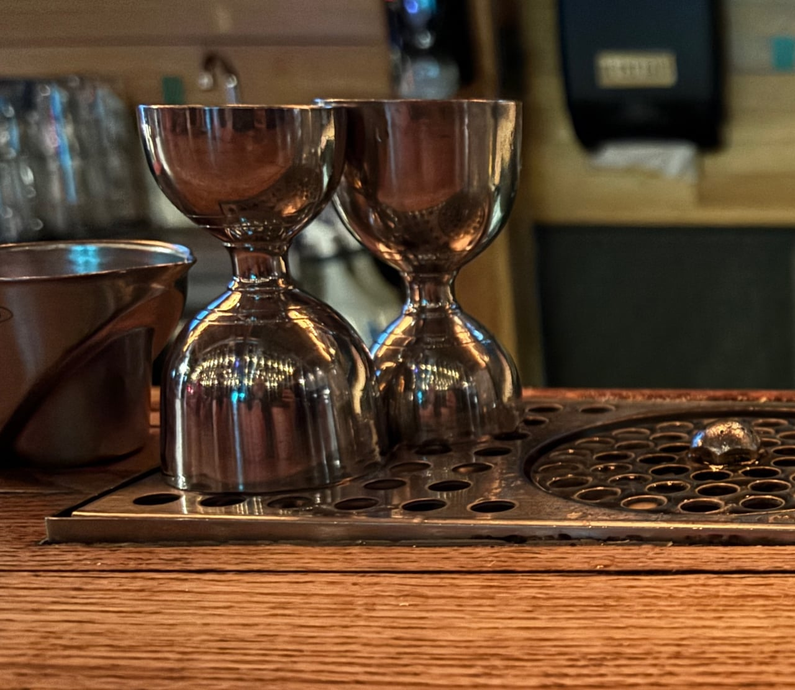

# 量酒器

量酒器（jigger）是调酒时用来量取酒液、糖浆与果汁的小型量具。它通常呈双头锥形，两端容量不同，一端大、一端小，可以快速倒出固定体积。配方能否稳定复现，很大程度上取决于量取是否准确，而不是凭手感“倒一点”。

图：两只金属双头量酒器放在吧台的滤水垫上，左侧还有一只小量杯。图片：Topher，CC0，来源：[原始页面](https://wordpress.org/photos/photo/93268b5b84/)。

## 定义与形制

常见量酒器为不锈钢双头锥形，两端各有一个容量，例如三十毫升与四十五毫升，或二十五毫升与五十毫升。也有单头带刻度的款式，以及玻璃量酒器。双头设计的优势是速度快：常用的两个容量随手可用，不必反复找量杯。

形制还影响倒口。锥形收口较窄，倒酒时容易控制；平口更宽，流速快但不易精确定量。带内壁刻度的款式适合需要更细分的配方，但刻度会随使用磨损，应定期核对。

## 容量与精度

量酒器的标称容量是“满杯到杯口”还是“到某条刻度”，不同产品并不一致。使用前应确认标称方式，并用带刻度的量杯核对一次。常见双头量酒器的一端约三十毫升，另一端约四十五毫升；家庭使用也可以选择更小的规格以适应低酒精度配方。

精度受倒酒角度、液体黏度与杯口残留影响。糖浆黏度高，挂壁多，实际倒出的量可能少于标称；高酒精液体流动性好，但容易溢出。需要精确到毫升时，电子秤或带刻度量杯比量酒器更可靠。

## 使用步骤

第一步，确认配方单位与量酒器容量是否对应。配方写“三十毫升”，就用对应的一端，不要用另一端估算。第二步，把量酒器放在稳定台面上，倒入液体至标称位置，避免从高处倾倒产生气泡。

第三步，观察液面是否与杯口或刻度齐平。第四步，把量酒器靠近目标容器，缓慢倾倒，减少飞溅与挂壁。第五步，倒完后稍等片刻，让挂壁液体落下，再移开。第六步，立即冲洗或擦净，避免糖浆残留影响下一次计量。

## 参数与判断

容量、液体黏度、倒酒角度与残留量共同决定实际用量。配方中的“一份”“一盎司”等说法在不同资料中可能对应不同毫升数，应以配方给出的具体单位为准。需要换算时，先确认资料使用的是美制还是英制单位。

量取速度与精度需要平衡。高频出品的吧台追求速度，会用量酒器快速量取；需要精确复现的实验性或低糖配方，则更适合电子秤。两者不是对立，而是不同场景的工具选择。

## 失败案例

第一，用错一端。把四十五毫升当成三十毫升，成品酒精度与平衡都会改变。第二，凭手感“倒满”。量酒器不按标称位置使用，等于没有量取。

第三，糖浆挂壁未计入。黏稠液体残留在杯壁，实际用量偏少，甜品风味变淡。第四，量酒器刻度磨损。长期使用后刻度模糊，应按期用标准量杯核对。

第五，倒得太猛。液体冲击目标容器，产生气泡与飞溅，也会影响后续摇和或搅拌。第六，量酒器混用不洗。残留的果汁或糖浆会污染下一杯，也可能堵塞滤冰器。

## 与其他工具的关系

量酒器负责“量”，[摇酒壶](ref:shaker)与搅拌杯负责“混合”，[吧勺](ref:spoon)负责搅拌与引导。三者分工明确：量取不准，后面的技法再标准也无法复现配方。

在[鸡尾酒基础](ref:cocktail-basics)中，配方通常以毫升或盎司给出。使用量酒器时，应把配方单位与器具容量对应起来；不确定时，先用电子秤或称量杯验证一次，再进入日常出品。

## 材质与保养

不锈钢量酒器耐用、易清洁，是最常见的选择；玻璃量酒器便于观察液面，但易碎。使用后应立即用温水冲洗，避免糖浆与果汁干结；清洗后擦干，防止水渍与氧化。

不要用量酒器直接加热或装强酸强碱液体。刻度磨损、杯口变形或内壁出现锈斑时，应停止用于精确计量。量酒器不宜用来搅拌或敲击，以免变形影响容量。

## 常见误区

第一，量酒器容量是固定的。不同产品的标称方式与容量不同，使用前应核对。

第二，凭手感比量取快。速度可以通过练习提高，但精度不能靠感觉替代。

第三，所有液体都可以用量酒器。黏稠液体与含果肉的配料可能挂壁或堵塞，应改用称量或其他方式。

第四，刻度永远准确。长期使用会磨损，应定期用标准量具核对。

第五，量酒器可以代替电子秤。需要精确到克或毫升时，电子秤更可靠。

## 选购建议

选购时先确认常用配方的容量范围，再选择对应规格的双头量酒器。家庭使用可以准备一只三十与四十五毫升的款式；配方跨度大时，可再添一只更小或更大的规格。

购买后先用标准量杯核对两端容量，再练习倾倒角度与停止位置。工具的价值在于稳定复现，而不是外观。

对照阅读：[调酒，是另一种认识酒的方式](ref:cocktail-basics)、[吧勺](ref:spoon)。

## 延伸阅读

- [鸡尾酒基础](ref:cocktail-basics)：配方单位、比例与调制流程。
- [摇酒壶](ref:shaker)：量取之后的混合工具。
- [吧勺](ref:spoon)：搅拌与引导倾倒。
- [内格罗尼](ref:negroni)：用量比例清楚的一个经典配方。

**关键事实。**

| 项目 | 内容 |
| --- | --- |
| 一句话定位 | 用于快速、重复量取少量液体的吧台量具；双头容量、刻度清晰度与倒口设计影响出品的稳定性与速度 |
| 材质 | 不锈钢、玻璃 |
| 用途 | 快速、重复地量取酒液与糖浆等配料 |

**来源与边界。** 本页关于「量酒器」的关键事实，主要由以下来源交叉核对：International Bartenders Association（经典鸡尾酒的配方用量）、Oxford University Press（提供关于量酒器与吧台计量的条目；由原条目末尾参考资料迁移，未逐条复核访问日期）、Difford's Guide（吧台器具与配方计量的公开说明）。价格、批次与状态会变，涉及这些字段时以页面所列来源的最新版本为准。正文为项目自写，来源只作核验，不复制原文。

**并读。** 把「量酒器」与「调酒，是另一种认识酒的方式」、「摇酒壶」、「吧勺」放在一起读时，先确认它们是同一层级还是上下游关系：先确认用途与材质，再比较尺寸、手感与替代方案。本页负责给出工具的基本坐标，对照条目补上具体案例与差异；读完再回到本页，才能分清哪些差别属于工具本身，哪些只是产地、批次或品牌选择。
