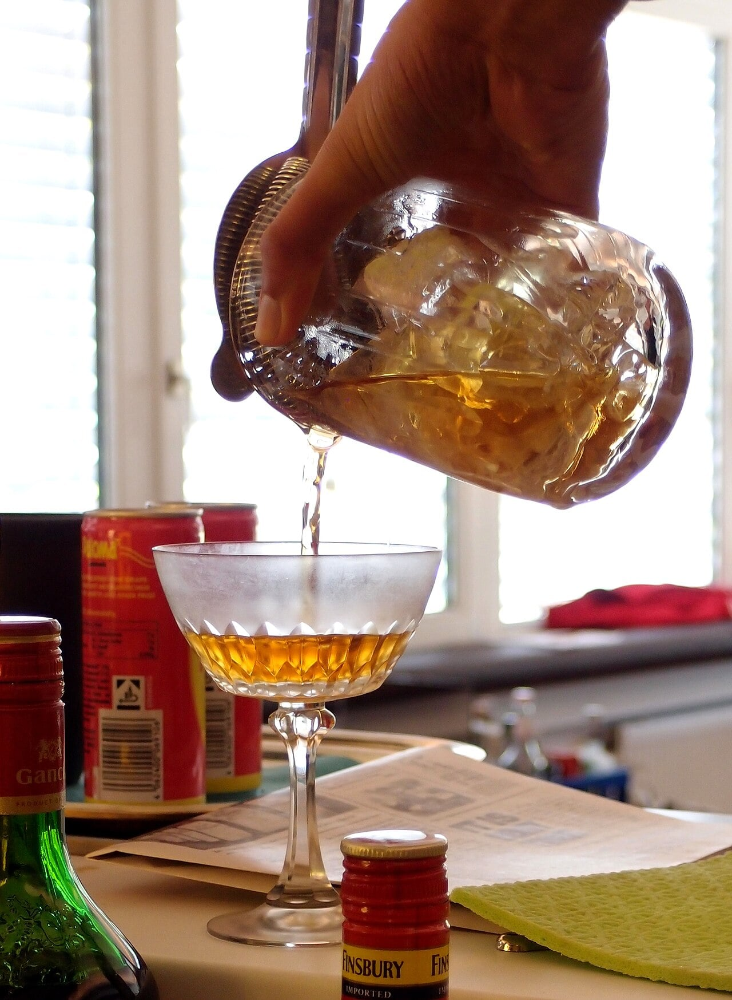

# 搅拌杯

搅拌杯（mixing glass）是搅拌型鸡尾酒的工作容器。把酒液、冰块与吧勺放进去，通过稳定搅拌完成冷却、稀释与混合，再滤入预冷的杯中。它不直接上桌，却是决定成品温度与稀释度的关键器具之一。

图：一只带雕纹的玻璃搅拌杯正把琥珀色鸡尾酒滤入碟形杯，杯中仍留有冰块。图片：SKopp，CC BY 4.0，来源：[原始页面](https://commons.wikimedia.org/wiki/File:Pouring_from_a_mixing_glass.jpg)。

## 定义与形制

搅拌杯通常是一只较高的玻璃杯，杯身略收、杯口较宽，便于吧勺伸入与旋转。常见形制有直筒形与上宽下窄的锥形；有些杯身带刻度，方便直接量取。与摇酒壶不同，搅拌杯没有密封结构，也不承受压力，因此只能用于搅拌，不能摇和。

它的容量通常在三百到五百毫升之间。容量太小，冰块与酒液挤在一起，搅拌不充分；容量太大，酒液表面积过大，温度上升快，稀释也更难控制。

## 为什么用玻璃

玻璃不与酸性果汁、糖浆或酒精发生反应，也不会像某些金属那样留下气味。透明杯身让操作者能看到冰块大小、搅拌轨迹与稀释程度，便于在过程中判断。水晶玻璃的导热与手感与普通玻璃略有差异，但对家庭使用而言，厚壁、耐温差、易清洁比“材质高级”更重要。

金属搅拌杯降温更快，但会遮挡视线，也不适合需要观察颜色的配方。玻璃杯的缺点是易碎，清洗与收纳需要更小心。

## 使用步骤

第一步，预冷。把搅拌杯放入冰箱或加冰旋转片刻，倒掉融水，让杯壁降温。第二步，按配方量取酒液，先倒入搅拌杯。第三步，加入适量冰块，通常装至杯容的三分之二左右，给吧勺留出搅动空间。

第四步，插入[吧勺](ref:spoon)，勺背贴近杯壁，手指沿螺旋杆稳定转动。第五步，搅拌到杯壁结霜、手感明显变冷，或达到配方要求的时间。第六步，通过滤冰器滤入预冷的杯中，避免冰块与融水进入成品。

## 参数与判断

容量决定冰块与酒液的比例，也决定搅拌时能否形成稳定的漩涡。杯壁越厚，预冷后回温越慢；杯口越宽，香气散失与温度上升越快。搅拌时间、冰块大小与初始温度共同决定最终稀释度，器具只是其中一环。

判断搅拌是否到位，可以看三个信号：杯壁外侧结霜、杯身手感明显变冷、吧勺周围的酒液流动变得顺滑。不同配方对稀释的要求不同，不能只按“搅多少圈”机械执行。

## 失败案例

第一，用摇酒壶替代搅拌杯。摇和会带入更多空气，成品浑浊、泡沫多，不适合以酒类和苦味酒为主的配方。第二，杯子没有预冷。冰块在温暖杯壁上迅速融化，成品稀释过多、温度不够低。

第三，冰块装得太满。没有搅动空间，吧勺转不动，冷却不均匀。第四，搅拌时间过长。稀释超过目标，香气变淡，口感变水。

第五，滤冰不彻底。碎冰与融水进入杯中，成品继续稀释。第六，用有裂纹或耐温差差的杯子。骤冷骤热可能炸裂，存在安全问题。

## 与摇酒壶的区别

[摇酒壶](ref:shaker)通过剧烈摇晃实现快速冷却、充气与乳化，适合含果汁、蛋清、奶油或糖浆的配方；搅拌杯通过温和搅动实现冷却与稀释，适合以酒类、苦味酒与美思为主的配方。[内格罗尼](ref:negroni)的 IBA 配方就是加冰搅拌、滤入古典杯，成品应清澈而不是带泡沫。

两者不是替代关系，而是对应不同配方目标的两套工具。把该搅拌的配方拿去摇，成品会过度充气；把该摇和的配方拿去搅拌，则难以乳化与降温。

## 材质与保养

玻璃搅拌杯使用后应立即用温水冲洗，避免糖浆与果汁干结。清洗时不要用钢丝球，以免留下划痕；有刻度的杯身应避免长时间浸泡，防止刻度脱落。清洗后倒扣晾干，避免水渍。

不要用搅拌杯装热饮或直接放在冷冻室长时间急冻。温差过大可能造成裂纹。出现裂纹、缺口或明显划痕时应停止使用，以免在搅拌时破裂。

## 常见误区

第一，搅拌杯可以摇和。没有密封结构，摇和会洒出，也无法形成压力。

第二，杯子越大越好。容量过大让温度上升快，稀释更难控制。

第三，预冷可以省略。预冷直接影响成品温度与稀释，不能靠多加冰弥补。

第四，搅拌杯只用于鸡尾酒。它也可用于需要温和混合的其他饮品，但应确认材质与清洁。

第五，玻璃杯一定比金属杯好。材质各有取舍，关键是与配方和操作方式匹配。

## 选购建议

选购时先看容量与常用配方是否匹配，再看杯壁是否均匀、杯口是否便于吧勺操作。家庭使用可以选择三百五十到四百五十毫升、杯壁较厚、带刻度的款式；高频出品的吧台可准备多只，轮流预冷。

购买后先空杯试握，确认杯身稳定、杯口不割手，再用清水与冰块练习搅拌。工具的价值在于稳定复现，而不是外观。

对照阅读：[搅拌](ref:stirring)、[摇酒壶](ref:shaker)。

## 延伸阅读

- [搅拌](ref:stirring)：搅拌的动作、时间与稀释控制。
- [吧勺](ref:spoon)：搅拌杯的配套工具。
- [摇酒壶](ref:shaker)：摇和工具与适用配方。
- [内格罗尼](ref:negroni)：搅拌型经典鸡尾酒的例子。

**关键事实。**

| 项目 | 内容 |
| --- | --- |
| 一句话定位 | 与吧勺配合、用于搅拌型鸡尾酒的杯具；杯壁厚度、容量与杯口形状影响搅拌效率、稀释速度与成品温度 |
| 材质 | 玻璃、水晶玻璃 |
| 用途 | 与吧勺配合搅拌鸡尾酒，使酒液冷却、适度稀释并均匀混合 |

**来源与边界。** 本页关于「搅拌杯」的关键事实，主要由以下来源交叉核对：International Bartenders Association（搅拌与摇和类鸡尾酒的调制方法）、Oxford University Press（提供关于搅拌杯、吧勺与搅拌技法的条目；由原条目末尾参考资料迁移，未逐条复核访问日期）、Difford's Guide（吧台器具与搅拌技法的公开说明）。价格、批次与状态会变，涉及这些字段时以页面所列来源的最新版本为准。正文为项目自写，来源只作核验，不复制原文。

**并读。** 把「搅拌杯」与「搅拌」、「吧勺」、「摇酒壶」放在一起读时，先确认它们是同一层级还是上下游关系：先确认用途与材质，再比较尺寸、手感与替代方案。本页负责给出工具的基本坐标，对照条目补上具体案例与差异；读完再回到本页，才能分清哪些差别属于工具本身，哪些只是产地、批次或品牌选择。
