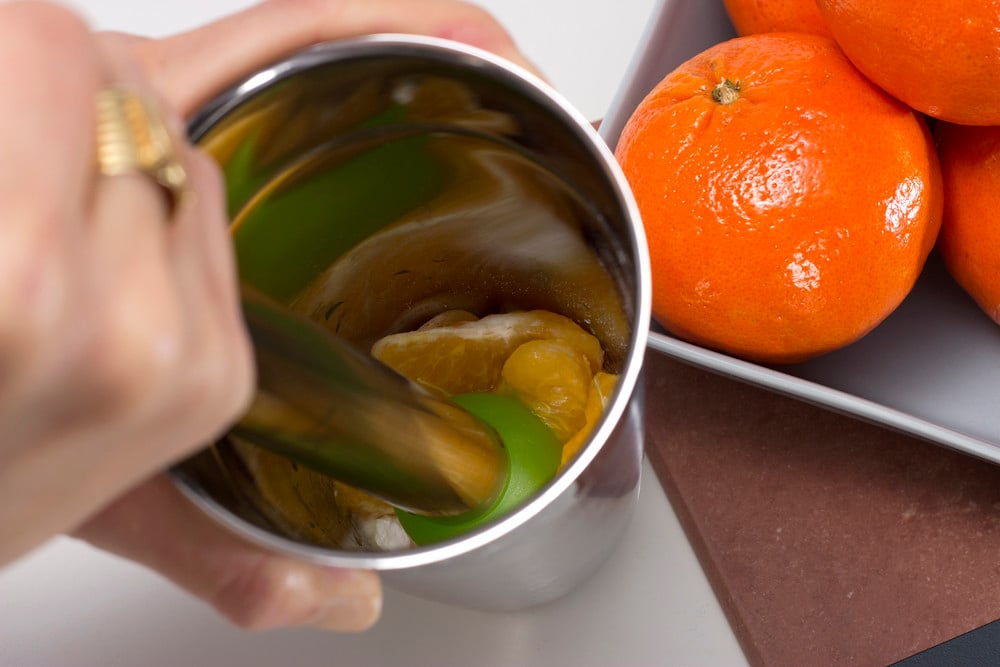

# 捣棒

捣棒（muddler）是调酒时用来在杯中轻压香草、水果与糖块的棒状工具。它看起来像一根短木棍，但长度、头部形状、重量与材质都会影响力度控制、清洁难度与杯具安全。用对工具，捣压会变得可控；用错工具，同一份薄荷可能从清香变成草腥。

图：一只手在金属杯中用木制捣棒轻压青柠，旁边放着几个柑橘。图片：Didriks，CC BY 2.0，来源：[原始页面](https://www.flickr.com/photos/49889671@N03/6353559445)。

## 它解决什么问题

捣棒解决的是“在杯中把香气压出来”的问题。薄荷、罗勒、青柠角与糖块放在杯底，如果没有合适的工具，只能用吧勺背面或手指按压，力度不均匀，也很难伸到杯底。

它让操作者可以在不破坏杯子的前提下施加垂直压力。头部面积适中，能把力分散到原料上，而不是集中成一点戳破杯壁；长度足够时，手可以停留在杯口上方，不必把手指伸进酒液。

它还把“压”与“搅”区分开来。吧勺适合搅拌，但用吧勺碾压香草容易变成研磨；捣棒的形状天生适合短促的垂直按压，提醒使用者控制力度。

## 结构与材料

捣棒通常由两部分构成：头部与棒身。头部是接触原料的部分，形状有平底、圆头与略带纹理的款式；棒身是握持部分，长度与粗细影响手感与杠杆。

常见材料有三类。木材手感温润、成本较低，但会吸收气味与水分，需要更仔细的清洁与干燥；食品级塑料耐用、易清洗，重量较轻；不锈钢坚固、卫生、易清洁，但重量较大，在薄杯中需要更好的控制。

不同材料的表面状态也会影响使用。木材表面若有裂纹或磨损，容易藏污纳垢；塑料头部若有划痕，也可能残留色素与气味；不锈钢如果表面粗糙，摩擦力大，压香草时更容易撕碎叶片。选择时应优先看食品接触安全与表面完整性，而不是只看外观。

## 怎么选

第一，看长度是否匹配常用杯具。捣棒应能伸到常用杯子的底部，同时让手保持在杯口上方；太短会让手指进入酒液，太长则不易控制。

第二，看头部尺寸是否匹配杯口。头部太大放不进窄杯，太小则接触面积不足、压力集中。

第三，看重量与平衡。过重的捣棒在薄玻璃杯中难以收力，过轻则需要更大力气，反而不稳。握持时应感觉重心靠近手部。

第四，看材质与清洁方式。经常处理薄荷、柑橘与糖浆的吧台，应选择易清洗、不易吸味的材料；木材需要手洗与彻底干燥。

第五，看表面完整性。裂纹、缺口、脱落的涂层都不适合继续接触食物。

不要根据“专业感”选购过重或过长的款式。捣棒是手部工具，合适比威猛重要。

## 正确用法

第一步，确认杯具能承受按压。薄壁杯、窄口杯与已经有裂纹的杯子不适合捣压；必要时改用更厚的搅拌杯。

第二步，把原料放入杯底。需要糖的配方，先放糖与少量酸汁，形成磨擦层。

第三步，握稳杯身，另一只手握住捣棒中上部，让捣棒接近垂直。

第四步，用短促、可控的力度向下压，接触原料后轻微转动再抬起。目标是压开植物结构，而不是把叶片捣成碎末。

第五步，观察叶片状态与香气。叶片变深、边缘略软即可停止；出现碎屑与暗色切口说明力度过大。

第六步，取出捣棒，擦净或冲洗，再进行下一步。不要把捣棒留在杯中当搅拌棒使用。

## 替代方案

没有捣棒时，可以用吧勺背面轻压，但接触面积小，力度更难控制；也可以使用木勺的柄部，前提是表面光滑、清洁且不会刮伤杯子。临时替代的关键是“面积适中、表面完整、能伸到杯底”。

如果目的是释放香草香气，也可以用摇和代替捣压：把香草与酒液一起摇和，再通过滤器去掉碎叶。这样香气更分散，但少了捣压的集中感。

如果目的是榨取果汁，捣棒不是合适工具，应使用压榨器或榨汁器。捣棒处理的是“压开”，不是“榨干”。

## 保养与安全

每次使用后应立即清洗。含糖与柑橘的残留会干结在头部与棒身，滋生微生物，也会影响下一杯的味道。木材应手洗、擦干并放在通风处，不要长时间浸泡；是否可进洗碗机应以产品说明为准。

定期检查头部是否有裂纹、缺口或异味。木材吸味后很难彻底去除，出现明显异味时应更换。不锈钢与塑料也应检查表面是否粗糙、是否有难以清洁的缝隙。

安全方面，不要在薄壁杯或窄口瓶中大力按压，杯子破裂与手部割伤都可能发生；不要用捣棒敲击杯沿或桌面；不要用它搅拌冰块，以免头部磨损或杯子受力不均。处理生鲜原料后，应按食品安全要求清洁工具与台面。

## 常见误区

第一，“越重越好”。重量增加控制难度，薄杯中更容易失控。

第二，“任何木棍都能当捣棒”。食品接触安全、表面完整性与清洁难度都需要考虑。

第三，“木头不用洗”。木材会吸味与吸水，必须及时清洗并彻底干燥。

第四，“捣压就是研磨”。捣棒的目标是压开香气结构，研磨会带来苦涩。

第五，“捣棒可以代替摇和”。捣压只处理原料，冷却、稀释与整体混合仍需后续步骤。

第六，“捣棒可以一直留在杯里”。它会影响饮用，也可能让叶片继续氧化。

相关条目：[捣压](ref:muddling)、[莫吉托](ref:mojito)、[调酒，是另一种认识酒的方式](ref:basics)。

## 另见

- [捣压](ref:muddling)：捣棒的对应技法与力度控制。
- [莫吉托](ref:mojito)：捣棒最典型的使用场景。
- [调酒基础](ref:basics)：器具在整体流程中的位置。
- [摇酒](ref:shaking)：没有捣棒时的替代思路。
- [香气](ref:aroma)：理解香草与柑橘香气的释放。

**关键事实。**

| 项目 | 内容 |
| --- | --- |
| 一句话定位 | 在杯中轻压香草、水果与糖块的棒状工具；长度、头部形状与材质决定力度控制、清洁难度与杯具安全 |
| 材质 | 木材、食品级塑料、不锈钢 |
| 用途 | 在杯中轻压香草、水果与糖块，使香气与汁液释放 |

**来源与边界。** 本页关于「捣棒」的关键事实，主要由以下来源交叉核对：International Bartenders Association（含新鲜香草与柑橘的配方及其器具）、Difford's Guide（捣棒与香草处理的公开说明）、Oxford University Press（提供关于吧台器具与捣压技法的条目；由原条目末尾参考资料迁移，未逐条复核访问日期）。价格、批次与状态会变，涉及这些字段时以页面所列来源的最新版本为准。正文为项目自写，来源只作核验，不复制原文。
