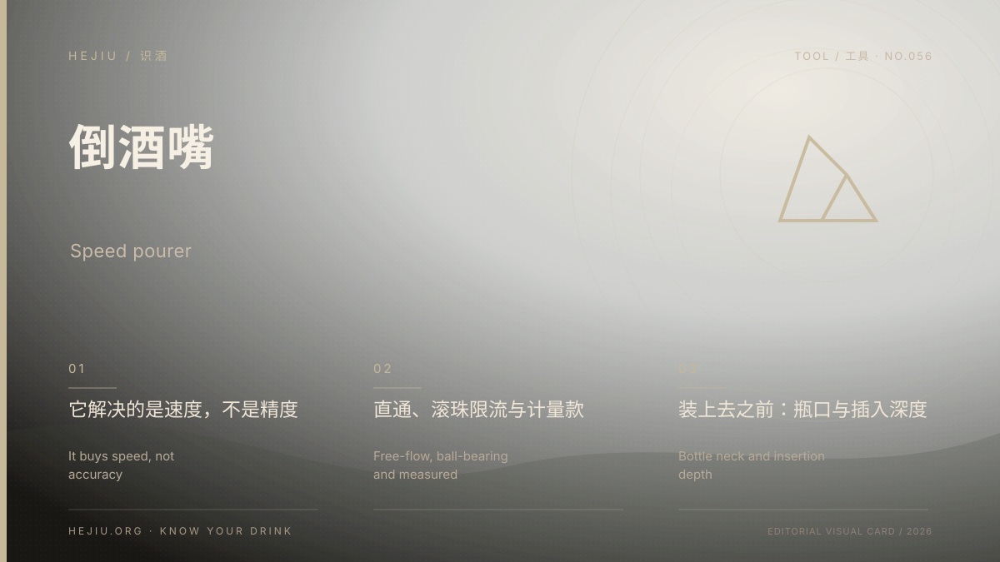

# 倒酒嘴

倒酒嘴（speed pourer）是插在烈酒瓶口的小配件。它把宽大的瓶口收成一个细嘴，让酒液以更稳定的速度流出，也把“最后一滴顺着瓶身流下来”的问题挡在瓶外。对需要连续出品的吧台，它几乎是标配；但它常被误解成“计量工具”，这是两回事。

图：倒酒嘴 双语视觉卡（项目自绘 SVG）。不是实拍。

> **先给结论**
> **一句话：** 这页判断倒酒嘴值不值得买，以及有没有替代方案。
>
> - **适合谁：** 想弄懂倒酒嘴的用途、替代方案和使用边界的人。
> - **不适合谁：** 只想要工具清单、不关心使用场景的人。
> - **先看这两点：**
>   - 装上倒酒嘴后，酒液进入摇酒壶或搅拌杯的速度变快，这会改变操作节奏，也会改变配方里“倒几秒”的换算。
>   - 倒酒嘴的核心作用是让单手倒酒变得可控。

## 它解决的是速度，不是精度

倒酒嘴的核心作用是让单手倒酒变得可控。没有它，宽瓶口在倾斜时酒液会突然涌出，收手时又容易滴漏；有了细嘴，流速被限制在一个较窄的范围，倒酒的动作可以更快、更连贯。

它带来的“一致性”是动作层面的一致性：同样的倾角、同样的时间，倒出的量大致相同。常被引用的量级是每秒约 30 毫升（1 盎司），实际速度会随瓶内液位、酒液黏度和倾角变化。这足以支撑熟练 Bartender 的“数秒倒酒”，但不等于精确。

精确配方仍然要用[量酒器](ref:jigger)。量酒器给出的是确定体积，倒酒嘴给出的是可重复的动作。两者不冲突：很多吧台先用倒酒嘴快速倒入，再用量酒器核对；或者只在客流量大的基酒上装倒酒嘴。

## 直通、滚珠限流与计量款

最常见的直通款（free-flow）内部没有阻流结构，只有一个收窄的出酒口，流速快，适合高频使用的基酒。

滚珠限流款在嘴内加了一颗小球或限流片，酒液必须绕过它才能流出，速度更慢、更均匀。它常被叫作“计量嘴”，但它并不计量，只是限流。倒出的量仍取决于倒多久。

真正的计量款（measured pourer）内部有定量腔，倒一次释放固定体积，比如 30 毫升，倒完会自动停止。它更接近计量工具，但结构复杂、清洗麻烦，价格也高，多用于需要严格控制成本的场合。

还有一种带翻盖的倒酒嘴，倒完自动闭合，能减少果蝇和灰尘进入，也减少酒精挥发。它适合露天或吧台环境较差的场所。

## 装上去之前：瓶口与插入深度

倒酒嘴靠锥形的尾部塞进瓶口，靠摩擦力固定。不同瓶口的直径、壁厚和瓶唇形状不一样，通用款并不真的通用。

插入前先擦干净瓶口，酒液残留会让倒酒嘴打滑，也容易粘灰。把倒酒嘴垂直压入，直到尾部与瓶口贴合、露出瓶唇的部分稳定不晃。不要用蛮力硬塞：塞得太浅会漏酒，塞得太深可能顶到瓶颈，影响流速，甚至让倒酒嘴取不出来。

软木塞封口的酒瓶和螺旋盖瓶口的内径不同，购买时应按瓶口内径选配，或以产品标注的适用瓶型为准。吧台常见做法是给同一款基酒固定一个倒酒嘴，换瓶时整体转移，避免反复插拔。

## 流速变了，配方也要跟着变

装上倒酒嘴后，酒液进入摇酒壶或搅拌杯的速度变快，这会改变操作节奏，也会改变配方里“倒几秒”的换算。倒酒只是[调酒基础](ref:basics)里最靠前的一步，后面还有冰、稀释和装饰。

对于[摇和](ref:shaking)类配方，比如[大吉利](ref:daiquiri)，基酒、糖浆和青柠汁的比例必须准确，倒酒嘴只负责把基酒快速送进[摇酒壶](ref:shaker)，比例仍靠量酒器或称重。流速快不等于可以少倒，习惯“数秒”而不核对的吧台，最容易在忙碌时出现偏差。

对于搅拌类配方，流速影响的是操作时间，而不是配方本身。搅拌需要的是冰、时间和温度，倒酒快一点不会让酒更好喝，但能让连续出品更顺。

黏稠的利口酒、糖浆和带果肉的液体不适合装倒酒嘴。它们会堵塞细嘴，流速忽快忽慢，清洗也困难。倒酒嘴只适合清澈、流动性好的烈酒。

## 清洗频率与果蝇

倒酒嘴内部是一个潮湿、带糖分和酒精的小空间，是果蝇最喜欢的地方。酒液残留在嘴内干结后，会形成黏层，招来果蝇，也会让下一杯带上旧酒的味道。

高频使用的吧台应每天冲洗一次：用温水从嘴口和尾部两个方向冲，把残留冲掉，必要时用细刷通一下。每周做一次较彻底的浸泡清洗，晾干后再装回。不要用洗碗机，高温会让塑料变形、橡胶圈老化。

瓶身也要擦。倒酒嘴漏出的酒会顺着瓶身流下，形成黏圈，招灰招虫。换瓶时顺便擦瓶口和瓶肩，比事后清理省事。

如果倒酒嘴带翻盖，检查铰链处是否积垢；翻盖合不严时，密封作用就消失了，应该更换。

## 什么时候应该把它拔下来

第一，碳酸饮料瓶。气泡在瓶内受压，倒酒嘴会阻碍排气，开瓶时可能喷溅，甚至把倒酒嘴顶飞。碳酸饮料应使用专用瓶塞或直接开瓶。

第二，黏稠或带果肉的液体。糖浆、果泥、利口酒会堵塞细嘴。

第三，需要精确计量的场合。单杯售价高、配方严格的酒，应直接用[量酒器](ref:jigger)或称重，不要依赖“数秒”。

第四，需要展示瓶身的酒。陈年烈酒、限量款、客人想看的酒瓶，倒酒嘴会破坏瓶口的完整感。

第五，长期不用的酒。倒酒嘴不是密封盖，长期存放会加速酒精挥发和氧化；存放时应换成原塞。

如果不想依赖“数秒”倒酒，替代方案有两条：一是回到量酒器，逐杯量取；二是使用电子计量倒酒器，通过按键、称重或流量计控制出酒量。后者适合菜单固定、客流稳定的吧台，但需要电源或电池，清洗也比普通倒酒嘴麻烦。

## 选购看什么

第一看材质。不锈钢嘴耐用、易清洗；塑料嘴轻、便宜，但容易老化、染色。接触酒液的部分应耐酒精和酸。

第二看密封。尾部应有合适的锥度和弹性，插入后不渗漏；橡胶圈老化后要及时更换。

第三看通气。多数倒酒嘴侧面有一个小通气孔，让空气进入、酒液顺畅流出。通气孔堵塞会导致流速忽快忽慢、液体“咕咚”跳动。

第四看是否带盖。翻盖款能防虫防尘，但清洗更麻烦；无盖款简单，但需要另配瓶塞。

第五看是否可拆洗。能拆成两件的款式更容易彻底清洗。

第六看瓶口适配。购买前量一下常用瓶口的内径，或以产品标注为准。

## 安全边界：碳酸饮料瓶

碳酸饮料瓶内有一定压力，倒酒嘴的细嘴和通气孔会改变排气路径。开瓶瞬间，压力可能把酒液和倒酒嘴一起推出，造成喷溅或飞物伤人。

不要在碳酸饮料瓶上安装倒酒嘴，也不要把普通倒酒嘴当作密封塞使用。需要保存气泡时，应使用专用的碳酸饮料瓶塞。

另外，倒酒嘴让瓶口变窄，倒酒时如果倾角过大，酒液仍可能从通气孔溢出。倒酒时应让瓶身与杯口保持距离，眼睛看着杯口，不要一边倒一边转头说话。

## 常见误区

第一，“装了倒酒嘴就能自动计量”。它只控制流速，不计量；精确配方仍要量酒器。

第二，“所有瓶子都能用同一个”。瓶口内径不同，通用款并不通用。

第三，“倒酒嘴不用洗”。残留酒液会招果蝇、影响风味，必须定期清洗。

第四，“流速越快越好”。过快会溢出、增加误差，也会让酒液飞溅。

第五，“可以装在可乐瓶上”。碳酸压力会导致喷溅和倒酒嘴飞出。

第六，“倒酒嘴可以长期当瓶塞”。它不是密封件，长期存放会氧化。

## 另见

- [量酒器](ref:jigger)：精确计量，与倒酒嘴分工明确。
- [摇酒壶](ref:shaker)：接收倒酒嘴送来的基酒。
- [摇和](ref:shaking)：需要准确比例的技法。
- [大吉利](ref:daiquiri)：比例敏感、适合说明计量重要性的酒款。
- [调酒基础](ref:basics)：倒酒与计量在出品流程中的位置。
