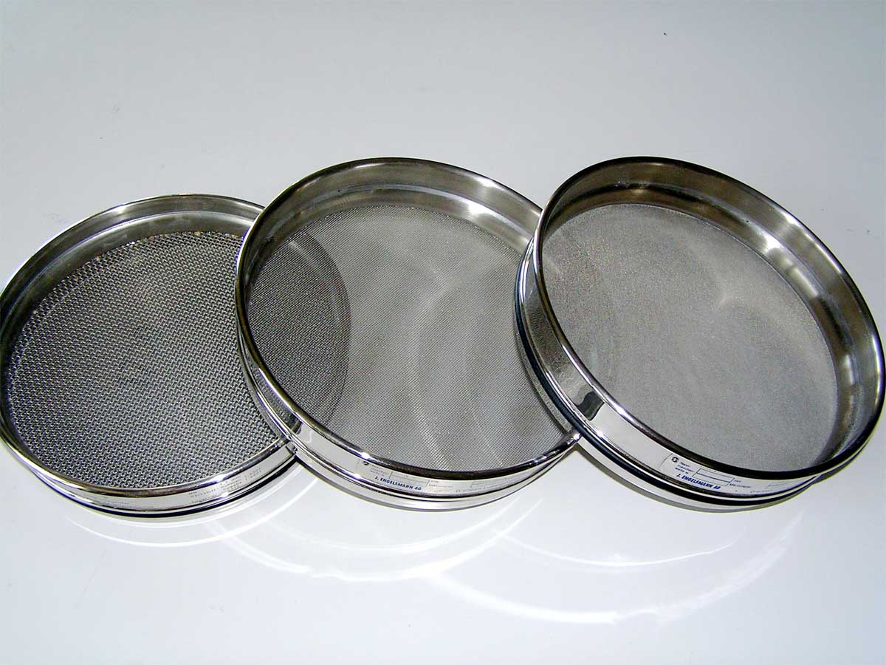

# 滤冰器

滤冰器（strainer）是倒在杯口、用来拦住冰块与固体残渣的工具。搅拌或摇和结束后，酒液需要与冰块分离，否则成品会继续稀释，碎冰也会影响口感与外观。滤冰器看起来只是“一个筛子”，但滤孔大小、贴合度与使用方式都会改变成品。

图：滤冰器。图片：User:BMK，CC BY-SA 3.0，via Wikimedia Commons（[原图页面](https://commons.wikimedia.org/wiki/File:Laboratory_sieves_BMK.jpg)）。

## 类型与形制

最常见的两类是霍桑滤冰器与朱利普滤冰器。霍桑滤冰器带有弹簧线圈，能贴合不同直径的摇酒壶或搅拌杯，滤孔较细，适合拦下碎冰；朱利普滤冰器形似带孔的勺子，常用于搅拌杯，贴合度依靠杯口尺寸。

还有细网滤器，通常与霍桑滤器叠用，用于二次过滤。它能拦下更细的果肉、香草碎屑与冰渣，让成品更清澈；但也会拦下部分油脂与气泡，改变口感。选择时应先明确配方要的是清澈还是保留质地。

## 尺寸与贴合

滤冰器的直径必须与杯口或摇酒壶口匹配。太小会滑入杯中，太大则无法固定，倒酒时容易翻倒。霍桑滤冰器的弹簧线圈可以适应一定范围的直径，但仍应确认在常用器具上稳固。

滤孔大小决定过滤效果。细孔能拦住碎冰与果肉，但流速慢，倒酒时需要更稳；粗孔流速快，但碎冰容易通过。双层过滤可以兼顾，但会增加操作步骤与清洗负担。

## 使用步骤

第一步，把滤冰器扣在杯口或摇酒壶口，确认稳固。第二步，一手握住杯身与滤冰器，另一手控制倒酒角度。第三步，缓慢倾倒，让酒液通过滤孔，冰块与残渣留在上方。

第四步，倒完后轻敲滤冰器边缘，让附着的酒液落下，但不要用力拍打，以免碎冰掉入杯中。第五步，如果需要二次过滤，把细网滤器放在霍桑滤器下方，形成双层。第六步，立即清洗滤冰器，避免糖浆与果肉干结。

## 参数与判断

流速、滤孔与倾斜角度共同决定过滤效果。倾斜角度大，流速快，但碎冰更容易通过；角度小，过滤更干净，但耗时更长。含果肉、捣压香草或蛋清的配方，通常需要更细的过滤；以酒类与苦味酒为主的搅拌配方，则只需要拦住冰块。

过滤也会改变口感。细网会拦下部分气泡与颗粒，让成品更清澈、更顺滑；但过度过滤可能损失质地与香气。是否需要二次过滤，应看配方目标，而不是默认“越干净越好”。

## 失败案例

第一，滤冰器尺寸不匹配。倒酒时滑动或翻倒，酒液洒出，甚至把冰块倒入杯中。第二，倒得太快。碎冰被冲过滤孔，成品出现冰渣。

第三，没有预冷滤冰器。温热器具会让酒液升温，也会让气泡更活跃。第四，滤冰器不干净。残留的糖浆与果肉会污染下一杯，也可能堵塞滤孔。

第五，用滤冰器代替滤网。需要拦截细颗粒时，单层霍桑滤器不够，应加细网。第六，倒完后用力拍打。碎冰与残渣被震入杯中，前功尽弃。

## 与搅拌、摇和的关系

[搅拌](ref:stirring)结束后，滤冰器负责把冰块与酒液分离，让成品保持清澈；[摇和](ref:shaking)结束后，滤冰器还要拦住碎冰与可能的果肉、蛋清碎片。搅拌杯与[摇酒壶](ref:shaker)的杯口尺寸不同，滤冰器应分别匹配。

[搅拌杯](ref:mixing-glass)通常搭配朱利普滤冰器或霍桑滤冰器；摇酒壶则多用霍桑滤冰器。器具之间的匹配，比单独追求“高级滤器”更重要。

## 材质与保养

不锈钢滤冰器耐用、易清洁，是最常见的选择。使用后应立即用温水冲洗，清除糖浆、果肉与香草碎屑；细网部分容易堵塞，必要时用软刷轻刷，避免用尖锐工具戳刺。

清洗后应擦干或倒扣晾干，避免水渍与氧化。弹簧线圈与滤网是易损部位，出现变形、锈斑或断裂时应更换。滤冰器不宜用来压碎冰块或撬动硬物，以免变形。

## 常见误区

第一，滤冰器越大越好。尺寸必须与杯口匹配，过大反而不稳。

第二，滤孔越细越好。细孔过滤更干净，但流速慢，也会拦下部分气泡与质地。

第三，倒得越快越省事。快速倾倒会把碎冰冲过去，成品出现冰渣。

第四，滤冰器可以替代细网。单层滤器拦不住细颗粒，需要二次过滤时应加细网。

第五，滤冰器不需要清洗。残留物会污染下一杯，也会堵塞滤孔。

## 选购建议

选购时先确认常用搅拌杯与摇酒壶的杯口直径，再选择能稳固贴合的款式。家庭使用可以准备一只霍桑滤冰器与一只细网滤器；高频出品的吧台应按器具尺寸准备多种规格。

购买后先空杯试扣，确认不滑动、不刮杯口，再用清水与冰块练习倾倒。工具的价值在于稳定复现，而不是外观。

对照阅读：[搅拌](ref:stirring)、[摇酒壶](ref:shaker)。

## 延伸阅读

- [搅拌](ref:stirring)：搅拌结束后的过滤衔接。
- [摇和](ref:shaking)：摇和后的碎冰与残渣处理。
- [摇酒壶](ref:shaker)：滤冰器的主要搭配器具。
- [搅拌杯](ref:mixing-glass)：搅拌型配方的容器。
- [吧勺](ref:spoon)：搅拌与引导倾倒的配套工具。

**关键事实。**

| 项目 | 内容 |
| --- | --- |
| 一句话定位 | 把冰块、碎冰与固体残渣拦在杯外的吧台工具；常见霍桑滤冰器与朱利普滤冰器，细网滤器用于二次过滤 |
| 材质 | 不锈钢 |
| 用途 | 过滤冰块、碎冰与固体残渣，控制成品口感与清澈度 |

**来源与边界。** 本页关于「滤冰器」的关键事实，主要由以下来源交叉核对：International Bartenders Association（鸡尾酒的调制与过滤方法）、Oxford University Press（提供关于滤冰器与吧台工具的条目；由原条目末尾参考资料迁移，未逐条复核访问日期）、Difford's Guide（吧台器具与过滤技法的公开说明）。价格、批次与状态会变，涉及这些字段时以页面所列来源的最新版本为准。正文为项目自写，来源只作核验，不复制原文。

**并读。** 把「滤冰器」与「搅拌」、「摇酒」、「摇酒壶」放在一起读时，先确认它们是同一层级还是上下游关系：先确认用途与材质，再比较尺寸、手感与替代方案。本页负责给出工具的基本坐标，对照条目补上具体案例与差异；读完再回到本页，才能分清哪些差别属于工具本身，哪些只是产地、批次或品牌选择。

**适用边界。** 对「滤冰器」而言，材质与尺寸会影响手感；替代工具可以完成动作，但精度与效率不同。
