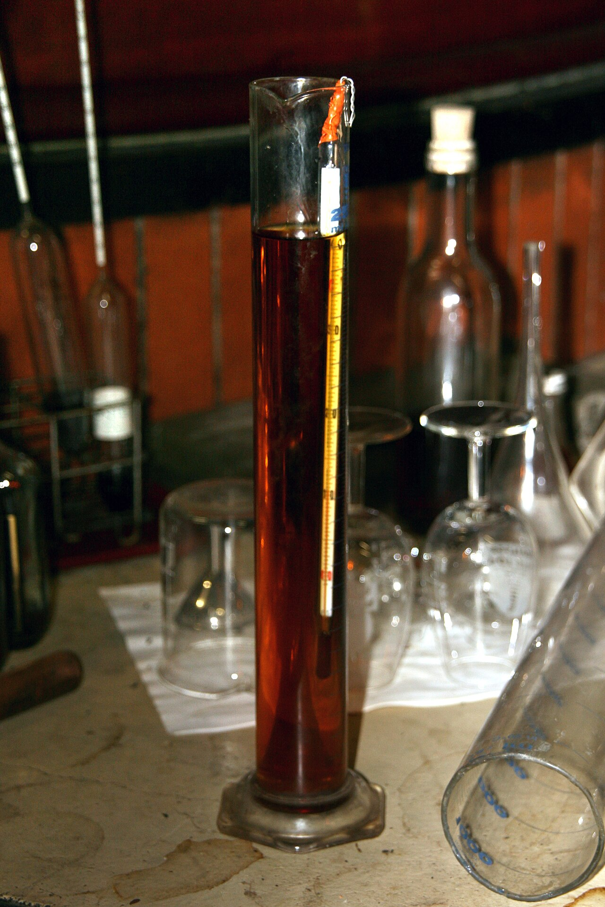

# 温度计

温度计是测量温度的工具。在酒的世界里，它有三个常见用途：测酒液温度、测瓶身温度、测储存环境温度。温度影响香气、口感、气泡与发酵，所以“知道多少度”比“觉得差不多”更可靠。关于葡萄酒的温度范围，可以参考[葡萄酒](ref:wine)。

温度计的类型很多：探针式、红外式、贴片式、玻璃酒精式。它们的测量对象不同，精度也不同；选错类型，读数会偏离，甚至完全不可用。

图：一只葡萄酒温度计。图片：Sémhur，CC BY-SA 4.0，via Wikimedia Commons（[原图页面](https://commons.wikimedia.org/wiki/File:Wine_thermometer_-_20091205.jpg)）。

## 类型与测量对象

探针式温度计最适合测酒液。探针插入液体，读数直接反映酒液温度；它的响应速度中等，精度较高，适合家庭与餐厅。探针要清洁，插入前要消毒，避免污染。

红外式温度计最适合测表面。它测量物体表面的红外辐射，不接触酒液，适合测瓶身、醒酒器外壁与酒窖墙面；但它不能测透明液体内部，也不能隔着玻璃准确测量。

贴片式温度计最适合测瓶身。它贴在瓶外，显示瓶壁温度；瓶壁温度不等于酒液温度，但能作为参考。玻璃酒精式温度计便宜、稳定，但响应慢，适合测环境，不适合快速测酒。

## 温度与酒的关系

温度影响香气的释放。温度太低，香气被压住，酒体显得封闭；温度太高，酒精挥发快，香气刺鼻，口感变松。白葡萄酒通常比红葡萄酒温度低，起泡酒更低，甜酒通常更低。

温度也影响气泡。起泡酒温度越低，二氧化碳越容易留在酒液中；温度升高，气泡逸出快，口感变“平”。冰桶与冰箱的作用，是让酒液回到合适温度，而不是越冷越好。

温度还影响发酵。发酵过程中，温度决定酵母的活性与风味物质的生成；温度过高，发酵过快，杂味增加；温度过低，发酵停滞。关于发酵，可以参考[发酵](ref:fermentation)。

## 适合什么场景

温度计适合需要精确控温的场景：餐厅服务、酒窖管理、发酵监控、盲品训练。它能把“感觉”变成“读数”，让温度判断有依据；对新手，它也是学习温度与香气关系的工具。

它不适合替代经验。温度计告诉你“多少度”，但不告诉你“这杯酒现在好不好喝”；香气、口感与个人偏好，仍然需要品尝判断。温度是变量，不是标准答案。

它也不适合测量所有液体。红外温度计不能测透明液体内部；探针温度计不适合测正在沸腾的液体；玻璃温度计不适合测快速变化的温度。选温度计，要先看测量对象。

## 使用与校准

第一步，清洁探针。探针插入酒液前，用酒精棉片擦拭，再用清水冲净；避免把灰尘、油脂与细菌带进酒里。

第二步，插入位置。探针要插入酒液中部，不要碰到杯壁或冰块；碰到杯壁，读数会偏向杯壁温度；碰到冰块，读数会偏低。

第三步，等待稳定。温度计需要时间响应，读数稳定后再记录；不要刚插入就读数，也不要反复移动探针。

第四步，定期校准。用冰水混合物（0 摄氏度）与沸水（约 100 摄氏度，视海拔）做参考，检查读数是否偏差；偏差较大时，按说明书校准或更换。关于温度与服务，可以参考[加冰与温度](ref:ice)。

## 清洗与保养

探针要每次使用后清洗。用温水与少量中性洗涤剂，擦洗探针表面，再用清水冲净；不要浸泡整个电子部件，以免进水。

红外温度计要保护镜头。镜头脏了，读数会偏差；用软布轻轻擦拭，不要用硬物刮。贴片式温度计要避免反复撕贴，以免失去粘性。

存放时避免高温与潮湿。电子温度计不要放在灶台边或阳光直射处；玻璃温度计要避免碰撞，以免破裂。电池式的要定期检查电量，低电量会让读数不稳。

## 常见误区

第一，用红外温度计测酒液内部。红外只能测表面，透明液体的内部读数不可靠；测酒液要用探针。

第二，探针碰到杯壁或冰块。读数会偏向杯壁或冰块的温度，不是酒液的真实温度；探针要插入酒液中部。

第三，忽略校准。温度计会漂移，长期不校准，读数可能偏差几度；定期用冰水与沸水检查。

第四，把温度计当“好坏标准”。温度合适，酒不一定好喝；温度只是变量，香气与口感仍需品尝判断。关于香气，可以参考[香气](ref:aroma)；关于倒酒，可以参考[倒酒](ref:pouring)。

酒窖管理也常用温度计。酒窖的温度要稳定，波动比绝对数值更重要；温度计要放在代表整体环境的位置，不要靠近门口、暖气或酒架背面。每天同一时间记录，比偶尔测一次更有意义；长期记录能看出季节变化与设备问题。记录时要同时写下湿度，因为湿度与温度共同影响瓶塞与酒标。

对照阅读：[加冰这件事，没有标准答案](ref:ice)、[发酵](ref:fermentation)。

相关条目：[葡萄酒](ref:wine)。

**关键事实。**

| 项目 | 内容 |
| --- | --- |
| 一句话定位 | 测量酒液、酒瓶或酒窖温度的工具，常见探针式、红外式与贴片式；读数要稳定，校准要定期，测量位置要代表整体 |
| 材质 | 不锈钢、玻璃、塑料 |
| 用途 | 测量酒液、瓶身与储存环境的温度 |

**来源与边界。** 本页关于「温度计」的关键事实，主要由以下来源交叉核对：Oxford University Press（酒水温度与服务背景）、Encyclopaedia Britannica（葡萄酒温度与发酵背景）、Corning Museum of Glass（温度计与玻璃器物的工艺背景）等 4 条来源。价格、批次与状态会变，涉及这些字段时以页面所列来源的最新版本为准。正文为项目自写，来源只作核验，不复制原文。

**并读。** 把「温度计」与「加冰这件事，没有标准答案」、「葡萄酒」、「发酵」放在一起读时，先确认它们是同一层级还是上下游关系：先确认用途与材质，再比较尺寸、手感与替代方案。本页负责给出工具的基本坐标，对照条目补上具体案例与差异；读完再回到本页，才能分清哪些差别属于工具本身，哪些只是产地、批次或品牌选择。

**适用边界。** 对「温度计」而言，材质与尺寸会影响手感；替代工具可以完成动作，但精度与效率不同。

**更新提示。** 「温度计」最近核对于 2026-11-20；尺寸、材质、容量与替代品会变，购买前以厂商规格为准。

**编者注。** 本页把「温度计」作为工具条目处理：定义、流程与关键数字以正文表格为准，与「加冰这件事，没有标准答案」、「葡萄酒」的差异用对照阅读验证；遇到价格、批次或地址，回到页面所列来源核对。
