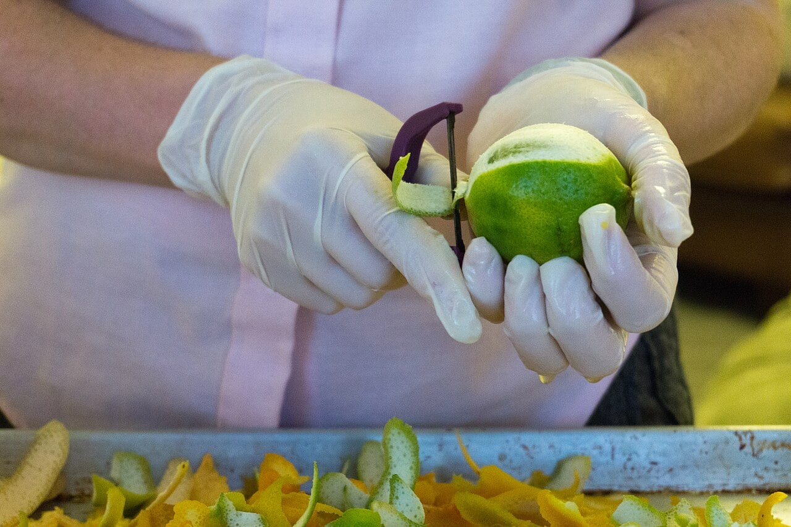

# Y 形削皮器

Y 形削皮器的手柄与刀片垂直相接，从侧面看像一个 Y 或 T。两只手一起工作：一只手握住果实，另一只手握住手柄往下拉，刀片贴着果皮削出一条宽而薄的皮片。它在厨房里用来削土豆、胡萝卜，在吧台里主要用来取柑橘皮和削蔬菜装饰。

图：一名戴手套的厨师用紫色手柄的 Y 形削皮器削青柠，台面上堆着削下的柑橘皮。图片：Jami430，CC BY-SA 4.0，来源：[原始页面](https://commons.wikimedia.org/wiki/File:Chef_uses_a_Y_peeler_to_peel_a_lime.jpg)。

## 为什么是“Y”而不是“I”

直柄削皮器（I 形，也叫 swivel peeler）像一支笔，单手握住向前推或向后拉，刀片可以随曲面转动。它适合长条形蔬菜，手腕动作自然，但削柑橘这种球面果实时，刀片容易在弧面上跳，皮片宽度不好控制。

Y 形把刀片横过来，两只手从果实两侧施力，手腕不需要扭转。拉动方向稳定，皮片宽度更容易保持一致。吧台需要的是整齐、可重复的皮片，而不是最快削完一筐土豆，所以 Y 形在调酒场景里更常见。

代价是灵活性。Y 形削凹面或很小的果实不顺手，青柠这种尺寸的果实，刀片往往比果面还宽，削出来容易带弧。遇到小青柠，用直柄削皮器反而更好控制。

## 刀刃会转与不会转

Y 形削皮器也有两种刀头。可转刀片（swivel）会随着果皮弧度轻微摆动，切削阻力小，适合表面不平的果实，但刀片在厚皮上容易“打颤”，皮片厚薄不均。固定刀片不会动，切口更平整，厚度更一致，但需要操作者自己调整手腕角度去贴合果面。

吧台取柑橘皮，多数人偏好固定刀片：一刀下去厚度稳定，皮片边缘整齐，适合直接做装饰。可转刀片更适合厨房里削形状不规则的蔬菜。购买时可以在同一颗柠檬上各试一刀，看皮片背面带白的程度，比看参数更直接。

## 一刀下去切多深

削皮器的深度由三个因素共同决定：刀片与刀架之间的间隙、下压的力度、刀片相对果皮的角度。

正确的深度同样是只取有色的外层，尽量不碰白色海绵层。下压过重，刀片会扎进白瓤，皮片变厚、发苦、含水；下压太轻，刀片只在表面打滑，削出来的皮片断断续续，也带不出足够的精油。

一个实用的判断方法：第一刀削下来后翻看背面。如果几乎看不到白色，只有薄薄一层浅色，深度就对了；如果背面白得像纸，说明压得太深；如果皮片透明、边缘发毛，说明太浅。根据这一刀再调整力度，比凭感觉更可靠。

果皮的厚度因品种而异。葡萄柚的白瓤厚，容错空间小；柠檬和白柠檬的皮相对薄，容易削得漂亮。表皮打蜡的果实，刀片会打滑，削之前可以用温水洗一遍并擦干。

## 皮片宽度与油脂释放

削皮器的刀片宽度通常在 4–6 厘米，削出来的皮片实际宽度多在 2–3 厘米，因为柑橘是球面，皮片会沿弧线自然收窄。

皮片越宽，被破坏的表皮面积越大，折叠、拧转或挤压时释放的精油越多。宽皮片适合大杯型，比如[古典鸡尾酒](ref:oldfashioned)用的古典杯，一片就能盖住半个杯口；也适合需要明显香气表现的酒。缺点是宽皮片容易带白瓤，重量大，挂在杯口会下垂，时间久了会滑进酒里。

窄皮片（1–2 厘米）更容易控制深度，形状挺，适合小杯型或需要竖立的装饰，但可挤的油少。做[燃烧皮油](ref:flame)时，皮片要够宽、够厚，才能挤出成团的油雾；太薄的皮片油量不足，火苗一闪就灭。

宽度不是越宽越好，而是要和杯型、酒体匹配。轻酒体的酒配窄皮，重酒体或甜味明显的酒可以配宽皮。

## 从柑橘到吧台备料

除了柑橘，Y 形削皮器还能削黄瓜、苹果、萝卜等装饰。黄瓜皮削成薄片后可以卷成筒，贴在杯壁内侧；萝卜削成薄片可以做成小花。这些用法和柑橘皮逻辑相同：只取表层，保持薄而完整。

削柑橘时，先从果顶下刀，让刀片咬住皮，再一口气拉到果底。不要在半途停下重新下刀，接头处会有台阶。削完一面后转动果实，削下一面；一个中等柠檬通常能削出四到六片可用的皮片。

削下来的皮片如果不马上用，可以夹在湿纸巾之间短时保存，但不要泡水，水会带走表皮的油。需要挤油的皮片，最好在出品前再削，切口暴露太久香气会散。柑橘备料与装饰在[调酒基础](ref:basics)里属于同一个出品环节，先削皮还是先榨汁，会影响台面占用和香气留存。

## 替代工具与临时办法

没有削皮器时，小刀（paring knife）是最直接的替代。刀身平贴果皮，用推的动作削下薄片，技术好的人能削得很漂亮，但深度全凭手感，容易切到白瓤，也容易伤手。

[刻槽刀](ref:channel)出的是 3–5 毫米的细长条，不能替代宽皮片；反过来，削皮器也做不出刻槽刀那种连续长条。两者是互补关系，不是替代关系。

刨丝器只能出细丝，适合要香气不要形状的场合。如果只是需要果汁，直接用[压榨器](ref:press)更合适，不必先削皮再挤。

## 手洗、擦干、刀刃朝内

削皮器的刀片很薄，刃口外露，最容易被忽视的风险是随手扔进餐具堆里，伸手去捞时割伤。清洗时刀片朝内，手指不要顺着刃口方向滑。

用完立即用温水冲洗，把卡在刀片和刀架之间的果皮屑冲掉。果皮精油干结后会黏住刀片，影响下一次切削。洗完后擦干，尤其是刀片与刀架的连接处，积水会让金属件生锈或让转轴发涩。

多数削皮器标注可进洗碗机，但高温和洗涤剂会加速塑料手柄老化、让刀片变钝。高频使用的吧台工具建议手洗。刀刃变钝、削皮开始打滑或撕裂果皮时，就该更换；这类刀片通常不能单独磨。

存放时刀片朝内放进抽屉分隔盒，或挂起来，不要和金属工具混放。带保护套的款式更适合随身携带。

## 常见误区

第一，“Y 形比直柄高级”。两者只是适用场景不同，青柠和凹面果实反而更适合直柄。

第二，“削得越厚越香”。厚皮片带白瓤，苦味会盖过香气。

第三，“刀片转得越灵活越好”。可转刀片在厚皮上容易打颤，皮片厚薄不均。

第四，“削皮器可以削任何东西”。它不适合削很软或很硬的表面，也不适合代替小刀做精细修边。

第五，“用完随便冲一下就行”。刀架缝隙里的果皮屑会发霉，也会影响下一杯的风味。

第六，“钝了磨一磨”。这类刀片多为不可磨结构，钝了应更换。

## 另见

- [刻槽刀](ref:channel)：拉细长皮条的工具，与削皮器互补。
- [压榨器](ref:press)：处理果汁的下一步。
- [燃烧皮油](ref:flame)：需要宽皮片和足够油雾的技法。
- [古典鸡尾酒](ref:oldfashioned)：常用宽橙皮表达的经典酒款。
- [调酒基础](ref:basics)：柑橘装饰与备料的整体流程。
