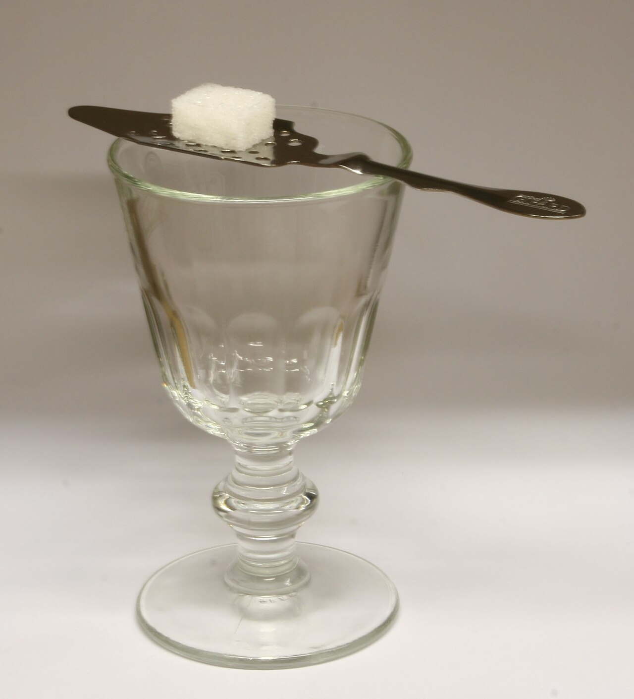

# 苦艾酒杯

苦艾酒杯是一种杯腹宽、杯口略收的玻璃杯，常配一把雕花糖匙。它的形状不是为了好看，而是为了“加水”：把方糖放在匙上，缓慢滴水，水与酒液混合，苦艾酒从翠绿变成乳白。

这种变化叫“乳化”（louche）。苦艾酒中的茴香类化合物溶于高浓度酒精，加水后酒精浓度下降，化合物析出，形成微小的乳浊液。杯子越宽，水与酒接触越充分，乳化越均匀。

图：苦艾酒杯、糖匙与方糖。图片：Cornischong，CC BY-SA 3.0，via Wikimedia Commons（[原图页面](https://commons.wikimedia.org/wiki/File:Absinthe_glass,_spoon_and_sugar.jpg)）。

## 器型与容量

苦艾杯的典型形状是“宽腹、收口、短颈”。宽腹让水与酒有足够的接触面，也让乳化后的酒液看起来更饱满；收口能聚拢香气，减少茴香与酒精的挥发；短颈方便放糖匙，也方便观察颜色变化。

容量通常在 200 到 300 毫升。杯子太小，加水后容易溢出；杯子太大，酒液太少，乳化不明显。杯子要与“一份酒 + 三到五份水”的比例匹配，而不是只看容量。

杯壁通常较薄，以便观察颜色与乳化；薄壁也意味着更容易碎，清洗与存放要更小心。杯底较厚，重心低，放在桌上更稳；杯口略收，糖匙不容易滑落。

苦艾杯有几个常见变体。Pontarlier 杯杯腹更圆、杯口更收，适合传统滴滤；Cordon 杯杯身更直，杯口略宽，适合现代酒吧；还有带刻度的“气泡杯”，杯壁有凸起的小泡，用来标记一份酒的位置。变体不同，但逻辑相同：宽腹、收口、能放糖匙。

它也不等同于普通高脚杯。高脚杯的杯腹太深、杯口太开，水滴容易溅出，糖匙也不稳；苦艾杯的短颈与收口，是为滴滤设计的。选杯时不要只看“像不像”，要看能不能稳定地放糖匙、滴水。杯口的收束还会影响香气：太开，茴香散得快；太窄，又不易观察乳化。

## 糖匙与滴水

糖匙是苦艾杯的配套工具。匙面雕花，能让水均匀滴落；匙柄横跨杯口，能让方糖悬在杯口上方。没有糖匙，可以用小滤网或滴壶代替，但效果不如专用匙均匀。

加水的速度影响乳化。水要慢滴，让酒液逐步稀释；滴得太快，乳化不均匀，酒液会出现分层。传统做法是“滴”，不是“倒”；现代酒吧有时用滴壶，也是为了控制速度。

方糖不是必须。有人直接加水，有人用糖浆；糖的作用是平衡苦艾的苦味与茴香的刺激。加糖前先尝一口，判断是否需要；不要因为“仪式”而加糖。

## 适合什么酒

苦艾杯最适合苦艾酒，也适合其他需要加水稀释的茴香酒，例如 pastis 与 anisette。它也适合需要观察颜色变化的饮品；杯子的宽腹与薄壁，能让乳化过程更清楚。

它不适合短饮与纯饮。杯太大，酒液太少，香气会散；杯口收，也不适合大口饮用。它也不适合热饮，薄壁与宽腹会让热饮迅速降温，手也难以握住。

如果只有一种杯子，苦艾杯不是“万能杯”。它的用途集中在苦艾与茴香酒；日常的加冰纯饮，古典杯更合适；气泡饮，高球杯更合适。关于高脚广口杯，可以参考[高脚广口杯](ref:goblet)。

## 使用与温度

苦艾酒通常加冰水稀释，水温越低，乳化越慢、越均匀；温水会加速乳化，但也可能让香气挥发过快。传统做法用冰水，现代酒吧有时用室温水，取决于想要的口感。

装杯时先倒一份苦艾酒，再把糖匙横跨杯口，放上方糖，缓慢滴水。水与酒的比例通常从 1:3 开始，根据酒精度与个人口味调整；酒精度高，水可以多一点。

不要点火。传统的“燃烧方糖”做法会破坏香气，也有安全风险；现代苦艾酒文化更推荐冷水滴滤。关于倒酒动作，可以参考[倒酒](ref:pouring)。

## 清洗与保养

苦艾杯杯腹宽、杯口收，清洗时容易碰到杯口。手洗时用温水和少量中性洗涤剂，重点清洗杯腹与杯底；充分冲洗，倒扣晾干。不要用硬刷，以免刮伤杯壁。

糖匙要单独清洗。方糖融化后会留下糖渍，糖渍干后很难洗；用完立即用温水浸泡，再用软布擦干。糖匙不要放进洗碗机，雕花缝隙容易残留。

薄壁杯不要堆叠。堆叠会让杯口与杯腹互相碰撞，产生裂纹；最好单独摆放，或使用杯架。长期不用的杯子，要保持干燥，避免水渍与异味。

## 常见误区

第一，用大火烧方糖。燃烧会破坏香气，也有安全风险；冷水滴滤才是更稳定的做法。

第二，水倒得太快。乳化不均匀，酒液会分层；水要慢滴，让酒液逐步稀释。

第三，杯子太小。加水后容易溢出，乳化也不明显；杯子要与比例匹配。

第四，忽略糖匙的清洗。糖渍干后很难洗，也会影响下一次使用。关于苦艾酒本身，可以参考[苦艾酒](ref:absinthe)；关于蒸馏工艺，可以参考[蒸馏](ref:distillation)；关于选杯原则，可以参考[如何选杯](ref:glass)。

对照阅读：[苦艾酒](ref:absinthe)、[高脚广口杯](ref:goblet)。

相关条目：[倒酒](ref:pouring)。

**关键事实。**

| 项目 | 内容 |
| --- | --- |
| 一句话定位 | 杯腹宽、杯口收的玻璃杯，常配雕花糖匙；用于苦艾酒的“加水稀释”仪式，让酒液从翠绿变为乳白 |
| 材质 | 玻璃 |
| 适用 | 苦艾酒、加水稀释的茴香酒 |

**来源与边界。** 本页关于「苦艾酒杯」的关键事实，主要由以下来源交叉核对：Oxford University Press（苦艾酒与加水仪式的历史）、Encyclopaedia Britannica（苦艾酒的工艺与文化背景）、Corning Museum of Glass（玻璃杯型与工艺背景）等 4 条来源。价格、批次与状态会变，涉及这些字段时以页面所列来源的最新版本为准。正文为项目自写，来源只作核验，不复制原文。

**并读。** 把「苦艾酒杯」与「苦艾酒」、「倒酒」、「高脚广口杯」放在一起读时，先确认它们是同一层级还是上下游关系：先确认杯型用途与材质，再比较容量、杯口与香气表现。本页负责给出器皿的基本坐标，对照条目补上具体案例与差异；读完再回到本页，才能分清哪些差别属于器皿本身，哪些只是产地、批次或品牌选择。

**适用边界。** 对「苦艾酒杯」而言，容量与杯型会因生产商不同；杯口、杯腹与材质比“专用杯”标签更重要。

**更新提示。** 「苦艾酒杯」最近核对于 2026-11-20；尺寸、材质、容量与替代品会变，购买前以厂商规格为准。

**编者注。** 本页把「苦艾酒杯」作为器皿条目处理：定义、流程与关键数字以正文表格为准，与「苦艾酒」、「倒酒」的差异用对照阅读验证；遇到价格、批次或地址，回到页面所列来源核对。
