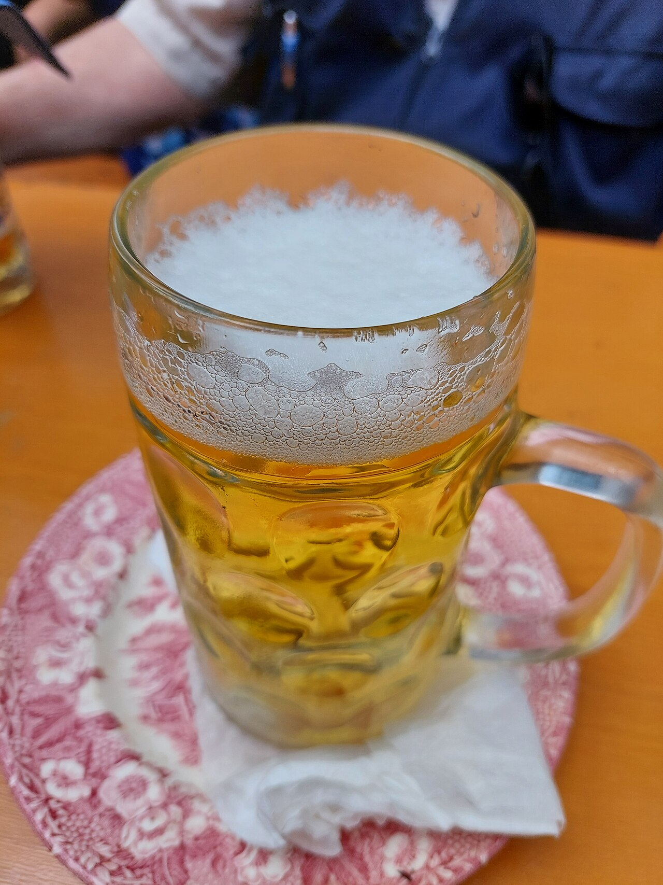

# 啤酒马克杯

啤酒马克杯是一种带把手、杯壁较厚、容量较大的啤酒杯。它常见于德国啤酒馆、节庆与家庭餐桌；把手让手指不必握住杯身，厚壁让酒液保持低温，宽口则方便大口饮用。关于啤酒本身，可以参考[啤酒](ref:beer)。

“马克杯”这个词容易让人想到陶瓷咖啡杯，但啤酒马克杯的范围更广：玻璃、陶瓷、锡器都有。它们的共同点不是材料，而是“把手 + 厚壁 + 大容量”的组合。这个组合服务的是一种轻松的、长时间的饮用方式。

图：一只装满啤酒的玻璃马克杯。图片：AxtImHause，CC BY 4.0，via Wikimedia Commons（[原图页面](https://commons.wikimedia.org/wiki/File:Glass_beer_mug_full.jpg)）。

## 器型与容量

啤酒马克杯的核心特征是“把手、厚壁、直筒或微收口”。把手让手远离杯壁，减少体温对酒液的影响；厚壁增加强度，也让杯子的保冷时间更长；直筒杯口方便大口饮用，微收口则能稍微聚拢泡沫。

容量通常比品脱杯更大，常见从 300 到 500 毫升，也有更大的节庆杯。容量大，适合慢慢喝；但酒液在杯中时间越长，温度越高，泡沫也越容易消失。大杯不是“越多越好”，而是要看饮用节奏。

杯底通常较厚，重心低，放在桌上更稳。厚底也能让杯子的视觉更“重”，符合啤酒馆的粗犷风格；但厚底会增加重量，长时间举杯会累。

## 把手的作用

把手不是为了好看。啤酒通常低温饮用，手指握住杯身会迅速传热，让酒液升温；把手让手指离开杯壁，保冷时间更长。把手也让杯子在碰杯时更稳，不容易滑落。

把手的形状影响握感。粗把手适合大手，细把手适合小手；把手与杯壁的距离要足够，手指才不会碰到杯壁。购买时可以用手试握，确认把手不夹手、不滑手。

没有把手的啤酒杯，例如品脱杯，适合快速饮用与叠放；有把手的马克杯，适合慢慢喝与餐桌场景。两者不是替代关系，而是不同节奏的工具。

## 适合什么酒

啤酒马克杯最适合拉格、小麦啤、皮尔森与部分艾尔。厚壁与宽口让泡沫有空间，也方便大口喝；把手与厚壁让低温保持更久。它不适合需要精细闻香的烈酒，也不适合带气泡的香槟。

它也不适合所有啤酒。品脱杯更适合英式艾尔与需要观察颜色的酒；郁金香杯更适合香气复杂的比利时啤酒；高脚杯更适合修道院啤酒。马克杯的优势是“舒适与容量”，不是“香气层次”。

如果只有一种啤酒杯，选一只厚壁、带把手、容量适中的马克杯最实用。它能应付多数日常啤酒，也能在节庆与聚餐时使用；但它不是品鉴杯，不能替代专门的啤酒品鉴杯。

## 使用与温度

啤酒通常在 4 到 8 摄氏度饮用，具体取决于风格。温度太低，香气被压住；温度太高，二氧化碳逸出快，酒体显得松散。马克杯的厚壁能减缓升温，但不能替代冷藏。

倒酒时先把杯子倾斜，让酒液沿杯壁流下，最后把杯子扶正，让泡沫形成一层。倒得太快，泡沫会溢出；倒得太慢，泡沫不足。关于倒酒动作，可以参考[倒酒](ref:pouring)。

不要把杯子冷冻到结霜。骤冷会让玻璃产生应力，杯口也可能结霜；冷藏杯子即可，不要放进冷冻室。泡沫与香气的关系，可以参考[香气](ref:aroma)。

## 清洗与保养

啤酒马克杯的厚壁与把手容易藏污。手洗时用温水和少量中性洗涤剂，重点清洗把手内侧与杯底；充分冲洗，倒扣晾干。不要用毛巾反复擦杯内，以免留下纤维与气味。

玻璃杯会吸附啤酒的苦味与香气。长期使用的杯子，可以用小苏打水浸泡，再用清水冲净；不要用有强烈气味的清洁剂，也不要把杯子放在潮湿、发霉的地方。

材质也影响保冷与手感。玻璃杯透明，能看到颜色与泡沫，但导热较快；陶瓷杯厚，保冷更好，但看不到酒液；锡器最保冷，也最重，适合节庆与展示。选材质时，先想清楚自己更看重“看”还是“保冷”。

陶瓷与锡器需要不同的保养。陶瓷杯避免骤冷骤热，以免开裂；锡器不要用钢丝球擦，以免留下划痕。无论材料，清洗后都要彻底晾干，避免水渍与异味。

## 常见误区

第一，认为马克杯越大越好。容量大，酒液升温慢，但喝不完会变温、跑气；容量要与饮用人数与节奏匹配。

第二，把杯子冷冻。骤冷会让玻璃产生应力，杯口结霜也会影响泡沫；冷藏即可。

第三，用马克杯品鉴啤酒。厚壁与宽口不利于聚香，品鉴应使用郁金香杯或专门的品鉴杯。

第四，忽略把手内侧的清洗。把手内侧容易残留泡沫与油脂，长期不洗会影响风味。关于其他啤酒杯型，可以参考[品脱杯](ref:pint)；关于选杯原则，可以参考[如何选杯](ref:glass)。

对照阅读：[啤酒](ref:beer)、[换一只杯子，会有什么不同？](ref:glass)。

相关条目：[品脱杯](ref:pint)。

**关键事实。**

| 项目 | 内容 |
| --- | --- |
| 一句话定位 | 带把手、杯壁较厚的大容量啤酒杯，常见于德国啤酒文化；厚壁保冷，把手隔热，宽口便于大口饮用 |
| 材质 | 玻璃、陶瓷、锡器 |
| 适用 | 啤酒、麦芽饮料与部分长饮 |

**来源与边界。** 本页关于「啤酒马克杯」的关键事实，主要由以下来源交叉核对：Oxford University Press（啤酒杯型与饮用文化）、Encyclopaedia Britannica（啤酒品类、泡沫与饮用方式）、Corning Museum of Glass（玻璃杯器型与工艺背景）等 5 条来源。价格、批次与状态会变，涉及这些字段时以页面所列来源的最新版本为准。正文为项目自写，来源只作核验，不复制原文。

**并读。** 把「啤酒马克杯」与「啤酒」、「品脱杯」、「换一只杯子，会有什么不同？」放在一起读时，先确认它们是同一层级还是上下游关系：先确认杯型用途与材质，再比较容量、杯口与香气表现。本页负责给出器皿的基本坐标，对照条目补上具体案例与差异；读完再回到本页，才能分清哪些差别属于器皿本身，哪些只是产地、批次或品牌选择。

**适用边界。** 对「啤酒马克杯」而言，容量与杯型会因生产商不同；杯口、杯腹与材质比“专用杯”标签更重要。

**更新提示。** 「啤酒马克杯」最近核对于 2026-11-20；尺寸、材质、容量与替代品会变，购买前以厂商规格为准。

**编者注。** 本页把「啤酒马克杯」作为器皿条目处理：定义、流程与关键数字以正文表格为准，与「啤酒」、「品脱杯」的差异用对照阅读验证；遇到价格、批次或地址，回到页面所列来源核对。
