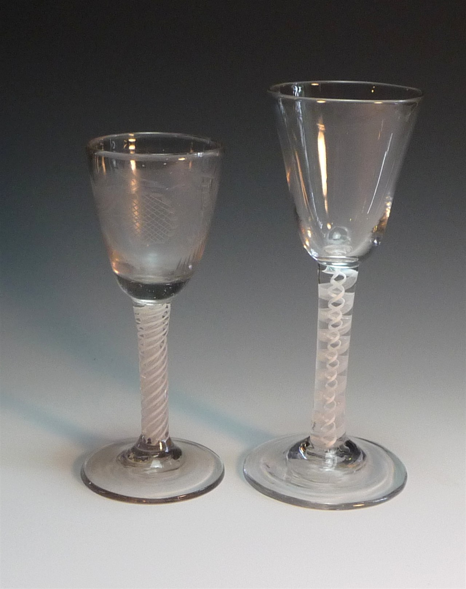

# 雪莉小杯

雪莉小杯（copita）是西班牙雪莉酒品鉴中最常见的小型带梗杯。它像一只缩小的郁金香杯：杯腹收拢，杯口略向外扩，杯梗细长，容量不大。它的用途很明确——用少量酒液、较小的液面与合适的温度，把雪莉的氧化香气送到鼻端，同时避免酒液在杯中迅速变暖。它也是被同名异物困扰最多的杯型之一：在墨西哥，copita 指的是另一种喝龙舌兰的小杯。

图：雪莉小杯。图片：User:Theroadislong，CC BY-SA 3.0，via Wikimedia Commons（[原图页面](https://commons.wikimedia.org/wiki/File:Twisted_stem_glass.JPG)）。

> **先给结论**
> **一句话：** 这页判断雪莉小杯为什么影响香气，以及该配什么酒。
>
> - **适合谁：** 想弄懂雪莉小杯为什么影响香气与口感的人。
> - **不适合谁：** 只想要“买最贵杯子”的结论、不关心酒款匹配的人。
> - **先看这两点：**
>   - 雪莉产自西班牙南部的赫雷斯（Jerez de la Frontera）、圣玛丽亚港（El Puerto de Santa María）与桑卢卡尔（Sanlúcar。
>   - 选购时先看容量与杯腹比例。

## copita 的字面意思是“小杯子”

copita 是西班牙语 copa（杯子、酒杯）的指小词，字面就是“小杯子”。在西班牙的酒馆里，这个词可以泛指任何小杯；在雪莉产区，它逐渐固定为一种特定的品鉴杯：带梗、小腹、收口、容量约一小杯。

这个词的模糊性正是混乱的来源。它既是一个通用的小杯称呼，也是一个有具体形制的杯型名称，还被墨西哥的龙舌兰文化借去指另一种完全不同的杯子。读酒单或买杯子时，需要看形制与容量，而不是只看名字。真正用于雪莉品鉴的 copita，通常有细梗、杯腹小于标准葡萄酒杯、杯口略外扩。

## 雪莉产区的品鉴现场

雪莉产自西班牙南部的赫雷斯（Jerez de la Frontera）、圣玛丽亚港（El Puerto de Santa María）与桑卢卡尔（Sanlúcar de Barrameda）一带。产区的品鉴传统使用一种叫 catavinos 的带梗杯，形状接近郁金香，用来观察颜色、闻香与判断酒体。

值得注意的是，产区管委会的品鉴材料并不主张杯子越小越好。它建议使用杯腹宽裕的杯子，容量约 200 ml，只倒三分之一左右，让酒液有足够的表面释放香气；材料甚至提醒不要用太小的 copita，因为液面太小、酒液太少，香气展不开。这与市场上“copita 就是迷你杯”的印象相反。

因此更准确的理解是：copita 是一个以小型化为特征的杯型家族，常见的品鉴用杯容量在 100–150 ml 之间；产区正式品鉴有时会用更大一些的 catavinos。两者不是对立关系，而是同一传统里不同尺寸的选择——小杯适合快速判断与多次倒酒，大杯适合完整闻香。

## 形制：收拢的杯腹与外扩的杯口

雪莉小杯的轮廓可以分三段看。下部是细梗与杯脚，让手指远离杯腹；中部是收拢的杯腹，最宽处偏下，向上逐渐收窄；上部是杯口，在最后一段略微向外翻。

收拢的杯腹制造了一个“香气漏斗”。酒液表面积不大，但香气在向上通过窄颈时被集中；杯口最后的外翻又让香气在离开杯子前稍微散开，避免全部撞在鼻尖上。这种“先收再放”的结构，与完全收口的杯子不同：它聚香，但不把香气闷住，也决定了[闻香](ref:nosing)时香气到达鼻子的方式。

外扩的杯口还有饮用上的作用。酒液流出时先接触舌尖与前段口腔，甜感与果味先出现，酒精的刺激被推后；对酒精度较高的雪莉与烈酒，这一点很重要。

杯梗是功能件，不是装饰。雪莉通常需要比室温低的温度，手握杯腹会迅速把酒液加热；捏住杯梗可以让温度维持得更久，也便于转动杯子观察挂杯。

## 为什么氧化型香气需要小杯

雪莉的风格跨度很大：菲诺（Fino）与曼萨尼亚（Manzanilla）在酒花覆盖下进行生物陈化，颜色浅、酒体轻，带海盐、青苹果与面包酵母的气息；阿蒙蒂亚多（Amontillado）、奥罗索（Oloroso）与帕洛科塔多（Palo Cortado）经历氧化陈化，颜色深，带核桃、焦糖、干果与香料；佩德罗-希梅内斯（Pedro Ximénez）与麝香（Moscatel）则是浓甜的甜酒。

氧化型香气的特点是“重而散”：坚果、焦糖、干果的分子容易在较大的液面上迅速释放，也容易在宽口杯里混成一团。小杯的作用是给出一个受控的空间：液面不大，香气释放速度有限，收拢的杯腹把这几类气味压在一起，闻起来更像一个整体而不是一堆碎片。

小杯还限制了空气量。菲诺与曼萨尼亚最怕过度接触空气，倒出后应在较短时间内喝完；小杯装少量，喝完再倒，比在大杯里留半杯更合适。对氧化型雪莉，小杯则避免香气一次散尽，让每一口都有内容。

## 温度：雪莉不该在室温里待着

雪莉的酒精度通常在 15% 到 22% 之间，温度对香气的影响比葡萄酒更直接。菲诺与曼萨尼亚通常要冰得比较透，温度低时海盐与酵母气息清晰，温度高时酒精感会盖过细腻的香气；阿蒙蒂亚多与奥罗索适合比室温略低的温度，坚果与焦糖的层次在稍暖时更开放；甜型雪莉可以再暖一点，但也不宜接近室温。

小杯在温度控制上有两面性。杯腹小、酒液少，升温快；但每次倒得少，可以在升温前喝完，再倒新的。杯梗减少手部传热，宽杯口则加速香气与酒精的挥发。实际使用时，把杯子提前冷却，倒酒量控制在一口到几口之间，比单纯追求“杯子够小”更有效。关于品鉴流程与温度的关系，可参考[第一次品鉴](ref:tasting)。

## 与标准葡萄酒杯的差别

标准[葡萄酒杯](ref:wine)的杯腹更大、杯口更宽，设计目标是让酒液有足够表面与空气接触，香气在杯中展开。用它喝雪莉不算错，但有两个问题：一是容量太大，倒一份正常的品鉴量（30–50 ml）会显得空荡，香气被大量空气稀释；二是杯口宽，氧化型香气散得快，菲诺的细腻气息更容易丢失。

雪莉小杯把这些问题反过来处理：杯腹小，让少量酒液也能形成可用的香气空间；杯口略收，减缓香气流失；杯梗更细，减少手温传入。它不追求“让酒呼吸”，而是追求“在短时间内把酒的气味固定住”。

## 与郁金香杯的差别

[郁金香杯](ref:tulip)与雪莉小杯的轮廓相近，常被混用。区别在比例与用途：郁金香杯的杯腹更大、杯口更窄，设计目标是兼顾香气与气泡，常用于香槟、啤酒与香气优先的短饮；雪莉小杯更小，杯口在最后一段外扩，而不是向内收。

外扩的杯口让雪莉小杯的香气更“开放”，适合闻香后立即入口；郁金香杯的收口让香气更集中，适合慢慢闻。用郁金香杯喝雪莉完全可以，尤其当你想强调香气层次时；用雪莉小杯喝香槟则不合适，杯腹太小，气泡很快消散，酒液也容易升温。

## 容量与倒酒量

常见容量约 100–150 ml，市面上也有 90 ml 左右与接近 190 ml 的款式；容量以具体产品为准。容量差异不只是大小问题：杯腹越小，香气越集中，但酒液升温越快；杯腹越大，香气越开放，但少量酒液容易被空气稀释。

倒酒时控制在杯腹的三分之一左右，约 30–50 ml。这个量足以覆盖杯底、形成液面，又不至于让香气空间被酒精填满。倒满会带来两个问题：一是闻香时酒精刺鼻，二是酒液太多，喝到后半杯时温度已经升高。

对烈酒品鉴，倒酒量还应更少，通常 20–30 ml 即可。杯腹留出的空间不是浪费，而是香气与空气混合的地方。

## 它不只用于雪莉

雪莉小杯的形制适合任何需要“少量、聚香、控温”的品鉴场合。威士忌行业有专门的闻香杯（copita 形），容量常在 100–120 ml 左右；一些厂商把同一款杯同时标为雪莉杯与[龙舌兰](ref:tequila)杯，容量接近 190 ml；朗姆、干邑与陈年烈酒的品鉴也常用类似形状。

这类杯子的共同点是：杯腹收拢、杯口略收或略外扩、带梗、容量小。它们不追求一口喝多少，而是让香气在杯中停留得久一点。用雪莉小杯喝威士忌，注意不要倒太多，否则酒精感会压过香气。

## 同名不同物：龙舌兰的 copita

在墨西哥，copita 指的是另一种杯子：一种小型、杯壁较厚、容量约 30–60 ml 的直身或略外扩小杯，常与桑格丽塔（sangrita）一起用于喝龙舌兰或梅斯卡尔。它没有细梗，杯腹不收拢，也不以闻香为主要目的；它的作用是快速喝完一小口烈酒。

把它与雪莉小杯混为一谈，会得出错误的使用方法：用龙舌兰 copita 喝雪莉，杯口太宽、容量太小，香气一散而空；用雪莉小杯喝龙舌兰，杯梗与薄壁反而不适合一口干的喝法。两者共享一个词，不共享形制。

## 选购、清洁与保存

选购时先看容量与杯腹比例。容量以具体产品为准，100–150 ml 是常见的品鉴区间；杯腹最宽处应明显低于杯口，杯口略微外扩，杯梗要细但不过分脆弱，杯脚要平稳。

第二看杯壁与杯口。杯口越薄，饮用时触感越干净，但也越易碎；杯壁厚薄不均会影响观感与香气表现。第三看透明度，品鉴需要观察颜色，带色或磨砂的杯身会干扰判断。

清洗建议手洗，用温水与少量中性洗涤剂，重点冲洗杯腹与杯口交界处，倒扣晾干。不要用毛巾反复擦杯内，纤维与洗涤剂气味会留在杯壁；杯口薄，避免碰撞。存放时不要叠放，细梗是受力薄弱点，最好单层摆放或使用杯架。长期存放前确认杯子完全干燥，避免水汽与储物柜气味。

## 常见误区

第一，“copita 就是雪莉杯”。在西班牙语里它只是“小杯子”，雪莉小杯是其中一种固定形制；在墨西哥，它又指另一种喝龙舌兰的小杯。

第二，“杯子越小越专业”。杯腹太小、倒得太少，香气反而展不开；产区品鉴材料甚至提醒不要用过小的杯子。

第三，“雪莉可以常温喝”。菲诺与曼萨尼亚需要明显低于室温的温度，氧化型雪莉也不宜接近室温；温度错了，香气结构会变形。

第四，“它只能装雪莉”。威士忌、朗姆、龙舌兰与干邑的品鉴也常用类似杯型，关键是少量与聚香。

第五，“倒满才划算”。倒满会让酒精感盖过香气，也让酒液在喝完前升温；三分之一是更合理的起点。

第六，“杯口越窄越聚香”。过窄的杯口会让闻香困难，也不方便清洗；雪莉小杯的杯口通常略外扩，而不是完全收死。

## 另见

- [葡萄酒](ref:wine)：与雪莉小杯最常被对比的杯型体系。
- [郁金香杯](ref:tulip)：轮廓相近但比例不同的杯型。
- [龙舌兰](ref:tequila)：另一个使用“copita”一词的酒类。
- [第一次品鉴](ref:tasting)：品鉴流程与温度控制。
- [闻香](ref:nosing)：如何用小型杯捕捉香气层次。
