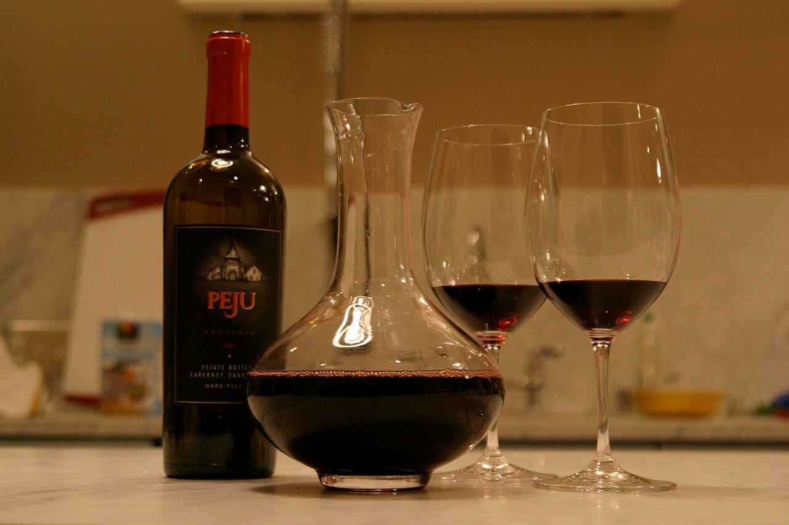

# 醒酒器

醒酒器是用于分离沉淀、让酒液接触空气的玻璃容器。它的形状通常“宽底、长颈、带塞”：宽底让酒液摊开，增加与空气的接触面；长颈让倒酒时手感稳定；带塞能在不喝的时候减少过度氧化。

醒酒器有两个任务，常被混为一谈：一是“除渣”，把陈年酒里的沉淀留在瓶底；二是“透气”，让年轻酒液接触空气，香气展开。两个任务对应不同的醒酒时间，也对应不同的器型。

图：醒酒器与酒瓶。图片：Daryn Nakhuda，CC BY 2.0，via Wikimedia Commons（[原图页面](https://commons.wikimedia.org/wiki/File:Decanter_and_wine.jpg)）。

## 器型与容量

醒酒器的核心是“宽底、长颈、稳定”。宽底让酒液摊薄，接触空气更充分；长颈让倒酒时容易控制；底部要平，放在桌上要稳。器型越宽，透气越快；器型越窄，透气越慢。

容量通常比一瓶酒大，常见从 750 毫升到 1500 毫升。容量太小，酒液会满到瓶颈，接触面不足；容量太大，酒液摊得太薄，香气散得快。容量要与一瓶酒的量匹配，而不是越大越好。

材质有普通玻璃与水晶玻璃。水晶玻璃更薄、更亮，但含铅的水晶不适合长期存放酒液；普通玻璃更耐用，也更适合日常使用。无论材质，醒酒器都要透明，才能观察沉淀与颜色。

## 历史与器型演变

醒酒器的历史与酒瓶、软木塞的历史有关。早期葡萄酒常从大容器分装，醒酒器既是“分装器”，也是“服务器”；后来玻璃工艺进步，醒酒器变得更薄、更透明，成为餐桌上的展示。

18 到 19 世纪，醒酒器出现许多华丽器型：钟形、船形、笛形、带塞的“城堡”形。它们不只是为了透气，也是为了展示酒的颜色与主人的品味。今天的醒酒器更简洁，但“宽底、长颈”的逻辑没有变。

醒酒器的器型也影响服务。宽底醒酒器适合年轻、需要透气的酒；窄底醒酒器适合陈年、容易氧化的酒；带塞的醒酒器适合需要长时间放置的酒。器型不是装饰，而是时间与空气的控制器。

## 适合什么酒

醒酒器适合有沉淀的陈年红葡萄酒，也适合年轻、单宁重、需要透气的红葡萄酒。它可以帮助分离沉淀，也可以让香气展开；对某些酒，醒酒能明显改变口感。

它不一定适合所有酒。老酒、香气脆弱的酒，醒酒时间要短，甚至可以不醒；白葡萄酒通常不需要醒酒，除非有沉淀或明显还原味；起泡酒不适合醒酒，气泡会迅速损失。

它也不适合烈酒。烈酒的香气靠杯型聚拢，醒酒器的宽口会让香气散掉；烈酒如果需要“透气”，通常用杯中的静置，而不是醒酒器。关于葡萄酒，可以参考[葡萄酒](ref:wine)；关于醒酒时的温度，可以参考[加冰与温度](ref:ice)。

## 使用与时间

第一步，直立酒瓶。陈年酒要提前直立，让沉淀落到瓶底；时间从几小时到一天不等，取决于酒龄与沉淀量。

第二步，准备光源。在瓶口下方放一支蜡烛或手电，观察瓶颈处的沉淀；看到沉淀接近瓶口时停止倒酒。

第三步，缓慢倒酒。酒液沿醒酒器壁流下，避免冲击；倒到沉淀接近瓶口时停下，把最后一点留在瓶里。

第四步，控制时间。年轻、单宁重的酒可以醒 1 到 2 小时；老酒通常 15 到 30 分钟，甚至更短；具体要看酒的状态，边醒边尝。关于完整流程，可以参考[醒酒](ref:decanting)。

## 清洗与保养

醒酒器难洗，因为瓶口窄、瓶腹宽。手洗时用温水与少量中性洗涤剂，倒入少量水，旋转，让水接触内壁；再用清水重复冲洗。不要用洗碗机，高温与水流可能让器壁破裂。

顽固的水渍与酒渍，可以用小苏打或专用清洁颗粒浸泡，再用清水冲净；不要用钢丝球或硬刷，以免刮伤玻璃。洗完后倒扣晾干，保持瓶口通风。

水晶玻璃要避免骤冷骤热。不要用热水冲冷醒酒器，也不要把湿醒酒器放进冷冻室；温差会让玻璃产生应力，甚至破裂。存放时避免碰撞，最好放在软垫上。

醒酒器与酒杯的分工也不同。醒酒器负责“分离”与“透气”，酒杯负责“聚香”与“饮用”；醒酒后的酒液要倒回酒杯，而不是直接对着醒酒器喝。醒酒器宽口，香气散得快；酒杯收口，香气聚得拢。两者配合，才能既醒酒又品香，也能让服务流程更自然。

## 常见误区

第一，所有酒都醒。老酒、香气脆弱的酒，醒酒时间要短，甚至可以不醒；醒过头，香气会散。

第二，醒酒器越大越好。容量太大，酒液摊得太薄，香气散得快；容量要与酒量匹配。

第三，用醒酒器醒起泡酒。气泡会迅速损失，起泡酒不适合醒酒。

第四，忽略清洗。醒酒器瓶口窄，残留的酒渍会氧化、变味；每次使用后都要彻底清洗。关于软木塞污染，可以参考[软木塞污染](ref:taint)；关于酒杯，可以参考[红酒杯](ref:glass)。

对照阅读：[醒酒](ref:decanting)、[红酒杯](ref:glass)。

相关条目：[葡萄酒](ref:wine)。

**关键事实。**

| 项目 | 内容 |
| --- | --- |
| 一句话定位 | 用于分离沉淀、让酒液接触空气的玻璃容器，常见宽底、长颈、带塞；醒酒时间要看酒龄、酒体与香气 |
| 材质 | 玻璃、水晶玻璃 |
| 适用 | 葡萄酒、陈年酒与需要透气的酒 |

**来源与边界。** 本页关于「醒酒器」的关键事实，主要由以下来源交叉核对：Oxford University Press（醒酒器与葡萄酒服务背景）、Encyclopaedia Britannica（醒酒与沉淀的历史）、Corning Museum of Glass（醒酒器器型与玻璃工艺）等 5 条来源。价格、批次与状态会变，涉及这些字段时以页面所列来源的最新版本为准。正文为项目自写，来源只作核验，不复制原文。

**并读。** 把「醒酒器」与「醒酒」、「葡萄酒」、「红酒杯」放在一起读时，先确认它们是同一层级还是上下游关系：先确认杯型用途与材质，再比较容量、杯口与香气表现。本页负责给出器皿的基本坐标，对照条目补上具体案例与差异；读完再回到本页，才能分清哪些差别属于器皿本身，哪些只是产地、批次或品牌选择。

**适用边界。** 对「醒酒器」而言，容量与杯型会因生产商不同；杯口、杯腹与材质比“专用杯”标签更重要。

**更新提示。** 「醒酒器」最近核对于 2026-11-20；尺寸、材质、容量与替代品会变，购买前以厂商规格为准。

**编者注。** 本页把「醒酒器」作为器皿条目处理：定义、流程与关键数字以正文表格为准，与「醒酒」、「葡萄酒」的差异用对照阅读验证；遇到价格、批次或地址，回到页面所列来源核对。
