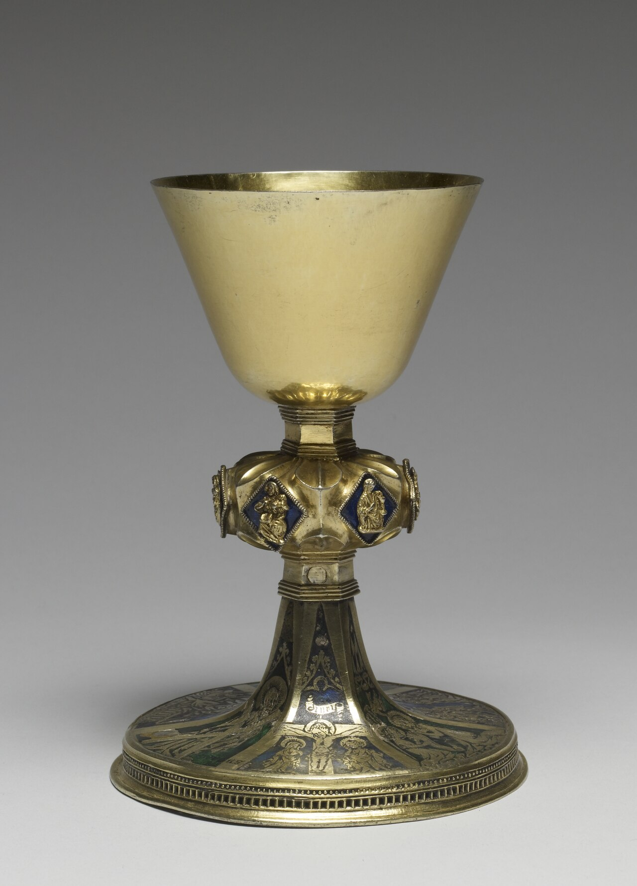

# 高脚广口杯

高脚广口杯（goblet）是一只带梗、杯腹宽、杯口开放的杯子。它看起来像一只被放大、放宽的酒杯：杯腹有足够的空间让酒液展开，杯口不内收，香气与泡沫都可以自由地向上升。它在比利时啤酒文化里尤其常见，也被用于部分葡萄酒和餐桌水。理解这只杯子的关键，不是记住某个品牌造型，而是理解“宽腹加开口”这个组合会带来什么。

图：高脚广口杯。图片：Anonymous ( Germany ) Unknown author，Public domain，via Wikimedia Commons（[原图页面](https://commons.wikimedia.org/wiki/File:German_-_Chalice_with_Saints_and_Scenes_from_the_Life_of_Christ_-_Walters_44116.jpg)）。

## 杯腹宽、杯口开，它到底适合什么

goblet 的结构可以拆成三部分：杯腹、杯梗、杯脚。杯腹通常呈半球形或 U 形，最宽处接近杯口；杯口直径大，多数款式不做明显内收；杯梗较短，杯脚直径与杯腹大致匹配。杯壁往往比精致葡萄酒杯厚，杯口边缘也偏圆润。

这种比例决定了它的用途。宽杯腹提供较大的液面面积，让香气挥发；开放杯口让香气不被压缩，直接向外扩散；短杯梗让杯子重心较低，适合放在餐桌上；厚杯壁让它比薄壁酒杯更耐碰撞。它不是为了“最大限度聚香”而设计的，而是为了在香气、泡沫、容量和耐用之间取得一个宽敞的平衡。

也因此，goblet 不适合被当作“所有高脚杯”的统称。葡萄酒杯、香槟杯、烈酒杯都可能有梗，但它们的杯腹比例、杯口收束和杯壁厚度各自服务于不同目标。goblet 是一类具体比例与用途的杯子，不是“带梗”这件事本身。

## 比利时啤酒为什么偏爱这种杯

比利时修道院啤酒与 abbey 风格的深色、烈性艾尔，常用 goblet 或 chalice 形状的杯子出品。dubbel、tripel、quadrupel 这类酒通常有浓郁的酯香，包括香蕉、李子、葡萄干、丁香和胡椒；酒精度不低，泡沫厚而持久。宽杯腹让这些香气有足够面积释放，开放杯口让厚泡沫有空间膨胀，短梗则让饮酒者在慢慢喝的过程中减少手温直接传给酒液。

修道院杯往往带有品牌特征：杯身印有修道院或酒厂标识，杯底可能有蚀刻的成核点，用来稳定泡沫；杯口有时在接近边缘处轻微内收，形成一个不夸张的收口。这种“大开口加轻微收口”的比例，与真正的郁金香杯不同：后者收口更明显，目标是聚香；前者仍然以开放、舒展为主。

chalice 常被用来指更厚重、更接近宗教器皿造型的款式，杯腹更浅、杯壁更厚、装饰更强；goblet 则是更通用的形状名称。两者在功能上高度重叠，日常点单时不必过度区分，但在描述杯型时，把 chalice 当成 goblet 的一个子类更准确。

## 宽口如何改变香气与泡沫

香气分子从液面挥发后，会进入杯腹上方的空腔。杯腹越宽、液面越大，单位时间内挥发的香气越多；杯口越开，香气越容易与室内空气混合，浓度下降得越快。于是宽口杯给人的感受是“香得开、散得快”：刚倒出来时香气扑鼻，放久了层次会变平。

这对烈性比利时艾尔未必是坏事。高酒精度的酒如果被收口杯紧紧罩住，乙醇感容易在杯口积累，闻起来刺鼻；开放杯口让乙醇与酯类一起扩散，反而更容易闻到麦芽、果干和香料。对于香气细腻、酒精度低的酒，宽口杯就不占优势，香气会散得太快。

泡沫的表现同样受杯口影响。宽口给泡沫提供更大的表面积，泡沫层可以铺开，看起来厚而饱满；但气泡也更容易从表面逸出，碳酸感下降得更快。窄口杯能延缓二氧化碳逃逸，却会把泡沫挤成较高的柱状。goblet 的选择是“泡沫好看、气味舒展”，代价是气泡持久度一般。

杯腹的宽度还影响摇杯。宽腹让酒液可以在杯内转动，增加与空气的接触；但杯口太大，摇得太猛容易洒出。比利时啤酒通常不需要像葡萄酒那样剧烈摇杯，只要轻轻转一圈，让香气重新扬起即可。

## 容量从 250 到 500 毫升

goblet 没有统一的容量标准，常见范围是 250–500 毫升，具体取决于酒款、瓶装规格和品牌设计。330 毫升瓶装的比利时艾尔，常配 250–330 毫升的杯子，倒完后留出泡沫空间；500 毫升左右的大杯，适合大瓶分享、酒精度较低或需要长时间慢慢喝的酒款。也有更小或更大的款式，容量以具体产品为准。

容量不是越大越好。杯子太大、酒太少，空腔过多，香气被稀释，温度也更容易受杯壁影响；杯子太小、酒太多，泡沫没有空间，倒酒时容易溢出。比较稳妥的判断是：倒完后液面位于杯腹最宽处附近或略低，泡沫层占杯口以下一到两厘米，剩余空腔足以让香气聚集但不至于空旷。

比利时啤酒的倒法通常是先用清水湿润杯壁，让杯子内壁附着一层水膜，减少泡沫附着不均；然后倾斜杯子，沿杯壁缓慢倒入，最后扶正，让泡沫形成一层厚而细密的盖子。不同品牌的建议略有差异，但“不要猛冲、不要倒满”是通用原则。

## 与郁金香杯的分工

[郁金香杯](ref:tulip)与 goblet 都有宽杯腹和带梗结构，差别在杯口。郁金香杯的杯口明显内收，形成一个收窄的出口，香气在杯口附近积累，适合闻香；goblet 的杯口开放，香气向外扩散，适合大口闻、大口喝。

这个差别决定了它们的适用场景。香气细腻、气泡活跃、需要集中闻香的酒，例如部分 saison、酸啤、香槟和香气型短饮，郁金香杯更合适。酒体厚重、酯香浓郁、泡沫厚、酒精度高的比利时艾尔，goblet 更合适。用郁金香杯装 quadrupel，香气会过于集中，乙醇感更明显；用 goblet 装细腻的酸啤，香气散得太快，层次不容易捕捉。

同一款酒在不同杯子里也会呈现不同面貌。这不是杯子改变了酒，而是杯子改变了香气到达鼻子的路径和气泡逸出的速度。选择时先确定你想强调什么，再决定杯口。

## 与品脱杯的分工

[品脱杯](ref:pint)是直身、无梗、容量明确的啤酒杯，适合低温、碳酸感强、需要大口解渴的啤酒；goblet 是带梗、宽腹、开放杯口的杯子，适合酒精度较高、香气复杂、需要慢慢喝的啤酒。两者不是高低之分，而是节奏之分。

品脱杯的开放杯口同样不聚香，但它没有宽杯腹，也没有杯梗，液面到杯口的距离短，香气更容易直接散掉。goblet 的杯腹给了香气一个缓冲空间，杯梗让手远离杯壁，适合在餐桌上放一段时间。若你把一款比利时艾尔倒进品脱杯，泡沫和香气都会显得局促；若把一款冰镇拉格倒进大 goblet，酒液会太快升温，气泡也撑不住。

## 和葡萄酒杯的边界在哪里

goblet 与葡萄酒杯的边界不在“有没有梗”，而在比例与用途。葡萄酒杯通常有更长的杯梗、更薄的杯壁、更精确的杯腹曲线，杯口往往略收，目的是把香气导向鼻尖，同时让酒液以特定角度入口。goblet 的杯腹更宽、杯口更开、杯壁更厚，目标是耐用、容量和舒展，而不是精细的香气定位。

这并不意味着 goblet 不能装[葡萄酒](ref:wine)。在一些欧洲乡村餐桌和日常场景里，goblet 就是普通的葡萄酒杯：容量够大、杯口够宽、清洗方便。用它喝一款结构简单、以果味为主的红酒，完全可行；用它喝一款香气细腻、需要辨别层次的酒，就会损失一部分表现力。

反过来，用葡萄酒杯装比利时艾尔也不是错误，只是杯腹比例可能不适合厚泡沫，杯口收束也可能让乙醇感更集中。边界是用途，不是规矩。

## 杯梗、杯脚与握持

goblet 的杯梗通常较短，手指容易碰到杯腹下部。正确的握法是捏住杯梗，或用拇指和食指托住杯梗与杯腹交界处，让手掌不直接包住杯腹。短梗杯的握持空间有限，手指较长的人可能会觉得局促，这时可以托住杯脚，但要注意平衡。

杯脚的大小直接影响稳定性。杯脚直径太小，杯子重心高，容易被碰倒；杯脚太大，占桌面空间，也不方便收纳。厚杯脚更稳，但更重；薄杯脚更优雅，但对桌面平整度更敏感。购买时可以把空杯放在平整桌面上轻推一下，观察杯脚是否翘动。

杯壁厚并不等于质量差。比利时啤酒杯经常故意做得厚实，以承受碰杯、洗碗和日常使用的损耗；厚杯口也让大口饮用时的触感更圆润。薄壁水晶杯更轻盈、更透亮，但更适合葡萄酒式的细致饮用，而不是高频碰撞的啤酒场景。

## 清洗与收纳

goblet 的宽口让清洗比郁金香杯容易，手可以伸进杯腹，刷子也容易触及杯底。但它仍然需要认真冲洗：洗涤剂残留会破坏啤酒泡沫，也会留下气味，影响下一杯酒的香气。建议用温水、少量中性洗涤剂和软刷清洗，然后用大量清水冲净，倒扣自然晾干。

杯口是薄弱点。宽口杯的杯口周长较大，碰撞时受力更明显；叠放时杯口承重，容易崩口。不要把 goblet 倒扣在硬质台面上，也不要把杯子叠在一起。收纳时留出足够间距，杯口朝上或使用杯架。

如果杯子带有蚀刻成核点或金色装饰，避免使用强碱性洗涤剂和钢丝球；装饰层被磨掉后，泡沫表现和外观都会受影响。洗碗机是否适用，以产品说明为准；即使标注可机洗，也建议使用温和程序并确保杯子不会相互碰撞。

## 常见误区

第一，“goblet 是所有高脚杯的统称”。不是。goblet 指一类宽腹、开放杯口、带梗的杯型，葡萄酒杯、香槟杯、烈酒杯各有自己的比例与用途。

第二，“goblet 只能装比利时啤酒”。它也常用于餐桌水、部分葡萄酒和日常饮品；杯型不限制酒款，只影响呈现。

第三，“杯口越宽香气越强”。宽口让香气释放更多，但也散得更快；闻起来“冲”不等于层次清楚。

第四，“chalice 和 goblet 完全一样”。chalice 通常更厚重、更浅、装饰更强，常带宗教或修道院联想；它可以被视为 goblet 的一个子类。

第五，“容量越大越划算”。容量应与瓶装规格、酒精度和饮用速度匹配；过大的杯子会让酒液升温过快、香气变淡。

第六，“厚壁杯是低端杯”。厚壁是耐用性和握持感的取舍，不等于质量差；薄壁也不等于更适合所有酒。

## 另见

- [啤酒](ref:beer)：goblet 最主要的酒款类型。
- [葡萄酒](ref:wine)：goblet 在日常餐桌上的另一种用途。
- [郁金香杯](ref:tulip)：收口聚香的对照杯型。
- [品脱杯](ref:pint)：直身、无梗的啤酒杯对照。
- [如何选杯](ref:glass)：高脚广口杯的杯型、香气与温度关系。
