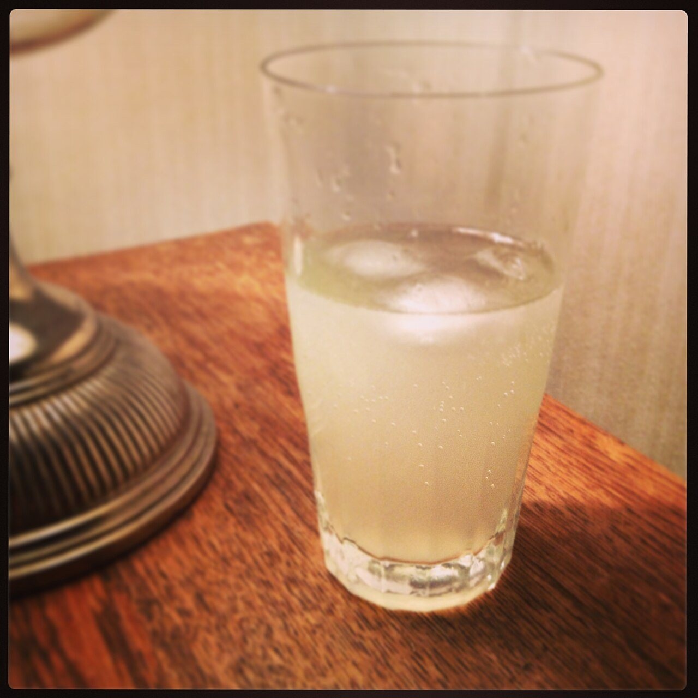

# 高球杯

高球杯（Highball glass）是一种直身、细长、容量较大的玻璃长饮杯。它常用于加冰长饮与气泡类鸡尾酒，例如莫吉托、金汤力与威士忌苏打。它没有杯梗，杯壁通常较直，杯口与杯底直径接近；这些特征决定了它适合什么，也决定了它不适合什么。

图：一只装有加冰长饮的高球杯，杯壁凝结水珠。图片：grosswurst，CC BY-SA 3.0，来源：[原始页面](https://commons.wikimedia.org/wiki/File:Moscow_Mule_Highball_glass.jpg)。

## 什么是高球杯

高球杯的核心特征是比例：高度明显大于直径，杯身接近直筒。它不是矮宽的短饮杯，也不是带梗的锥形杯。直身让冰块能分层堆叠，细长让气泡有上升空间，较大的容量则能容纳酒液、冰与苏打水。

“高球”这个名字与威士忌苏打一类的高球饮品相关，但杯子的用途不限于此。莫吉托、金汤力、长岛冰茶一类长饮都可以使用。名称是习惯，不是限制。有的资料把更高的直身杯单列为柯林杯，两者在日常使用中常被混称，本页按“直身长饮杯”一并讨论。

## 器型与容量

高球杯没有统一的容量标准。市面上常见的容量从较小到较大都有，杯壁厚薄与杯口直径也各不相同。因此，本页不给出一个“标准容量”，也不建议按固定毫升数假定所有高球杯都一样。

容量差异会直接影响使用：杯小、冰多，酒液与苏打水空间不足，容易溢出；杯大、冰少，气泡感被拉薄，香气也容易散。实际使用时，应先看自己的杯子能放多少冰，再决定倒多少酒。配方中的“加满冰”“补满苏打水”应根据杯子调整。

## 适合什么

高球杯最适合两类场景。第一类是加冰长饮，例如[莫吉托配方](ref:recipe)：直身杯能容纳大量冰块、薄荷与苏打水，细长杯身让气泡有上升空间。第二类是烈酒加苏打或汤力水，例如威士忌苏打、金汤力，杯子的容量足以让酒液与气泡水按比例组合。

它不适合需要聚拢香气的短饮。杯口宽、杯身高，香气会沿杯口散开；也不适合需要大量大冰块的纯饮，因为杯口直径通常放不下过大的冰块。需要聚香时，收口杯更合适；具体杯型的作用可参考[如何选杯](ref:glass)。

## 冰块与温度

高球杯的体验很大程度取决于冰。冰块不足，苏打水很快变温，气泡消散，口感变平；冰块过多而杯子偏小，又难以搅拌与放置装饰。长饮通常使用较多冰块，让杯中出现明显冰层，并用较大的冰而不是碎冰，以控制稀释速度。

大冰块表面积小、融化慢，能让酒在较长时间里保持低温而不过度稀释；碎冰降温快，但融化也快，几分钟内就会让长饮变淡。杯子没有杯梗，手持杯身会把体温传给酒液；想延长保冷，可以握住杯口附近或使用杯垫。关于冰型与温度的进一步说明，可参考[加冰与温度](ref:ice)。

## 气泡与搅拌

高球杯的细长形状有利于气泡上升，但也意味着气泡更容易在搅拌时损失。加苏打水后应轻轻搅拌几次，让原料混合即可，不要剧烈搅动；摇和会带入空气与碎冰，并让气泡快速散失，长饮通常不需要。

气泡是长饮结构的一部分，不是装饰。苏打水应在最后加入，补满后轻轻搅拌；若想更清爽，可以增加气泡水的比例，但应同时调整糖与酸，避免味道被冲淡。关于长饮结构的一般说明，可参考[调酒基础](ref:cocktails)。

## 持杯与保冷

持杯方式会影响温度与观感。握杯身方便，但传热快；握杯口附近传热慢，但手指会接触杯口，可能影响卫生与香气。折中的做法是握杯身下部，减少手掌大面积接触，同时避免手指伸进杯口。

杯垫与杯套能减少桌面与手的热传导，但不会改变冰的融化速度。若想延长保冷，优先使用更大的冰、预冷杯子与减少手接触，而不是依赖杯垫。长饮通常喝得较慢，保冷措施的影响比短饮更明显。

## 与相近杯型的区别

高球杯与[古典杯](ref:glass)常被混淆。古典杯矮而宽，适合短饮与大冰块；高球杯细长，容量通常更大，适合长饮与气泡饮品。高球杯与柯林杯也有差异：柯林杯通常更高更窄，容量更大，适合加吸管的长饮；高球杯相对矮一些，便于直接饮用。

与收口闻香杯相比，高球杯的香气扩散更明显，层次感较弱，但入口方便、加冰稳定，适合需要大量冰与气泡的场合。两者不是替代关系，而是不同目的的工具。

## 清洗与存放

高球杯杯身细长，杯底与杯壁交界处容易积累洗涤剂残留，手洗时应充分冲洗。使用温水和少量中性洗涤剂，倒扣晾干；不要用毛巾反复擦杯内，以免留下纤维与气味。杯口较薄，清洗时避免碰撞。

存放高球杯时避免与有强烈气味的物品放在一起。玻璃会吸附气味，尤其是长期不用的杯子。使用前可以用清水冲一遍并晾干，确认没有洗涤剂或储物柜的气味。

## 常见误区

第一，认为高球杯有标准容量。容量差异很大，应按自己的杯子调整冰量与酒量。

第二，用碎冰加满一杯。碎冰融化快，会让长饮在几分钟内变淡。

第三，把高球杯当成万能杯。它适合长饮与气泡饮品，不适合需要聚香的短饮。

第四，剧烈搅拌或摇和。气泡会快速散失，长饮只需轻轻搅拌。

第五，忽视预冷。温热的杯子会加速冰块融化，影响稀释节奏。

## 选择建议

选购时可以先看三点：杯身高度是否适合你的手与常用冰量；杯口直径是否能放下冰块与装饰；杯壁是否均匀、杯口是否平整。容量不必追求某个数字，但应与你常做的配方匹配。

如果只买一只，选直身、容量中等偏大、杯壁略厚的款式，通常更耐用，也更适合加冰。若经常做长饮，可以准备两只，方便在客人来访时使用。不要为了“专业感”购买杯壁过薄或容量过小的款式，它们在实际使用中容易受限。

## 边界

高球杯是工具，不是身份标志。容量、冰型与气泡对成品的影响，往往比杯子的价格更大。本页不推荐具体品牌，也不把某种器型说成唯一正确选择；实际使用应以杯子条件与个人感受为准。

相关条目：[莫吉托配方（IBA 版本）](ref:recipe)、[加冰这件事，没有标准答案](ref:ice)、[调酒，是另一种认识酒的方式](ref:cocktails)。
