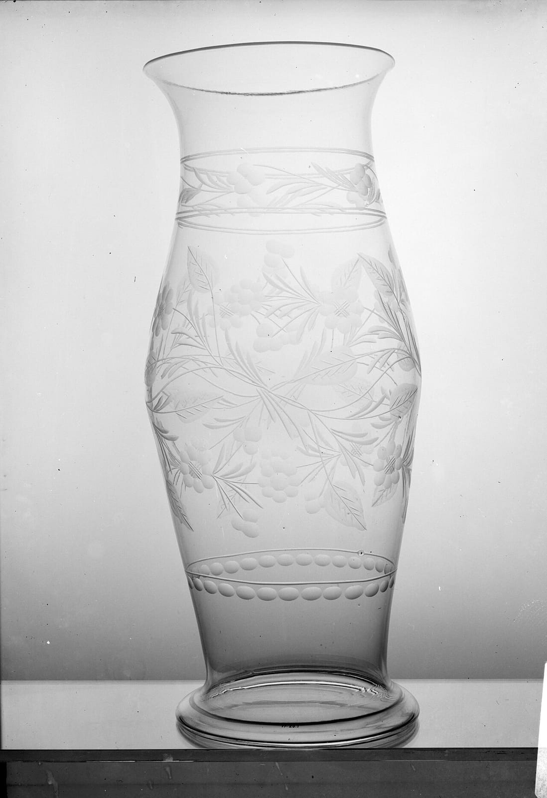

# 飓风杯

飓风杯是一种杯身细长、中部鼓起、杯口外翻的高杯。它的轮廓像老式飓风灯的玻璃罩：下窄、中宽、上外翻。这个形状不是为了模仿风暴，而是为了容纳大量碎冰、托住泡沫、让热带鸡尾酒看起来更高、更满。

飓风杯与热带鸡尾酒文化紧密相连。20 世纪中叶的新奥尔良酒吧，把朗姆、果汁、糖浆与碎冰装进这种杯子，做出颜色鲜艳、体积庞大的饮品；杯子本身，也成了“度假”与“派对”的视觉符号。

图：一只飓风杯。图片：Wikimedia Commons contributor，CC0，via Wikimedia Commons（[原图页面](https://commons.wikimedia.org/wiki/File:Hurricane_glass_(one_of_a_pair)_MET_34989.jpg)）。

## 器型与比例

飓风杯的核心比例是“细长杯身、中部鼓起、外翻杯口”。杯身下部窄，便于手持；中部宽，能容纳碎冰与酒液；杯口外翻，能让泡沫与装饰有落点，也方便嘴唇接触。

容量通常比高球杯更大，常见从 400 到 600 毫升。容量大，适合大量碎冰与果汁；但杯子太大，酒液太少，冰会迅速融化，味道变淡。杯子要与配方匹配，而不是越大越好。

杯壁通常较薄，以便观察颜色与层次；薄壁也意味着更容易碎，清洗与存放要更小心。杯底较窄，重心偏高，放在不平的桌面容易倾倒；使用时要注意稳定性。

## 为什么是曲线

曲线有三个作用。第一，容纳碎冰。中部鼓起，能装下更多碎冰，也能让冰堆出杯口；第二，托住泡沫。外翻杯口能让泡沫展开，形成“满杯”的视觉效果；第三，引导香气。杯口外翻，香气向四周扩散，适合果香浓郁的热带饮品。

曲线也会影响手感。杯身中部宽，手握时更稳；杯底窄，放在桌上不够稳。喝的时候可以握住杯身中部，避免握住杯口；如果要拍照，杯子的曲线能让颜色与装饰更突出。

飓风杯的“高”也有实际作用。高杯能让碎冰分层，颜色从下到上变化；高杯也能让吸管有足够长度，方便喝到杯底。它是“视觉优先”的杯型，功能与装饰很难分开。

它与高球杯的区别，主要在轮廓与容量。高球杯是直筒或微收，容量较小，适合气泡饮与简单的长饮；飓风杯中部鼓起、杯口外翻，容量更大，适合碎冰与多层颜色。两者都能装长饮，但飓风杯更“戏剧化”，高球杯更“日常”，选择要看饮品想表达的气质，也要看桌面空间是否足够。

## 适合什么酒

飓风杯最适合热带鸡尾酒，例如飓风（Hurricane）、迈泰（Mai Tai）、僵尸（Zombie）与新加坡司令。它也适合大量碎冰、果汁与糖浆的长饮；杯子的容量与曲线，能让这些饮品看起来更丰富。

它不适合短饮与纯饮。杯太大，酒液太少，香气会散；杯口外翻，也不适合精细闻香。它也不适合热饮，薄壁与高杯身会让热饮迅速降温，手也难以握住。

如果只有一种杯子，飓风杯不是“万能杯”。它的用途集中在热带与碎冰饮品；日常的加冰纯饮，古典杯更合适；气泡饮，高球杯更合适。关于高球杯，可以参考[高球杯](ref:highball)。

## 使用与温度

飓风杯使用前可以冷藏，但不必冷冻。冷藏能让杯壁降温，也能让泡沫更稳定；冷冻会让薄壁更脆，也可能让杯口结霜。

装杯时先加碎冰，再倒入酒液，最后加装饰。碎冰要堆到杯口，让杯子看起来“满”；酒液要沿杯壁注入，避免冲散冰层。关于倒酒动作，可以参考[倒酒](ref:pouring)。

装饰是飓风杯的一部分。菠萝叶、橙片、樱桃与小雨伞，能让杯子更高、更有热带感；但装饰太多会挡住杯口，也会让杯子头重脚轻。装饰要服务于主题，不是堆砌。

## 清洗与保养

飓风杯杯身高、杯口外翻，清洗时容易碰到杯口。手洗时用温水和少量中性洗涤剂，重点清洗杯底与杯身中部；充分冲洗，倒扣晾干。不要用硬刷，以免刮伤杯壁。

薄壁杯不要堆叠。堆叠会让杯口与杯身互相碰撞，产生裂纹；最好单独摆放，或使用杯架。长期不用的杯子，要保持干燥，避免水渍与异味。

玻璃会吸附气味，尤其是长期不用的杯子。使用前可以用清水冲一遍并晾干；不要用有强烈气味的清洁剂，也不要把杯子放在香料或咖啡豆旁边。

## 常见误区

第一，把飓风杯当万能杯。它的容量与曲线适合热带长饮，不适合短饮、纯饮与热饮。

第二，杯子太大、酒太少。冰会迅速融化，味道变淡；杯子要与配方匹配。

第三，装饰堆太多。装饰会挡住杯口，也会让杯子头重脚轻；装饰要服务于主题。

第四，用薄壁杯装热饮。薄壁与高杯身会让热饮迅速降温，手也难以握住；热饮应使用陶瓷或双层玻璃杯。关于热带鸡尾酒，可以参考[迈泰](ref:maitai)与[僵尸](ref:zombie)；关于朗姆酒，可以参考[朗姆酒](ref:rum)；关于选杯原则，可以参考[如何选杯](ref:glass)。

对照阅读：[高球杯](ref:highball)、[僵尸](ref:zombie)。

**关键事实。**

| 项目 | 内容 |
| --- | --- |
| 一句话定位 | 杯身细长、中部鼓起、杯口外翻的高杯，形似老式飓风灯罩；常用于热带鸡尾酒与大量碎冰的饮品 |
| 材质 | 玻璃 |
| 适用 | 热带鸡尾酒、碎冰长饮 |

**来源与边界。** 本页关于「飓风杯」的关键事实，主要由以下来源交叉核对：Oxford University Press（飓风杯与热带鸡尾酒的历史）、International Bartenders Association（热带鸡尾酒的配方与杯型）、CocktailDB（交叉核对飓风杯的用法与容量）等 5 条来源。价格、批次与状态会变，涉及这些字段时以页面所列来源的最新版本为准。正文为项目自写，来源只作核验，不复制原文。

**并读。** 把「飓风杯」与「高球杯」、「迈泰」、「僵尸」放在一起读时，先确认它们是同一层级还是上下游关系：先确认杯型用途与材质，再比较容量、杯口与香气表现。本页负责给出器皿的基本坐标，对照条目补上具体案例与差异；读完再回到本页，才能分清哪些差别属于器皿本身，哪些只是产地、批次或品牌选择。

**适用边界。** 对「飓风杯」而言，容量与杯型会因生产商不同；杯口、杯腹与材质比“专用杯”标签更重要。

**更新提示。** 「飓风杯」最近核对于 2026-11-20；尺寸、材质、容量与替代品会变，购买前以厂商规格为准。

**编者注。** 本页把「飓风杯」作为器皿条目处理：定义、流程与关键数字以正文表格为准，与「高球杯」、「迈泰」的差异用对照阅读验证；遇到价格、批次或地址，回到页面所列来源核对。
