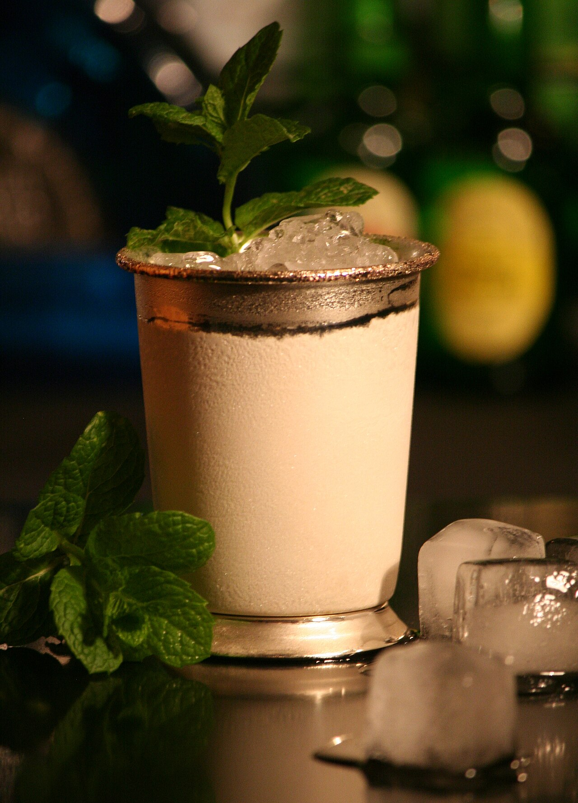

# 朱利普杯

朱利普杯是一种小型金属杯，常见银制、锡制或不锈钢制，杯身略呈锥形，杯口外翻，容量不大。它几乎与薄荷朱利普绑定：碎冰、薄荷、糖与波本威士忌，装在金属杯里，杯壁结霜，喝起来冰凉。

金属杯与玻璃杯的逻辑不同。玻璃是隔热材料，金属是导热材料；金属杯会把手的温度迅速传给酒液，也会把外界的冷迅速传进杯里。朱利普杯的“霜”，正是这种导热性的结果。

图：一只盛着薄荷朱利普的银杯。图片：Cocktailmarler，CC BY-SA 3.0，via Wikimedia Commons（[原图页面](https://commons.wikimedia.org/wiki/File:Mint_Julep_im_Silberbecher.jpg)）。

## 器型与容量

朱利普杯的核心特征是“金属、锥形杯身、外翻杯口、无把手”。杯身下窄上宽，方便堆叠碎冰；杯口外翻，方便嘴唇接触，也方便把薄荷枝插在冰里；无把手，则让杯子更紧凑。

容量通常在 240 到 350 毫升，具体取决于杯型与产区。杯子太小，碎冰与薄荷放不下；杯子太大，酒液太少，冰会迅速融化，味道变淡。容量要与配方匹配，而不是越大越好。

杯壁的厚度也影响体验。厚壁保冷更久，但重量更大；薄壁更轻，但更容易传导手的温度。银杯通常比锡杯更薄、更贵，也更需要保养；不锈钢杯更耐用，适合日常使用。

朱利普杯没有把手，也是设计的一部分。把手会增加杯壁与手掌的距离，但也会破坏杯身的完整曲线；薄荷朱利普靠碎冰与杯壁结霜来保冷，握住杯口或杯底，比握住把手更直接。没有把手，杯子更紧凑，也更像一只“金属碗”。

## 金属杯的保冷逻辑

金属的导热系数远高于玻璃。当杯里装满碎冰，杯壁的温度会迅速降到零度附近；空气中的水汽在杯壁凝结，形成一层霜。霜不是“装饰”，而是杯子正在保冷的信号。

金属也会把手的热量迅速传给杯壁。握住杯身，手的温度会加速冰的融化；正确的方式是握住杯口外翻处或杯底，减少手掌与杯壁的接触。杯子越冷，霜越厚，酒液越能保持低温。

碎冰是朱利普杯的关键。碎冰表面积大，降温快，但融化也快；大冰块降温慢，但保冷久。薄荷朱利普通常用碎冰，因为要快速降温、堆出杯口；喝的时候要尽快，否则冰会化水。

## 适合什么酒

朱利普杯最适合薄荷朱利普，也适合其他碎冰类鸡尾酒，例如需要大量碎冰与薄荷的变体。它不适合加一个大冰块的短饮，也不适合需要观察颜色的清酒与葡萄酒。

它不适合热饮。金属导热快，热饮会让杯壁迅速变烫，手无法握住；热饮应使用陶瓷或双层玻璃杯。它也不适合带气泡的饮品，碎冰会加速气泡逸出。

如果只有一种杯子，朱利普杯不是“万能杯”。它的用途窄，但在薄荷朱利普与夏季碎冰饮品上，它的体验是玻璃杯无法替代的。关于薄荷朱利普的做法，可以参考[薄荷朱利普](ref:julep)。

## 使用与温度

朱利普杯使用前可以冷藏，但不要冷冻到结霜过度。冷藏能让杯壁更快降温，也能让霜更均匀；冷冻会让杯子过冷，手无法握住，也可能让杯口结冰。

装杯时先放薄荷与糖，轻压释放香气，再加碎冰与酒液。薄荷不要压碎，压碎会释放苦味；轻压即可。关于轻压的手法，可以参考[轻压](ref:muddling)。

倒酒时沿杯壁注入，避免直接冲击碎冰。冲击会让冰迅速融化，也会让薄荷叶翻起；沿壁倒酒更温和，也更容易控制分量。关于冰与温度，可以参考[加冰与温度](ref:ice)。

## 清洗与保养

银杯需要单独清洗。银会与硫化物反应变黑，清洗时用温水与少量中性洗涤剂，避免使用含氯清洁剂；洗完后立即擦干，避免水渍。长期不用的银杯可以用银布擦拭，但不要过度抛光。

锡杯较软，不要用钢丝球擦，也不要用硬物刮。不锈钢杯最耐用，可以用软海绵清洗；无论材料，都要避免骤冷骤热，以免杯体变形。

存放时避免堆叠。金属杯杯口外翻，堆叠会刮伤杯口；最好单独摆放，或套上软布。杯子长期不用时，要保持干燥，避免氧化。

## 常见误区

第一，认为金属杯越冷越好。过度冷冻会让杯子无法握住，也会让霜过厚、冰融化更快；冷藏即可。

第二，握住杯身。手的温度会迅速传给杯壁，加速冰的融化；应握住杯口或杯底。

第三，用大冰块代替碎冰。大冰块降温慢，堆不出杯口，也不适合薄荷朱利普的口感；碎冰才是标准。

第四，把朱利普杯当通用杯。它的用途窄，适合碎冰类饮品，不适合热饮、气泡饮与需要观察颜色的酒。关于其他短饮杯型，可以参考[古典杯](ref:rocks)；关于选杯原则，可以参考[如何选杯](ref:glass)。

对照阅读：[薄荷朱利普](ref:julep)、[古典杯](ref:rocks)。

相关条目：[捣压](ref:muddling)。

**关键事实。**

| 项目 | 内容 |
| --- | --- |
| 一句话定位 | 银制或锡制的小型金属杯，常用于薄荷朱利普；金属导热快，杯壁会结霜，碎冰与薄荷让酒液保持低温 |
| 材质 | 银、锡、不锈钢 |
| 适用 | 薄荷朱利普、碎冰类鸡尾酒 |

**来源与边界。** 本页关于「朱利普杯」的关键事实，主要由以下来源交叉核对：Oxford University Press（薄荷朱利普与金属杯的历史）、International Bartenders Association（薄荷朱利普的配方与做法）、Encyclopaedia Britannica（薄荷朱利普的文化背景）等 5 条来源。价格、批次与状态会变，涉及这些字段时以页面所列来源的最新版本为准。正文为项目自写，来源只作核验，不复制原文。

**并读。** 把「朱利普杯」与「薄荷朱利普」、「捣压」、「古典杯」放在一起读时，先确认它们是同一层级还是上下游关系：先确认杯型用途与材质，再比较容量、杯口与香气表现。本页负责给出器皿的基本坐标，对照条目补上具体案例与差异；读完再回到本页，才能分清哪些差别属于器皿本身，哪些只是产地、批次或品牌选择。

**适用边界。** 对「朱利普杯」而言，容量与杯型会因生产商不同；杯口、杯腹与材质比“专用杯”标签更重要。

**更新提示。** 「朱利普杯」最近核对于 2026-11-20；尺寸、材质、容量与替代品会变，购买前以厂商规格为准。

**编者注。** 本页把「朱利普杯」作为器皿条目处理：定义、流程与关键数字以正文表格为准，与「薄荷朱利普」、「捣压」的差异用对照阅读验证；遇到价格、批次或地址，回到页面所列来源核对。
