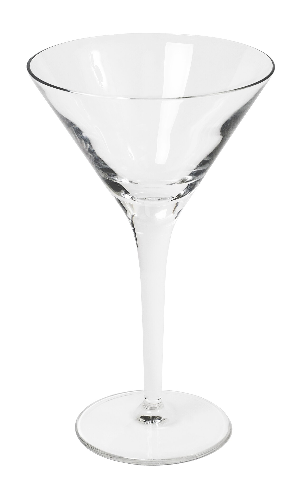

# 马天尼杯

马天尼杯（Martini glass，也常称鸡尾酒杯）是一种锥形、有梗、杯口略收的玻璃短饮杯。它最常用于干马天尼，也用于玛格丽特、代基里等滤冰后直接饮用的短饮。锥形杯身与细长杯梗是它的核心特征；这些特征决定了它适合什么，也决定了它的局限。

图：马天尼杯。图片：Evan-Amos，Public domain，via Wikimedia Commons（[原图页面](https://commons.wikimedia.org/wiki/File:Cocktail-glass.jpg)）。

## 什么是马天尼杯

马天尼杯的核心特征有三个：锥形杯身、有杯梗、杯口略收。锥形让杯口宽、杯底窄，香气在杯口附近聚集；杯梗让手持时不必接触杯身，减少体温传导；略收的杯口则让香气更集中。它不是直身长饮杯，也不是矮宽短饮杯。

“马天尼杯”这个中文名来自它的典型用途，但杯子的用途不限于马天尼。玛格丽特、代基里、曼哈顿一类短饮也常使用。名称是习惯，不是限制；不同地区对“鸡尾酒杯”的定义略有差异，但锥形加杯梗的基本形态是一致的。

## 器型与容量

马天尼杯没有统一的容量标准。市面上常见的容量从较小到较大都有，杯口直径、锥角与杯梗高度也各不相同。因此，本页不给出一个“标准容量”，也不建议按固定毫升数假定所有马天尼杯都一样。

容量差异会直接影响使用：杯太小，装不下配方，滤入后容易溢出；杯太大，酒液铺得太薄，香气散得快，回温也更快。实际使用时，应先看自己的杯子能装多少，再调整配方总量，而不是倒满为止。关于杯型与容量的关系，可参考[如何选杯](ref:glass)。

## 适合什么

马天尼杯最适合需要聚香、滤冰后直接饮用的短饮。例如[干马天尼配方](ref:recipe)：酒液已经冷却与稀释，滤入预冷杯中，锥形杯身聚拢杜松子与味美思的香气。[玛格丽特配方](ref:margarita)也使用同类杯型，配合半圈盐边。

它不适合加冰长饮。杯口宽、杯身浅，冰块放不下几块，气泡也容易散；也不适合需要大量冰块的纯饮。需要长饮时，高球杯更合适；需要加冰短饮时，古典杯更合适。

## 预冷与温度

马天尼杯最重要的使用条件是预冷。杯子不冷，成品会在短时间内回温，香气与酸度都会变化。预冷方式可以是放入冰箱冷冻室，也可以埋入碎冰中；无论哪种，都应让杯身充分冷却后再滤入酒液。

杯子有杯梗，手持杯梗可以避免体温传给酒液；若握住锥形杯身，热量会直接进入酒液，加速回温。饮用时应握杯梗或杯底，而不是握杯身。关于温度与稀释的进一步说明，可参考[加冰与温度](ref:ice)。

## 香气与饮用

锥形杯身让香气在杯口附近聚集，但杯口较宽，香气也会随空气流动而散。饮用时可以把鼻子靠近杯口闻香，再小口饮用；不要一次大口喝完，短饮的酒精度通常较高，快速饮用会让香气来不及展开。

杯口略收是聚香的关键，但杯口过窄也会影响饮用与清洗。选择时应在聚香与易用之间取平衡：杯口过宽，香气散；杯口过窄，饮用与清洗都不方便。

## 装饰与摆放

马天尼杯的装饰通常放在杯口或杯底：柠檬皮置于杯口，橄榄用牙签固定在杯口，盐边做在杯口外沿。装饰不应落入杯中太久，柠檬皮会变干，橄榄会释放过多咸味。

杯口较宽，装饰容易滑落。使用牙签或杯口夹固定，可以避免装饰掉入酒液。装饰的作用是补充香气与视觉，不是掩盖酒液本身；过多装饰会让杯口显得拥挤，也影响饮用。

## 清洗与存放

马天尼杯杯口宽、杯身浅，清洗相对方便，但杯梗与杯底连接处容易积累洗涤剂残留，需要充分冲洗。手洗时用温水和少量中性洗涤剂，倒扣晾干；不要用毛巾反复擦杯内，以免留下纤维与气味。

杯梗较细，存放与清洗时应避免碰撞。叠放容易压断杯梗，最好单层摆放或使用带分隔的杯架。长期不用的杯子使用前应冲洗并晾干，确认没有储物柜的气味。

## 常见误区

第一，认为马天尼杯有标准容量。容量差异很大，应按自己的杯子调整配方总量。

第二，用常温杯。杯子不冷，成品迅速回温，香气与口感都会走样。

第三，握住杯身。体温会直接传给酒液，加速回温。

第四，把马天尼杯当成万能杯。它适合滤冰短饮，不适合加冰长饮。

第五，装饰堆得太多。杯口空间有限，过多装饰会影响饮用与观感。

杯型不决定酒质；预冷、容量与饮用速度比杯口形状更影响一杯短饮的温度与香气。

## 选择与替代

选购时可以先看三点：杯口直径是否适合你的饮用方式；杯梗是否稳固、杯底是否平整；容量是否与你常做的配方匹配。容量不必追求某个数字，但应与配方总量相符。

没有专用杯时，可以选杯口略收、容量适中的其他杯子，关键是预冷与容量合适。杯太小装不下配方，杯太大香气散得快。杯型不是定义的一部分，但它确实影响体验；具体选择可参考[调酒基础](ref:cocktails)。

## 边界

马天尼杯是工具，不是身份标志。预冷、容量与手持方式对成品的影响，往往比杯子的价格更大。本页不推荐具体品牌，也不把某种杯型说成唯一正确选择；实际使用应以杯子条件与个人感受为准。

相关条目：[干马天尼配方（IBA 版本）](ref:recipe)、[玛格丽特配方（IBA 版本）](ref:margarita)、[换一只杯子，会有什么不同？](ref:glass)。

**关键事实。**

| 项目 | 内容 |
| --- | --- |
| 一句话定位 | 锥形、有梗、杯口略收的短饮杯，也常称鸡尾酒杯，用于干马天尼、玛格丽特与代基里等短饮；容量没有统一标准，预冷比杯型更影响体验 |
| 材质 | 玻璃 |
| 适用 | 搅拌或摇和后滤冰的短饮、需要聚香的鸡尾酒 |

**来源与边界。** 本页关于「马天尼杯」的关键事实，主要由以下来源交叉核对：International Bartenders Association（马天尼杯在成品中的实际用法与预冷要求；确认该饮品属于 IBA 官方鸡尾酒名单）、Oxford University Press（锥形杯型、短饮服务与香气聚集的一般背景）、Dave Arnold / W. W. Norton（预冷、温度与稀释对短饮的影响）等 5 条来源。价格、批次与状态会变，涉及这些字段时以页面所列来源的最新版本为准。正文为项目自写，来源只作核验，不复制原文。
