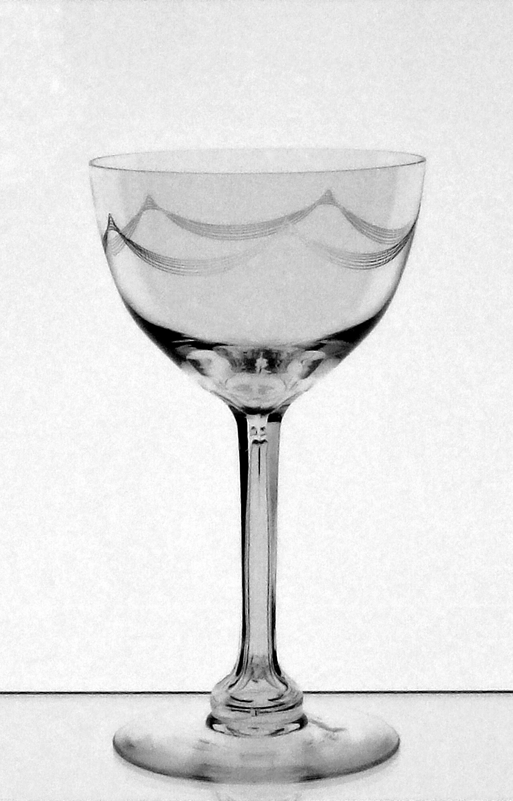

# 尼克与诺拉杯

尼克与诺拉杯（Nick and Nora）是一种带细梗的小型浅碗杯。它的杯腹不深，杯口宽，杯梗细长，整体像一只缩小并压扁的碟形杯。名字来自 1934 年电影《瘦人》（The Thin Man）里的侦探夫妻尼克与诺拉·查尔斯，因此它常被当作“复古马天尼杯”的代名词。但它既不是马天尼杯，也不是所有复古浅杯的统称；理解它的形状与容量，比记住名字更有用。

图：一只复古尼克与诺拉杯，约 120 ml，杯身带蚀刻波纹。图片：Mangomix，CC BY-SA 4.0，来源：[原始页面](https://commons.wikimedia.org/wiki/File:Nick_and_Nora_cocktail_glass.jpg)。

> **先给结论**
> **一句话：** 这页判断尼克与诺拉杯为什么影响香气，以及该配什么酒。
>
> - **适合谁：** 想弄懂尼克与诺拉杯为什么影响香气与口感的人。
> - **不适合谁：** 只想要“买最贵杯子”的结论、不关心酒款匹配的人。
> - **先看这两点：**
>   - 宽口带来的是“开放”，不是“集中”。
>   - 1934 年上映的《瘦人》改编自达希尔·哈米特（Dashiell Hammett）的同名侦探小说。

## 名字来自一部电影

1934 年上映的《瘦人》改编自达希尔·哈米特（Dashiell Hammett）的同名侦探小说。威廉·鲍威尔（William Powell）与玛娜·洛伊（Myrna Loy）饰演尼克与诺拉·查尔斯夫妇：两人一边查案，一边在餐桌、酒吧和家里调酒。片中他们手里拿的是浅碗、宽口、带细梗的小杯，而不是后来更常见的 V 形马天尼杯。这个系列从 1934 年一直拍到 1947 年，前后共六部，杯子的形象也随影像反复出现。

“尼克与诺拉杯”这个名字并不是 1930 年代的厂商命名。它常被归功于调酒师 Dale DeGroff：1980 年代后期，他在纽约 Rainbow Room 重新使用这类小杯出品鸡尾酒，并用片中夫妻的名字称呼它们。名字流行之后，杯型才被更多厂商单独生产。因此更准确的说法是：杯子先出现在电影里，名字是半个世纪后才追加上去的。把它当成“1934 年的原版设计”，是把命名时间与影像时间混在了一起。

## 杯型长什么样

这种杯子有四个可以肉眼判断的特征：杯腹浅、杯口宽、杯壁弧线较直、杯梗细。

杯腹浅是它与普通碟形杯最直接的区别。碟形杯的碗更深、更圆，像一只浅碟；尼克与诺拉杯的碗更小，深度更浅，杯口直径与杯腹最大直径接近，侧面从杯脚向上外张的幅度也更小。它看起来像一只被压缩过的碟形杯，而不是一只被拉宽的葡萄酒杯。

杯口宽不是缺陷，而是设计目的。宽口让香气有较大的扩散面，闻香时鼻子不必探进狭窄的杯口；同时，宽口也让酒液更容易在杯口形成薄薄的一层，入口时最先接触到的是香气而不是杯壁。

杯梗细，是为了让手指远离杯腹。短饮本来就没有冰，酒液温度完全依赖预冷与杯壁；握住细梗可以少传一点体温，也避免在杯壁留下指纹。代价是杯梗更脆弱，清洗与收纳要更小心。

## 浅碗为什么适合这杯酒

浅碗的第一个作用是缩短香气到鼻子的距离。酒液表面到杯口的垂直距离很短，香气不需要穿过很高的杯壁就能到达杯口；对一杯以杜松子、柑橘皮或味美思草本香为主的短饮来说，这比“聚香”更重要，因为它的香气本来就容易被酒精压住。

第二个作用是控制每次入口的量。杯腹浅，倒满也装不了多少；这迫使出品者把酒液量控制在 60–100 ml 左右，正好是一杯短饮在回温前能喝完的量。用大杯装同样的酒，液面太薄，香气散得快，温度也更难维持。

第三个作用是视觉上的“满杯感”。浅杯腹让少量酒液也能占到杯腹的大半，看起来不像只倒了半杯；这对一杯没有冰块撑场面的短饮很重要，因为杯子空荡荡会让香气空间变成无用的空气。

它不适合加冰。杯腹浅，放不下几块冰；宽口也不利于保冷。需要冰与气泡的饮品，应改用直身杯或古典杯。

## 香气开放与温度上升的取舍

宽口带来的是“开放”，不是“集中”。酒液上方的香气会向四周扩散，靠近杯口时能闻到较宽的香气面，柑橘、花香、草本会同时出现；但香气不会像在收口杯里那样被压成一束，细腻的层次容易被稀释。这是这只杯子的基本取舍：它优先呈现香气的宽度，而不是深度。

温度是另一半取舍。杯腹小、液面相对大，酒液升温快；宽口又加速了香气与酒精的挥发。搅拌并滤冰后的短饮通常在零度上下出品，倒入常温杯后几分钟内就会明显回温。回温并不全是坏事：温度略升，香气分子更容易逸出，闻起来更开放；但酒精感也会同时增强，入口变得刺辣，苦味与酸度的平衡被打破。

实际做法是接受这个取舍，而不是对抗它。杯子提前放进冷冻室预冷十几分钟；倒酒前再取出，避免杯壁结霜稀释酒液；饮用时握杯梗或杯脚，不握杯腹；一杯酒在十分钟内喝完。想要更长时间保持低温，应该减少倒酒量、缩短从滤冰到入口的时间，而不是换一只更大的杯子。

## 与 coupe、martini glass 的差别

[碟形杯](ref:coupe)是最容易被混淆的邻居。两者都是带梗浅碗，但碟形杯的碗更深、更圆，杯口更大，容量通常也更大；它最初与香槟联系在一起，宽口是为了让气泡与香气一起出来。尼克与诺拉杯更小、更浅，侧面更直，杯口相对杯腹没有那么外张，因此香气更靠近鼻端，酒液也更靠近杯口。用碟形杯装马天尼并不算错，只是酒液铺得更开，回温更快。

[马天尼杯](ref:martini-glass)是另一种结构。它的杯身是 V 形锥体，杯口宽、杯底窄，容量通常比尼克与诺拉杯大，重心也更高。锥形让香气在杯口附近聚集，但杯口同样开放；它的优势是视觉上的“马天尼感”，劣势是酒液铺得薄、升温快、容易洒。

三者的差别可以归纳为三点：容量，尼克与诺拉杯最小；深度与杯口比例，它最浅、最接近“小碗”；重心，它最低、最稳。它牺牲了一部分香气集中度，换来更合适的单次酒量与更稳的持杯感。

## 容量与倒多少

常见容量约 150–200 ml，市面上也有 120 ml 左右的小杯与超过 200 ml 的款式；容量以具体产品为准。不要按“标准 180 ml”去假定每一只杯子，购买前应看产品标注的实际容量。

倒酒时把酒液控制在杯腹的二分之一到三分之二之间，留下足够的香气空间。以 150 ml 杯为例，60–90 ml 的酒液大约占杯腹一半；以 200 ml 杯为例，同样的酒液会显得更浅，香气空间更大，但也更容易回温。倒得太满，鼻子一靠近就是酒精；倒得太少，香气没有足够的液面支撑。

容量还会影响配方。用 120 ml 的小杯装一份 90 ml 的搅拌短饮，几乎要倒到杯口；用 200 ml 的杯子装同样的量，看起来只有半杯。前者适合一人一份、快速喝完，后者适合慢慢闻香。先量自己的杯子，再决定配方总量，比反过来更可靠。

## 哪些酒适合端上来

最适合的是不加冰、滤冰后直接饮用的短饮。[干马天尼](ref:martini)是典型：搅拌、滤冰、倒入预冷的小杯，酒液量不大，香气以杜松子与干味美思为主，浅杯让香气很快到达鼻端。[曼哈顿](ref:manhattan)同样合适：威士忌、甜味美思与苦精的组合在宽口杯里会显得更甜、更香，但温度上升后苦味会更明显，因此更要快喝。

边车、吉姆雷特、代基里一类酸型短饮也可以用，但要注意酸度在回温后会变尖；含糖量较高的配方更耐放，干型配方更依赖低温。含气泡的短饮不适合，宽口会让气泡迅速散掉；加冰长饮也不适合，杯腹装不下冰。

在吧台点单时，如果酒单写“up”或“straight up”，通常就是这类杯子的用法：滤冰、不加冰、短饮。若你想要更聚香的体验，可以要求换用收口更窄的杯型；若你更在意香气开放，这只杯子更合适。关于杯型与香气的一般关系，可参考[如何选杯](ref:glass)。

## 拿杯、预冷与清洗

拿杯只握杯梗或杯脚。杯腹浅，手指很容易碰到杯壁；体温会直接传给酒液，加速回温，也会在杯壁留下油印，影响观感。杯梗细，拿取时要避开杯梗与杯脚连接的受力点，不要捏着杯腹举起。

预冷比杯型更能影响体验。把杯子放进冷冻室十几分钟，或在冰桶里埋几分钟，取出后擦干外壁再倒酒。杯子不冷，酒液一进杯就开始升温，香气还没展开，口感已经变软。不要往杯里放冰块降温，那会稀释配方。

清洗建议手洗，用温水与少量中性洗涤剂，充分冲洗杯腹与杯口交界处，倒扣晾干。不要用毛巾反复擦杯内，纤维与气味会留在杯壁；杯口薄，清洗时避免碰撞。若产品标注可机洗，也应使用温和程序并确保杯子不会互相碰撞。存放时避免叠放，细梗是整只杯子最脆弱的部分；最好单层摆放或使用带分隔的杯架。

## 常见误区

第一，“它是专用马天尼杯”。它不是马天尼杯，也不专属于马天尼；马天尼杯通常指 V 形锥体杯，而这只杯子是浅碗。名字来自电影，不来自配方。

第二，“所有复古浅杯都叫尼克与诺拉”。不是。碟形杯、香槟碟杯、小号鸡尾酒杯都可能长得相似；区分要看杯腹深度、杯口比例与容量，而不是看它是否“复古”。

第三，“名字和杯子一样老”。杯子在 1934 年的电影里出现，名字却是 1980 年代后期才流行；把它说成 1930 年代的商业产品，是时间上的错位。

第四，“容量越大越气派”。杯子越大，同样的酒液铺得越薄，香气散得越快，回温也越明显；这只杯子的价值恰恰在于小。

第五，“杯口越宽越香”。宽口让香气开放，但也让香气散失更快；对细腻的短饮，过宽反而削弱层次。

第六，“薄梗不结实，不能用”。薄梗确实更脆弱，但正常拿取与手洗没有问题；真正的风险是叠放、碰撞与洗碗机水流。

## 另见

- [干马天尼](ref:martini)：最适合这只杯子的经典短饮。
- [曼哈顿](ref:manhattan)：威士忌基底的滤冰短饮。
- [碟形杯](ref:coupe)：更深的带梗浅碗，香气更开放。
- [马天尼杯](ref:martini-glass)：V 形锥体的另一种短饮杯。
- [如何选杯](ref:glass)：杯型、容量与香气的关系。
