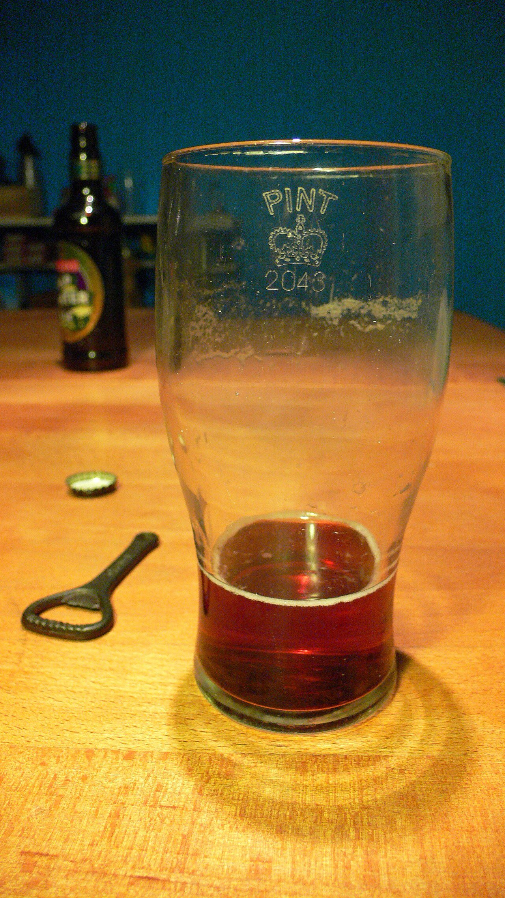

# 品脱杯

品脱杯（pint glass）是最容易被低估的啤酒杯。它看上去只是一只厚底的直身玻璃杯，实际上“品脱”首先是一个容量单位，其次才是一只杯子的名字。英国酒吧里的品脱杯、美国酒吧里的品脱杯、爱尔兰世涛吧台上的品脱杯，容量和形状都可能不同。理解这只杯子，第一步不是看杯型，而是先问：这里的“一品脱”是多少毫升。

图：一只带“PINT”与皇冠戳记的英国品脱杯，杯底留有少量啤酒。图片：Justinc，CC BY-SA 2.0，来源：[原始页面](https://commons.wikimedia.org/wiki/File:Pint_Glass_with_some_beer.jpg)。

> **先给结论**
> **一句话：** 这页判断品脱杯为什么影响香气，以及该配什么酒。
>
> - **适合谁：** 想弄懂品脱杯为什么影响香气与口感的人。
> - **不适合谁：** 只想要“买最贵杯子”的结论、不关心酒款匹配的人。
> - **先看这两点：**
>   - 品脱杯的强项是容量、耐用和传递效率。
>   - 英国的一品脱是 568 毫升，精确值为 568.26125 毫升；美国的一品脱是 473 毫升，精确值为 473.176473 毫升。

## 同叫一个品脱，容量差 95 毫升

英国的一品脱是 568 毫升，精确值为 568.26125 毫升；美国的一品脱是 473 毫升，精确值为 473.176473 毫升。两者相差约 95 毫升，英国品脱比美国品脱大约多出五分之一。

差异不是杯子做得不一样，而是“盎司”不一样。英国品脱等于 20 英制液体盎司，1 英制液体盎司约为 28.413 毫升；美国品脱等于 16 美制液体盎司，1 美制液体盎司约为 29.574 毫升。20 乘 28.413 约等于 568，16 乘 29.574 约等于 473。两边都叫 pint，但一个按 20 个较小的盎司计算，一个按 16 个稍大的盎司计算，结果自然分叉。

这也是为什么英国至今为生啤和苹果酒保留了品脱这一英制单位的例外。英国法规把品脱列为可以单独用于散装生啤与苹果酒贸易的计量单位，而大多数其他商品以公制为主。美国则沿用美制习惯单位，品脱是日常容量单位之一。对消费者来说，最实用的结论是：在伦敦点 “a pint”，和在纽约点 “a pint”，拿到的酒量并不相同。

其他市场还有自己的习惯。澳大利亚多数地方把一品脱当作 570 毫升左右，爱尔兰通常与英国一致，加拿大则因省份而异。这些差异进一步说明，品脱杯不是一只全球统一规格的杯子，而是一组围绕“一品脱”这个本地容量单位生长的杯型。

## 三种常见形制：锥形、nonic、带柄 jug

最常见的品脱杯是锥形杯（conical）。杯身从较窄的杯底向上略微外扩，形成一个截锥，杯口直径大于杯底。它可以叠放，生产简单，厚底提供稳定性，是英国酒吧里数量最多的一种。锥形杯没有收口，也没有杯梗，设计目标是大口喝、快速传递、耐碰撞。

nonic 杯在杯口下方有一圈明显的凸起。这圈凸起常被解释为 “no nick” 的来历：叠杯时杯口不直接承重，减少磕碰与崩口；同时它也是一圈天然的握持位，手滑时不容易脱手。无论名称的民间词源是否准确，凸起确实同时服务于叠放、抗崩口和握持三件事。nonic 的杯身通常比锥形杯更接近直筒，杯口略微外翻，容量仍是当地的一品脱。

带柄的 jug 杯（也常被叫作 tankard）在杯身侧面加了一个把手。把手让手指不必直接包住杯壁，握持更稳，也更适合手掌温度敏感的人。英国的 dimpled jug 带有一圈凹凸纹理，既增加刚度，也让杯子看起来更传统。jug 常见一品脱容量，也有两品脱或更大的分享型；把手并不改变容量定义，只改变握持方式。

还有一种常被单独提起的变体是 tulip pint，也就是爱尔兰世涛常用的“品脱郁金香杯”。它有小腹、有轻微收口，泡沫表现更好，但它仍然是品脱容量，收口幅度远小于真正的香气杯。注意不要把它与[郁金香杯](ref:tulip)混为一谈：后者是香气优先的杯型，容量与比例都另有一套逻辑。

## 杯壁厚度不是“越厚越保冷”

品脱杯通常杯壁较厚，杯底尤其厚。厚壁带来的第一感受是结实，第二感受是重。它对温度的影响需要分开看：玻璃是较差的热导体，厚壁确实能减缓外界热量传入，但厚玻璃本身也有更大的热容量。如果杯子从室温柜子里拿出来，厚壁储存的热量更多，刚开始反而会让酒液略微升温；如果杯子经过预冷，厚壁能更长时间维持低温。

所以“厚杯更保冷”只在特定条件下成立。真正决定一杯啤酒升温速度的，是酒液与环境的温差、杯子的初始温度、液面面积以及你握杯的时间。厚底的主要价值其实是稳定重心和耐碰撞，而不是保温。

厚壁还会影响入口手感。杯口边缘厚，嘴唇接触的面积大，喝起来更“实在”，但少了一点薄边杯的利落。对以大口饮用为目标的品脱杯来说，这不是缺陷，而是取舍。

杯内壁的微小划痕会影响气泡。二氧化碳倾向于在粗糙点成核，划痕多的杯子会持续冒出细密气泡；完全光滑的杯壁气泡更少、更细。有些杯子在杯底激光刻出微点，用来稳定泡沫，但多数普通品脱杯没有这种设计。清洗时用硬刷反复刮擦内壁，反而可能制造过多成核点，让泡沫表现变得不稳定。

## 杯口收束改变了什么

品脱杯的杯口基本是开放的，直径与杯身接近，甚至略微外翻。它不负责把香气收拢到鼻尖，也不负责限制酒精感。开放杯口让香气向四周散开，你闻到的是啤酒的总体印象，而不是被压缩后的浓缩香气。

这与收口杯的机制相反。收口杯减少香气逃逸，让杯内空腔的香气浓度升高；开放杯口则让香气与室内空气快速混合。对于低温、碳酸感强、以解渴和爽脆为目标的拉格，开放杯口是合理的：你不需要费力闻香，喝一大口时气泡和苦味同时到达。对于香气复杂、酒精感强的比利时艾尔，开放杯口会让香气散得太快，这时[高脚广口杯](ref:goblet)或[郁金香杯](ref:tulip)更合适。

杯口形状也决定酒液进入口腔的位置。宽口杯让酒液铺满舌面，气泡感更明显；略收的杯口把酒液导向口腔中央，香气与味道更集中。品脱杯的宽口适合“喝”，不适合“品”。

nonic 杯口下方的那圈凸起不在杯口内侧，因此不会形成真正的收香结构。它改变的是结构强度和握持，不是香气路径。把 nonic 当成“聚香杯”是常见的误读。

## 握持方式与手温

品脱杯没有杯梗，手指只能接触杯壁或杯底。握杯底是更稳妥的方式，手掌不直接包住杯身，传热较慢；握杯身上半部则更稳，但手掌会持续给酒液加热。英国酒吧里常见的握法是托住杯底或握住杯身下半部，前者更适合慢慢喝，后者更适合走动。

带柄 jug 的把手把手指与杯壁隔开，减少直接接触，但金属或玻璃把手本身也会传热，效果不是绝对的。厚壁杯在短时间内的隔热感更明显，但一杯 568 毫升的啤酒通常要喝十几分钟，手温仍会逐渐进入酒液。

杯子的初始温度常被忽略。从洗碗机刚取出的热杯子，会让第一口啤酒的温度明显升高，也会加剧泡沫溢出；从冰柜取出的杯子则会在杯壁结露，握持变滑。最实用的做法是让杯子接近室温或略低于室温，再用足够长的倒酒时间让泡沫稳定。

## 泡沫、挂杯与清洗

啤酒泡沫是蛋白质、苦味物质与气泡共同形成的网络。杯壁上的油脂、洗涤剂残留、口红和指纹都会破坏这个网络，让泡沫迅速塌陷。所谓“啤酒干净杯”，指的是没有油脂和洗涤剂残留的杯子，而不是看起来没有污渍的杯子。

清洗品脱杯时，先用温水冲掉残留，再用专用刷子和少量中性洗涤剂清洗，最后用大量清水冲净，倒扣自然晾干。不要用带香味的毛巾擦拭杯内，纤维和香精都会留在杯壁上，既影响泡沫也影响香气。若使用洗碗机，应确认杯子标注可机洗，并避免与其他餐具碰撞。

挂杯（lacing）是泡沫在杯壁留下的环状痕迹。它既与啤酒本身的蛋白质含量有关，也与杯壁是否干净有关。挂杯漂亮不代表酒一定好，但完全不挂杯、泡沫立刻消失，通常说明杯子不够干净，或者啤酒的泡沫蛋白不足。

倒酒时先倾斜杯子约 45 度，让酒液沿杯壁流下，再逐渐扶正，最后留出一到两厘米的泡沫层。英国生啤常用的手泵与火花塞会影响泡沫质地，但杯型本身不制造泡沫。容量标记对应的是酒液，不是泡沫；有刻线的杯子应以刻线作为酒液下限，无刻线的杯子则以满杯为准，具体以当地计量规定为准。

## 容量区间与倒酒判断

品脱杯的标称容量随市场变化：英国 568 毫升，美国 473 毫升，澳大利亚常见 570 毫升。实际杯子的满杯容量往往大于标称值，因为要留出泡沫空间。一只标称 568 毫升的英国品脱杯，满到杯口可能接近 600 毫升；一只标称 473 毫升的美国品脱杯，满杯也常略高于 473 毫升。容量以具体产品为准，不能只看外观大小。

倒酒时，先确认杯子的标称容量，再决定倒多少。用 500 毫升的瓶子往英国品脱杯里倒，酒液只到杯身中上部，泡沫空间充足；倒进美国品脱杯则接近满杯，泡沫容易溢出。反过来，用 330 毫升的瓶子倒进美国品脱杯，会留下大片空腔，香气散得快，温度也更容易受杯壁影响。

如果你经常在家喝啤酒，可以先用量杯给自己的杯子做一次标定：倒满水到杯口，记录实际容量；再倒到常用饮用高度，记录“舒适线”。这两个数字比杯子上印的花纹更有用。

## 刻线不等于量具

品脱杯上的刻线、印刷线或蚀刻线，是容量标记，不是实验量具的刻度。玻璃在温度变化时会轻微膨胀，杯子的放置角度、液面弯月面、泡沫厚度都会影响读数；印刷装饰线也可能只是图案的一部分。把品脱杯当作调酒量杯，误差会明显大于专用量酒器。

容量标记的意义在于交易：它让一杯酒有一个可核对的下限。英国对容量售酒器具有检定与标记制度，带标记的杯子在正常使用下应能提供标称容量。但“有刻线”不等于“每一毫升都准确”，更不等于可以替代厨房量杯。

在酒吧里，如果一杯啤酒明显没有达到标称容量，顾客可以要求补满；这是计量制度提供的保护，而不是杯型本身的功能。理解这一点，就不会把杯子上的一条线当成精确配方刻度。

## 和其他杯型怎么分工

品脱杯的强项是容量、耐用和传递效率。它适合低温、碳酸感强、适合大口饮用的[啤酒](ref:beer)，也适合苹果酒、shandy 和部分加冰长饮。它的开放杯口不聚香，所以不适合需要细闻的烈性啤酒。

需要香气时，[郁金香杯](ref:tulip)更合适：杯腹宽、杯口收，能在保留气泡的同时集中香气。需要展示比利时艾尔的酯香与厚泡沫时，[高脚广口杯](ref:goblet)更合适：杯腹更圆、杯口更开，泡沫有空间膨胀。需要大量冰块与长饮时，[高球杯](ref:highball)更合适：杯身细长，冰块的冷却效率更高。关于杯型与香气、温度的一般关系，可以参考[如何选杯](ref:glass)。

品脱杯不是“低级”的杯子。它解决的问题很明确：在拥挤、快节奏、洗杯量大的环境里，用一只便宜、结实、容量明确的杯子，把一杯温度合适的啤酒送到客人手里。用香气杯的标准要求它，是用错了评价维度。

## 常见误区

第一，“a pint 在哪里都一样”。英国 568 毫升，美国 473 毫升，澳大利亚常见 570 毫升，容量随国家与地区变化。

第二，“品脱杯只有一种形状”。锥形、nonic、带柄 jug、tulip pint 都是常见形制，杯口、杯壁和握持方式不同。

第三，“杯壁越厚越保冷”。厚壁减缓传热，但热容量也更大；杯子的初始温度与握持时间同样重要。

第四，“有刻线就是精确量具”。刻线是容量标记，存在制造与读数误差，不能替代量酒器。

第五，“nonic 的凸起只是装饰”。它同时服务于叠放、抗崩口和握持。

第六，“品脱杯只能装啤酒”。苹果酒、shandy、部分长饮和佐餐水也会使用类似容量的直身杯。

## 另见

- [啤酒](ref:beer)：品脱杯最主要的酒款类型。
- [郁金香杯](ref:tulip)：香气优先的收口杯型。
- [高脚广口杯](ref:goblet)：比利时艾尔常用的宽腹带梗杯。
- [高球杯](ref:highball)：加冰长饮的直身杯。
- [如何选杯](ref:glass)：品脱杯的杯型、香气与温度关系。
