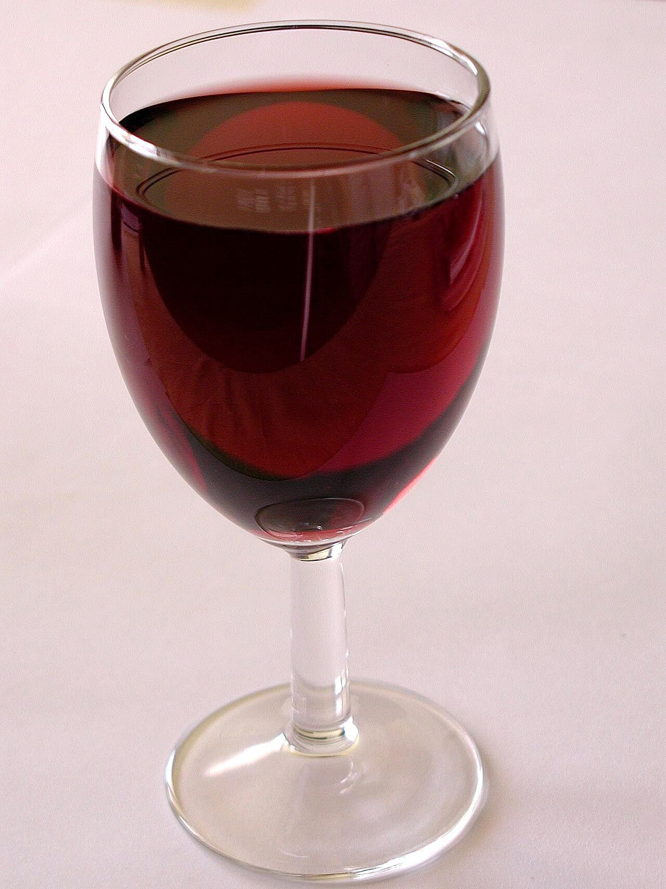

# 红酒杯

红酒杯是一种杯身宽大、杯口略收的带梗酒杯。它的形状不是为了好看，而是为了服务红葡萄酒的香气：宽大的杯腹让酒液与空气接触，收拢的杯口把香气聚到鼻前，杯梗则让手指不必握住杯身。

同样叫“红酒杯”，不同酒款却有不同形状。波尔多杯偏高、杯身较直，勃艮第杯更宽、更圆；它们都叫红酒杯，但服务的香气类型不同。理解形状与香气的关系，比记住某个品牌更重要。关于红葡萄酒本身，可以参考[红葡萄酒](ref:red)。

图：一杯红葡萄酒。图片：Paolo Neo，Public Domain，via Wikimedia Commons（[原图页面](https://commons.wikimedia.org/wiki/File:Red_wine_in_glass_in_restaurant.jpg)）。

## 器型与比例

红酒杯的核心比例是“大杯腹、窄杯口、长杯梗”。杯腹的容量通常在 350 到 600 毫升之间，实际倒酒只占三分之一左右；留下的空间不是浪费，而是香气与空气的缓冲层。

杯口略收，能让香气集中。杯口完全敞开，香气会向四周散；杯口过窄，香气又会被闷住。收口的弧度、杯腹的宽度与杯梗的长度，共同决定了这杯酒的香气表现。

杯梗的长度也有实际作用。长梗让手指远离杯身，减少体温对酒液的影响；短梗或无水杯则更适合强调便携与耐用，而不是精细品鉴。

## 为什么用大杯

红葡萄酒的香气来自酒精、酯类、酚类与果香的共同作用。酒液倒入大杯后，表面积增加，香气更容易释放；杯口收拢，释放出的香气又不会立刻散掉。这个“先释放、再聚集”的过程，是大杯的主要价值。

大杯也能容纳更多的空气。年轻、单宁紧的红酒在杯中与空气接触后，香气会逐渐打开；老酒则可能在短时间内衰退。因此，大杯不是“越老越适用”，而是要看酒的状态。

小杯并非不能用。小杯能让香气更集中，但酒液与空气接触少，适合已经充分醒酒、香气外放的酒；对大酒而言，小杯会显得拥挤，香气层次展不开。

杯型还与产区习惯有关。波尔多杯偏高，适合赤霞珠、梅洛的直筒香气；勃艮第杯更宽，适合黑皮诺的细腻花香；罗讷河谷杯介于两者之间，适合西拉与歌海娜。没有“唯一正确”的杯型，只有更适合当前酒款的形状。

## 适合什么酒

红酒杯最适合果香明显、结构完整的红葡萄酒，例如赤霞珠、梅洛、西拉、丹魄与内比奥罗。不同品种的香气类型不同，杯型也应随之调整：赤霞珠适合较高的杯身，勃艮第黑皮诺适合更宽的杯腹。

它不适合香槟与气泡酒。气泡需要细长的杯身来保留，红酒杯的宽口会让气泡迅速散失；它也不适合清爽型白葡萄酒，因为大杯腹会让香气过度氧化。

如果只有一种杯子，选中号的红酒杯最通用。它能容纳多数红酒，也能应付部分白葡萄酒；但它不是万能杯，香气精细的酒仍需要更合适的杯型。

## 温度与倒酒

红葡萄酒的饮用温度通常在 16 到 18 摄氏度，具体取决于酒体与年份。温度太高，酒精感会突出，香气变得浑浊；温度太低，香气被压住，单宁显得僵硬。

倒酒时只倒到杯腹的三分之一左右。倒得太满，香气没有空间展开，摇杯也容易溢出；倒得太少，酒液表面积不足，香气释放慢。三分之一是经验值，不是硬标准。

倒酒要沿杯壁缓慢注入，避免直接冲击杯底。冲击会搅动沉淀，也会让香气过度挥发；沿壁倒酒更温和，也更容易控制分量。关于倒酒动作，可以参考[倒酒](ref:pouring)。

## 持杯与清洗

持杯时握住杯梗或杯脚，不要握住杯腹。手指的温度会传给酒液，让酒在几分钟内升温；杯腹上的指纹也会影响观感与香气。握住杯梗，既稳又不会传热。

清洗时用温水和少量中性洗涤剂，充分冲洗，倒扣晾干。不要用毛巾反复擦杯内，纤维与洗涤剂残留会影响香气；如果有水渍，可以用干净的超细纤维布轻按，不要用力摩擦。

存放红酒杯时避免与有强烈气味的物品放在一起。玻璃会吸附气味，长期不用的杯子在使用前可以用清水冲一遍并晾干。关于选杯的更多原则，可以参考[如何选杯](ref:glass)。

## 常见误区

第一，认为红酒杯越大越好。杯腹过大，酒液太少，香气会显得空；杯腹过小，香气展不开。尺寸要与酒款、倒酒量匹配。

第二，倒酒倒满。满杯没有香气空间，摇杯会溢出，也不便观察颜色。三分之一左右才是合适的起点。

第三，握住杯腹。体温会让酒升温，手指也会留下痕迹；握住杯梗或杯脚更合适。

第四，用红酒杯喝香槟。宽口会让气泡迅速散失，香槟需要更细长的杯型。关于白葡萄酒的杯型，可以参考[白葡萄酒杯](ref:white)；关于收口杯的香气逻辑，可以参考[郁金香杯](ref:tulip)。

对照阅读：[红葡萄酒](ref:red)、[郁金香杯](ref:tulip)。

相关条目：[白葡萄酒杯](ref:white)。

**关键事实。**

| 项目 | 内容 |
| --- | --- |
| 一句话定位 | 杯身宽大、杯口略收的带梗酒杯，用于红葡萄酒；较大的杯腹帮助香气展开，收口则让香气集中于杯口 |
| 材质 | 玻璃、水晶玻璃 |
| 适用 | 红葡萄酒、部分深色果香型酒款 |

**来源与边界。** 本页关于「红酒杯」的关键事实，主要由以下来源交叉核对：Oxford University Press（酒杯形制、香气与品鉴背景）、Encyclopaedia Britannica（葡萄酒品鉴与侍酒的一般背景）、Corning Museum of Glass（玻璃器型与工艺背景）等 5 条来源。价格、批次与状态会变，涉及这些字段时以页面所列来源的最新版本为准。正文为项目自写，来源只作核验，不复制原文。

**并读。** 把「红酒杯」与「红葡萄酒」、「白葡萄酒杯」、「郁金香杯」放在一起读时，先确认它们是同一层级还是上下游关系：先确认杯型用途与材质，再比较容量、杯口与香气表现。本页负责给出器皿的基本坐标，对照条目补上具体案例与差异；读完再回到本页，才能分清哪些差别属于器皿本身，哪些只是产地、批次或品牌选择。

**适用边界。** 对「红酒杯」而言，容量与杯型会因生产商不同；杯口、杯腹与材质比“专用杯”标签更重要。

**更新提示。** 「红酒杯」最近核对于 2026-11-20；尺寸、材质、容量与替代品会变，购买前以厂商规格为准。

**编者注。** 本页把「红酒杯」作为器皿条目处理：定义、流程与关键数字以正文表格为准，与「红葡萄酒」、「白葡萄酒杯」的差异用对照阅读验证；遇到价格、批次或地址，回到页面所列来源核对。
