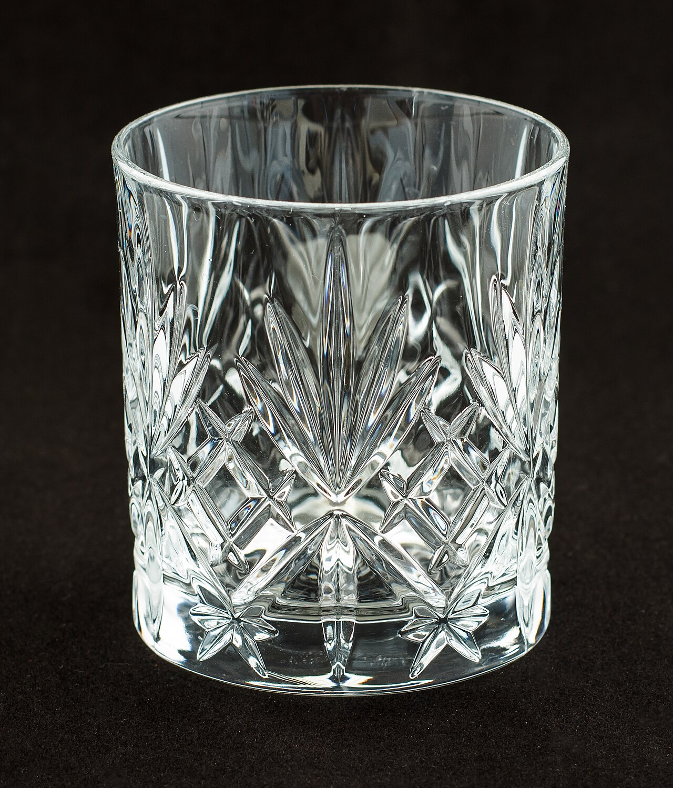

# 古典杯

古典杯（Old-fashioned glass / Rocks glass）是一种杯身较矮、杯口较宽的玻璃短饮杯。它常用于加冰纯饮烈酒，也用于需要滤冰或加冰呈现的鸡尾酒。它没有杯梗，杯壁较厚，能容纳较大的冰块；这些特征决定了它的用途，也决定了它的局限。

图：古典杯。图片：Andreas Argirakis，CC BY-SA 3.0，via Wikimedia Commons（[原图页面](https://commons.wikimedia.org/wiki/File:Old_Fashioned_Glass.jpg)）。

## 什么是古典杯

古典杯的核心特征是两个比例：杯口直径相对杯身高，杯身矮而宽。它不是高脚杯，也不是细长的长饮杯。杯口宽，方便放入大冰块和装饰；杯身矮，方便手持，也让酒液与空气的接触面积更大。

“古典杯”这个中文名来自它的典型用途——古典鸡尾酒（Old-fashioned）。但它的用途不限于此：加冰纯饮的威士忌、搅拌后滤入的短饮、甚至部分需要大冰块的饮品，都可以使用。名称是习惯，不是限制。

## 器型与容量

古典杯没有统一的容量标准。市面上常见的容量从较小到较大都有，杯壁厚薄、杯底厚度和杯口直径也各不相同。因此，本页不给出一个“标准容量”，也不建议按固定毫升数假定所有古典杯都一样。

容量差异会直接影响使用：杯小、冰大，酒液空间不足，容易溢出；杯大、冰小，香气空腔过大，香气容易散。实际使用时，应先看自己的杯子能放多大的冰，再决定倒多少酒。配方中的“适量冰”应根据杯子调整，而不是照搬。

## 适合什么

古典杯最适合两类场景。第一类是加冰纯饮，例如[威士忌](ref:whisky)加一块大冰：矮宽的杯身便于放大冰，宽杯口便于闻香。第二类是搅拌后滤入的短饮，例如[内格罗尼配方](ref:recipe)：酒液已经冷却和稀释，滤入装有冰的古典杯，可以保持低温和清爽口感。

它不适合需要大量气泡的长饮，因为杯口宽、杯身矮，气泡容易散失；也不适合需要聚拢细腻香气的酒，因为宽杯口会让香气向四周扩散。需要聚香时，收口杯更合适；具体杯型的作用可参考[如何选杯](ref:glass)。

## 冰块与温度

古典杯的体验很大程度取决于冰。大冰块表面积小，融化慢，降温持久，稀释可控；碎冰降温快，但融化也快，几分钟内就会让酒变淡。使用大冰时，酒液应提前冷却，否则冰块会被酒液迅速加热，融化加快。

杯子没有杯梗，手持杯身会把体温传给酒液。需要长时间保冷时，可以握住杯口附近，或使用杯垫、杯套；也可以先把杯子冰镇，再放入冰块。关于冰型与温度的进一步说明，可以参考[加冰与温度](ref:ice)与[调酒基础](ref:cocktails)。

## 持杯与保冷

持杯方式会影响温度，也会影响观感。握杯身方便，但传热快；握杯口附近传热慢，但手指会接触杯口，可能影响卫生和香气。折中的做法是握杯身下部，减少手掌大面积接触，同时避免手指伸进杯口。

杯垫和杯套能减少桌面与手的热传导，但不会改变冰的融化速度。若想延长保冷，优先使用更大的冰、预冷杯子和减少手接触，而不是依赖杯垫。

## 与相近杯型的区别

古典杯与高球杯常被混淆。高球杯细长，容量通常更大，适合加长饮和气泡饮料；古典杯矮宽，适合短饮和大冰块。古典杯与平底水杯也不同：水杯杯壁通常更薄，杯口更大，设计目标不是聚香或保冷。

与收口闻香杯相比，古典杯的香气扩散更明显，层次感较弱，但入口更方便，加冰更稳定。两者不是替代关系，而是不同目的的工具。

## 清洗与存放

古典杯杯口宽，容易清洗，但厚杯底和杯壁可能让洗涤剂残留更难冲净。手洗时用温水和少量中性洗涤剂，充分冲洗，倒扣晾干；不要用毛巾反复擦杯内，以免留下纤维和气味。

存放古典杯时避免与有强烈气味的物品放在一起。玻璃会吸附气味，尤其是长期不用的杯子。使用前可以用清水冲一遍并晾干，确认没有洗涤剂或储物柜的气味。

## 常见误区

第一，认为古典杯有标准容量。容量差异很大，应按自己的杯子调整冰量和酒量。

第二，用碎冰加满一杯。碎冰融化快，会让酒在几分钟内变淡；短饮通常更适合大冰。

第三，把古典杯当成万能杯。它适合短饮和加冰纯饮，不适合需要聚香或大量气泡的场景。

第四，忽视预冷。温热的杯子会加速冰块融化，影响稀释节奏。

第五，只追求杯子好看。杯口是否平整、杯壁是否均匀、容量是否适合你的用法，比外观更重要。

## 选择建议

选购时可以先看三点：杯口直径是否能放下你常用的大冰块；杯身高度是否适合你的手；杯壁是否均匀、杯口是否平整。容量不必追求某个数字，但应与你常做的配方匹配。

如果只买一只，选中等等径、杯壁略厚的款式，通常更耐用，也更适合加冰。若经常做短饮，可以准备两只，方便在客人来访时使用。不要为了“专业感”购买容量过小或杯壁过薄的款式，它们在实际使用中容易受限。

## 边界

古典杯是工具，不是身份标志。容量、冰型和温度对成品的影响，往往比杯子的价格更大。本页不推荐具体品牌，也不把某种器型说成唯一正确选择；实际使用应以杯子条件和个人感受为准。

对照阅读：[内格罗尼配方（IBA 版本）](ref:recipe)、[加冰这件事，没有标准答案](ref:ice)。

相关条目：[换一只杯子，会有什么不同？](ref:glass)。

**关键事实。**

| 项目 | 内容 |
| --- | --- |
| 一句话定位 | 杯身较矮、杯口较宽的短饮杯，常用于加冰纯饮与搅拌类鸡尾酒；容量没有统一标准，冰量应按自己的杯子调整 |
| 材质 | 玻璃 |
| 适用 | 加冰纯饮、搅拌类鸡尾酒 |

**来源与边界。** 本页关于「古典杯」的关键事实，主要由以下来源交叉核对：International Bartenders Association（古典杯在成品中的实际用法与装饰方式；确认该饮品属于 IBA 官方鸡尾酒名单）、Oxford University Press（短饮杯型、加冰纯饮与稀释的一般背景）、Dave Arnold / W. W. Norton（冰型、温度与稀释对杯饮的影响）等 5 条来源。价格、批次与状态会变，涉及这些字段时以页面所列来源的最新版本为准。正文为项目自写，来源只作核验，不复制原文。
