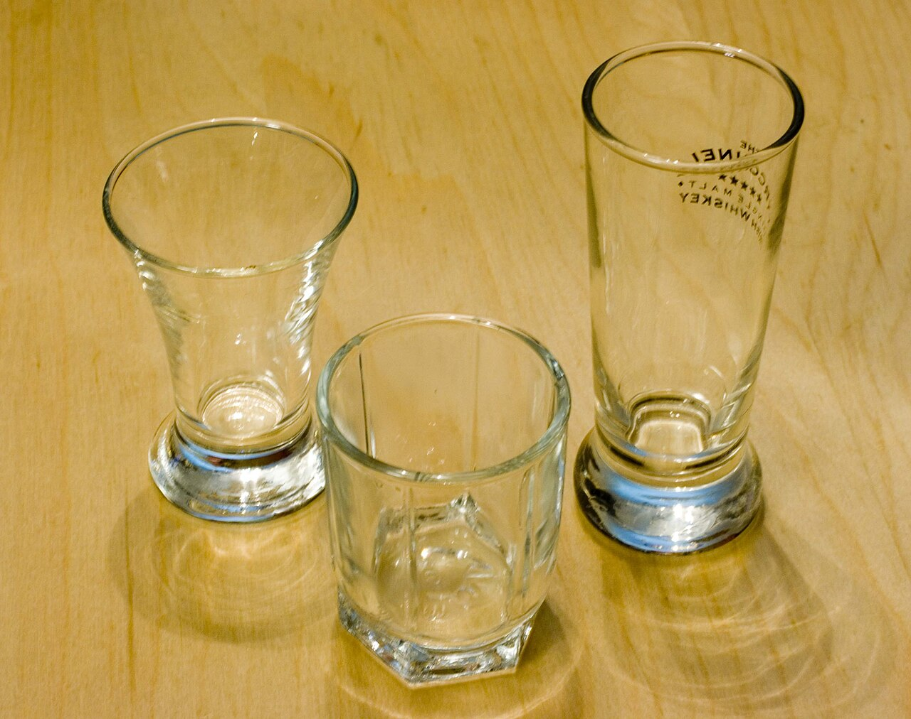

# 烈酒杯

烈酒杯（shot glass）是一种容量很小、杯壁较厚的小杯。它的名字来自“shot”——一口饮用的少量烈酒。它不追求香气层次，也不追求慢慢品饮；它追求的是方便、强度与节奏。

烈酒杯的容量没有统一标准，常见从 30 到 60 毫升不等。小杯用于一口饮，大杯用于量酒或分层；杯壁厚，能承受碰撞与低温，也能让酒液在短时间内保持温度。它的“简单”，其实是一套很实用的设计。

图：三只烈酒杯。图片：Kelly Martin，CC BY-SA 2.5，via Wikimedia Commons（[原图页面](https://commons.wikimedia.org/wiki/File:Three_shotglasses.jpg)）。

## 器型与容量

烈酒杯的核心特征是“小容量、厚杯壁、直口或微收口”。直口杯方便倒入与饮用，微收口杯能稍微聚拢香气；杯底厚，能增加稳定性，也能让杯子的重心更低。

容量差异直接影响使用。30 毫升的杯子适合一口饮，45 到 60 毫升的杯子适合量酒或加少量冰块；如果杯子太大，一口喝不完，酒会回温，风味也会变；如果杯子太小，量酒时容易溢出。

杯口的大小也有讲究。杯口大，香气散失快，但方便倒入；杯口小，香气集中，但倒入时容易洒。烈酒杯通常不需要精细闻香，所以杯口设计更偏向“好倒、好喝”。

## 历史与酒吧文化

烈酒杯的普及与 20 世纪美国酒吧文化有关。它的前身是量酒用的 jigger 与小玻璃杯；随着酒吧把“一口饮”变成一种消费方式，专门的 shot 杯开始出现。

“shot”这个词的起源没有可靠的一手记载。有说法认为它来自射击（a shot）的比喻，也有说法认为它来自酒杯的容量或饮用方式。可以确认的是：shot 杯在 20 世纪中后期成为美国酒吧的标准器具之一。

烈酒杯的流行也带来了“shot 文化”：快速饮用、互相碰杯、把烈酒一口喝完。这种喝法追求的是强度与社交节奏，不是风味；理解这一点，才能理解烈酒杯的设计。

## 适合什么酒

烈酒杯最适合高酒精度的烈酒，例如伏特加、金酒、朗姆酒、龙舌兰与部分利口酒。它不适合香气精细的威士忌与干邑；这些酒需要闻香杯，才能分辨层次。

它也常用于分层鸡尾酒。分层依靠糖浆、利口酒与烈酒之间的比重差，小杯能让每一层更清楚；杯壁厚，能让酒液在倒入时保持稳定。关于分层做法，可以参考[分层](ref:layering)。

分层的顺序不是随意的。糖浆比重最大，先倒；利口酒次之；烈酒最轻，最后倒。每一层都要沿杯壁缓慢注入，杯口越窄，层越容易保持；杯口越宽，酒液越容易混。小杯的优势，是让层与层之间的距离更短，视觉更集中。如果杯子太矮，层数多时每层会很薄，颜色不容易分辨；如果杯子太高，倒入时冲击力更大，层也容易混。杯壁的厚度也会影响观察，厚壁会产生折射，让层的边界看起来更模糊。

烈酒杯还可以当量杯使用。没有量酒器时，可以用已知容量的 shot 杯量取；但它的刻度通常不精确，只能作为粗略参考。精确量取仍应使用[量酒器](ref:jigger)。

## 使用与温度

烈酒杯通常不预热，也不加冰；酒液在室温下倒入，一口喝完。需要冰镇时，可以把杯子提前冷藏，或把酒液冷藏；不要把杯子放进冷冻室，骤冷会让玻璃产生应力。

倒酒时倒到杯口下方一点，不要倒满。倒满容易溢出，也不方便举杯；留一点空间，能让香气聚集，也能避免手指接触酒液。

如果要做分层，先倒比重最大的糖浆，再倒利口酒，最后倒烈酒；每一层都要沿杯壁缓慢注入。倒得太快，层会混在一起；倒得太慢，酒液会挂在杯壁。关于调酒基础，可以参考[调酒基础](ref:basics)。

## 清洗与存放

烈酒杯杯口小、杯底厚，清洗时容易残留洗涤剂。手洗时用温水和少量中性洗涤剂，充分冲洗，倒扣晾干；不要用毛巾反复擦杯内，以免留下纤维与气味。

存放时避免堆叠。杯壁厚，但杯口仍然脆弱；堆叠会让杯口互相碰撞，产生裂纹。最好放在杯架或软垫上，单独排列。

玻璃会吸附气味，长期不用的杯子在使用前可以用清水冲一遍并晾干。不要用有强烈气味的清洁剂，也不要把杯子放在香料、咖啡豆或烟草旁边。

## 常见误区

第一，认为所有 shot 杯容量相同。容量差异很大，量酒时应先确认杯子的实际容量。

第二，用 shot 杯品鉴威士忌。小杯无法聚香，酒精感会压过细节；品鉴应使用闻香杯。

第三，倒满。满杯容易溢出，也不方便举杯；留一点空间更安全。

第四，把 shot 杯当精确量具。杯上的刻度通常不准确，只能粗略参考；精确量取应使用量酒器。关于加冰饮用的杯型，可以参考[古典杯](ref:rocks)；关于伏特加的饮用方式，可以参考[伏特加](ref:vodka)。

对照阅读：[量酒器](ref:jigger)、[分层](ref:layering)。

相关条目：[古典杯](ref:rocks)。

**关键事实。**

| 项目 | 内容 |
| --- | --- |
| 一句话定位 | 容量很小、杯壁较厚的小杯，常用于一口饮用的烈酒、量酒与分层鸡尾酒；它追求的是方便与强度，不是香气层次 |
| 材质 | 玻璃、水晶玻璃 |
| 适用 | 一口饮用的烈酒、量酒、分层鸡尾酒 |

**来源与边界。** 本页关于「烈酒杯」的关键事实，主要由以下来源交叉核对：Oxford University Press（shot 杯与酒吧计量文化）、International Bartenders Association（鸡尾酒结构与分层做法）、CocktailDB（交叉核对分层鸡尾酒与杯型用法）等 5 条来源。价格、批次与状态会变，涉及这些字段时以页面所列来源的最新版本为准。正文为项目自写，来源只作核验，不复制原文。

**并读。** 把「烈酒杯」与「量酒器」、「古典杯」、「分层」放在一起读时，先确认它们是同一层级还是上下游关系：先确认杯型用途与材质，再比较容量、杯口与香气表现。本页负责给出器皿的基本坐标，对照条目补上具体案例与差异；读完再回到本页，才能分清哪些差别属于器皿本身，哪些只是产地、批次或品牌选择。

**适用边界。** 对「烈酒杯」而言，容量与杯型会因生产商不同；杯口、杯腹与材质比“专用杯”标签更重要。

**更新提示。** 「烈酒杯」最近核对于 2026-11-20；尺寸、材质、容量与替代品会变，购买前以厂商规格为准。

**编者注。** 本页把「烈酒杯」作为器皿条目处理：定义、流程与关键数字以正文表格为准，与「量酒器」、「古典杯」的差异用对照阅读验证；遇到价格、批次或地址，回到页面所列来源核对。
