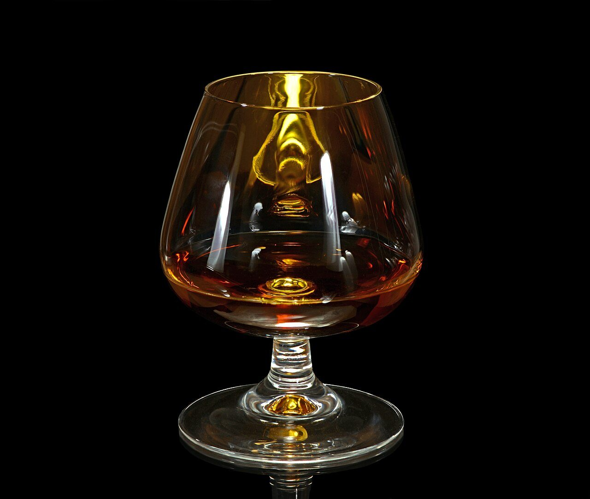

# 白兰地杯

白兰地杯（snifter，也叫气球杯）是一种短梗、大肚、杯口收拢的玻璃杯。杯腹像一只气球，最宽处在中部偏下，向上逐渐收窄；杯梗很短，手指可以托住杯腹。它最常与干邑和白兰地联系在一起，也用于其他陈年烈酒与部分烈性啤酒。它的名声建立在“用手温加热、让香气升起来”这套动作上，但真正决定体验的，是容量、倒酒量与杯口的收拢程度。

图：一只盛有干邑的白兰地杯（气球杯），黑色背景。图片：Didier Descouens，CC BY-SA 3.0，来源：[原始页面](https://commons.wikimedia.org/wiki/File:Cognac_glass.jpg)。

> **先给结论**
> **一句话：** 这页判断白兰地杯为什么影响香气，以及该配什么酒。
>
> - **适合谁：** 想弄懂白兰地杯为什么影响香气与口感的人。
> - **不适合谁：** 只想要“买最贵杯子”的结论、不关心酒款匹配的人。
> - **先看这两点：**
>   - 加冰不是白兰地杯的强项。
>   - 第一看杯腹与杯口的比例。

## 一只容易被用错的杯子

白兰地杯的形象太成功，以至于很多人把它当成“干邑专用杯”，并且认为杯子越大越气派、酒倒得越满越诚意。这两个印象都不准确。

它确实传统上与[白兰地](ref:brandy)绑定，尤其是干邑，但同一形状也被威士忌、朗姆、陈年龙舌兰与甜酒使用；在啤酒世界，类似的杯型被称为 snifter，用来盛酒精度较高、香气浓郁的烈性啤酒。

容量大也不是为了多喝。大杯腹是为了留出香气空间，让酒液上方有足够的空气与挥发面；真正倒进去的酒通常只有几十毫升。把大杯倒满，等于把设计目的反过来用。

## 短梗、大肚、收口：形制拆解

短梗是第一个特征。它不像葡萄酒杯那样有细长杯梗，而是短到可以用手指夹住、让杯腹落在掌心里。这个结构决定了它的使用方式：手可以托住杯腹，也可以只握短梗。

大肚是第二个特征。杯腹最宽处直径明显大于杯口，形成较大的液面与较大的空气体积。液面大，香气释放快；空气体积大，香气有空间混合，不会一倒出来就冲到鼻尖。

收口是第三个特征。杯口直径小于杯腹最宽处，向上收拢但不完全闭合。收口把上升的香气引向杯口中央，也减少了香气向四周散失；但它不像郁金香杯那样收得很紧，闻香时鼻子仍能舒适地进入杯口。

这三个特征合在一起，形成了一个“宽底—窄口”的香气腔体。它的长处是容纳与聚拢，短处是升温快、酒精挥发也快。

## 手温是帮手还是干扰

传统动作是：手指夹住短梗，杯腹落在掌心，靠手温把酒液加热到略高于室温，让香气升起来。这套动作有真实的物理基础。白兰地的香气来自酯类、醛类、萜类与木桶带来的香兰素等物质，温度升高会提高它们的挥发性，闻起来更开放、更甜、更有层次。

但手温也是干扰。酒精的沸点比水低，升温同样会提高乙醇的挥发；当酒液温度过高，闻到的第一层就是酒精，原本的果香、花香与木质香被压住，入口也变得刺辣。手掌温度通常在三十度上下，长时间托着杯腹，足以让一小杯酒明显升温。

实际的分寸是：让杯子从室温开始，用手温短时间托住，闻到香气打开就停止加热；不要一边聊天一边把杯子捂在手里十几分钟。如果室温本来就高，或者酒精度很高，宁可不加热，也不要让手温持续作用。关于闻香的判断方法，可参考[闻香](ref:nosing)。

## 收口把香气聚到哪里

收口的作用不是“锁住”香气，而是改变香气的流向。宽杯腹里的香气上升时本来会向四周扩散，收口把向上的气流导向杯口中央，形成一个较窄的香气柱；鼻子靠近杯口时，闻到的浓度更高。

收口的程度决定了体验。收得太松，香气散得快，杯子接近普通大肚杯；收得太紧，香气集中但酒精也集中，闻久了容易疲劳。好的白兰地杯收口温和，杯口边缘略外翻，饮用时酒液流向舌尖而不是喉咙。

收口还影响转杯。杯腹宽，转杯时酒液可以在内壁形成较大的薄膜，增加与空气接触的面积，香气释放更明显。但转杯幅度过大会让酒精冲上来，尤其是高度数的干邑；轻轻转动即可。

## 容量 300–800 ml，倒多少才合理

常见容量在 300–800 ml 之间，差异很大；也有厂商建议使用 250 ml 左右的气球杯来集中香气。容量以具体产品为准，购买前应看产品标注。

倒酒量则完全不能用容量推算。常见的纯饮份量是 25–50 ml，约合一到两指高；倒到杯腹最宽处以下，留出大半个杯子的空间。以 300 ml 杯为例，30 ml 酒液只占十分之一；以 800 ml 杯为例，同样的酒液几乎铺不满杯底，香气反而难以聚拢。杯子过大、酒液过少，会导致“闻不到、喝得快、升温慢”的奇怪组合。

一个实用的判断是：倒完后把杯子静置十几秒，若香气能在杯口形成稳定的一层，说明量合适；若必须把鼻子探进杯腹才闻得到，说明酒太少或杯太大；若一靠近就是酒精，说明倒多了。

## 与郁金香杯的分工

[郁金香杯](ref:tulip)是白兰地杯最常被拿来比较的杯型。它有更长的杯梗、更窄的杯口与更小的杯腹，设计目标是精确闻香：香气被收得更紧，手不容易碰到杯腹，温度更稳定。干邑酒庄的品鉴人员往往更偏好郁金香杯，因为它减少了手温的干扰，也更容易捕捉细腻层次。

白兰地杯的优势在别处：杯腹大，香气展开的空间大，适合闻香时间较长、香气浓郁的陈年酒；短梗让托杯的动作更自然，仪式感更强；宽杯口也方便加入一滴水或一块冰。

两者不是替代关系，而是场景分工。想要专注判断，用郁金香杯；想要慢慢闻、慢慢喝，用白兰地杯。若只有一只杯子，郁金香杯的适用范围更广；若你享受托杯的动作，白兰地杯更合适。

## 转杯、闻香与第一口

转杯的目的是增加酒液与空气的接触，不是表演。把杯子放在桌面上，以杯脚为轴轻轻画圈，让酒液沿杯壁上升一层即可；不要大力摇晃，高度酒会立刻释放刺鼻的酒精。

闻香分两次。第一次短促地闻，判断有没有明显的酒精刺激与异味；第二次把鼻子放在杯口稍下方，慢慢吸气，分辨果香、花香、木质与香料。不要连续深吸，嗅觉会疲劳；闻两三次后可以闻一下自己的手背，让鼻子“重启”。

第一口要小。酒液在口中停留一两秒，让温度升到口腔温度，香气从后鼻腔返回；然后再咽。大口喝会跳过香气，也会让酒精感占据全部注意力。关于品鉴顺序与节奏，可参考[第一次品鉴](ref:tasting)。

## 加冰、加水与别的喝法

加冰不是白兰地杯的强项。杯腹虽大，但杯口收拢，放入大冰块后不便饮用；冰块融化也会持续稀释酒液。要加冰，[古典杯](ref:rocks)更合适：杯口宽、杯身矮，冰块有空间，温度也更稳定。

加水是另一回事。几滴常温清水可以降低酒精的表面活性，让香气更容易释放，尤其是酒精度较高的干邑；水量以“闻起来更开放、入口不那么刺”为准，通常几滴到一小勺。不要加冰水，低温会压住香气。

白兰地杯也常用于甜酒、陈年朗姆与龙舌兰；在啤酒中，类似的杯型用于大麦酒、帝国世涛一类香气浓郁、酒精度高的酒。用途可以扩展，但倒酒量的原则不变：少量，留空间。

## 选购：看得见的四个细节

第一看杯腹与杯口的比例。杯腹明显宽于杯口，香气才聚得住；比例接近直筒，杯子就退化成普通大水杯。第二看杯壁厚度。杯口边缘越薄，饮用触感越干净；杯壁过厚会让香气显得闷。

第三看短梗与杯脚。短梗要能稳稳夹住手指，杯脚要平整、不易倾倒；大肚杯重心高，杯脚太小会翻。第四看透明度。品鉴需要观察颜色，带色、磨砂或重雕花的杯身会干扰判断；厂商也建议使用透明玻璃，让颜色与光泽参与品鉴。

不要被“手工”“水晶”这类词带走。水晶玻璃更薄更亮，但更易碎；普通玻璃更耐用。容量以具体产品为准，先确定自己常喝的酒与倒酒量，再选杯腹大小；800 ml 的杯子并不比 300 ml 的更适合所有人。

## 清洗与存放

白兰地杯杯腹大、杯口收，手可以伸进去，但杯底与杯腹交界处容易积洗涤剂。建议手洗：温水、少量中性洗涤剂，用软海绵沿杯壁清洗，充分冲洗后倒扣晾干。不要用毛巾伸进杯腹反复擦，纤维与气味会留在玻璃上；也不要把杯子泡在洗涤液里过夜。

杯口薄，清洗时避免与其他杯子碰撞；短梗与杯脚连接处是受力点，拿取时托住杯脚或握短梗，不要只捏杯口。存放时不要叠放，大肚杯叠起来容易卡住并压裂杯口；最好单层摆放或使用杯架。长期不用的杯子，使用前用清水冲洗并晾干，确认没有储物柜的气味。

## 常见误区

第一，“容量大就要倒满”。容量是香气空间，不是酒量；倒满会破坏香气，也让人喝得过快。

第二，“白兰地杯只装干邑”。它也用于其他白兰地、陈年烈酒与烈性啤酒；杯型不限制酒款。

第三，“必须用手加热”。手温可以帮助香气打开，但不是必要步骤；温度过高会让酒精盖过香气，室温饮用完全合理。

第四，“杯子越大越专业”。过大的杯子配过少的酒，香气反而散；大小应与倒酒量匹配。

第五，“收口越紧越聚香”。收得太紧，酒精也会被聚在杯口，闻久了刺鼻；温和收口更实用。

第六，“白兰地杯适合加冰”。加冰应换古典杯；白兰地杯的收口与短梗不适合长时间加冰饮用。

## 另见

- [白兰地](ref:brandy)：白兰地杯最传统的酒类。
- [郁金香杯](ref:tulip)：更聚香、更适合精确品鉴的替代杯型。
- [古典杯](ref:rocks)：加冰饮用时的替代杯型。
- [闻香](ref:nosing)：如何判断香气是否被酒精盖住。
- [第一次品鉴](ref:tasting)：品鉴顺序与温度控制。
