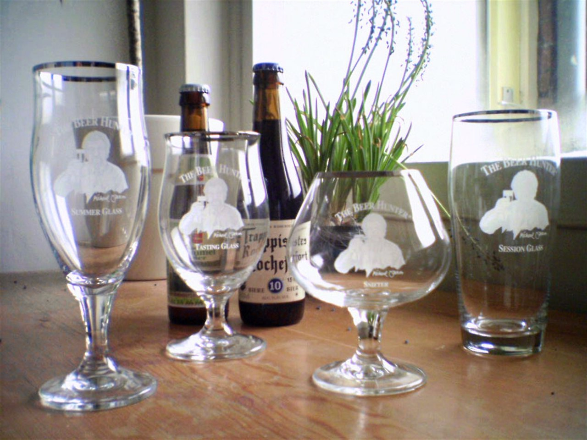

# 品鉴杯

品鉴杯不是一个笼统的“用来品酒的杯子”，而是一只有标准可查的杯型。它最常指 ISO 3591 规定的葡萄酒品评杯，因法国原产地品评体系的使用传统而常被称为 INAO 杯。它的形状接近一只拉长的蛋，杯口比杯腹最宽处窄，杯腹下方接短梗与杯脚。它存在的理由不是让酒更好喝，而是让不同的酒在同一个几何条件下被比较。

图：品鉴杯。图片：Sietske at Dutch Wikipedia，CC BY-SA 3.0，via Wikimedia Commons（[原图页面](https://commons.wikimedia.org/wiki/File:Michaeljacksonbierglazen.jpg)）。

> **先给结论**
> **一句话：** 这页判断品鉴杯为什么影响香气，以及该配什么酒。
>
> - **适合谁：** 想弄懂品鉴杯为什么影响香气与口感的人。
> - **不适合谁：** 只想要“买最贵杯子”的结论、不关心酒款匹配的人。
> - **先看这两点：**
>   - 这类标准品鉴杯的标称容量通常写作 215 毫升。
>   - ISO 3591 于 1977 年发布，标准名称是《感官分析——器具——葡萄酒品评杯》。

## 一只被标准定义过的杯子

ISO 3591 于 1977 年发布，标准名称是《感官分析——器具——葡萄酒品评杯》。标准把杯腹描述为“拉长的蛋”，由杯梗支撑、落在杯脚上；杯口比杯腹的凸出部分更窄，用来集中香气。标准还规定了物理、尺寸与特殊特性，并在附录中给出使用建议。该标准在 2022 年经复审确认继续有效，说明这套比例在几十年的品评实践中没有被推翻。

标准化的意义在于消除变量。杯腹的容积、液面到杯口的距离、杯口的直径、杯壁的厚度，都会影响香气的浓度和入口的角度。如果每位品评者用不同的杯子，比较就变成了杯子之间的比较。ISO 3591 把这些几何参数固定下来，让“同一杯酒”在不同场合成为了一个可控的对象。

需要区分的是，ISO 3591 的标题与适用范围是葡萄酒的感官分析。烈酒与清酒使用类似杯型，是行业实践中的延伸，不是标准本身的规定。把这一点说清楚，才不会把“标准杯”误解为“万能杯”。

## 215 毫升是怎么来的

这类标准品鉴杯的标称容量通常写作 215 毫升。这个数字对应的是一个足够装下品评所需酒液、又不会让杯内空腔过大的体积：酒液倒到杯腹三分之一左右时，上方仍留有足够的香气空间；杯子本身不大，便于在品评桌上排列多只样品；杯腹的宽度足以让酒液转动，杯口又能把香气收拢。

215 毫升是标准杯型的标称值，实际产品会略有差异。不同厂商在杯壁厚度、杯口直径和杯脚高度上会有微小出入，玻璃与水晶玻璃的热性能也不同。购买时可以把 215 毫升当作“这一类杯子”的参考，而不是每一只杯子都必须精确到毫升的承诺。容量以具体产品为准。

容量小还有一层实际考虑：品评往往要连续尝多款酒。杯子太大，每一杯都倒得多，酒精摄入和味觉疲劳都会增加；杯子太小，酒液不足以覆盖舌面，香气也起不来。215 毫升是一个折中值，让“闻得到、尝得清、喝得完”三件事同时成立。

## 郁金香形与收口：为了聚香，也为了可比

品鉴杯的轮廓是郁金香形：杯腹下部圆鼓，向上逐渐收窄，杯口略小。香气从液面挥发后，会在杯腹上方形成一层浓度较高的气体；收窄的杯口减少它与室内空气的交换，让香气在杯口附近积累。闻香时，鼻子靠近杯口，就能在相近的浓度下比较不同样品。

这与宽口杯的机制相反。宽口杯让香气自由扩散，闻起来更“开阔”，但浓度低、变化快；收口杯把香气困在一个较小的出口，浓度高、层次更容易分辨，但酒精感也更容易被放大。品鉴杯选择收口，是因为品评需要稳定的香气信号，而不是舒适的饮用体验。

收口还影响摇杯后的香气释放。轻轻转动杯腹，酒液在杯壁上形成一层薄膜，增加与空气的接触面积；收口把新释放的香气留在杯内，不至于立刻散失。这个动作在葡萄酒品评里很常见，也是品鉴杯比普通水杯更适合闻香的原因之一。

不过，收口不是越窄越好。杯口过窄，鼻子难以进入，摇杯时酒液容易碰到杯口，清洗也不方便。标准杯的收口是温和的，目的是引导而不是封锁。

## 为什么统一杯型能让酒款可比

品评的核心不是“哪只杯子更好”，而是“如何让比较成立”。同一只杯子、同样的倒酒量、同样的温度、同样的静置时间，才能把差异归因于酒本身。统一杯型至少控制了四个变量：液面面积、杯内空腔体积、香气到杯口的路径、酒液入口的角度。

液面面积决定香气挥发的速率。杯腹相同的两只杯子，倒入同样多的酒，液面面积相同，香气浓度才有可比性。空腔体积决定香气的稀释程度；杯口直径决定香气逃逸的速度；杯壁形状决定酒液接触舌面的位置。任何一项不同，品评者的判断都可能偏移。

这也是为什么专业品评场合会强调“同一套杯子”，而不是“每人选一只顺手的杯子”。在比赛、产区认证或实验室感官测试中，杯子是受控条件的一部分，和温度、倒酒量、静置时间一样，需要被记录。关于如何在家做一次简单的对照品评，可以参考[第一口，先别急着下结论](ref:first)。

## 倒到杯腹三分之一

标准杯的常用倒酒量是杯腹的三分之一左右。以 215 毫升的杯子计算，大约是 70 毫升；实际品评中，很多场合会把倒酒量控制在 50–70 毫升之间，视酒款、品评目的和机构习惯而定。关键是留出足够的空腔，让香气有地方积累，同时让酒液有足够的深度供摇杯。

倒得太满，空腔被压缩，香气集中在很小的空间里，酒精感会压过细节；摇杯时酒液容易溅出，杯口也会沾上酒液，影响下一次闻香。倒得太少，液面面积不足，香气强度弱，酒液温度也更容易受杯壁影响。三分之一下是一个实用的起点，不是精确的配方。

对烈酒来说，倒酒量通常更少，常见 20–30 毫升，因为酒精度高，香气强，少量就足够；对清酒来说，品评杯中的酒液可以接近三分之一，温度通常控制在室温或略低。无论哪种酒，判断标准都是一样的：液面之上要留有可以容纳香气的空间。

## 摇杯的自由度与限制

品鉴杯的杯腹不大，摇杯的自由度有限。轻轻转动可以让酒液铺开，释放香气；剧烈摇晃则容易让酒液冲到杯口，甚至洒出。对葡萄酒，通常以杯腹为轴缓慢旋转几圈即可；对烈酒，摇杯的意义更多在于让酒液与空气接触，而不是制造大量气泡。

限制还来自杯口。收口杯的出口小，摇杯后香气集中，但酒精也集中。高酒精度的烈酒在收口杯中久闻，容易出现鼻腔刺痛，判断会变得迟钝。这时可以稍微拉开距离，或滴入少量水降低酒精感，再重新闻香。品鉴杯不解决酒精刺激的问题，它只是把香气集中起来。

另一个限制是温度。杯腹小、酒液少，手温很容易通过杯壁传入。握杯时应捏住杯梗或杯脚，不要包住杯腹；如果品评时间较长，可以让杯子在桌面上静置，而不是一直握在手里。温度上升会让香气变“散”，也会改变酒精感的强度。

## 烈酒与清酒为什么也用这种杯

烈酒品鉴需要稳定的香气信号，品鉴杯的收口和短梗正好满足这一点。威士忌、干邑、朗姆、龙舌兰等烈酒的品评中，常使用类似的小型郁金香杯；有些场合会用杯腹更小的 copita 或专门的烈酒杯，但逻辑相同：少量酒液、足够空腔、收口聚香。关于[威士忌](ref:whisky)的闻香与加水，可以结合具体酒款调整，不必把品鉴杯当成唯一选择。

清酒品鉴也常借用葡萄酒杯或品鉴杯。吟酿类清酒有突出的果香与花香，收口杯能把香气集中；无色透明杯身便于观察清酒的色泽与澄清度。传统清酒饮用多用小杯，重在入口与温度；品评场合则更重视香气与对照，所以会使用类似 ISO 杯的器型。两者并不冲突，只是目的不同。关于[清酒](ref:sake)的品类与温度，可以另页阅读。

这也是“品鉴杯”与“饮用杯”的分野：饮用杯优化的是愉悦和场景，品鉴杯优化的是信息和可比性。用同一只杯子喝完整瓶酒，未必舒服；用同一只杯子比较十款酒，却很方便。

## 透明、无色与刻线

品鉴杯通常无色透明，杯身不做切割、雕花或大面积印花。原因很直接：品评需要观察酒液的颜色、澄清度、黏稠度和气泡，任何颜色或纹理都会干扰判断。杯壁上的装饰越少，视觉信息越可靠。

有的品鉴杯带一条刻线或印刷线，用来提示倒酒量；有的完全没有标记，靠品评者的经验控制。刻线是辅助，不是精密量具。杯子的实际容量会因制造公差、玻璃厚度和温度略有差异，倒酒时的液面弯月面也会影响读数。把刻线当作“大约到这里”的提醒，比当作实验刻度更合适。

杯子的清洁程度同样影响判断。洗涤剂残留会留下气味，油脂会改变酒液的表面张力，水垢会影响澄清度的观察。品评前应使用无香精的中性洗涤剂清洗，充分冲洗，倒扣晾干；不要用带香味的布擦拭杯内。

## 它牺牲了什么

品鉴杯为了可比性，牺牲了一部分享乐性。它的容量小，倒得少，喝一大口就没了；杯腹小，摇杯受限；杯口收，香气集中但酒精也集中；短梗让手离杯腹更近，温度控制不如长梗酒杯从容。它不是为餐桌上的轻松饮用设计的。

这并不意味着它“难用”或“高级”。它只是把目标从“好喝”换成了“好比较”。在盲品、比赛、产区认证、实验室测试里，这些牺牲是值得的；在朋友聚会、配餐、庆祝场合，一只更大的葡萄酒杯或一只合适的啤酒杯可能更舒服。

理解这一点，就不会把品鉴杯当成“更专业的杯子”而到处使用。专业与否取决于使用目的，不取决于杯子的外形。关于杯型与香气、温度的一般关系，可以参考[如何选杯](ref:glass)；如果你更喜欢收口但容量稍大的杯子，[郁金香杯](ref:tulip)是更接近日常饮用的选择。

## 常见误区

第一，“用品鉴杯喝酒更好喝”。品鉴杯优化的是香气信号和可比性，不优化大口饮用的愉悦感；小容量和收口会让酒精感更集中。

第二，“所有郁金香杯都是 ISO 杯”。ISO 3591 对杯腹、杯口和尺寸有具体规定，市面上许多郁金香杯只是轮廓相似，比例并不相同。

第三，“215 毫升是每一只杯子的精确容量”。215 毫升是标准杯型的标称值，实际产品会有差异，容量以具体产品为准。

第四，“倒得越满，香气越强”。倒得太满会压缩空腔，香气反而拥挤，摇杯也容易洒出；三分之一左右更合适。

第五，“品鉴杯只能用于葡萄酒”。烈酒和清酒品评也常使用类似杯型，但这是延伸用法，不属于 ISO 3591 的原始适用范围。

第六，“有了标准杯就会品酒”。杯子只控制变量，判断力来自训练、对照和记录；杯型不能替代经验。

## 另见

- [葡萄酒](ref:wine)：品鉴杯最主要的原始用途。
- [威士忌](ref:whisky)：烈酒品鉴中的类似杯型。
- [清酒](ref:sake)：清酒品评中的香气与温度。
- [郁金香杯](ref:tulip)：容量更大、更接近日常饮用的收口杯。
- [第一口，先别急着下结论](ref:first)：在家做对照品评的方法。
