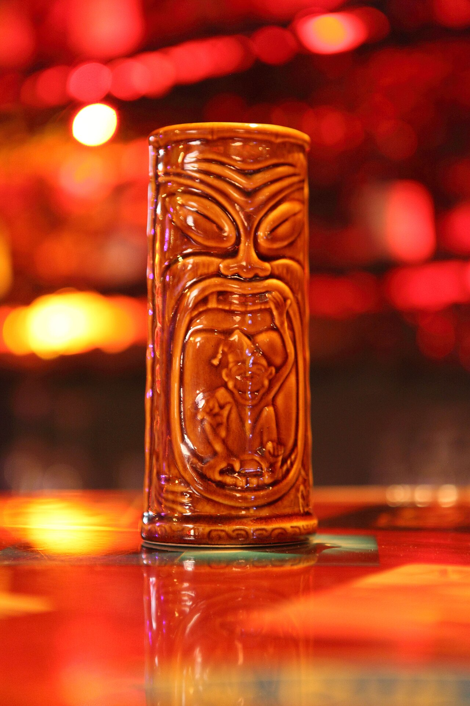

# Tiki 杯

Tiki 杯是一种异形杯，常以陶瓷或玻璃制成，杯身雕刻成提基神像、面具、图腾或动物。它不是普通的饮用容器，而是热带鸡尾酒文化的一部分：杯子本身就是装饰、叙事与气氛。

Tiki 文化在 20 世纪中叶的美国流行，与 Trader Vic's、Don the Beachcomber 等酒吧有关。酒吧把朗姆、果汁、糖浆与香料混合，装进雕刻杯，配上花卉、竹叶与小伞，营造“南太平洋”的想象。Tiki 杯，是这种想象的载体。

图：一只 Tiki 马克杯。图片：Sam Howzit，CC BY 2.0，via Wikimedia Commons（[原图页面](https://commons.wikimedia.org/wiki/File:Tiki_mug_from_the_Purple_Orchid_Exotic_Tiki_Lounge.jpg)）。

## 器型与容量

Tiki 杯没有统一形状。常见的有神像杯、面具杯、桶形杯、贝壳杯与动物杯；材料有陶瓷、玻璃、甚至树脂。它们的共同点是“造型优先”：杯子先是一个雕塑，然后才是一个容器。

容量通常比普通鸡尾酒杯更大，常见从 300 到 500 毫升。容量大，适合大量碎冰与果汁；但杯子太大，酒液太少，冰会迅速融化，味道变淡。杯子要与配方匹配，而不是只看造型。

杯口通常较宽，方便放入碎冰、吸管与装饰；杯口太窄，装饰放不下，喝的时候也不方便。杯壁较厚，能保冷，也能承受碰撞；但厚壁会让杯子更重，长时间举杯会累。

## 造型与叙事

Tiki 杯的造型来自对“南太平洋”的想象，而不是某个真实的岛屿文化。提基（tiki）在波利尼西亚文化中指神像或祖先像；20 世纪中叶的美国酒吧把它商业化，变成面具、图腾与卡通形象。

这种“想象”有历史背景，也有文化争议。Tiki 文化把不同岛屿的元素混在一起，创造出一个虚构的热带天堂；对一些人，它是怀旧与娱乐；对另一些人，它是对真实文化的简化。理解这杯酒的背景，比只看造型更重要。

Tiki 杯的叙事也影响饮用方式。杯子越夸张，饮品越像“场景道具”；酒吧用干冰、火焰、花卉与多层装饰，让杯子成为拍照的焦点。喝的时候，杯子是体验的一部分，不只是容器。

Tiki 杯在今天也有收藏文化。酒吧与陶艺工作室推出限量杯，爱好者按主题、造型与产地收藏；二手市场上的稀有杯，价格可以很高。收藏让 Tiki 杯从“容器”变成“物件”，也让这种风格继续演化。收藏杯通常不用于日常饮用，因为釉面与雕刻容易磨损；如果要使用，手洗比机洗更安全。杯底的款识与标签，也是判断年代与产地的线索。

## 适合什么酒

Tiki 杯最适合热带鸡尾酒，例如迈泰、僵尸、Painkiller、Saturn 与 Jungle Bird。它也适合大量碎冰、果汁与糖浆的长饮；杯子的容量与造型，能让这些饮品看起来更丰富。

它不适合短饮与纯饮。杯太大，酒液太少，香气会散；杯口太宽，也不适合精细闻香。它也不适合热饮，厚壁与异形杯身会让热饮迅速降温，清洗也不方便。

如果只有一种杯子，Tiki 杯不是“万能杯”。它的用途集中在热带与装饰性饮品；日常的加冰纯饮，古典杯更合适；气泡饮，高球杯更合适。关于高球杯，可以参考[高球杯](ref:highball)。

## 使用与温度

Tiki 杯使用前可以冷藏，但不必冷冻。冷藏能让杯壁降温，也能让泡沫更稳定；冷冻会让陶瓷或玻璃更脆，也可能让杯口结霜。

装杯时先加碎冰，再倒入酒液，最后加装饰。碎冰要堆到杯口，让杯子看起来“满”；酒液要沿杯壁注入，避免冲散冰层。关于倒酒动作，可以参考[倒酒](ref:pouring)。

装饰是 Tiki 杯的一部分。花卉、竹叶、菠萝叶、樱桃与小伞，能让杯子更高、更有热带感；但装饰太多会挡住杯口，也会让杯子头重脚轻。装饰要服务于主题，不是堆砌。

## 清洗与保养

陶瓷杯与玻璃杯的清洗方式不同。陶瓷杯用温水和少量中性洗涤剂，重点清洗杯底与雕刻凹槽；玻璃杯用软海绵，避免刮伤。无论材料，都要充分冲洗，倒扣晾干。

雕刻凹槽容易藏污。可以用软毛刷轻轻刷洗，不要用硬刷或钢丝球；凹槽里的水渍可以用干净布吸干，不要用力擦。长期不用的杯子，要保持干燥，避免霉味。

Tiki 杯通常较脆，不要堆叠。堆叠会让杯口与雕刻突出部分互相碰撞，产生裂纹；最好单独摆放，或使用杯架。玻璃会吸附气味，使用前可以用清水冲一遍并晾干。

## 常见误区

第一，把 Tiki 杯当万能杯。它的容量与造型适合热带长饮，不适合短饮、纯饮与热饮。

第二，杯子太大、酒太少。冰会迅速融化，味道变淡；杯子要与配方匹配。

第三，装饰堆太多。装饰会挡住杯口，也会让杯子头重脚轻；装饰要服务于主题。

第四，忽略雕刻凹槽的清洗。凹槽容易藏污，长期不洗会影响风味与卫生。关于热带鸡尾酒，可以参考[迈泰](ref:maitai)与[僵尸](ref:zombie)；关于朗姆酒，可以参考[朗姆酒](ref:rum)；关于选杯原则，可以参考[如何选杯](ref:glass)。

对照阅读：[朗姆酒](ref:rum)、[僵尸](ref:zombie)。

**关键事实。**

| 项目 | 内容 |
| --- | --- |
| 一句话定位 | 以陶瓷或玻璃制成的异形杯，常雕刻成提基神像、面具或图腾；它是热带鸡尾酒文化的一部分，容量与造型都比普通杯更夸张 |
| 材质 | 陶瓷、玻璃 |
| 适用 | 热带鸡尾酒、提基风格饮品 |

**来源与边界。** 本页关于「Tiki 杯」的关键事实，主要由以下来源交叉核对：Oxford University Press（提基文化与热带鸡尾酒背景）、International Bartenders Association（热带鸡尾酒的配方与杯型）、CocktailDB（交叉核对提基杯的用法与容量）等 5 条来源。价格、批次与状态会变，涉及这些字段时以页面所列来源的最新版本为准。正文为项目自写，来源只作核验，不复制原文。

**并读。** 把「Tiki 杯」与「朗姆酒」、「迈泰」、「僵尸」放在一起读时，先确认它们是同一层级还是上下游关系：先确认杯型用途与材质，再比较容量、杯口与香气表现。本页负责给出器皿的基本坐标，对照条目补上具体案例与差异；读完再回到本页，才能分清哪些差别属于器皿本身，哪些只是产地、批次或品牌选择。

**适用边界。** 对「Tiki 杯」而言，容量与杯型会因生产商不同；杯口、杯腹与材质比“专用杯”标签更重要。

**更新提示。** 「Tiki 杯」最近核对于 2026-11-20；尺寸、材质、容量与替代品会变，购买前以厂商规格为准。

**编者注。** 本页把「Tiki 杯」作为器皿条目处理：定义、流程与关键数字以正文表格为准，与「朗姆酒」、「迈泰」的差异用对照阅读验证；遇到价格、批次或地址，回到页面所列来源核对。
